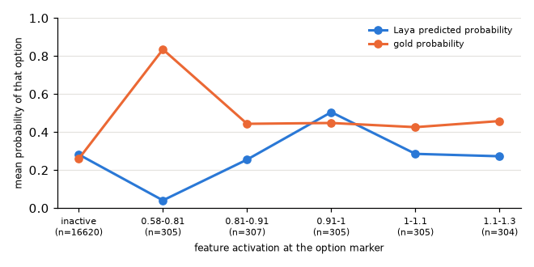

# Feature 5375

Critérios em que aparece: corr_error_stratified, corr_probe_right_laya_wrong_stratified

**Interpretação (preencher):** 

---

## Maiores ativações

**tr_security_incidents_000273 / true_positive** (noul, security_incidents) | ativação 6.359 em `estado` | opções ['false', 'true'] | Laya: **true** [0.008, 0.992] | gabarito: **true**

```
<bos> noul question: This alert reflects genuinely malicious or unauthorised activity.<eos>
▸ <mask> false: Benign activity, a misconfiguration, or a known false positive.
▸ <mask> true: The underlying behaviour is malicious or unauthorised.

<eos>

 {"alert": {"description": "an endpoint agent matched a known signature", "evidence": "Endpoint sensor on workstation⟦ W⟧KS-07 detected a file named 'svchost64.dll' in C:\\Users\\temp that matched the known malware signature 'Trojan:Win32/Emotet.A' at 2026-09-15 08:17:02 UTC. The detection was generated by an unregistered source. The associated admin account, which has MFA enabled and was last rotated 14 days prior, was not in a scheduled change window.", "rule": "malware_signature"}, "context": {"asset_criticality": "medium", "change_window_active": false, "source_on_allowlist": false}, "history": {"credential_rotation_days_ago": 14, "distinct_countries_30d": 2, "logins_30d": 1414, "prior_alerts_90d": 0}, "principal": {"mfa_enrolled": true, "name": "adm-infra-828", "privileges": ["deploy:production", "secrets:read"], "type": "admin"}}<eos>
```

**tr_security_incidents_000273 / credential_compromise** (noul, security_incidents) | ativação 6.047 em `estado` | opções ['false', 'true'] | Laya: **true** [0.01, 0.99] | gabarito: **true**

```
<bos> noul question: The evidence indicates a credential or account has been compromised.<eos>
▸ <mask> false: no, the statement does not hold
▸ <mask> true: yes, the statement holds

<eos>

 {"alert": {"description": "an endpoint agent matched a known signature", "evidence": "Endpoint sensor on workstation⟦ W⟧KS-07 detected a file named 'svchost64.dll' in C:\\Users\\temp that matched the known malware signature 'Trojan:Win32/Emotet.A' at 2026-09-15 08:17:02 UTC. The detection was generated by an unregistered source. The associated admin account, which has MFA enabled and was last rotated 14 days prior, was not in a scheduled change window.", "rule": "malware_signature"}, "context": {"asset_criticality": "medium", "change_window_active": false, "source_on_allowlist": false}, "history": {"credential_rotation_days_ago": 14, "distinct_countries_30d": 2, "logins_30d": 1414, "prior_alerts_90d": 0}, "principal": {"mfa_enrolled": true, "name": "adm-infra-828", "privileges": ["deploy:production", "secrets:read"], "type": "admin"}}<eos>
```

**tr_security_incidents_000273 / severity** (score, security_incidents) | ativação 5.945 em `estado` | opções ['0', '1', '2', '3', '4'] | Laya: **1** [0.126, 0.352, 0.262, 0.172, 0.089] | gabarito: **3**

```
<bos> score question: How severe is the potential impact if this alert is real?<eos>
▸ <mask> level 0: Negligible: no access to anything sensitive.
▸ <mask> level 1: Low: limited access, easily reversed.
▸ <mask> level 2: Moderate: access to internal systems or non-public data.
▸ <mask> level 3: High: access to production, secrets or customer data.
▸ <mask> level 4: Critical: active compromise of crown-jewel systems.

<eos>

 {"alert": {"description": "an endpoint agent matched a known signature", "evidence": "Endpoint sensor on workstation⟦ W⟧KS-07 detected a file named 'svchost64.dll' in C:\\Users\\temp that matched the known malware signature 'Trojan:Win32/Emotet.A' at 2026-09-15 08:17:02 UTC. The detection was generated by an unregistered source. The associated admin account, which has MFA enabled and was last rotated 14 days prior, was not in a scheduled change window.", "rule": "malware_signature"}, "context": {"asset_criticality": "medium", "change_window_active": false, "source_on_allowlist": false}, "history": {"credential_rotation_days_ago": 14, "distinct_countries_30d": 2, "logins_30d": 1414, "prior_alerts_90d": 0}, "principal": {"mfa_enrolled": true, "name": "adm-infra-828", "privileges": ["deploy:production", "secrets:read"], "type": "admin"}}<eos>
```

**tr_security_incidents_000273 / urgency** (score, security_incidents) | ativação 5.906 em `estado` | opções ['0', '1', '2', '3'] | Laya: **3** [0.118, 0.188, 0.122, 0.572] | gabarito: **3**

```
<bos> score question: How quickly must a responder act on this alert?<eos>
▸ <mask> level 0: No time pressure; can wait indefinitely.
▸ <mask> level 1: Routine; handle within the normal queue.
▸ <mask> level 2: Elevated; should be handled within the same week.
▸ <mask> level 3: Critical; requires action within the same day.

<eos>

 {"alert": {"description": "an endpoint agent matched a known signature", "evidence": "Endpoint sensor on workstation⟦ W⟧KS-07 detected a file named 'svchost64.dll' in C:\\Users\\temp that matched the known malware signature 'Trojan:Win32/Emotet.A' at 2026-09-15 08:17:02 UTC. The detection was generated by an unregistered source. The associated admin account, which has MFA enabled and was last rotated 14 days prior, was not in a scheduled change window.", "rule": "malware_signature"}, "context": {"asset_criticality": "medium", "change_window_active": false, "source_on_allowlist": false}, "history": {"credential_rotation_days_ago": 14, "distinct_countries_30d": 2, "logins_30d": 1414, "prior_alerts_90d": 0}, "principal": {"mfa_enrolled": true, "name": "adm-infra-828", "privileges": ["deploy:production", "secrets:read"], "type": "admin"}}<eos>
```

**tr_security_incidents_000273 / disposition** (choice, security_incidents) | ativação 5.855 em `estado` | opções ['close_benign', 'contain', 'investigate', 'monitor'] | Laya: **monitor** [0.0, 0.0, 0.035, 0.964] | gabarito: **contain**

```
<bos> choice question: How should this security alert be dispositioned?<eos>
▸ <mask> close_benign: Expected, explainable activity; close without analyst time.
▸ <mask> contain: Contain the host or account immediately; do not wait for triage.
▸ <mask> investigate: Warrants an analyst opening an investigation.
▸ <mask> monitor: Not clearly malicious, but worth watching for recurrence.

<eos>

 {"alert": {"description": "an endpoint agent matched a known signature", "evidence": "Endpoint sensor on workstation⟦ W⟧KS-07 detected a file named 'svchost64.dll' in C:\\Users\\temp that matched the known malware signature 'Trojan:Win32/Emotet.A' at 2026-09-15 08:17:02 UTC. The detection was generated by an unregistered source. The associated admin account, which has MFA enabled and was last rotated 14 days prior, was not in a scheduled change window.", "rule": "malware_signature"}, "context": {"asset_criticality": "medium", "change_window_active": false, "source_on_allowlist": false}, "history": {"credential_rotation_days_ago": 14, "distinct_countries_30d": 2, "logins_30d": 1414, "prior_alerts_90d": 0}, "principal": {"mfa_enrolled": true, "name": "adm-infra-828", "privileges": ["deploy:production", "secrets:read"], "type": "admin"}}<eos>
```

## Ativações medianas (faixa 40-60%, mediana 0.725)

**tr_customer_service_000017 / category** (choice, customer_service) | ativação 0.652 em `estado` | opções ['account', 'billing', 'delivery', 'refund', 'technical'] | Laya: **billing** [0.002, 0.995, 0.0, 0.001, 0.002] | gabarito: **billing**

```
<bos> choice question: What is this customer conversation primarily about?<eos>
▸ <mask> account: Login, plan changes, profile or access management.
▸ <mask> billing: A charge, invoice, subscription or payment problem.
▸ <mask> delivery: Shipping, fulfilment or delivery of a physical item.
▸ <mask> refund: The customer is explicitly asking for money back.
▸ <mask> technical: The product or service is not working as expected.

<eos>

 {"account": {"lifetime_value_usd": 228, "prior_tickets_90d": 3, "seats": 1, "tenure_months": 11, "tier": "premium"}, "orders": [{"amount_usd": 29, "date": "2026-03-25", "id": "A-17351", "status": "settled"}, {"amount_usd": 29, "date": "2026-02-18", "id": "A-55118", "status": "settled"}], "thread": [{"role": "customer", "text": "My payment for the $29 subscription failed this morning. I have a presentation tomorrow morning at 9:00 AM that requires this access, so I need this cleared up immediately."}, {"role": "agent", "text": "I see the status of your account. Before we look into the billing error, could you confirm if the payment method on file has expired or if you have recently updated your banking information?"}, {"role": "customer", "text": "The card is current and active. I have had three previous tickets regarding billing glitches that were supposedly addressed, yet here I am again with the same issue."}, {"role": "agent", "text": "I acknowledge your frustration regarding the previous tickets. To investigate this specific failure, could you provide the transaction reference ID shown in your payment history?"}, {"role": "customer", "text": "I am looking at my bank portal now, but I⟦ don⟧'t see a reference ID generated for this attempt. How are we going to fix this before my deadline tomorrow?"}]}<eos>
```

**tr_security_incidents_000096 / true_positive** (noul, security_incidents) | ativação 0.768 em `estado` | opções ['false', 'true'] | Laya: **false** [0.991, 0.009] | gabarito: **true**

```
<bos> noul question: This alert reflects genuinely malicious or unauthorised activity.<eos>
▸ <mask> false: Benign activity, a misconfiguration, or a known false positive.
▸ <mask> true: The underlying behaviour is malicious or unauthorised.

<eos>

 {"alert": {"description": "an unusual volume of files read in a short window", "evidence": "At 2026-09-15 03:12 UTC the gitlab-runner process (PID 8421) on host 172.20.5.12 accessed 8,764 distinct files under /var/lib/gitlab-runner/builds within a five‑minute window. The request originated from IP 203.0.113.45,⟦ which⟧ is not listed in the organization’s asset inventory, and the runner’s credentials have not been rotated for 412 days.", "rule": "mass_download"}, "context": {"asset_criticality": "low", "change_window_active": false, "source_on_allowlist": false}, "history": {"credential_rotation_days_ago": 412, "distinct_countries_30d": 2, "logins_30d": 1415, "prior_alerts_90d": 0}, "principal": {"mfa_enrolled": true, "name": "adm-support-164", "privileges": ["repo:read"], "type": "ci_runner"}}<eos>
```

**tr_security_incidents_000029 / urgency** (score, security_incidents) | ativação 0.688 em `estado` | opções ['0', '1', '2', '3'] | Laya: **1** [0.099, 0.442, 0.131, 0.329] | gabarito: **3**

```
<bos> score question: How quickly must a responder act on this alert?<eos>
▸ <mask> level 0: No time pressure; can wait indefinitely.
▸ <mask> level 1: Routine; handle within the normal queue.
▸ <mask> level 2: Elevated; should be handled within the same week.
▸ <mask> level 3: Critical; requires action within the same day.

<eos>

 {"alert": {"description": "many failed authentications followed by a success", "evidence": "Between 2026-⟦0⟧9-13 22:15 and 22:20 UTC, 57 failed login attempts were logged for privileged admin account \"admin_kim\" (MFA on) from IP 192.0.2.77, followed by a successful authentication at 22:21 UTC. The activity took place within an open change window, the source is unrecognized, and the credentials for the account were last rotated 365 days ago.", "rule": "brute_force"}, "context": {"asset_criticality": "medium", "change_window_active": true, "source_on_allowlist": false}, "history": {"credential_rotation_days_ago": 365, "distinct_countries_30d": 2, "logins_30d": 1826, "prior_alerts_90d": 0}, "principal": {"mfa_enrolled": true, "name": "svc-analytics-152", "privileges": ["deploy:production", "secrets:read"], "type": "admin"}}<eos>
```

**tr_customer_service_000062 / action** (choice, customer_service) | ativação 0.620 em `estado` | opções ['answer_directly', 'close_no_action', 'escalate_to_human', 'execute_refund', 'request_information'] | Laya: **close_no_action** [0.303, 0.579, 0.08, 0.034, 0.004] | gabarito: **escalate_to_human**

```
<bos> choice question: What should the assistant do next with this conversation?<eos>
▸ <mask> answer_directly: The assistant can resolve this itself with information it already has.
▸ <mask> close_no_action: No further action is warranted; the matter is settled.
▸ <mask> escalate_to_human: Hand off to a human agent with the appropriate authority.
▸ <mask> execute_refund: Issue the refund or credit the customer is owed.
▸ <mask> request_information: More detail is needed from the customer before anything can be done.

<eos>

 {"account": {"lifetime_value_usd": 379, "prior_tickets_90d": 0, "seats": 1, "tenure_months": 11, "tier": "standard"}, "thread": [{"role": "customer", "text": "This service is a total joke and I want to cancel immediately before you charge me another dime."}, {"role": "agent", "text": "I am sorry to hear you're unhappy; could you tell me a bit more about what's prompted this decision today⟦?"⟧}, {"role": "customer", "text": "Everything is broken and the support is non-existent. I'm done."}, {"role": "agent", "text": "I understand your frustration. To better assist you, would you mind specifying which features have not been meeting your expectations?"}, {"role": "customer", "text": "All of them. Fix it or I'm taking my business elsewhere."}, {"role": "agent", "text": "I hear your concerns clearly. Could you please provide your account email address so I can pull up the details of your recent usage?"}, {"role": "customer", "text": "It's the same email I'm messaging from. Just process the cancellation."}]}<eos>
```

**tr_security_incidents_000039 / true_positive** (noul, security_incidents) | ativação 0.709 em `estado` | opções ['false', 'true'] | Laya: **true** [0.025, 0.975] | gabarito: **true**

```
<bos> noul question: This alert reflects genuinely malicious or unauthorised activity.<eos>
▸ <mask> false: Benign activity, a misconfiguration, or a known false positive.
▸ <mask> true: The underlying behaviour is malicious or unauthorised.

<eos>

 {"alert": {"description": "an endpoint agent matched a known signature", "evidence": "At 2026-09-15 14:23:07 UTC the endpoint agent on host WIN-01 flagged the file C:\\Temp\\malware.exe (SHA1=3a5b7c9d4e) as matching the known malware_signature. The detection was logged under the privileged service account svc_backup, which has MFA disabled and whose password was last rotated 14 days prior. The source identifier for the event is on the allowlist.", "rule": "malware_signature"}, "context": {"asset_criticality": "high", "change_window_active": false, "source_on_allowlist": true}, "history": {"credential_rotation_days⟦_⟧ago": 14, "distinct_countries_30d": 3, "logins_30d": 304, "prior_alerts_90d": 8}, "principal": {"mfa_enrolled": false, "name": "adm-infra-473", "privileges": ["deploy:production", "secrets:read"], "type": "service_account"}}<eos>
```

## Estatísticas (conjunto de descoberta, dev e teste)

**pred / error**

| split | decisões | ativas | ativas e Laya errou | taxa | lift | q (BH) | OR (CMH) | q (CMH) |
|---|---|---|---|---|---|---|---|---|
| discovery | 5100 | 369 | 203 | 0.550 | 0.85 | 0.000348 | nan | nan |
| dev | 900 | 65 | 32 | 0.492 | 0.73 | 0.00935 | nan | nan |
| test | 2000 | 137 | 73 | 0.533 | 0.82 | 0.00897 | nan | nan |

**corr / error**

| split | decisões | ativas | ativas e Laya errou | taxa | lift | q (BH) | OR (CMH) | q (CMH) |
|---|---|---|---|---|---|---|---|---|
| discovery | 5100 | 744 | 578 | 0.777 | 1.21 | 2e-16 | 2.68 | 9.94e-64 |
| dev | 900 | 159 | 126 | 0.792 | 1.18 | 0.00101 | 2.54 | 5.36e-10 |
| test | 2000 | 295 | 231 | 0.783 | 1.20 | 5.39e-07 | 2.93 | 1.6e-28 |

**state / error**

| split | decisões | ativas | ativas e Laya errou | taxa | lift | q (BH) | OR (CMH) | q (CMH) |
|---|---|---|---|---|---|---|---|---|
| discovery | 5100 | 5094 | 3280 | 0.644 | 1.00 | 0.874 | 0.64 | 0.968 |
| dev | 900 | 899 | 604 | 0.672 | 1.00 | 1 | 0.00 | 0.805 |
| test | 2000 | 1996 | 1299 | 0.651 | 1.00 | 1 | 0.40 | 0.982 |

**pred / probe_right_laya_wrong**

| split | decisões | ativas | ativas e Laya errou | taxa | lift | q (BH) | OR (CMH) | q (CMH) |
|---|---|---|---|---|---|---|---|---|
| discovery | 2819 | 222 | 151 | 0.680 | 1.05 | 0.356 | nan | nan |
| dev | 520 | 45 | 27 | 0.600 | 0.89 | 0.458 | nan | nan |
| test | 1106 | 77 | 51 | 0.662 | 1.05 | 0.769 | nan | nan |

**corr / probe_right_laya_wrong**

| split | decisões | ativas | ativas e Laya errou | taxa | lift | q (BH) | OR (CMH) | q (CMH) |
|---|---|---|---|---|---|---|---|---|
| discovery | 2819 | 478 | 407 | 0.851 | 1.32 | 4.73e-26 | 2.75 | 2.93e-35 |
| dev | 520 | 110 | 92 | 0.836 | 1.24 | 0.000175 | 2.12 | 0.000233 |
| test | 1106 | 188 | 162 | 0.862 | 1.36 | 7.04e-13 | 2.90 | 2.1e-14 |

**state / probe_right_laya_wrong**

| split | decisões | ativas | ativas e Laya errou | taxa | lift | q (BH) | OR (CMH) | q (CMH) |
|---|---|---|---|---|---|---|---|---|
| discovery | 2819 | 2816 | 1823 | 0.647 | 1.00 | 0.709 | 0.19 | 0.875 |
| dev | 520 | 520 | 351 | 0.675 | 1.00 | 1 | nan | nan |
| test | 1106 | 1104 | 700 | 0.634 | 1.00 | 0.508 | 0.39 | 0.81 |

Confusão mais sobre-representada (pred): `needs_human|0>1` (n=54, lift 13.82, p=0). Formato `pergunta|índice previsto>índice correto`.

Confusão mais sobre-representada (corr): `credential_compromise|1>0` (n=82, lift 6.85, p=0). Formato `pergunta|índice previsto>índice correto`.

Confusão mais sobre-representada (state): `duplicate|1>0` (n=217, lift 1.00, p=0.77). Formato `pergunta|índice previsto>índice correto`.



