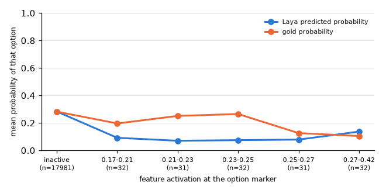

# Feature 5470

Critérios em que aparece: corr_error

**Interpretação (preencher):** 

---

## Maiores ativações

**tr_customer_service_000043 / needs_human** (noul, customer_service) | ativação 4.441 em `estado` | opções ['false', 'true'] | Laya: **false** [0.51, 0.49] | gabarito: **false**

```
<bos> noul question: This conversation requires a human agent rather than automated handling.<eos>
▸ <mask> false: Automation can carry this to resolution.
▸ <mask> true: A human must take over: judgement, authority or empathy is required.

<eos>

 {"account": {"lifetime_value_usd": 208, "prior_tickets_90d": 0, "seats": 1, "tenure_months": 3, "tier": "free"}, "orders": [{"amount_usd": 999, "date": "2026-0⟦3⟧-09", "id": "A-17017", "status": "refunded"}, {"amount_usd": 999, "date": "2026-01-04", "id": "A-58989", "status": "failed"}], "thread": [{"role": "customer", "text": "I need to get my data out of the system, but I’m not holding my breath—it probably won’t happen any time soon."}, {"role": "agent", "text": "I hear you. Could you tell me which parts of your account you’d like included in the export?"}, {"role": "customer", "text": "Just the basic account information—profile details and settings. Nothing fancy."}, {"role": "agent", "text": "Understood. Do you have a preferred format for the file—CSV, JSON, or something else?"}, {"role": "customer", "text": "Whatever you can manage, I don’t mind waiting."}]}<eos>
```

**tr_customer_service_000190 / churn_risk** (score, customer_service) | ativação 4.434 em `estado` | opções ['0', '1', '2', '3'] | Laya: **1** [0.057, 0.629, 0.245, 0.069] | gabarito: **0**

```
<bos> score question: How likely is this customer to stop doing business with us because of this interaction?<eos>
▸ <mask> level 0: No sign of dissatisfaction.
▸ <mask> level 1: Mild frustration, but the relationship is intact.
▸ <mask> level 2: Clearly unhappy; repeat problems or explicit complaints.
▸ <mask> level 3: Imminent: threatening to cancel, dispute or leave.

<eos>

 {"account": {"lifetime_value_usd": 245, "prior_tickets_90d": 0, "seats": 1, "tenure_months": 14, "tier": "standard"}, "orders": [{"amount_usd": 299, "date": "2026-0⟦3⟧-03", "id": "A-23818", "status": "settled"}], "thread": [{"role": "customer", "text": "I’m not sure what’s going on—I need a copy of my invoice for the $299 charge, but I can’t find it anywhere in the portal. I’ve only been with the standard plan for 14 months, so I thought it would be straightforward."}, {"role": "agent", "text": "I’m sorry for the confusion. Could you let me know the month you’re looking for and which email you use for the account?"}, {"role": "customer", "text": "It’s the invoice for March 2026, and the account email is jane.doe@example.com."}, {"role": "agent", "text": "Thanks, Jane. I’ll check the records for that invoice. Just to be clear, are you looking for the PDF version or a printed copy?"}, {"role": "customer", "text": "A PDF would be fine, I just need it to submit to my accountant by the 20th."}]}<eos>
```

**tr_customer_service_000043 / action** (choice, customer_service) | ativação 4.418 em `estado` | opções ['answer_directly', 'close_no_action', 'escalate_to_human', 'execute_refund', 'request_information'] | Laya: **close_no_action** [0.234, 0.46, 0.231, 0.05, 0.025] | gabarito: **answer_directly**

```
<bos> choice question: What should the assistant do next with this conversation?<eos>
▸ <mask> answer_directly: The assistant can resolve this itself with information it already has.
▸ <mask> close_no_action: No further action is warranted; the matter is settled.
▸ <mask> escalate_to_human: Hand off to a human agent with the appropriate authority.
▸ <mask> execute_refund: Issue the refund or credit the customer is owed.
▸ <mask> request_information: More detail is needed from the customer before anything can be done.

<eos>

 {"account": {"lifetime_value_usd": 208, "prior_tickets_90d": 0, "seats": 1, "tenure_months": 3, "tier": "free"}, "orders": [{"amount_usd": 999, "date": "2026-0⟦3⟧-09", "id": "A-17017", "status": "refunded"}, {"amount_usd": 999, "date": "2026-01-04", "id": "A-58989", "status": "failed"}], "thread": [{"role": "customer", "text": "I need to get my data out of the system, but I’m not holding my breath—it probably won’t happen any time soon."}, {"role": "agent", "text": "I hear you. Could you tell me which parts of your account you’d like included in the export?"}, {"role": "customer", "text": "Just the basic account information—profile details and settings. Nothing fancy."}, {"role": "agent", "text": "Understood. Do you have a preferred format for the file—CSV, JSON, or something else?"}, {"role": "customer", "text": "Whatever you can manage, I don’t mind waiting."}]}<eos>
```

**tr_customer_service_000033 / churn_risk** (score, customer_service) | ativação 4.418 em `estado` | opções ['0', '1', '2', '3'] | Laya: **1** [0.066, 0.549, 0.35, 0.035] | gabarito: **3**

```
<bos> score question: How likely is this customer to stop doing business with us because of this interaction?<eos>
▸ <mask> level 0: No sign of dissatisfaction.
▸ <mask> level 1: Mild frustration, but the relationship is intact.
▸ <mask> level 2: Clearly unhappy; repeat problems or explicit complaints.
▸ <mask> level 3: Imminent: threatening to cancel, dispute or leave.

<eos>

 {"account": {"lifetime_value_usd": 972, "prior_tickets_90d": 3, "seats": 1, "tenure_months": 49, "tier": "free"}, "orders": [{"amount_usd": 999, "date": "2026-0⟦3⟧-06", "id": "A-72271", "status": "settled"}, {"amount_usd": 999, "date": "2026-02-16", "id": "A-14198", "status": "settled"}, {"amount_usd": 999, "date": "2026-01-05", "id": "A-90678", "status": "settled"}], "thread": [{"role": "customer", "text": "I've been trying to downgrade to the free plan for three days now and the website just keeps looping me back to the dashboard. This is incredibly annoying given I've been a loyal user for over four years."}, {"role": "agent", "text": "I'm sorry for the frustration the downgrade process is causing. Could you tell me if you are seeing any specific error codes or pop-up messages when the page refreshes?"}, {"role": "customer", "text": "There are no codes, it just fails silently. I've spent almost a thousand dollars with you guys over 49 months, and after having three previous tickets only 'partially' addressed, I really expected a simple plan change to actually work."}, {"role": "agent", "text": "I appreciate your long-term history with us. To help me investigate the account block, would you mind specifying which features from those three previous tickets are still causing you issues on your current plan?"}, {"role": "customer", "text": "The seat management and the data exports never worked right, which is why I'm trying to scale back. I'm just tired of paying for a service that feels broken every time I try to adjust my settings."}]}<eos>
```

**tr_customer_service_000043 / churn_risk** (score, customer_service) | ativação 4.406 em `estado` | opções ['0', '1', '2', '3'] | Laya: **1** [0.275, 0.645, 0.048, 0.031] | gabarito: **2**

```
<bos> score question: How likely is this customer to stop doing business with us because of this interaction?<eos>
▸ <mask> level 0: No sign of dissatisfaction.
▸ <mask> level 1: Mild frustration, but the relationship is intact.
▸ <mask> level 2: Clearly unhappy; repeat problems or explicit complaints.
▸ <mask> level 3: Imminent: threatening to cancel, dispute or leave.

<eos>

 {"account": {"lifetime_value_usd": 208, "prior_tickets_90d": 0, "seats": 1, "tenure_months": 3, "tier": "free"}, "orders": [{"amount_usd": 999, "date": "2026-0⟦3⟧-09", "id": "A-17017", "status": "refunded"}, {"amount_usd": 999, "date": "2026-01-04", "id": "A-58989", "status": "failed"}], "thread": [{"role": "customer", "text": "I need to get my data out of the system, but I’m not holding my breath—it probably won’t happen any time soon."}, {"role": "agent", "text": "I hear you. Could you tell me which parts of your account you’d like included in the export?"}, {"role": "customer", "text": "Just the basic account information—profile details and settings. Nothing fancy."}, {"role": "agent", "text": "Understood. Do you have a preferred format for the file—CSV, JSON, or something else?"}, {"role": "customer", "text": "Whatever you can manage, I don’t mind waiting."}]}<eos>
```

## Ativações medianas (faixa 40-60%, mediana 1.435)

**tr_customer_service_000299 / category** (choice, customer_service) | ativação 1.599 em `estado` | opções ['account', 'billing', 'delivery', 'refund', 'technical'] | Laya: **billing** [0.015, 0.976, 0.0, 0.005, 0.004] | gabarito: **billing**

```
<bos> choice question: What is this customer conversation primarily about?<eos>
▸ <mask> account: Login, plan changes, profile or access management.
▸ <mask> billing: A charge, invoice, subscription or payment problem.
▸ <mask> delivery: Shipping, fulfilment or delivery of a physical item.
▸ <mask> refund: The customer is explicitly asking for money back.
▸ <mask> technical: The product or service is not working as expected.

<eos>

 {"account": {"lifetime_value_usd": 4289, "prior_tickets_90d": 1, "seats": 3, "tenure_months": 72, "tier": "premium"}, "orders": [{"amount_usd": 29, "date": "202⟦6⟧-01-21", "id": "A-19524", "status": "settled"}, {"amount_usd": 29, "date": "2026-03-11", "id": "A-67481", "status": "settled"}, {"amount_usd": 29, "date": "2026-03-12", "id": "A-89299", "status": "settled"}], "thread": [{"role": "customer", "text": "I've had this account for six years and I'm done. Cancel my subscription immediately!"}, {"role": "agent", "text": "I can certainly look into that for you. To ensure I have the right account, could you please verify the email address associated with your billing?"}, {"role": "customer", "text": "You should already have it from the ticket I opened last month that you guys barely even helped me with!"}]}<eos>
```

**tr_security_incidents_000041 / severity** (score, security_incidents) | ativação 1.544 em `estado` | opções ['0', '1', '2', '3', '4'] | Laya: **1** [0.071, 0.52, 0.282, 0.059, 0.067] | gabarito: **1**

```
<bos> score question: How severe is the potential impact if this alert is real?<eos>
▸ <mask> level 0: Negligible: no access to anything sensitive.
▸ <mask> level 1: Low: limited access, easily reversed.
▸ <mask> level 2: Moderate: access to internal systems or non-public data.
▸ <mask> level 3: High: access to production, secrets or customer data.
▸ <mask> level 4: Critical: active compromise of crown-jewel systems.

<eos>

 {"alert": {"description": "two successful logins from distant locations too close together", "evidence": "Two successful logins were recorded for service account svc_sync: one from IP 203.⟦0⟧.113.45 (New York) at 2026-09-16 01:02 UTC and another from IP 198.51.100.22 (Tokyo) at 2026-09-16 01:10 UTC, a span of eight minutes. The account is unprivileged, does not have MFA enabled, and its password was last changed three days ago. Both source entries appear on the allowlist.", "rule": "impossible_travel"}, "context": {"asset_criticality": "low", "change_window_active": false, "source_on_allowlist": true}, "history": {"credential_rotation_days_ago": 3, "distinct_countries_30d": 2, "logins_30d": 1729, "prior_alerts_90d": 0}, "principal": {"mfa_enrolled": false, "name": "usr-analytics-776", "privileges": ["repo:read"], "type": "service_account"}}<eos>
```

**tr_customer_service_000261 / category** (choice, customer_service) | ativação 1.319 em `estado` | opções ['account', 'billing', 'delivery', 'refund', 'technical'] | Laya: **technical** [0.014, 0.018, 0.001, 0.001, 0.967] | gabarito: **technical**

```
<bos> choice question: What is this customer conversation primarily about?<eos>
▸ <mask> account: Login, plan changes, profile or access management.
▸ <mask> billing: A charge, invoice, subscription or payment problem.
▸ <mask> delivery: Shipping, fulfilment or delivery of a physical item.
▸ <mask> refund: The customer is explicitly asking for money back.
▸ <mask> technical: The product or service is not working as expected.

<eos>

 {"account": {"lifetime_value_usd": 244, "prior_tickets_90d": 1, "seats": 40, "tenure_months": 5, "tier": "premium"}, "orders": [{"amount_usd": 57, "date": "202⟦6⟧-02-23", "id": "A-35156", "status": "refunded"}, {"amount_usd": 57, "date": "2026-01-11", "id": "A-26925", "status": "pending"}, {"amount_usd": 57, "date": "2026-01-04", "id": "A-63187", "status": "failed"}], "thread": [{"role": "customer", "text": "I’ve been paying for the $57 Premium plan for five months now, and the reporting feature is still completely broken. I opened a ticket about this weeks ago and was told it’d be fixed, but nothing has changed. If this isn't working by my presentation tomorrow morning, I’m canceling my subscription and moving to a competitor."}, {"role": "agent", "text": "I understand how critical that reporting feature is for your upcoming presentation. To help me look into this further, could you please clarify if you're seeing a specific error message or if the data simply isn't loading when you attempt to run the report?"}, {"role": "customer", "text": "It just hangs on a white screen every single time. I don't have time for more 'clarifications'—I need someone to actually look at why my account is failing before I lose my client."}]}<eos>
```

**tr_invoice_processing_000240 / duplicate** (noul, invoice_processing) | ativação 1.594 em `estado` | opções ['false', 'true'] | Laya: **true** [0.028, 0.972] | gabarito: **false**

```
<bos> noul question: This invoice appears to duplicate an invoice already submitted.<eos>
▸ <mask> false: no, the statement does not hold
▸ <mask> true: yes, the statement holds

<eos>

 {"delivery": {"condition": "accepted with exceptions", "date": "2026-03-01", "received_qty": 400}, "invoice": {"currency": "USD", "id": "INV-2026-7564", "lines": [{"qty": 400, "sku": "SKU-444", "total_usd": 113636.0, "unit_usd": 28⟦4⟧.09}], "total_usd": 113636.0, "vendor": "Orbit Logistics"}, "payment": {"days_until_due": 0, "discount_expires_in_days": null, "early_payment_discount_pct": null, "status": "scheduled", "terms": "net 60"}, "purchase_order": {"freight_terms": "freight prepaid by vendor, not separately billable", "id": "PO-7772", "lines": [{"qty": 400, "unit_usd": 284.09}], "total_usd": 113636.0}, "vendor_history": {"disputes_12m": 2, "invoices_12m": 47, "prior_invoice_ids": ["INV-2026-9066"]}}<eos>
```

**tr_customer_service_000158 / churn_risk** (score, customer_service) | ativação 1.474 em `estado` | opções ['0', '1', '2', '3'] | Laya: **1** [0.222, 0.525, 0.136, 0.118] | gabarito: **1**

```
<bos> score question: How likely is this customer to stop doing business with us because of this interaction?<eos>
▸ <mask> level 0: No sign of dissatisfaction.
▸ <mask> level 1: Mild frustration, but the relationship is intact.
▸ <mask> level 2: Clearly unhappy; repeat problems or explicit complaints.
▸ <mask> level 3: Imminent: threatening to cancel, dispute or leave.

<eos>

 {"account": {"lifetime_value_usd": 134, "prior_tickets_90d": 5, "seats": 5, "tenure_months": 3, "tier": "enterprise"}, "orders": [{"amount_usd": 49, "date": "2026-02-16", "id": "A-54178", "status": "settled"}, {"amount_usd": 49, "date": "202⟦6⟧-02-18", "id": "A-29578", "status": "settled"}, {"amount_usd": 49, "date": "2026-01-24", "id": "A-46676", "status": "refunded"}], "thread": [{"role": "customer", "text": "The bulk‑upload feature stopped accepting CSV files; it returns a generic error as soon as I click Submit."}]}<eos>
```

## Estatísticas (conjunto de descoberta, dev e teste)

**pred / error**

| split | decisões | ativas | ativas e Laya errou | taxa | lift | q (BH) | OR (CMH) | q (CMH) |
|---|---|---|---|---|---|---|---|---|
| discovery | 5100 | 3 | 3 | 1.000 | 1.55 | nan | nan | nan |
| dev | 900 | 0 | 0 | nan | nan | nan | nan | nan |
| test | 2000 | 0 | 0 | nan | nan | nan | nan | nan |

**corr / error**

| split | decisões | ativas | ativas e Laya errou | taxa | lift | q (BH) | OR (CMH) | q (CMH) |
|---|---|---|---|---|---|---|---|---|
| discovery | 5100 | 28 | 28 | 1.000 | 1.55 | 1.73e-05 | inf | 0.868 |
| dev | 900 | 4 | 4 | 1.000 | 1.49 | nan | nan | nan |
| test | 2000 | 15 | 15 | 1.000 | 1.54 | nan | nan | nan |

**state / error**

| split | decisões | ativas | ativas e Laya errou | taxa | lift | q (BH) | OR (CMH) | q (CMH) |
|---|---|---|---|---|---|---|---|---|
| discovery | 5100 | 3789 | 2395 | 0.632 | 0.98 | 0.014 | 0.88 | 0.415 |
| dev | 900 | 694 | 461 | 0.664 | 0.99 | 0.747 | 0.76 | 0.538 |
| test | 2000 | 1475 | 935 | 0.634 | 0.97 | 0.0838 | 0.71 | 0.184 |

**pred / probe_right_laya_wrong**

| split | decisões | ativas | ativas e Laya errou | taxa | lift | q (BH) | OR (CMH) | q (CMH) |
|---|---|---|---|---|---|---|---|---|
| discovery | 2819 | 1 | 1 | 1.000 | 1.55 | nan | nan | nan |
| dev | 520 | 0 | 0 | nan | nan | nan | nan | nan |
| test | 1106 | 0 | 0 | nan | nan | nan | nan | nan |

**corr / probe_right_laya_wrong**

| split | decisões | ativas | ativas e Laya errou | taxa | lift | q (BH) | OR (CMH) | q (CMH) |
|---|---|---|---|---|---|---|---|---|
| discovery | 2819 | 12 | 12 | 1.000 | 1.55 | nan | nan | nan |
| dev | 520 | 4 | 4 | 1.000 | 1.48 | nan | nan | nan |
| test | 1106 | 6 | 6 | 1.000 | 1.58 | nan | nan | nan |

**state / probe_right_laya_wrong**

| split | decisões | ativas | ativas e Laya errou | taxa | lift | q (BH) | OR (CMH) | q (CMH) |
|---|---|---|---|---|---|---|---|---|
| discovery | 2819 | 2168 | 1377 | 0.635 | 0.98 | 0.0437 | 0.88 | 0.538 |
| dev | 520 | 411 | 274 | 0.667 | 0.99 | 0.82 | 0.72 | 0.541 |
| test | 1106 | 862 | 533 | 0.618 | 0.98 | 0.204 | 0.58 | 0.0618 |

Confusão mais sobre-representada (pred): `churn_risk|0>1` (n=1, lift 340.00, p=nan). Formato `pergunta|índice previsto>índice correto`.

Confusão mais sobre-representada (corr): `risk|2>0` (n=16, lift 71.08, p=3.03e-28). Formato `pergunta|índice previsto>índice correto`.

Confusão mais sobre-representada (state): `duplicate|1>0` (n=217, lift 1.35, p=1.92e-29). Formato `pergunta|índice previsto>índice correto`.



