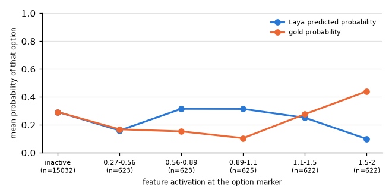

# Feature 5476

Critérios em que aparece: attribution_toward_correct

**Interpretação (preencher):** 

---

## Maiores ativações

**tr_customer_service_000248 / needs_human** (noul, customer_service) | ativação 15.781 em `estado` | opções ['false', 'true'] | Laya: **false** [0.996, 0.004] | gabarito: **true**

```
<bos> noul question: This conversation requires a human agent rather than automated handling.<eos>
▸ <mask> false: Automation can carry this to resolution.
▸ <mask> true: A human must take over: judgement, authority or empathy is required.

<eos>

 {"account": {"lifetime_value_usd": 5956, "prior_tickets_90d": 0, "seats": 1, "tenure_months": 72, "tier": "standard"}, "orders": [{"amount_usd": 19, "date": "2026-02-20", "id": "A-97410", "status": "pending"}], "thread": [{"role": "customer", "text": "I just opened my package and I'm quite puzzled, I ordered the matte black frame but the one in the box is a very bright glossy silver."}, {"role": "agent", "text": "I appreciate you reaching out about this discrepancy. Could you let me know if the SKU number printed on the external packaging matches your order confirmation?"}, {"role": "customer", "text": "Let's see... the box says SKU-992, but I'm looking at the email I got when I ordered it and that says I should have received SKU-995."}, {"role": "agent", "text": "Thank you for checking that. Besides the color being incorrect, does the frame appear⟦ to⟧ be the correct size that you requested, or is that different as well?"}, {"role": "customer", "text": "The size seems to be the 11x14 I wanted, it's just the finish that's totally wrong and won't work for where I wanted to hang it."}, {"role": "agent", "text": "I understand. To help me document this correctly for our warehouse team, could you describe any other labels or markings you see on the inner protective wrapping?"}, {"role": "customer", "text": "There aren't really any other labels on the inside, just the clear plastic sleeve, so I'm still trying to figure out how I ended up with silver instead of black."}]}<eos>
```

**tr_customer_service_000248 / urgency** (score, customer_service) | ativação 15.695 em `estado` | opções ['0', '1', '2', '3'] | Laya: **0** [0.554, 0.383, 0.035, 0.028] | gabarito: **1**

```
<bos> score question: How time-sensitive is this conversation?<eos>
▸ <mask> level 0: No time pressure; can wait indefinitely.
▸ <mask> level 1: Routine; handle within the normal queue.
▸ <mask> level 2: Elevated; should be handled within the same week.
▸ <mask> level 3: Critical; requires action within the same day.

<eos>

 {"account": {"lifetime_value_usd": 5956, "prior_tickets_90d": 0, "seats": 1, "tenure_months": 72, "tier": "standard"}, "orders": [{"amount_usd": 19, "date": "2026-02-20", "id": "A-97410", "status": "pending"}], "thread": [{"role": "customer", "text": "I just opened my package and I'm quite puzzled, I ordered the matte black frame but the one in the box is a very bright glossy silver."}, {"role": "agent", "text": "I appreciate you reaching out about this discrepancy. Could you let me know if the SKU number printed on the external packaging matches your order confirmation?"}, {"role": "customer", "text": "Let's see... the box says SKU-992, but I'm looking at the email I got when I ordered it and that says I should have received SKU-995."}, {"role": "agent", "text": "Thank you for checking that. Besides the color being incorrect, does the frame appear⟦ to⟧ be the correct size that you requested, or is that different as well?"}, {"role": "customer", "text": "The size seems to be the 11x14 I wanted, it's just the finish that's totally wrong and won't work for where I wanted to hang it."}, {"role": "agent", "text": "I understand. To help me document this correctly for our warehouse team, could you describe any other labels or markings you see on the inner protective wrapping?"}, {"role": "customer", "text": "There aren't really any other labels on the inside, just the clear plastic sleeve, so I'm still trying to figure out how I ended up with silver instead of black."}]}<eos>
```

**tr_customer_service_000248 / category** (choice, customer_service) | ativação 15.641 em `estado` | opções ['account', 'billing', 'delivery', 'refund', 'technical'] | Laya: **technical** [0.013, 0.011, 0.024, 0.001, 0.951] | gabarito: **delivery**

```
<bos> choice question: What is this customer conversation primarily about?<eos>
▸ <mask> account: Login, plan changes, profile or access management.
▸ <mask> billing: A charge, invoice, subscription or payment problem.
▸ <mask> delivery: Shipping, fulfilment or delivery of a physical item.
▸ <mask> refund: The customer is explicitly asking for money back.
▸ <mask> technical: The product or service is not working as expected.

<eos>

 {"account": {"lifetime_value_usd": 5956, "prior_tickets_90d": 0, "seats": 1, "tenure_months": 72, "tier": "standard"}, "orders": [{"amount_usd": 19, "date": "2026-02-20", "id": "A-97410", "status": "pending"}], "thread": [{"role": "customer", "text": "I just opened my package and I'm quite puzzled, I ordered the matte black frame but the one in the box is a very bright glossy silver."}, {"role": "agent", "text": "I appreciate you reaching out about this discrepancy. Could you let me know if the SKU number printed on the external packaging matches your order confirmation?"}, {"role": "customer", "text": "Let's see... the box says SKU-992, but I'm looking at the email I got when I ordered it and that says I should have received SKU-995."}, {"role": "agent", "text": "Thank you for checking that. Besides the color being incorrect, does the frame appear⟦ to⟧ be the correct size that you requested, or is that different as well?"}, {"role": "customer", "text": "The size seems to be the 11x14 I wanted, it's just the finish that's totally wrong and won't work for where I wanted to hang it."}, {"role": "agent", "text": "I understand. To help me document this correctly for our warehouse team, could you describe any other labels or markings you see on the inner protective wrapping?"}, {"role": "customer", "text": "There aren't really any other labels on the inside, just the clear plastic sleeve, so I'm still trying to figure out how I ended up with silver instead of black."}]}<eos>
```

**tr_customer_service_000248 / action** (choice, customer_service) | ativação 15.586 em `estado` | opções ['answer_directly', 'close_no_action', 'escalate_to_human', 'execute_refund', 'request_information'] | Laya: **close_no_action** [0.144, 0.749, 0.004, 0.098, 0.006] | gabarito: **escalate_to_human**

```
<bos> choice question: What should the assistant do next with this conversation?<eos>
▸ <mask> answer_directly: The assistant can resolve this itself with information it already has.
▸ <mask> close_no_action: No further action is warranted; the matter is settled.
▸ <mask> escalate_to_human: Hand off to a human agent with the appropriate authority.
▸ <mask> execute_refund: Issue the refund or credit the customer is owed.
▸ <mask> request_information: More detail is needed from the customer before anything can be done.

<eos>

 {"account": {"lifetime_value_usd": 5956, "prior_tickets_90d": 0, "seats": 1, "tenure_months": 72, "tier": "standard"}, "orders": [{"amount_usd": 19, "date": "2026-02-20", "id": "A-97410", "status": "pending"}], "thread": [{"role": "customer", "text": "I just opened my package and I'm quite puzzled, I ordered the matte black frame but the one in the box is a very bright glossy silver."}, {"role": "agent", "text": "I appreciate you reaching out about this discrepancy. Could you let me know if the SKU number printed on the external packaging matches your order confirmation?"}, {"role": "customer", "text": "Let's see... the box says SKU-992, but I'm looking at the email I got when I ordered it and that says I should have received SKU-995."}, {"role": "agent", "text": "Thank you for checking that. Besides the color being incorrect, does the frame appear⟦ to⟧ be the correct size that you requested, or is that different as well?"}, {"role": "customer", "text": "The size seems to be the 11x14 I wanted, it's just the finish that's totally wrong and won't work for where I wanted to hang it."}, {"role": "agent", "text": "I understand. To help me document this correctly for our warehouse team, could you describe any other labels or markings you see on the inner protective wrapping?"}, {"role": "customer", "text": "There aren't really any other labels on the inside, just the clear plastic sleeve, so I'm still trying to figure out how I ended up with silver instead of black."}]}<eos>
```

**tr_customer_service_000248 / churn_risk** (score, customer_service) | ativação 15.219 em `estado` | opções ['0', '1', '2', '3'] | Laya: **0** [0.487, 0.353, 0.143, 0.017] | gabarito: **1**

```
<bos> score question: How likely is this customer to stop doing business with us because of this interaction?<eos>
▸ <mask> level 0: No sign of dissatisfaction.
▸ <mask> level 1: Mild frustration, but the relationship is intact.
▸ <mask> level 2: Clearly unhappy; repeat problems or explicit complaints.
▸ <mask> level 3: Imminent: threatening to cancel, dispute or leave.

<eos>

 {"account": {"lifetime_value_usd": 5956, "prior_tickets_90d": 0, "seats": 1, "tenure_months": 72, "tier": "standard"}, "orders": [{"amount_usd": 19, "date": "2026-02-20", "id": "A-97410", "status": "pending"}], "thread": [{"role": "customer", "text": "I just opened my package and I'm quite puzzled, I ordered the matte black frame but the one in the box is a very bright glossy silver."}, {"role": "agent", "text": "I appreciate you reaching out about this discrepancy. Could you let me know if the SKU number printed on the external packaging matches your order confirmation?"}, {"role": "customer", "text": "Let's see... the box says SKU-992, but I'm looking at the email I got when I ordered it and that says I should have received SKU-995."}, {"role": "agent", "text": "Thank you for checking that. Besides the color being incorrect, does the frame appear⟦ to⟧ be the correct size that you requested, or is that different as well?"}, {"role": "customer", "text": "The size seems to be the 11x14 I wanted, it's just the finish that's totally wrong and won't work for where I wanted to hang it."}, {"role": "agent", "text": "I understand. To help me document this correctly for our warehouse team, could you describe any other labels or markings you see on the inner protective wrapping?"}, {"role": "customer", "text": "There aren't really any other labels on the inside, just the clear plastic sleeve, so I'm still trying to figure out how I ended up with silver instead of black."}]}<eos>
```

## Ativações medianas (faixa 40-60%, mediana 0.960)

**tr_customer_service_000167 / action** (choice, customer_service) | ativação 1.096 em `marcador` | opções ['answer_directly', 'close_no_action', 'escalate_to_human', 'execute_refund', 'request_information'] | Laya: **answer_directly** [0.779, 0.037, 0.107, 0.07, 0.007] | gabarito: **answer_directly**

```
<bos> choice question: What should the assistant do next with this conversation?<eos>
▸ <mask> answer_directly: The assistant can resolve this itself with information it already has.
▸ <mask> close_no_action: No further action is warranted; the matter is settled.
▸ <mask> escalate_to_human: Hand off to a human agent with the appropriate authority.
▸ ⟦<mask>⟧ execute_refund: Issue the refund or credit the customer is owed.
▸ <mask> request_information: More detail is needed from the customer before anything can be done.

<eos>

 {"account": {"lifetime_value_usd": 48, "prior_tickets_90d": 0, "seats": 1, "tenure_months": 1, "tier": "standard"}, "thread": [{"role": "customer", "text": "The package arrived today, but it’s not what I ordered. I received a different color and size than what I picked out. I guess I’m not surprised, really."}, {"role": "agent", "text": "I am sorry to hear that you received the incorrect items. Could you please provide your order number so I can investigate the fulfillment records?"}, {"role": "customer", "text": "It is order #44921. It’s my first month trying this service, so I suppose I should have expected some kind of error."}, {"role": "agent", "text": "Thank you for providing that. I am pulling up your account details now. Could you please tell me exactly which item you received versus what you were expecting?"}, {"role": "customer", "text": "I got the blue medium shirt, but I ordered the black large. It’s all listed right there on the packing slip."}]}<eos>
```

**tr_invoice_processing_000015 / disposition** (choice, invoice_processing) | ativação 0.977 em `marcador` | opções ['approve', 'hold', 'manual_review', 'reject'] | Laya: **reject** [0.275, 0.043, 0.012, 0.671] | gabarito: **manual_review**

```
<bos> choice question: How should this vendor invoice be dispositioned?<eos>
▸ <mask> approve: Matches the order and delivery; approve for payment.
▸ <mask> hold: Something needs confirming before payment; hold pending clarification.
▸ <mask> manual_review: A human in finance must review the discrepancy.
▸ ⟦<mask>⟧ reject: Should not be paid: duplicate, unauthorised or materially wrong.

<eos>

 {"delivery": {"condition": "accepted with exceptions", "date": "2026-03-01", "received_qty": 400}, "invoice": {"currency": "USD", "id": "INV-2026-7138", "lines": [{"qty": 400, "sku": "SKU-998", "total_usd": 151584.0, "unit_usd": 378.96}, {"qty": 1, "sku": "FREIGHT", "total_usd": 1231.43, "unit_usd": 1231.43}], "total_usd": 152815.43, "vendor": "Kestrel Supply"}, "payment": {"days_until_due": 2, "discount_expires_in_days": 7, "early_payment_discount_pct": 2.0, "status": "scheduled", "terms": "net 45"}, "purchase_order": {"freight_terms": "freight prepaid by vendor, not separately billable", "id": "PO-5300", "lines": [{"qty": 400, "unit_usd": 378.96}], "total_usd": 151584.0}, "vendor_history": {"disputes_12m": 0, "invoices_12m": 11, "prior_invoice_ids": ["INV-2026-3511", "INV-2026-4299"]}}<eos>
```

**tr_invoice_processing_000168 / disposition** (choice, invoice_processing) | ativação 1.129 em `opção` | opções ['approve', 'hold', 'manual_review', 'reject'] | Laya: **reject** [0.281, 0.045, 0.023, 0.65] | gabarito: **manual_review**

```
<bos> choice question: How should this vendor invoice be dispositioned?<eos>
▸ <mask> approve: Matches the order and delivery⟦;⟧ approve for payment.
▸ <mask> hold: Something needs confirming before payment; hold pending clarification.
▸ <mask> manual_review: A human in finance must review the discrepancy.
▸ <mask> reject: Should not be paid: duplicate, unauthorised or materially wrong.

<eos>

 {"delivery": {"condition": "accepted with exceptions", "date": "2026-03-02", "received_qty": 100}, "invoice": {"currency": "USD", "id": "INV-2026-6227", "lines": [{"qty": 100, "sku": "SKU-366", "total_usd": 21767.0, "unit_usd": 217.67}, {"qty": 1, "sku": "FREIGHT", "total_usd": 1816.75, "unit_usd": 1816.75}], "total_usd": 23583.75, "vendor": "Orbit Logistics"}, "payment": {"days_until_due": 5, "discount_expires_in_days": null, "early_payment_discount_pct": null, "status": "scheduled", "terms": "net 45"}, "purchase_order": {"freight_terms": "freight prepaid by vendor, not separately billable", "id": "PO-9134", "lines": [{"qty": 100, "unit_usd": 217.67}], "total_usd": 21767.0}, "vendor_history": {"disputes_12m": 1, "invoices_12m": 40, "prior_invoice_ids": ["INV-2026-9709"]}}<eos>
```

**tr_customer_service_000186 / churn_risk** (score, customer_service) | ativação 0.845 em `estado` | opções ['0', '1', '2', '3'] | Laya: **3** [0.027, 0.073, 0.145, 0.755] | gabarito: **3**

```
<bos> score question: How likely is this customer to stop doing business with us because of this interaction?<eos>
▸ <mask> level 0: No sign of dissatisfaction.
▸ <mask> level 1: Mild frustration, but the relationship is intact.
▸ <mask> level 2: Clearly unhappy; repeat problems or explicit complaints.
▸ <mask> level 3: Imminent: threatening to cancel, dispute or leave.

<eos>

 {"account": {"lifetime_value_usd": 94, "prior_tickets_90d": 0, "seats": 1, "tenure_months": 2, "tier": "free"}, "orders": [{"amount_usd": 99, "date": "2026-03-11", "id": "A-98793", "status": "pending"}, {"amount_usd": 99, "date": "2026-03-28", "id": "A-39133", "status": "failed"}], "thread": [{"role": "customer", "text": "I’m sick of this platform⟦—⟧cancel my account immediately and stop charging me the $99 I’m being billed each month."}, {"role": "agent", "text": "I understand you want to close the account. Could you verify the email address linked to the subscription so I can locate the correct profile?"}, {"role": "customer", "text": "It’s john.doe@example.com. I’ve already told you this before; if you don’t process the cancellation right now I’ll be forced to dispute the charges."}]}<eos>
```

**tr_customer_service_000180 / category** (choice, customer_service) | ativação 1.112 em `opção` | opções ['account', 'billing', 'delivery', 'refund', 'technical'] | Laya: **technical** [0.342, 0.259, 0.003, 0.005, 0.392] | gabarito: **technical**

```
<bos> choice question: What is this customer conversation primarily about?<eos>
▸ <mask> account: Login⟦,⟧ plan changes, profile or access management.
▸ <mask> billing: A charge, invoice, subscription or payment problem.
▸ <mask> delivery: Shipping, fulfilment or delivery of a physical item.
▸ <mask> refund: The customer is explicitly asking for money back.
▸ <mask> technical: The product or service is not working as expected.

<eos>

 {"account": {"lifetime_value_usd": 1386, "prior_tickets_90d": 0, "seats": 5, "tenure_months": 33, "tier": "premium"}, "orders": [{"amount_usd": 29, "date": "2026-01-04", "id": "A-58867", "status": "settled"}], "thread": [{"role": "customer", "text": "I need you to fix our seat management right now – we can't add any new users and the dashboard keeps throwing a 500 error. If this isn’t sorted out immediately I’m pulling us off the platform."}, {"role": "agent", "text": "I’m sorry you’re seeing that, and I understand the urgency. Could you tell me which team or project you’re trying to add seats to?"}, {"role": "customer", "text": "It’s the Sales Ops group – the “Add Seats” button just spins forever after I enter the email addresses, and none of the new accounts appear."}, {"role": "agent", "text": "Thanks for the detail. Are you getting any specific error message besides the spinner, maybe in the console or an email notification?"}, {"role": "customer", "text": "No email, just the endless loading. I’ve tried clearing cache, different browsers, everything. I need this resolved today or we’re out."}]}<eos>
```

## Estatísticas (conjunto de descoberta, dev e teste)

**pred / error**

| split | decisões | ativas | ativas e Laya errou | taxa | lift | q (BH) | OR (CMH) | q (CMH) |
|---|---|---|---|---|---|---|---|---|
| discovery | 5100 | 655 | 532 | 0.812 | 1.26 | 2.55e-22 | 1.24 | 0.735 |
| dev | 900 | 121 | 104 | 0.860 | 1.28 | 1.13e-05 | inf | 0.464 |
| test | 2000 | 269 | 209 | 0.777 | 1.19 | 1.05e-05 | 0.64 | 0.814 |

**corr / error**

| split | decisões | ativas | ativas e Laya errou | taxa | lift | q (BH) | OR (CMH) | q (CMH) |
|---|---|---|---|---|---|---|---|---|
| discovery | 5100 | 737 | 614 | 0.833 | 1.29 | 9.05e-33 | 2.44 | 0.0206 |
| dev | 900 | 122 | 105 | 0.861 | 1.28 | 5.41e-06 | 3.25 | 0.207 |
| test | 2000 | 297 | 237 | 0.798 | 1.23 | 1.91e-08 | 1.22 | 0.899 |

**state / error**

| split | decisões | ativas | ativas e Laya errou | taxa | lift | q (BH) | OR (CMH) | q (CMH) |
|---|---|---|---|---|---|---|---|---|
| discovery | 5100 | 3661 | 2331 | 0.637 | 0.99 | 0.214 | 1.07 | 0.686 |
| dev | 900 | 651 | 424 | 0.651 | 0.97 | 0.25 | 0.82 | 0.647 |
| test | 2000 | 1430 | 920 | 0.643 | 0.99 | 0.605 | 1.03 | 0.947 |

**pred / probe_right_laya_wrong**

| split | decisões | ativas | ativas e Laya errou | taxa | lift | q (BH) | OR (CMH) | q (CMH) |
|---|---|---|---|---|---|---|---|---|
| discovery | 2819 | 334 | 250 | 0.749 | 1.16 | 6.34e-05 | 1.68 | 0.493 |
| dev | 520 | 61 | 46 | 0.754 | 1.12 | 0.315 | inf | 0.62 |
| test | 1106 | 130 | 90 | 0.692 | 1.09 | 0.225 | inf | 0.694 |

**corr / probe_right_laya_wrong**

| split | decisões | ativas | ativas e Laya errou | taxa | lift | q (BH) | OR (CMH) | q (CMH) |
|---|---|---|---|---|---|---|---|---|
| discovery | 2819 | 418 | 334 | 0.799 | 1.23 | 1.39e-12 | 0.00 | 0.311 |
| dev | 520 | 74 | 59 | 0.797 | 1.18 | 0.0317 | 0.00 | 0.731 |
| test | 1106 | 163 | 123 | 0.755 | 1.19 | 0.00102 | 0.00 | 0.397 |

**state / probe_right_laya_wrong**

| split | decisões | ativas | ativas e Laya errou | taxa | lift | q (BH) | OR (CMH) | q (CMH) |
|---|---|---|---|---|---|---|---|---|
| discovery | 2819 | 2009 | 1288 | 0.641 | 0.99 | 0.457 | 1.55 | 0.000456 |
| dev | 520 | 379 | 248 | 0.654 | 0.97 | 0.414 | 1.05 | 0.933 |
| test | 1106 | 812 | 496 | 0.611 | 0.97 | 0.063 | 0.99 | 0.979 |

Confusão mais sobre-representada (pred): `action|3>1` (n=111, lift 7.79, p=0). Formato `pergunta|índice previsto>índice correto`.

Confusão mais sobre-representada (corr): `action|0>2` (n=62, lift 6.92, p=0). Formato `pergunta|índice previsto>índice correto`.

Confusão mais sobre-representada (state): `needs_human|0>1` (n=54, lift 1.39, p=1.5e-08). Formato `pergunta|índice previsto>índice correto`.



