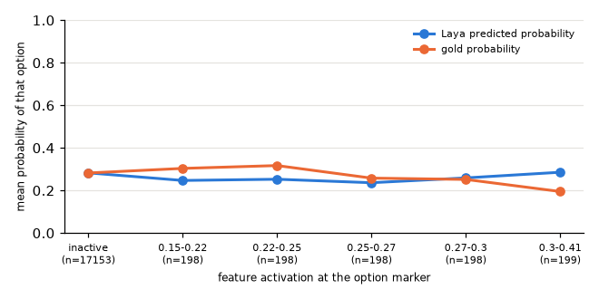

# Feature 5519

Critérios em que aparece: pred_error_stratified, pred_probe_right_laya_wrong_stratified

**Interpretação (preencher):** 

---

## Maiores ativações

**tr_customer_service_000253 / urgency** (score, customer_service) | ativação 2.656 em `estado` | opções ['0', '1', '2', '3'] | Laya: **1** [0.175, 0.546, 0.213, 0.066] | gabarito: **3**

```
<bos> score question: How time-sensitive is this conversation?<eos>
▸ <mask> level 0: No time pressure; can wait indefinitely.
▸ <mask> level 1: Routine; handle within the normal queue.
▸ <mask> level 2: Elevated; should be handled within the same week.
▸ <mask> level 3: Critical; requires action within the same day.

<eos>

 {"account": {"lifetime_value_usd": 4869, "prior_tickets_90d": 1, "seats": 40, "tenure_months": 60, "tier": "premium"}, "thread": [{"role": "customer", "text": "My premium package is late yet again. I’ve been a loyal customer for 60 months, and frankly, I’m tired of dealing with these same logistical failures."}, {"role": "agent", "text": "I understand your frustration regarding this delay. To help me investigate the status of your shipment, could you please provide your order reference number?"}, {"role": "customer", "text": "It’s 8829-X⟦.⟧ You guys had this issue last year, and here we are repeating the exact same problem."}, {"role": "agent", "text": "Thank you for that information. I am checking the current tracking status for you now; could you verify if the address listed on your account is the one where the delivery was expected?"}, {"role": "customer", "text": "Yes, it is the same address as always. Just tell me where the package is instead of making me repeat myself."}]}<eos>
```

**tr_security_incidents_000095 / urgency** (score, security_incidents) | ativação 2.646 em `estado` | opções ['0', '1', '2', '3'] | Laya: **3** [0.114, 0.345, 0.185, 0.356] | gabarito: **2**

```
<bos> score question: How quickly must a responder act on this alert?<eos>
▸ <mask> level 0: No time pressure; can wait indefinitely.
▸ <mask> level 1: Routine; handle within the normal queue.
▸ <mask> level 2: Elevated; should be handled within the same week.
▸ <mask> level 3: Critical; requires action within the same day.

<eos>

 {"alert": {"description": "a security group was opened to the public internet", "evidence": "An unprivileged admin principal modified the security group 'sg-0a1b2c3d' to permit inbound traffic from 0.0.0.0/0 at 21:08:44⟦.⟧ This configuration change was initiated from an unrecognized external IP address and did not correlate with an active change window. The principal's credentials were last rotated 180 days ago, though multi-factor authentication was present for the session.", "rule": "config_drift"}, "context": {"asset_criticality": "low", "change_window_active": false, "source_on_allowlist": false}, "history": {"credential_rotation_days_ago": 180, "distinct_countries_30d": 2, "logins_30d": 1207, "prior_alerts_90d": 25}, "principal": {"mfa_enrolled": true, "name": "usr-deploy-183", "privileges": ["repo:read"], "type": "admin"}}<eos>
```

**tr_customer_service_000253 / churn_risk** (score, customer_service) | ativação 2.604 em `estado` | opções ['0', '1', '2', '3'] | Laya: **1** [0.133, 0.702, 0.137, 0.028] | gabarito: **2**

```
<bos> score question: How likely is this customer to stop doing business with us because of this interaction?<eos>
▸ <mask> level 0: No sign of dissatisfaction.
▸ <mask> level 1: Mild frustration, but the relationship is intact.
▸ <mask> level 2: Clearly unhappy; repeat problems or explicit complaints.
▸ <mask> level 3: Imminent: threatening to cancel, dispute or leave.

<eos>

 {"account": {"lifetime_value_usd": 4869, "prior_tickets_90d": 1, "seats": 40, "tenure_months": 60, "tier": "premium"}, "thread": [{"role": "customer", "text": "My premium package is late yet again. I’ve been a loyal customer for 60 months, and frankly, I’m tired of dealing with these same logistical failures."}, {"role": "agent", "text": "I understand your frustration regarding this delay. To help me investigate the status of your shipment, could you please provide your order reference number?"}, {"role": "customer", "text": "It’s 8829-X⟦.⟧ You guys had this issue last year, and here we are repeating the exact same problem."}, {"role": "agent", "text": "Thank you for that information. I am checking the current tracking status for you now; could you verify if the address listed on your account is the one where the delivery was expected?"}, {"role": "customer", "text": "Yes, it is the same address as always. Just tell me where the package is instead of making me repeat myself."}]}<eos>
```

**tr_security_incidents_000067 / urgency** (score, security_incidents) | ativação 2.564 em `estado` | opções ['0', '1', '2', '3'] | Laya: **1** [0.107, 0.381, 0.266, 0.246] | gabarito: **3**

```
<bos> score question: How quickly must a responder act on this alert?<eos>
▸ <mask> level 0: No time pressure; can wait indefinitely.
▸ <mask> level 1: Routine; handle within the normal queue.
▸ <mask> level 2: Elevated; should be handled within the same week.
▸ <mask> level 3: Critical; requires action within the same day.

<eos>

 {"alert": {"description": "a security group was opened to the public internet", "evidence": "The security group configuration was modified to allow inbound traffic from 0.0.0.0/0⟦.⟧ This change originated from an unrecognized network source outside of a designated maintenance window.", "rule": "config_drift"}, "context": {"asset_criticality": "medium", "change_window_active": false, "source_on_allowlist": false}, "history": {"credential_rotation_days_ago": 14, "distinct_countries_30d": 1, "logins_30d": 1017, "prior_alerts_90d": 25}, "principal": {"mfa_enrolled": true, "name": "svc-analytics-657", "privileges": ["deploy:production", "secrets:read"], "type": "admin"}}<eos>
```

**tr_security_incidents_000095 / disposition** (choice, security_incidents) | ativação 2.543 em `estado` | opções ['close_benign', 'contain', 'investigate', 'monitor'] | Laya: **monitor** [0.296, 0.136, 0.227, 0.341] | gabarito: **investigate**

```
<bos> choice question: How should this security alert be dispositioned?<eos>
▸ <mask> close_benign: Expected, explainable activity; close without analyst time.
▸ <mask> contain: Contain the host or account immediately; do not wait for triage.
▸ <mask> investigate: Warrants an analyst opening an investigation.
▸ <mask> monitor: Not clearly malicious, but worth watching for recurrence.

<eos>

 {"alert": {"description": "a security group was opened to the public internet", "evidence": "An unprivileged admin principal modified the security group 'sg-0a1b2c3d' to permit inbound traffic from 0.0.0.0/0 at 21:08:44⟦.⟧ This configuration change was initiated from an unrecognized external IP address and did not correlate with an active change window. The principal's credentials were last rotated 180 days ago, though multi-factor authentication was present for the session.", "rule": "config_drift"}, "context": {"asset_criticality": "low", "change_window_active": false, "source_on_allowlist": false}, "history": {"credential_rotation_days_ago": 180, "distinct_countries_30d": 2, "logins_30d": 1207, "prior_alerts_90d": 25}, "principal": {"mfa_enrolled": true, "name": "usr-deploy-183", "privileges": ["repo:read"], "type": "admin"}}<eos>
```

## Ativações medianas (faixa 40-60%, mediana 0.620)

**tr_security_incidents_000241 / severity** (score, security_incidents) | ativação 0.695 em `estado` | opções ['0', '1', '2', '3', '4'] | Laya: **2** [0.116, 0.265, 0.362, 0.09, 0.168] | gabarito: **2**

```
<bos> score question: How severe is the potential impact if this alert is real?<eos>
▸ <mask> level 0: Negligible: no access to anything sensitive.
▸ <mask> level 1: Low: limited access, easily reversed.
▸ <mask> level 2: Moderate: access to internal systems or non-public data.
▸ <mask> level 3: High: access to production, secrets or customer data.
▸ <mask> level 4: Critical: active compromise of crown-jewel systems.

<eos>

 {"alert": {"description": "audit logging was turned off on a host", "evidence": "A service account disabled audit logging on the host⟦,⟧ an action performed outside of any defined change window. While the activity originated from an allowlisted source, the account lacks MFA and has not rotated credentials in 180 days.", "rule": "disabled_logging"}, "context": {"asset_criticality": "medium", "change_window_active": false, "source_on_allowlist": true}, "history": {"credential_rotation_days_ago": 180, "distinct_countries_30d": 3, "logins_30d": 613, "prior_alerts_90d": 0}, "principal": {"mfa_enrolled": false, "name": "adm-infra-357", "privileges": ["repo:read"], "type": "service_account"}}<eos>
```

**tr_security_incidents_000265 / urgency** (score, security_incidents) | ativação 0.625 em `estado` | opções ['0', '1', '2', '3'] | Laya: **2** [0.141, 0.256, 0.318, 0.285] | gabarito: **3**

```
<bos> score question: How quickly must a responder act on this alert?<eos>
▸ <mask> level 0: No time pressure; can wait indefinitely.
▸ <mask> level 1: Routine; handle within the normal queue.
▸ <mask> level 2: Elevated; should be handled within the same week.
▸ <mask> level 3: Critical; requires action within the same day.

<eos>

 {"alert": {"description": "an account granted itself or received elevated permissions", "evidence⟦":⟧ "The account assigned to an unprivileged contractor was granted elevated permissions at 11:05 AM from an unrecognized source address. Although multi-factor authentication was enabled and credentials were last rotated 14 days ago, no scheduled change window was present for this administrative action.", "rule": "privilege_escalation"}, "context": {"asset_criticality": "medium", "change_window_active": false, "source_on_allowlist": false}, "history": {"credential_rotation_days_ago": 14, "distinct_countries_30d": 3, "logins_30d": 164, "prior_alerts_90d": 1}, "principal": {"mfa_enrolled": true, "name": "usr-infra-439", "privileges": ["repo:read"], "type": "contractor"}}<eos>
```

**tr_customer_service_000033 / action** (choice, customer_service) | ativação 0.625 em `estado` | opções ['answer_directly', 'close_no_action', 'escalate_to_human', 'execute_refund', 'request_information'] | Laya: **close_no_action** [0.067, 0.893, 0.015, 0.015, 0.01] | gabarito: **escalate_to_human**

```
<bos> choice question: What should the assistant do next with this conversation?<eos>
▸ <mask> answer_directly: The assistant can resolve this itself with information it already has.
▸ <mask> close_no_action: No further action is warranted; the matter is settled.
▸ <mask> escalate_to_human: Hand off to a human agent with the appropriate authority.
▸ <mask> execute_refund: Issue the refund or credit the customer is owed.
▸ <mask> request_information: More detail is needed from the customer before anything can be done.

<eos>

 {"account": {"lifetime_value_usd": 972, "prior_tickets_90d": 3, "seats": 1, "tenure_months": 49, "tier": "free"}, "orders": [{"amount_usd": 999, "date": "2026-03-06", "id": "A-72271", "status": "settled"}, {"amount_usd": 999, "date": "2026-02-16", "id": "A-14198", "status": "settled"}, {"amount_usd": 999, "date": "2026-01-05", "id": "A-90678", "status": "settled"}], "thread": [{"role": "customer", "text": "I've been trying to downgrade to the free plan for three days now and the website just keeps looping me back to the dashboard. This is incredibly annoying given I've been a loyal user for over four years."}, {"role": "agent", "text": "I'm sorry for the frustration the downgrade process is causing. Could you tell me if you are seeing any specific error codes or pop-up messages when the page refreshes?"}, {"role": "customer", "text": "There are no codes, it just fails silently. I've spent almost a thousand dollars with you guys over 49 months, and after having three previous tickets only 'partially' addressed, I really expected a simple plan change to actually work."}, {"role": "agent", "text": "I appreciate your long-term history with us. To help me investigate the account block⟦,⟧ would you mind specifying which features from those three previous tickets are still causing you issues on your current plan?"}, {"role": "customer", "text": "The seat management and the data exports never worked right, which is why I'm trying to scale back. I'm just tired of paying for a service that feels broken every time I try to adjust my settings."}]}<eos>
```

**tr_customer_service_000053 / action** (choice, customer_service) | ativação 0.653 em `estado` | opções ['answer_directly', 'close_no_action', 'escalate_to_human', 'execute_refund', 'request_information'] | Laya: **answer_directly** [0.598, 0.027, 0.332, 0.035, 0.008] | gabarito: **answer_directly**

```
<bos> choice question: What should the assistant do next with this conversation?<eos>
▸ <mask> answer_directly: The assistant can resolve this itself with information it already has.
▸ <mask> close_no_action: No further action is warranted; the matter is settled.
▸ <mask> escalate_to_human: Hand off to a human agent with the appropriate authority.
▸ <mask> execute_refund: Issue the refund or credit the customer is owed.
▸ <mask> request_information: More detail is needed from the customer before anything can be done.

<eos>

 {"account": {"lifetime_value_usd": 3557, "prior_tickets_90d": 0, "seats": 1, "tenure_months": 72, "tier": "standard"}, "orders": [{"amount_usd": 58, "date": "2026-02-03", "id": "A-39815", "status": "settled"}], "thread": [{"role": "customer", "text⟦":⟧ "Looks like my payment didn't go through again. I've been on the standard plan for six years, paying about $58 each month. I'm not sure what's happening."}, {"role": "agent", "text": "I’m sorry to hear that. Could you tell me which payment method you attempted to use and the date of the failed transaction?"}, {"role": "customer", "text": "It was my Visa ending in 1234 on the 12th of this month. The charge just shows as declined. I’d appreciate any help you can give."}]}<eos>
```

**tr_customer_service_000014 / needs_human** (noul, customer_service) | ativação 0.584 em `opção` | opções ['false', 'true'] | Laya: **true** [0.028, 0.972] | gabarito: **true**

```
<bos> noul question: This conversation requires a human agent rather than automated handling.<eos>
▸ <mask> false: Automation can carry this to resolution.
▸ <mask> true: A human must take over⟦:⟧ judgement, authority or empathy is required.

<eos>

 {"account": {"lifetime_value_usd": 563, "prior_tickets_90d": 0, "seats": 1, "tenure_months": 8, "tier": "free"}, "thread": [{"role": "customer", "text": "I requested a refund two weeks ago and haven’t heard anything; I’ve been on the free plan for eight months, so I’m just waiting now."}, {"role": "agent", "text": "I’m sorry for the delay. Could you provide the refund request reference number or the email it was sent from?"}, {"role": "customer", "text": "It was sent from my account@myemail.com, reference #R5678. Please let me know what the next steps are."}]}<eos>
```

## Estatísticas (conjunto de descoberta, dev e teste)

**pred / error**

| split | decisões | ativas | ativas e Laya errou | taxa | lift | q (BH) | OR (CMH) | q (CMH) |
|---|---|---|---|---|---|---|---|---|
| discovery | 5100 | 252 | 162 | 0.643 | 1.00 | 1 | 1.82 | 0.017 |
| dev | 900 | 37 | 31 | 0.838 | 1.25 | 0.0776 | 8.00 | 0.0422 |
| test | 2000 | 98 | 62 | 0.633 | 0.97 | 0.828 | 2.15 | 0.166 |

**corr / error**

| split | decisões | ativas | ativas e Laya errou | taxa | lift | q (BH) | OR (CMH) | q (CMH) |
|---|---|---|---|---|---|---|---|---|
| discovery | 5100 | 246 | 156 | 0.634 | 0.99 | 0.833 | 0.65 | 0.0496 |
| dev | 900 | 34 | 28 | 0.824 | 1.23 | 0.119 | 1.52 | 0.788 |
| test | 2000 | 91 | 55 | 0.604 | 0.93 | 0.46 | 0.45 | 0.0905 |

**state / error**

| split | decisões | ativas | ativas e Laya errou | taxa | lift | q (BH) | OR (CMH) | q (CMH) |
|---|---|---|---|---|---|---|---|---|
| discovery | 5100 | 3951 | 2499 | 0.632 | 0.98 | 0.00891 | 1.25 | 0.111 |
| dev | 900 | 666 | 442 | 0.664 | 0.99 | 0.749 | 1.48 | 0.374 |
| test | 2000 | 1522 | 982 | 0.645 | 0.99 | 0.701 | 1.29 | 0.337 |

**pred / probe_right_laya_wrong**

| split | decisões | ativas | ativas e Laya errou | taxa | lift | q (BH) | OR (CMH) | q (CMH) |
|---|---|---|---|---|---|---|---|---|
| discovery | 2819 | 117 | 83 | 0.709 | 1.10 | 0.211 | 6.21 | 1.46e-09 |
| dev | 520 | 17 | 15 | 0.882 | 1.31 | nan | nan | nan |
| test | 1106 | 31 | 20 | 0.645 | 1.02 | 1 | 4.92 | 0.0218 |

**corr / probe_right_laya_wrong**

| split | decisões | ativas | ativas e Laya errou | taxa | lift | q (BH) | OR (CMH) | q (CMH) |
|---|---|---|---|---|---|---|---|---|
| discovery | 2819 | 85 | 51 | 0.600 | 0.93 | 0.466 | 0.73 | 0.498 |
| dev | 520 | 14 | 12 | 0.857 | 1.27 | nan | nan | nan |
| test | 1106 | 24 | 13 | 0.542 | 0.86 | 0.523 | 0.54 | 0.55 |

**state / probe_right_laya_wrong**

| split | decisões | ativas | ativas e Laya errou | taxa | lift | q (BH) | OR (CMH) | q (CMH) |
|---|---|---|---|---|---|---|---|---|
| discovery | 2819 | 2223 | 1419 | 0.638 | 0.99 | 0.134 | 2.06 | 1.1e-06 |
| dev | 520 | 392 | 265 | 0.676 | 1.00 | 1 | 2.58 | 0.0287 |
| test | 1106 | 861 | 534 | 0.620 | 0.98 | 0.292 | 1.54 | 0.17 |

Confusão mais sobre-representada (pred): `urgency|3>0` (n=37, lift 18.72, p=0). Formato `pergunta|índice previsto>índice correto`.

Confusão mais sobre-representada (corr): `urgency|1>3` (n=43, lift 5.90, p=8.03e-23). Formato `pergunta|índice previsto>índice correto`.

Confusão mais sobre-representada (state): `credential_compromise|1>0` (n=82, lift 1.29, p=6.7e-10). Formato `pergunta|índice previsto>índice correto`.



