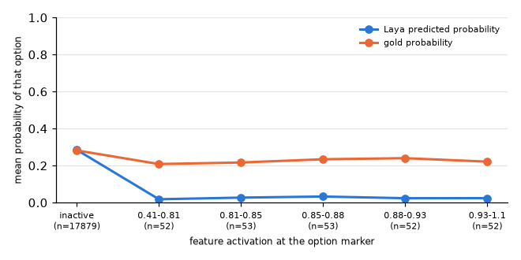

# Feature 5523

Critérios em que aparece: corr_error

**Interpretação (preencher):** 

---

## Maiores ativações

**tr_customer_service_000241 / needs_human** (noul, customer_service) | ativação 2.422 em `estado` | opções ['false', 'true'] | Laya: **true** [0.021, 0.979] | gabarito: **false**

```
<bos> noul question: This conversation requires a human agent rather than automated handling.<eos>
▸ <mask> false: Automation can carry this to resolution.
▸ <mask> true: A human must take over: judgement, authority or empathy is required.

<eos>

 {"account": {"lifetime_value_usd": 1906, "prior_tickets_90d": 2, "seats": 1, "tenure_months": 33, "tier": "standard"}, "thread": [{"role": "customer", "text": "Hello, could you help me add three new seats to our existing subscription? We’ve been with the Standard plan for about 33 months now."}, {"role": "agent", "text": "Certainly, happy to assist. May I have the names and email addresses of the users you’d like to add, as well as any role specifications?"}, {"role": "customer", "text": "Sure, the users are Alex (admin), Priya (editor), and Luis (viewer); their emails are alex@mycorp.com, priya@mycorp.com, and luis@⟦my⟧corp.com. Please let me know what information you need next."}]}<eos>
```

**tr_security_incidents_000217 / severity** (score, security_incidents) | ativação 2.418 em `estado` | opções ['0', '1', '2', '3', '4'] | Laya: **1** [0.087, 0.39, 0.334, 0.084, 0.105] | gabarito: **3**

```
<bos> score question: How severe is the potential impact if this alert is real?<eos>
▸ <mask> level 0: Negligible: no access to anything sensitive.
▸ <mask> level 1: Low: limited access, easily reversed.
▸ <mask> level 2: Moderate: access to internal systems or non-public data.
▸ <mask> level 3: High: access to production, secrets or customer data.
▸ <mask> level 4: Critical: active compromise of crown-jewel systems.

<eos>

 {"alert": {"description": "a session token was presented from a second address", "evidence": "At 11:30 UTC, a session token belonging to the privileged account `svc_storage_admin` was presented from IP `10.50.2.14` and subsequently from `10.50.2.89`. The activity originated from an allowlisted source, though the account's authentication credentials have not been updated in 412 days.", "rule⟦":⟧ "token_reuse"}, "context": {"asset_criticality": "crown_jewel", "change_window_active": false, "source_on_allowlist": true}, "history": {"credential_rotation_days_ago": 412, "distinct_countries_30d": 3, "logins_30d": 50, "prior_alerts_90d": 0}, "principal": {"mfa_enrolled": false, "name": "usr-deploy-906", "privileges": ["deploy:production", "secrets:read"], "type": "service_account"}}<eos>
```

**tr_security_incidents_000217 / urgency** (score, security_incidents) | ativação 2.357 em `estado` | opções ['0', '1', '2', '3'] | Laya: **1** [0.124, 0.514, 0.145, 0.218] | gabarito: **3**

```
<bos> score question: How quickly must a responder act on this alert?<eos>
▸ <mask> level 0: No time pressure; can wait indefinitely.
▸ <mask> level 1: Routine; handle within the normal queue.
▸ <mask> level 2: Elevated; should be handled within the same week.
▸ <mask> level 3: Critical; requires action within the same day.

<eos>

 {"alert": {"description": "a session token was presented from a second address", "evidence": "At 11:30 UTC, a session token belonging to the privileged account `svc_storage_admin` was presented from IP `10.50.2.14` and subsequently from `10.50.2.89`. The activity originated from an allowlisted source, though the account's authentication credentials have not been updated in 412 days.", "rule⟦":⟧ "token_reuse"}, "context": {"asset_criticality": "crown_jewel", "change_window_active": false, "source_on_allowlist": true}, "history": {"credential_rotation_days_ago": 412, "distinct_countries_30d": 3, "logins_30d": 50, "prior_alerts_90d": 0}, "principal": {"mfa_enrolled": false, "name": "usr-deploy-906", "privileges": ["deploy:production", "secrets:read"], "type": "service_account"}}<eos>
```

**tr_customer_service_000241 / urgency** (score, customer_service) | ativação 2.348 em `estado` | opções ['0', '1', '2', '3'] | Laya: **1** [0.169, 0.553, 0.171, 0.107] | gabarito: **1**

```
<bos> score question: How time-sensitive is this conversation?<eos>
▸ <mask> level 0: No time pressure; can wait indefinitely.
▸ <mask> level 1: Routine; handle within the normal queue.
▸ <mask> level 2: Elevated; should be handled within the same week.
▸ <mask> level 3: Critical; requires action within the same day.

<eos>

 {"account": {"lifetime_value_usd": 1906, "prior_tickets_90d": 2, "seats": 1, "tenure_months": 33, "tier": "standard"}, "thread": [{"role": "customer", "text": "Hello, could you help me add three new seats to our existing subscription? We’ve been with the Standard plan for about 33 months now."}, {"role": "agent", "text": "Certainly, happy to assist. May I have the names and email addresses of the users you’d like to add, as well as any role specifications?"}, {"role": "customer", "text": "Sure, the users are Alex (admin), Priya (editor), and Luis (viewer); their emails are alex@mycorp.com, priya@mycorp.com, and luis@⟦my⟧corp.com. Please let me know what information you need next."}]}<eos>
```

**tr_customer_service_000241 / action** (choice, customer_service) | ativação 2.328 em `estado` | opções ['answer_directly', 'close_no_action', 'escalate_to_human', 'execute_refund', 'request_information'] | Laya: **escalate_to_human** [0.343, 0.009, 0.583, 0.013, 0.052] | gabarito: **answer_directly**

```
<bos> choice question: What should the assistant do next with this conversation?<eos>
▸ <mask> answer_directly: The assistant can resolve this itself with information it already has.
▸ <mask> close_no_action: No further action is warranted; the matter is settled.
▸ <mask> escalate_to_human: Hand off to a human agent with the appropriate authority.
▸ <mask> execute_refund: Issue the refund or credit the customer is owed.
▸ <mask> request_information: More detail is needed from the customer before anything can be done.

<eos>

 {"account": {"lifetime_value_usd": 1906, "prior_tickets_90d": 2, "seats": 1, "tenure_months": 33, "tier": "standard"}, "thread": [{"role": "customer", "text": "Hello, could you help me add three new seats to our existing subscription? We’ve been with the Standard plan for about 33 months now."}, {"role": "agent", "text": "Certainly, happy to assist. May I have the names and email addresses of the users you’d like to add, as well as any role specifications?"}, {"role": "customer", "text": "Sure, the users are Alex (admin), Priya (editor), and Luis (viewer); their emails are alex@mycorp.com, priya@mycorp.com, and luis@⟦my⟧corp.com. Please let me know what information you need next."}]}<eos>
```

## Ativações medianas (faixa 40-60%, mediana 1.649)

**tr_security_incidents_000036 / credential_compromise** (noul, security_incidents) | ativação 1.679 em `estado` | opções ['false', 'true'] | Laya: **true** [0.084, 0.916] | gabarito: **false**

```
<bos> noul question: The evidence indicates a credential or account has been compromised.<eos>
▸ <mask> false: no, the statement does not hold
▸ <mask> true: yes, the statement holds

<eos>

 {"alert": {"description": "a long-unused account became active", "evidence": "At 2026-09-15 08:43:12 UTC, the employee account \"asmith\" generated a successful interactive login from source IP 198.51.100.22, the first recorded sign‑in in the past 412 days. The login was performed with MFA enabled and originated from a device that is listed on the allowlist.", "rule⟦":⟧ "dormant_account_use"}, "context": {"asset_criticality": "crown_jewel", "change_window_active": false, "source_on_allowlist": true}, "history": {"credential_rotation_days_ago": 412, "distinct_countries_30d": 3, "logins_30d": 1445, "prior_alerts_90d": 1}, "principal": {"mfa_enrolled": true, "name": "usr-infra-849", "privileges": ["repo:read"], "type": "employee"}}<eos>
```

**tr_security_incidents_000068 / urgency** (score, security_incidents) | ativação 1.663 em `estado` | opções ['0', '1', '2', '3'] | Laya: **3** [0.081, 0.38, 0.114, 0.424] | gabarito: **3**

```
<bos> score question: How quickly must a responder act on this alert?<eos>
▸ <mask> level 0: No time pressure; can wait indefinitely.
▸ <mask> level 1: Routine; handle within the normal queue.
▸ <mask> level 2: Elevated; should be handled within the same week.
▸ <mask> level 3: Critical; requires action within the same day.

<eos>

 {"alert": {"description": "two successful logins from distant locations too close together", "evidence": "Two successful authentication events for the service account occurred 12 minutes apart from IP addresses located in London and Singapore. The account credentials have not been updated in 412 days.", "rule⟦":⟧ "impossible_travel"}, "context": {"asset_criticality": "high", "change_window_active": false, "source_on_allowlist": false}, "history": {"credential_rotation_days_ago": 412, "distinct_countries_30d": 1, "logins_30d": 521, "prior_alerts_90d": 8}, "principal": {"mfa_enrolled": true, "name": "adm-analytics-682", "privileges": ["deploy:production", "secrets:read"], "type": "service_account"}}<eos>
```

**tr_security_incidents_000234 / credential_compromise** (noul, security_incidents) | ativação 1.642 em `estado` | opções ['false', 'true'] | Laya: **true** [0.01, 0.99] | gabarito: **true**

```
<bos> noul question: The evidence indicates a credential or account has been compromised.<eos>
▸ <mask> false: no, the statement does not hold
▸ <mask> true: yes, the statement holds

<eos>

 {"alert": {"description": "an unrecognised binary executed on a server", "evidence": "At 14:22 UTC, the unprivileged ci_runner service executed an unrecognized binary named 'sys_update_util' on production server SRV-PROD-04. The process originated from external IP 198.51.100.12 outside of a maintenance window using credentials that were last rotated 90 days ago.", "rule⟦":⟧ "suspicious_process"}, "context": {"asset_criticality": "crown_jewel", "change_window_active": false, "source_on_allowlist": false}, "history": {"credential_rotation_days_ago": 90, "distinct_countries_30d": 4, "logins_30d": 1084, "prior_alerts_90d": 0}, "principal": {"mfa_enrolled": true, "name": "adm-billing-703", "privileges": ["repo:read"], "type": "ci_runner"}}<eos>
```

**tr_security_incidents_000048 / disposition** (choice, security_incidents) | ativação 1.592 em `estado` | opções ['close_benign', 'contain', 'investigate', 'monitor'] | Laya: **monitor** [0.044, 0.322, 0.197, 0.438] | gabarito: **investigate**

```
<bos> choice question: How should this security alert be dispositioned?<eos>
▸ <mask> close_benign: Expected, explainable activity; close without analyst time.
▸ <mask> contain: Contain the host or account immediately; do not wait for triage.
▸ <mask> investigate: Warrants an analyst opening an investigation.
▸ <mask> monitor: Not clearly malicious, but worth watching for recurrence.

<eos>

 {"alert": {"description": "a long-unused account became active", "evidence": "Administrative principal access was detected from an unrecognized source after 700 days of account inactivity. The privileged session was established using MFA during an active change window.", "rule⟦":⟧ "dormant_account_use"}, "context": {"asset_criticality": "crown_jewel", "change_window_active": true, "source_on_allowlist": false}, "history": {"credential_rotation_days_ago": 700, "distinct_countries_30d": 3, "logins_30d": 503, "prior_alerts_90d": 8}, "principal": {"mfa_enrolled": true, "name": "svc-analytics-977", "privileges": ["deploy:production", "secrets:read"], "type": "admin"}}<eos>
```

**tr_security_incidents_000158 / credential_compromise** (noul, security_incidents) | ativação 1.612 em `estado` | opções ['false', 'true'] | Laya: **true** [0.005, 0.995] | gabarito: **true**

```
<bos> noul question: The evidence indicates a credential or account has been compromised.<eos>
▸ <mask> false: no, the statement does not hold
▸ <mask> true: yes, the statement holds

<eos>

 {"alert": {"description": "many failed authentications followed by a success", "evidence": "Between 2026-09-16 11:02 UTC and 11:07 UTC, a contractor account experienced 27 consecutive failed authentication attempts from 198.51.100.22, after which a successful login occurred at 11:09 UTC using MFA. The originating address is absent from the approved source list, and the account's credentials were last rotated on 2026‑08‑17.", "rule⟦":⟧ "brute_force"}, "context": {"asset_criticality": "medium", "change_window_active": false, "source_on_allowlist": false}, "history": {"credential_rotation_days_ago": 30, "distinct_countries_30d": 2, "logins_30d": 1639, "prior_alerts_90d": 3}, "principal": {"mfa_enrolled": true, "name": "ci-analytics-833", "privileges": ["repo:read"], "type": "contractor"}}<eos>
```

## Estatísticas (conjunto de descoberta, dev e teste)

**pred / error**

| split | decisões | ativas | ativas e Laya errou | taxa | lift | q (BH) | OR (CMH) | q (CMH) |
|---|---|---|---|---|---|---|---|---|
| discovery | 5100 | 1 | 1 | 1.000 | 1.55 | nan | nan | nan |
| dev | 900 | 0 | 0 | nan | nan | nan | nan | nan |
| test | 2000 | 0 | 0 | nan | nan | nan | nan | nan |

**corr / error**

| split | decisões | ativas | ativas e Laya errou | taxa | lift | q (BH) | OR (CMH) | q (CMH) |
|---|---|---|---|---|---|---|---|---|
| discovery | 5100 | 52 | 52 | 1.000 | 1.55 | 6.16e-10 | nan | nan |
| dev | 900 | 7 | 7 | 1.000 | 1.49 | nan | nan | nan |
| test | 2000 | 24 | 24 | 1.000 | 1.54 | 0.000149 | nan | nan |

**state / error**

| split | decisões | ativas | ativas e Laya errou | taxa | lift | q (BH) | OR (CMH) | q (CMH) |
|---|---|---|---|---|---|---|---|---|
| discovery | 5100 | 1356 | 813 | 0.600 | 0.93 | 0.000608 | 1.19 | 0.411 |
| dev | 900 | 232 | 143 | 0.616 | 0.92 | 0.273 | 1.40 | 0.548 |
| test | 2000 | 540 | 326 | 0.604 | 0.93 | 0.0794 | 1.20 | 0.652 |

**pred / probe_right_laya_wrong**

| split | decisões | ativas | ativas e Laya errou | taxa | lift | q (BH) | OR (CMH) | q (CMH) |
|---|---|---|---|---|---|---|---|---|
| discovery | 2819 | 1 | 1 | 1.000 | 1.55 | nan | nan | nan |
| dev | 520 | 0 | 0 | nan | nan | nan | nan | nan |
| test | 1106 | 0 | 0 | nan | nan | nan | nan | nan |

**corr / probe_right_laya_wrong**

| split | decisões | ativas | ativas e Laya errou | taxa | lift | q (BH) | OR (CMH) | q (CMH) |
|---|---|---|---|---|---|---|---|---|
| discovery | 2819 | 3 | 3 | 1.000 | 1.55 | nan | nan | nan |
| dev | 520 | 1 | 1 | 1.000 | 1.48 | nan | nan | nan |
| test | 1106 | 3 | 3 | 1.000 | 1.58 | nan | nan | nan |

**state / probe_right_laya_wrong**

| split | decisões | ativas | ativas e Laya errou | taxa | lift | q (BH) | OR (CMH) | q (CMH) |
|---|---|---|---|---|---|---|---|---|
| discovery | 2819 | 841 | 509 | 0.605 | 0.94 | 0.00974 | 1.71 | 0.00106 |
| dev | 520 | 148 | 91 | 0.615 | 0.91 | 0.346 | 2.01 | 0.149 |
| test | 1106 | 347 | 197 | 0.568 | 0.90 | 0.0224 | 1.25 | 0.583 |

Confusão mais sobre-representada (pred): `action|4>2` (n=1, lift 5100.00, p=nan). Formato `pergunta|índice previsto>índice correto`.

Confusão mais sobre-representada (corr): `action|0>4` (n=27, lift 98.08, p=0). Formato `pergunta|índice previsto>índice correto`.

Confusão mais sobre-representada (state): `credential_compromise|1>0` (n=82, lift 3.76, p=0). Formato `pergunta|índice previsto>índice correto`.



