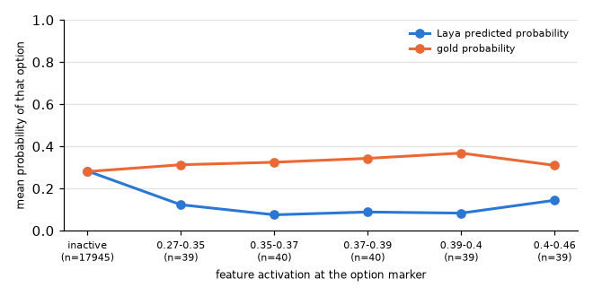

# Feature 5580

Critérios em que aparece: corr_probe_right_laya_wrong

**Interpretação (preencher):** 

---

## Maiores ativações

**tr_security_incidents_000004 / credential_compromise** (noul, security_incidents) | ativação 5.930 em `estado` | opções ['false', 'true'] | Laya: **true** [0.004, 0.996] | gabarito: **true**

```
<bos> noul question: The evidence indicates a credential or account has been compromised.<eos>
▸ <mask> false: no, the statement does not hold
▸ <mask> true: yes, the statement holds

<eos>

 {"alert": {"description": "many failed authentications followed by a success", "evidence": "Between 03:12⟦ and⟧ 03:20 UTC on 2026-09-15, 27 failed login attempts were logged from IP 203.0.113.45 targeting the CI runner service, followed by a successful authentication from the same IP at 03:21 UTC. The principal is an unprivileged CI runner with MFA enabled, operating from an unrecognised source, and the credentials were last rotated 30 days ago. No change window was defined for this period.", "rule": "brute_force"}, "context": {"asset_criticality": "high", "change_window_active": false, "source_on_allowlist": false}, "history": {"credential_rotation_days_ago": 30, "distinct_countries_30d": 1, "logins_30d": 502, "prior_alerts_90d": 0}, "principal": {"mfa_enrolled": true, "name": "usr-analytics-977", "privileges": ["repo:read"], "type": "ci_runner"}}<eos>
```

**tr_security_incidents_000004 / true_positive** (noul, security_incidents) | ativação 5.883 em `estado` | opções ['false', 'true'] | Laya: **true** [0.044, 0.956] | gabarito: **true**

```
<bos> noul question: This alert reflects genuinely malicious or unauthorised activity.<eos>
▸ <mask> false: Benign activity, a misconfiguration, or a known false positive.
▸ <mask> true: The underlying behaviour is malicious or unauthorised.

<eos>

 {"alert": {"description": "many failed authentications followed by a success", "evidence": "Between 03:12⟦ and⟧ 03:20 UTC on 2026-09-15, 27 failed login attempts were logged from IP 203.0.113.45 targeting the CI runner service, followed by a successful authentication from the same IP at 03:21 UTC. The principal is an unprivileged CI runner with MFA enabled, operating from an unrecognised source, and the credentials were last rotated 30 days ago. No change window was defined for this period.", "rule": "brute_force"}, "context": {"asset_criticality": "high", "change_window_active": false, "source_on_allowlist": false}, "history": {"credential_rotation_days_ago": 30, "distinct_countries_30d": 1, "logins_30d": 502, "prior_alerts_90d": 0}, "principal": {"mfa_enrolled": true, "name": "usr-analytics-977", "privileges": ["repo:read"], "type": "ci_runner"}}<eos>
```

**tr_security_incidents_000004 / severity** (score, security_incidents) | ativação 5.879 em `estado` | opções ['0', '1', '2', '3', '4'] | Laya: **2** [0.115, 0.225, 0.312, 0.111, 0.236] | gabarito: **3**

```
<bos> score question: How severe is the potential impact if this alert is real?<eos>
▸ <mask> level 0: Negligible: no access to anything sensitive.
▸ <mask> level 1: Low: limited access, easily reversed.
▸ <mask> level 2: Moderate: access to internal systems or non-public data.
▸ <mask> level 3: High: access to production, secrets or customer data.
▸ <mask> level 4: Critical: active compromise of crown-jewel systems.

<eos>

 {"alert": {"description": "many failed authentications followed by a success", "evidence": "Between 03:12⟦ and⟧ 03:20 UTC on 2026-09-15, 27 failed login attempts were logged from IP 203.0.113.45 targeting the CI runner service, followed by a successful authentication from the same IP at 03:21 UTC. The principal is an unprivileged CI runner with MFA enabled, operating from an unrecognised source, and the credentials were last rotated 30 days ago. No change window was defined for this period.", "rule": "brute_force"}, "context": {"asset_criticality": "high", "change_window_active": false, "source_on_allowlist": false}, "history": {"credential_rotation_days_ago": 30, "distinct_countries_30d": 1, "logins_30d": 502, "prior_alerts_90d": 0}, "principal": {"mfa_enrolled": true, "name": "usr-analytics-977", "privileges": ["repo:read"], "type": "ci_runner"}}<eos>
```

**tr_security_incidents_000029 / disposition** (choice, security_incidents) | ativação 5.832 em `estado` | opções ['close_benign', 'contain', 'investigate', 'monitor'] | Laya: **monitor** [0.053, 0.084, 0.135, 0.728] | gabarito: **investigate**

```
<bos> choice question: How should this security alert be dispositioned?<eos>
▸ <mask> close_benign: Expected, explainable activity; close without analyst time.
▸ <mask> contain: Contain the host or account immediately; do not wait for triage.
▸ <mask> investigate: Warrants an analyst opening an investigation.
▸ <mask> monitor: Not clearly malicious, but worth watching for recurrence.

<eos>

 {"alert": {"description": "many failed authentications followed by a success", "evidence": "Between 2026-09-13 22:15⟦ and⟧ 22:20 UTC, 57 failed login attempts were logged for privileged admin account \"admin_kim\" (MFA on) from IP 192.0.2.77, followed by a successful authentication at 22:21 UTC. The activity took place within an open change window, the source is unrecognized, and the credentials for the account were last rotated 365 days ago.", "rule": "brute_force"}, "context": {"asset_criticality": "medium", "change_window_active": true, "source_on_allowlist": false}, "history": {"credential_rotation_days_ago": 365, "distinct_countries_30d": 2, "logins_30d": 1826, "prior_alerts_90d": 0}, "principal": {"mfa_enrolled": true, "name": "svc-analytics-152", "privileges": ["deploy:production", "secrets:read"], "type": "admin"}}<eos>
```

**tr_security_incidents_000004 / disposition** (choice, security_incidents) | ativação 5.828 em `estado` | opções ['close_benign', 'contain', 'investigate', 'monitor'] | Laya: **monitor** [0.027, 0.127, 0.098, 0.748] | gabarito: **investigate**

```
<bos> choice question: How should this security alert be dispositioned?<eos>
▸ <mask> close_benign: Expected, explainable activity; close without analyst time.
▸ <mask> contain: Contain the host or account immediately; do not wait for triage.
▸ <mask> investigate: Warrants an analyst opening an investigation.
▸ <mask> monitor: Not clearly malicious, but worth watching for recurrence.

<eos>

 {"alert": {"description": "many failed authentications followed by a success", "evidence": "Between 03:12⟦ and⟧ 03:20 UTC on 2026-09-15, 27 failed login attempts were logged from IP 203.0.113.45 targeting the CI runner service, followed by a successful authentication from the same IP at 03:21 UTC. The principal is an unprivileged CI runner with MFA enabled, operating from an unrecognised source, and the credentials were last rotated 30 days ago. No change window was defined for this period.", "rule": "brute_force"}, "context": {"asset_criticality": "high", "change_window_active": false, "source_on_allowlist": false}, "history": {"credential_rotation_days_ago": 30, "distinct_countries_30d": 1, "logins_30d": 502, "prior_alerts_90d": 0}, "principal": {"mfa_enrolled": true, "name": "usr-analytics-977", "privileges": ["repo:read"], "type": "ci_runner"}}<eos>
```

## Ativações medianas (faixa 40-60%, mediana 0.533)

**tr_agent_trace_observability_000195 / risk** (score, agent_trace_observability) | ativação 0.493 em `opção` | opções ['0', '1', '2', '3'] | Laya: **2** [0.019, 0.191, 0.716, 0.074] | gabarito: **1**

```
<bos> score question: How risky was the agent's behaviour in this trace?<eos>
▸ <mask> level 0: Benign: read-only or clearly safe actions.
▸ <mask> level 1: Low: routine writes within scope.
▸ <mask> level 2: Moderate⟦:⟧ irreversible or out-of-scope actions.
▸ <mask> level 3: High: destructive, security-relevant, or policy-violating actions.

<eos>

 {"agent": {"autonomy": "unsupervised", "model": "internal-agent-v4"}, "constraints": ["Do not force-push to any branch"], "task": "Triage and close duplicate issues in the support tracker.", "trace_summary": {"constraint_violations": 0, "duration_s": 20.1, "irreversible_actions": 1, "steps": 6, "tool_errors": 1}}<eos>
```

**tr_invoice_processing_000017 / matches_order** (noul, invoice_processing) | ativação 0.501 em `estado` | opções ['false', 'true'] | Laya: **true** [0.034, 0.966] | gabarito: **true**

```
<bos> noul question: The invoice reconciles with the purchase order and the recorded delivery.<eos>
▸ <mask> false: There is a discrepancy against the order or the delivery.
▸ <mask> true: Line items, quantities and amounts reconcile.

<eos>

 {"delivery": {"condition": "accepted with exceptions", "date": "2026-03-05", "received_qty": 250}, "invoice": {"currency": "USD", "id": "INV-2026-7884", "lines": [{"qty": 250, "sku": "SKU-918", "total_usd": 41030.0, "unit_usd": 164.12}], "total_usd": 41030.0, "vendor": "Kestrel Supply"}, "payment": {"days_until_due": 27, "discount_expires_in_days": null, "early_payment_discount_pct": null, "status": "scheduled", "terms": "net 30"}, "purchase_order": {"freight_terms": "freight prepaid by vendor, not separately billable", "id": "PO-2281", "lines": [{"qty": 250, "unit_usd": 164.12}], "total_usd": 41030.0}, "vendor_history": {"disputes_12m": 0, "invoices_12m": 40, "prior_invoice_ids": ["INV-2026-1269", "INV-2026⟦-⟧3034", "INV-2026-2611"]}}<eos>
```

**tr_invoice_processing_000049 / disposition** (choice, invoice_processing) | ativação 0.510 em `estado` | opções ['approve', 'hold', 'manual_review', 'reject'] | Laya: **reject** [0.381, 0.13, 0.022, 0.468] | gabarito: **hold**

```
<bos> choice question: How should this vendor invoice be dispositioned?<eos>
▸ <mask> approve: Matches the order and delivery; approve for payment.
▸ <mask> hold: Something needs confirming before payment; hold pending clarification.
▸ <mask> manual_review: A human in finance must review the discrepancy.
▸ <mask> reject: Should not be paid: duplicate, unauthorised or materially wrong.

<eos>

 {"delivery": {"condition": "accepted with exceptions", "date": "2026-03-16", "received_qty": 1000}, "invoice": {"currency": "USD", "id": "INV-2026-8794", "lines": [{"qty": 1000, "sku": "SKU-610", "total_usd": 287770.0, "unit_usd": 287.77}], "total_usd": 287770.0, "vendor": "Pallas Industrial"}, "payment": {"days_until_due": -9, "discount_expires_in_days": null, "early_payment_discount_pct": null, "status": "overdue", "terms": "net 15"}, "purchase_order": {"freight_terms": "freight prepaid by vendor, not separately billable", "id": "PO-9867", "lines": [{"qty": 1000⟦,⟧ "unit_usd": 287.77}], "total_usd": 287770.0}, "vendor_history": {"disputes_12m": 0, "invoices_12m": 54, "prior_invoice_ids": ["INV-2026-7292", "INV-2026-5406"]}}<eos>
```

**tr_invoice_processing_000119 / discrepancy_severity** (score, invoice_processing) | ativação 0.487 em `estado` | opções ['0', '1', '2', '3'] | Laya: **2** [0.072, 0.295, 0.583, 0.05] | gabarito: **2**

```
<bos> score question: How material is any discrepancy between the invoice, the order and the delivery?<eos>
▸ <mask> level 0: None: everything reconciles.
▸ <mask> level 1: Trivial: rounding or a cosmetic difference.
▸ <mask> level 2: Moderate: a real difference worth confirming.
▸ <mask> level 3: Material: a large or unexplained difference.

<eos>

 {"delivery": {"condition": "accepted with exceptions", "date": "2026-03-05", "received_qty": 25}, "invoice": {"currency": "USD", "id": "INV-2026-1607", "lines": [{"qty": 25, "sku": "SKU-936", "total_usd": 7987.25, "unit_usd": 319.49}], "total_usd": 7987.25, "vendor": "Orbit Logistics"}, "payment": {"days_until_due": 27, "discount_expires_in_days": null, "early_payment_discount_pct": null, "status": "scheduled", "terms": "net 15"}, "purchase_order": {"freight_terms": "freight prepaid by vendor, not separately billable", "id": "PO-5883", "lines": [{"qty": 25⟦,⟧ "unit_usd": 310.18}], "total_usd": 7754.5}, "vendor_history": {"disputes_12m": 0, "invoices_12m": 26, "prior_invoice_ids": ["INV-2026-1630", "INV-2026-2519"]}}<eos>
```

**tr_customer_service_000262 / churn_risk** (score, customer_service) | ativação 0.522 em `estado` | opções ['0', '1', '2', '3'] | Laya: **3** [0.024, 0.05, 0.099, 0.828] | gabarito: **2**

```
<bos> score question: How likely is this customer to stop doing business with us because of this interaction?<eos>
▸ <mask> level 0: No sign of dissatisfaction.
▸ <mask> level 1: Mild frustration, but the relationship is intact.
▸ <mask> level 2: Clearly unhappy; repeat problems or explicit complaints.
▸ <mask> level 3: Imminent: threatening to cancel, dispute or leave.

<eos>

 {"account": {"lifetime_value_usd": 728, "prior_tickets_90d": 1, "seats": 1, "tenure_months": 19, "tier": "standard"}, "orders": [{"amount_usd": 18, "date": "2026-01-04", "id": "A-75798", "status": "settled"}, {"amount_usd": 18, "date": "2026-02-14", "id": "A-84810", "status": "failed"}, {"amount_usd": 18, "date": "2026-01-11", "id": "⟦A⟧-71488", "status": "settled"}], "thread": [{"role": "customer", "text": "I need help immediately. I've been a loyal customer for 19 months on the $18 standard plan, but I just noticed I've been downgraded to the free tier without my consent. This happened once before and was only half-fixed, and now I've lost access to my active projects."}, {"role": "agent", "text": "I see your account history here and recognize you've been with us for quite a while. To help me investigate the billing status, could you confirm if you received any automated emails regarding a failed payment recently?"}, {"role": "customer", "text": "No, there were no emails at all, and my card on file is perfectly fine. I have a team waiting on these files right now and we can't get anything done while the account says 'Basic'."}, {"role": "agent", "text": "Thank you for that information. Could you please provide the last four digits of the card you have on file so I can cross-reference it with our payment processor's logs?"}, {"role": "customer", "text": "It's 4492. Please, just check whatever you need to check quickly, because our entire workflow is stalled until those standard features are toggled back on."}]}<eos>
```

## Estatísticas (conjunto de descoberta, dev e teste)

**pred / error**

| split | decisões | ativas | ativas e Laya errou | taxa | lift | q (BH) | OR (CMH) | q (CMH) |
|---|---|---|---|---|---|---|---|---|
| discovery | 5100 | 5 | 4 | 0.800 | 1.24 | nan | nan | nan |
| dev | 900 | 1 | 1 | 1.000 | 1.49 | nan | nan | nan |
| test | 2000 | 1 | 0 | 0.000 | 0.00 | nan | nan | nan |

**corr / error**

| split | decisões | ativas | ativas e Laya errou | taxa | lift | q (BH) | OR (CMH) | q (CMH) |
|---|---|---|---|---|---|---|---|---|
| discovery | 5100 | 78 | 77 | 0.987 | 1.53 | 3.25e-13 | 2.24 | 0.616 |
| dev | 900 | 11 | 11 | 1.000 | 1.49 | nan | nan | nan |
| test | 2000 | 22 | 21 | 0.955 | 1.47 | 0.00346 | 0.35 | 0.743 |

**state / error**

| split | decisões | ativas | ativas e Laya errou | taxa | lift | q (BH) | OR (CMH) | q (CMH) |
|---|---|---|---|---|---|---|---|---|
| discovery | 5100 | 1812 | 1120 | 0.618 | 0.96 | 0.0197 | 0.83 | 0.105 |
| dev | 900 | 315 | 214 | 0.679 | 1.01 | 1 | 0.87 | 0.735 |
| test | 2000 | 709 | 471 | 0.664 | 1.02 | 0.657 | 1.21 | 0.436 |

**pred / probe_right_laya_wrong**

| split | decisões | ativas | ativas e Laya errou | taxa | lift | q (BH) | OR (CMH) | q (CMH) |
|---|---|---|---|---|---|---|---|---|
| discovery | 2819 | 2 | 2 | 1.000 | 1.55 | nan | nan | nan |
| dev | 520 | 0 | 0 | nan | nan | nan | nan | nan |
| test | 1106 | 0 | 0 | nan | nan | nan | nan | nan |

**corr / probe_right_laya_wrong**

| split | decisões | ativas | ativas e Laya errou | taxa | lift | q (BH) | OR (CMH) | q (CMH) |
|---|---|---|---|---|---|---|---|---|
| discovery | 2819 | 30 | 30 | 1.000 | 1.55 | 7.29e-06 | inf | 0.629 |
| dev | 520 | 4 | 4 | 1.000 | 1.48 | nan | nan | nan |
| test | 1106 | 8 | 8 | 1.000 | 1.58 | nan | nan | nan |

**state / probe_right_laya_wrong**

| split | decisões | ativas | ativas e Laya errou | taxa | lift | q (BH) | OR (CMH) | q (CMH) |
|---|---|---|---|---|---|---|---|---|
| discovery | 2819 | 1053 | 657 | 0.624 | 0.96 | 0.109 | 0.77 | 0.0595 |
| dev | 520 | 191 | 128 | 0.670 | 0.99 | 1 | 0.81 | 0.594 |
| test | 1106 | 445 | 294 | 0.661 | 1.04 | 0.318 | 1.43 | 0.172 |

Confusão mais sobre-representada (pred): `action|2>3` (n=1, lift 1020.00, p=nan). Formato `pergunta|índice previsto>índice correto`.

Confusão mais sobre-representada (corr): `action|3>2` (n=72, lift 40.94, p=0). Formato `pergunta|índice previsto>índice correto`.

Confusão mais sobre-representada (state): `discrepancy_severity|2>0` (n=95, lift 2.48, p=3.71e-30). Formato `pergunta|índice previsto>índice correto`.



