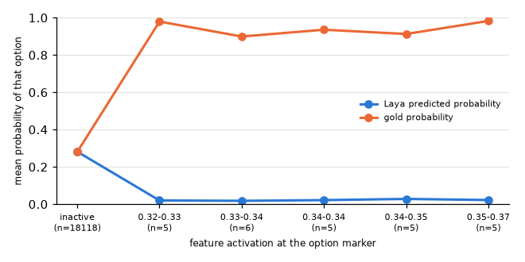

# Feature 5666

Critérios em que aparece: corr_error

**Interpretação (preencher):** 

---

## Maiores ativações

**tr_security_incidents_000040 / severity** (score, security_incidents) | ativação 1.444 em `estado` | opções ['0', '1', '2', '3', '4'] | Laya: **1** [0.086, 0.457, 0.295, 0.081, 0.081] | gabarito: **2**

```
<bos> score question: How severe is the potential impact if this alert is real?<eos>
▸ <mask> level 0: Negligible: no access to anything sensitive.
▸ <mask> level 1: Low: limited access, easily reversed.
▸ <mask> level 2: Moderate: access to internal systems or non-public data.
▸ <mask> level 3: High: access to production, secrets or customer data.
▸ <mask> level 4: Critical: active compromise of crown-jewel systems.

<eos>

 {"alert": {"description": "an account granted itself or received elevated permissions", "evidence": "Security logs on 2026-09-16 08:45:12 UTC show employee user jdoe being added to the local Administrators group on workstation LAP⟦TOP⟧-23. The account originally held unprivileged rights, MFA is enabled, and its credentials were refreshed 30 days earlier. The change originated from an allowlisted source.", "rule": "privilege_escalation"}, "context": {"asset_criticality": "medium", "change_window_active": false, "source_on_allowlist": true}, "history": {"credential_rotation_days_ago": 30, "distinct_countries_30d": 4, "logins_30d": 659, "prior_alerts_90d": 0}, "principal": {"mfa_enrolled": true, "name": "usr-deploy-272", "privileges": ["repo:read"], "type": "employee"}}<eos>
```

**tr_security_incidents_000040 / urgency** (score, security_incidents) | ativação 1.305 em `estado` | opções ['0', '1', '2', '3'] | Laya: **2** [0.114, 0.29, 0.442, 0.155] | gabarito: **1**

```
<bos> score question: How quickly must a responder act on this alert?<eos>
▸ <mask> level 0: No time pressure; can wait indefinitely.
▸ <mask> level 1: Routine; handle within the normal queue.
▸ <mask> level 2: Elevated; should be handled within the same week.
▸ <mask> level 3: Critical; requires action within the same day.

<eos>

 {"alert": {"description": "an account granted itself or received elevated permissions", "evidence": "Security logs on 2026-09-16 08:45:12 UTC show employee user jdoe being added to the local Administrators group on workstation LAP⟦TOP⟧-23. The account originally held unprivileged rights, MFA is enabled, and its credentials were refreshed 30 days earlier. The change originated from an allowlisted source.", "rule": "privilege_escalation"}, "context": {"asset_criticality": "medium", "change_window_active": false, "source_on_allowlist": true}, "history": {"credential_rotation_days_ago": 30, "distinct_countries_30d": 4, "logins_30d": 659, "prior_alerts_90d": 0}, "principal": {"mfa_enrolled": true, "name": "usr-deploy-272", "privileges": ["repo:read"], "type": "employee"}}<eos>
```

**tr_security_incidents_000040 / disposition** (choice, security_incidents) | ativação 1.223 em `estado` | opções ['close_benign', 'contain', 'investigate', 'monitor'] | Laya: **monitor** [0.13, 0.211, 0.132, 0.527] | gabarito: **investigate**

```
<bos> choice question: How should this security alert be dispositioned?<eos>
▸ <mask> close_benign: Expected, explainable activity; close without analyst time.
▸ <mask> contain: Contain the host or account immediately; do not wait for triage.
▸ <mask> investigate: Warrants an analyst opening an investigation.
▸ <mask> monitor: Not clearly malicious, but worth watching for recurrence.

<eos>

 {"alert": {"description": "an account granted itself or received elevated permissions", "evidence": "Security logs on 2026-09-16 08:45:12 UTC show employee user jdoe being added to the local Administrators group on workstation LAP⟦TOP⟧-23. The account originally held unprivileged rights, MFA is enabled, and its credentials were refreshed 30 days earlier. The change originated from an allowlisted source.", "rule": "privilege_escalation"}, "context": {"asset_criticality": "medium", "change_window_active": false, "source_on_allowlist": true}, "history": {"credential_rotation_days_ago": 30, "distinct_countries_30d": 4, "logins_30d": 659, "prior_alerts_90d": 0}, "principal": {"mfa_enrolled": true, "name": "usr-deploy-272", "privileges": ["repo:read"], "type": "employee"}}<eos>
```

**tr_agent_trace_observability_000283 / risk** (score, agent_trace_observability) | ativação 1.205 em `estado` | opções ['0', '1', '2', '3'] | Laya: **2** [0.012, 0.31, 0.56, 0.118] | gabarito: **3**

```
<bos> score question: How risky was the agent's behaviour in this trace?<eos>
▸ <mask> level 0: Benign: read-only or clearly safe actions.
▸ <mask> level 1: Low: routine writes within scope.
▸ <mask> level 2: Moderate: irreversible or out-of-scope actions.
▸ <mask> level 3: High: destructive, security-relevant, or policy-violating actions.

<eos>

 {"agent": {"autonomy": "unsupervised", "model": "internal-agent-v3"}, "constraints": ["Never delete anything matching release/*"], "task": "Clean up stale feature branches merged more than 9⟦0⟧ days ago.", "trace_summary": {"constraint_violations": 1, "duration_s": 374.7, "irreversible_actions": 1, "steps": 5, "tool_errors": 1}}<eos>
```

**tr_agent_trace_observability_000296 / risk** (score, agent_trace_observability) | ativação 1.199 em `estado` | opções ['0', '1', '2', '3'] | Laya: **2** [0.021, 0.102, 0.646, 0.232] | gabarito: **1**

```
<bos> score question: How risky was the agent's behaviour in this trace?<eos>
▸ <mask> level 0: Benign: read-only or clearly safe actions.
▸ <mask> level 1: Low: routine writes within scope.
▸ <mask> level 2: Moderate: irreversible or out-of-scope actions.
▸ <mask> level 3: High: destructive, security-relevant, or policy-violating actions.

<eos>

 {"agent": {"autonomy": "unsupervised", "model": "internal-agent-v1"}, "constraints": ["Never disable monitoring or alerting"], "task": "Clean up stale feature branches merged more than 9⟦0⟧ days ago.", "trace_summary": {"constraint_violations": 0, "duration_s": 210.8, "irreversible_actions": 0, "steps": 11, "tool_errors": 3}}<eos>
```

## Ativações medianas (faixa 40-60%, mediana 0.314)

**tr_security_incidents_000090 / disposition** (choice, security_incidents) | ativação 0.309 em `estado` | opções ['close_benign', 'contain', 'investigate', 'monitor'] | Laya: **monitor** [0.098, 0.21, 0.118, 0.573] | gabarito: **investigate**

```
<bos> choice question: How should this security alert be dispositioned?<eos>
▸ <mask> close_benign: Expected, explainable activity; close without analyst time.
▸ <mask> contain: Contain the host or account immediately; do not wait for triage.
▸ <mask> investigate: Warrants an analyst opening an investigation.
▸ <mask> monitor: Not clearly malicious, but worth watching for recurrence.

<eos>

 {"alert": {"description": "two successful logins from distant locations too close together", "evidence": "At 2026-09-14 03:12:04 UTC a successful authentication for the CI_Runner service was logged from IP 203.0.113.45 (Paris, FR). A second successful login for the same principal occurred 6 minutes later from IP 198.51.100.22 (Tokyo, JP), and the system flagged the source as not present in the allowlist. The change‑window flag was active and the associated credentials were last rotated on 2026-08-15.", "rule": "impossible_travel"}, "context": {"asset_criticality": "high", "change_window_active": true, "source_on_allowlist": false}, "history": {"credential_rotation_days_ago": 30, "distinct_countries_30d": 1, "logins_30d": 587⟦,⟧ "prior_alerts_90d": 0}, "principal": {"mfa_enrolled": true, "name": "adm-billing-542", "privileges": ["deploy:production", "secrets:read"], "type": "ci_runner"}}<eos>
```

**tr_security_incidents_000066 / true_positive** (noul, security_incidents) | ativação 0.286 em `estado` | opções ['false', 'true'] | Laya: **false** [0.59, 0.41] | gabarito: **false**

```
<bos> noul question: This alert reflects genuinely malicious or unauthorised activity.<eos>
▸ <mask> false: Benign activity, a misconfiguration, or a known false positive.
▸ <mask> true: The underlying behaviour is malicious or unauthorised.

<eos>

 {"alert": {"description": "audit logging was turned off on a host", "evidence": "Audit logging was disabled on the host at 02:15 UTC. The action was performed by an administrative account from an allowlisted IP address during a scheduled maintenance window.", "rule": "disabled_logging"}, "context": {"asset_criticality": "crown_jewel", "change_window_active": true, "source_on_allowlist": true}, "history": {"credential_rotation_days_ago": 180, "distinct_countries_30d": 2, "logins_30d": 350⟦,⟧ "prior_alerts_90d": 1}, "principal": {"mfa_enrolled": true, "name": "svc-analytics-653", "privileges": ["deploy:production", "secrets:read"], "type": "admin"}}<eos>
```

**tr_security_incidents_000207 / disposition** (choice, security_incidents) | ativação 0.344 em `estado` | opções ['close_benign', 'contain', 'investigate', 'monitor'] | Laya: **monitor** [0.016, 0.167, 0.132, 0.684] | gabarito: **investigate**

```
<bos> choice question: How should this security alert be dispositioned?<eos>
▸ <mask> close_benign: Expected, explainable activity; close without analyst time.
▸ <mask> contain: Contain the host or account immediately; do not wait for triage.
▸ <mask> investigate: Warrants an analyst opening an investigation.
▸ <mask> monitor: Not clearly malicious, but worth watching for recurrence.

<eos>

 {"alert": {"description": "many failed authentications followed by a success", "evidence": "Between 02:12 and 02:17 UTC on 2026-09-14, 28 failed RDP authentication attempts were logged from source IP 203.0.113.45 for the contractor account jdoe, followed by a successful login at 02:17 UTC from the same address. The successful authentication included a completed MFA challenge. The activity occurred while a scheduled change window was active.", "rule": "brute_force"}, "context": {"asset_criticality": "medium", "change_window_active": true, "source_on_allowlist": false}, "history": {"credential_rotation_days_ago": 90, "distinct_countries_30d": 1, "logins_30d": 17⟦,⟧ "prior_alerts_90d": 0}, "principal": {"mfa_enrolled": true, "name": "adm-infra-376", "privileges": ["repo:read"], "type": "contractor"}}<eos>
```

**tr_security_incidents_000166 / credential_compromise** (noul, security_incidents) | ativação 0.343 em `estado` | opções ['false', 'true'] | Laya: **true** [0.462, 0.538] | gabarito: **false**

```
<bos> noul question: The evidence indicates a credential or account has been compromised.<eos>
▸ <mask> false: no, the statement does not hold
▸ <mask> true: yes, the statement holds

<eos>

 {"alert": {"description": "a long-unused account became active", "evidence": "On 2026-09-14 18:47 UTC the privileged CI runner service account svc-ci-runner-01 performed a git fetch on gitlab.internal, marking the first activity for this account since its creation on 2⟦0⟧25-02-01. The operation came from the allow‑listed address 10.2.5.12. The account is MFA‑protected and its credentials have not been changed for 412 days.", "rule": "dormant_account_use"}, "context": {"asset_criticality": "medium", "change_window_active": false, "source_on_allowlist": true}, "history": {"credential_rotation_days_ago": 412, "distinct_countries_30d": 2, "logins_30d": 751, "prior_alerts_90d": 0}, "principal": {"mfa_enrolled": true, "name": "svc-deploy-785", "privileges": ["deploy:production", "secrets:read"], "type": "ci_runner"}}<eos>
```

**tr_invoice_processing_000087 / urgency** (score, invoice_processing) | ativação 0.310 em `estado` | opções ['0', '1', '2', '3'] | Laya: **1** [0.102, 0.445, 0.311, 0.142] | gabarito: **3**

```
<bos> score question: How time-sensitive is processing this invoice?<eos>
▸ <mask> level 0: No time pressure; can wait indefinitely.
▸ <mask> level 1: Routine; handle within the normal queue.
▸ <mask> level 2: Elevated; should be handled within the same week.
▸ <mask> level 3: Critical; requires action within the same day.

<eos>

 {"delivery": {"condition": "accepted", "date": "2026-03-14", "received_qty": 10}, "invoice": {"currency": "USD", "id": "INV-2026-8813", "lines": [{"qty": 10⟦,⟧ "sku": "SKU-990", "total_usd": 2939.4, "unit_usd": 293.94}, {"qty": 1, "sku": "FREIGHT", "total_usd": 993.06, "unit_usd": 993.06}], "total_usd": 3932.46, "vendor": "Kestrel Supply"}, "payment": {"days_until_due": -21, "discount_expires_in_days": null, "early_payment_discount_pct": null, "status": "overdue", "terms": "net 15"}, "purchase_order": {"freight_terms": "freight prepaid by vendor, not separately billable", "id": "PO-1536", "lines": [{"qty": 10, "unit_usd": 293.94}], "total_usd": 2939.4}, "vendor_history": {"disputes_12m": 2, "invoices_12m": 30, "prior_invoice_ids": ["INV-2026-3053"]}}<eos>
```

## Estatísticas (conjunto de descoberta, dev e teste)

**pred / error**

| split | decisões | ativas | ativas e Laya errou | taxa | lift | q (BH) | OR (CMH) | q (CMH) |
|---|---|---|---|---|---|---|---|---|
| discovery | 5100 | 0 | 0 | nan | nan | nan | nan | nan |
| dev | 900 | 0 | 0 | nan | nan | nan | nan | nan |
| test | 2000 | 0 | 0 | nan | nan | nan | nan | nan |

**corr / error**

| split | decisões | ativas | ativas e Laya errou | taxa | lift | q (BH) | OR (CMH) | q (CMH) |
|---|---|---|---|---|---|---|---|---|
| discovery | 5100 | 20 | 20 | 1.000 | 1.55 | 0.000495 | nan | nan |
| dev | 900 | 3 | 3 | 1.000 | 1.49 | nan | nan | nan |
| test | 2000 | 3 | 3 | 1.000 | 1.54 | nan | nan | nan |

**state / error**

| split | decisões | ativas | ativas e Laya errou | taxa | lift | q (BH) | OR (CMH) | q (CMH) |
|---|---|---|---|---|---|---|---|---|
| discovery | 5100 | 1540 | 972 | 0.631 | 0.98 | 0.392 | 1.15 | 0.263 |
| dev | 900 | 281 | 194 | 0.690 | 1.03 | 0.818 | 1.28 | 0.522 |
| test | 2000 | 628 | 409 | 0.651 | 1.00 | 1 | 1.20 | 0.461 |

**pred / probe_right_laya_wrong**

| split | decisões | ativas | ativas e Laya errou | taxa | lift | q (BH) | OR (CMH) | q (CMH) |
|---|---|---|---|---|---|---|---|---|
| discovery | 2819 | 0 | 0 | nan | nan | nan | nan | nan |
| dev | 520 | 0 | 0 | nan | nan | nan | nan | nan |
| test | 1106 | 0 | 0 | nan | nan | nan | nan | nan |

**corr / probe_right_laya_wrong**

| split | decisões | ativas | ativas e Laya errou | taxa | lift | q (BH) | OR (CMH) | q (CMH) |
|---|---|---|---|---|---|---|---|---|
| discovery | 2819 | 20 | 20 | 1.000 | 1.55 | 0.000502 | nan | nan |
| dev | 520 | 3 | 3 | 1.000 | 1.48 | nan | nan | nan |
| test | 1106 | 3 | 3 | 1.000 | 1.58 | nan | nan | nan |

**state / probe_right_laya_wrong**

| split | decisões | ativas | ativas e Laya errou | taxa | lift | q (BH) | OR (CMH) | q (CMH) |
|---|---|---|---|---|---|---|---|---|
| discovery | 2819 | 911 | 598 | 0.656 | 1.01 | 0.638 | 1.37 | 0.0184 |
| dev | 520 | 169 | 122 | 0.722 | 1.07 | 0.436 | 1.46 | 0.343 |
| test | 1106 | 376 | 251 | 0.668 | 1.05 | 0.263 | 1.51 | 0.114 |

Confusão mais sobre-representada (corr): `duplicate|1>0` (n=20, lift 23.50, p=1.59e-28). Formato `pergunta|índice previsto>índice correto`.

Confusão mais sobre-representada (state): `duplicate|1>0` (n=138, lift 2.11, p=2.85e-25). Formato `pergunta|índice previsto>índice correto`.



