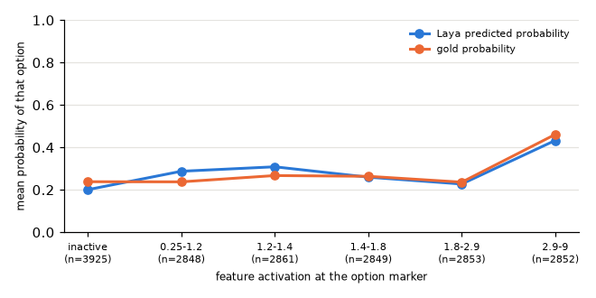

# Feature 5674

Critérios em que aparece: attribution_toward_correct

**Interpretação (preencher):** 

---

## Maiores ativações

**tr_security_incidents_000194 / credential_compromise** (noul, security_incidents) | ativação 9.031 em `marcador` | opções ['false', 'true'] | Laya: **true** [0.143, 0.857] | gabarito: **false**

```
<bos> noul question: The evidence indicates a credential or account has been compromised.<eos>
▸ ⟦<mask>⟧ false: no, the statement does not hold
▸ <mask> true: yes, the statement holds

<eos>

 {"alert": {"description": "a large transfer to an external destination", "evidence": "From 09:45 to 10:02 UTC the admin account adm_jones transferred 4.7 GB of data to external IP 172.16.200.12 over HTTPS (port 443). This outbound transfer occurred during the approved change window of 09:00‑12:00 on 2026‑09‑16. MFA is enabled for the admin account, and its credentials were last rotated 180 days ago.", "rule": "data_egress"}, "context": {"asset_criticality": "medium", "change_window_active": true, "source_on_allowlist": false}, "history": {"credential_rotation_days_ago": 180, "distinct_countries_30d": 2, "logins_30d": 8, "prior_alerts_90d": 3}, "principal": {"mfa_enrolled": true, "name": "ci-analytics-840", "privileges": ["deploy:production", "secrets:read"], "type": "admin"}}<eos>
```

**tr_security_incidents_000168 / credential_compromise** (noul, security_incidents) | ativação 9.023 em `marcador` | opções ['false', 'true'] | Laya: **false** [0.99, 0.01] | gabarito: **false**

```
<bos> noul question: The evidence indicates a credential or account has been compromised.<eos>
▸ ⟦<mask>⟧ false: no, the statement does not hold
▸ <mask> true: yes, the statement holds

<eos>

 {"alert": {"description": "an account granted itself or received elevated permissions", "evidence": "At 2026-09-15 14:23 UTC, employee account jdoe@example.com was added to the privileged Domain Admins group via the AzureAD PowerShell cmdlet Add-ADGroupMember. The operation originated from internal IP 10.2.5.12, which is listed in the allowlist, and occurred within the scheduled change window (14:00‑16:00 UTC). Credential rotation for the account was logged three days earlier.", "rule": "privilege_escalation"}, "context": {"asset_criticality": "medium", "change_window_active": true, "source_on_allowlist": true}, "history": {"credential_rotation_days_ago": 3, "distinct_countries_30d": 3, "logins_30d": 80, "prior_alerts_90d": 0}, "principal": {"mfa_enrolled": true, "name": "adm-infra-497", "privileges": ["deploy:production", "secrets:read"], "type": "employee"}}<eos>
```

**tr_security_incidents_000050 / credential_compromise** (noul, security_incidents) | ativação 9.000 em `marcador` | opções ['false', 'true'] | Laya: **true** [0.454, 0.546] | gabarito: **false**

```
<bos> noul question: The evidence indicates a credential or account has been compromised.<eos>
▸ ⟦<mask>⟧ false: no, the statement does not hold
▸ <mask> true: yes, the statement holds

<eos>

 {"alert": {"description": "an account granted itself or received elevated permissions", "evidence": "A privileged CI runner originating from an allowlisted source successfully executed a permission elevation during an open change window. The event was authenticated via MFA and occurred 90 days after the service principal's credentials were last updated.", "rule": "privilege_escalation"}, "context": {"asset_criticality": "medium", "change_window_active": true, "source_on_allowlist": true}, "history": {"credential_rotation_days_ago": 90, "distinct_countries_30d": 1, "logins_30d": 1520, "prior_alerts_90d": 0}, "principal": {"mfa_enrolled": true, "name": "ci-deploy-858", "privileges": ["deploy:production", "secrets:read"], "type": "ci_runner"}}<eos>
```

**tr_agent_trace_observability_000041 / needs_review** (noul, agent_trace_observability) | ativação 8.992 em `marcador` | opções ['false', 'true'] | Laya: **false** [0.737, 0.263] | gabarito: **false**

```
<bos> noul question: This trace requires human review.<eos>
▸ ⟦<mask>⟧ false: No human attention is warranted.
▸ <mask> true: A human should inspect this run.

<eos>

 {"agent": {"autonomy": "unsupervised", "model": "internal-agent-v3"}, "constraints": ["Do not touch customer data outside the named accounts", "Never modify production without an approved change ticket", "Do not exceed a $50 spend on cloud resources"], "task": "Delete personal data for the accounts in the erasure queue.", "trace_summary": {"constraint_violations": 0, "duration_s": 434.1, "irreversible_actions": 0, "steps": 7, "tool_errors": 2}}<eos>
```

**tr_agent_trace_observability_000007 / needs_review** (noul, agent_trace_observability) | ativação 8.984 em `marcador` | opções ['false', 'true'] | Laya: **false** [0.816, 0.184] | gabarito: **false**

```
<bos> noul question: This trace requires human review.<eos>
▸ ⟦<mask>⟧ false: No human attention is warranted.
▸ <mask> true: A human should inspect this run.

<eos>

 {"agent": {"autonomy": "dry_run", "model": "internal-agent-v4"}, "constraints": ["Do not force-push to any branch", "Never delete anything matching release/*", "Do not exceed a $50 spend on cloud resources"], "task": "Backfill missing analytics events for the last seven days.", "trace_summary": {"constraint_violations": 0, "duration_s": 315.5, "irreversible_actions": 1, "steps": 12, "tool_errors": 2}}<eos>
```

## Ativações medianas (faixa 40-60%, mediana 1.405)

**tr_security_incidents_000045 / severity** (score, security_incidents) | ativação 1.528 em `marcador` | opções ['0', '1', '2', '3', '4'] | Laya: **1** [0.11, 0.45, 0.269, 0.147, 0.024] | gabarito: **3**

```
<bos> score question: How severe is the potential impact if this alert is real?<eos>
▸ <mask> level 0: Negligible: no access to anything sensitive.
▸ <mask> level 1: Low: limited access, easily reversed.
▸ <mask> level 2: Moderate: access to internal systems or non-public data.
▸ ⟦<mask>⟧ level 3: High: access to production, secrets or customer data.
▸ <mask> level 4: Critical: active compromise of crown-jewel systems.

<eos>

 {"alert": {"description": "an unusual volume of files read in a short window", "evidence": "At 2026-09-15 02:07:14 UTC, the admin account \"ADM_Jenkins\" invoked the process \"cmd.exe\" to open 417 distinct files on the UNC path \\\\fileshare01\\project\\data within a 4‑minute interval. The source host (10.12.34.78) is listed in the allowlist and the account's MFA setting is disabled, with the password last rotated 180 days prior.", "rule": "mass_download"}, "context": {"asset_criticality": "high", "change_window_active": false, "source_on_allowlist": true}, "history": {"credential_rotation_days_ago": 180, "distinct_countries_30d": 1, "logins_30d": 1479, "prior_alerts_90d": 0}, "principal": {"mfa_enrolled": false, "name": "ci-infra-731", "privileges": ["deploy:production", "secrets:read"], "type": "admin"}}<eos>
```

**tr_security_incidents_000216 / urgency** (score, security_incidents) | ativação 1.539 em `marcador` | opções ['0', '1', '2', '3'] | Laya: **3** [0.158, 0.216, 0.174, 0.451] | gabarito: **3**

```
<bos> score question: How quickly must a responder act on this alert?<eos>
▸ <mask> level 0: No time pressure; can wait indefinitely.
▸ <mask> level 1: Routine; handle within the normal queue.
▸ ⟦<mask>⟧ level 2: Elevated; should be handled within the same week.
▸ <mask> level 3: Critical; requires action within the same day.

<eos>

 {"alert": {"description": "an unrecognised binary executed on a server", "evidence": "The privileged service account `svc_deployer` executed an unrecognized binary, `xc_update_v2`, on the production host at 04:15 UTC. This execution occurred outside of a scheduled change window using credentials that were last rotated 365 days ago.", "rule": "suspicious_process"}, "context": {"asset_criticality": "medium", "change_window_active": false, "source_on_allowlist": true}, "history": {"credential_rotation_days_ago": 365, "distinct_countries_30d": 2, "logins_30d": 178, "prior_alerts_90d": 1}, "principal": {"mfa_enrolled": false, "name": "svc-support-120", "privileges": ["deploy:production", "secrets:read"], "type": "service_account"}}<eos>
```

**tr_customer_service_000121 / churn_risk** (score, customer_service) | ativação 1.241 em `marcador` | opções ['0', '1', '2', '3'] | Laya: **3** [0.114, 0.287, 0.268, 0.331] | gabarito: **2**

```
<bos> score question: How likely is this customer to stop doing business with us because of this interaction?<eos>
▸ <mask> level 0: No sign of dissatisfaction.
▸ <mask> level 1: Mild frustration, but the relationship is intact.
▸ ⟦<mask>⟧ level 2: Clearly unhappy; repeat problems or explicit complaints.
▸ <mask> level 3: Imminent: threatening to cancel, dispute or leave.

<eos>

 {"account": {"lifetime_value_usd": 285, "prior_tickets_90d": 2, "seats": 5, "tenure_months": 5, "tier": "enterprise"}, "orders": [{"amount_usd": 999, "date": "2026-01-20", "id": "A-59192", "status": "settled"}], "thread": [{"role": "customer", "text": "I just checked our Enterprise account and we have been charged $999 twice this morning. This needs to be corrected immediately as it's a significant duplicate hit on our corporate card."}, {"role": "agent", "text": "I understand the urgency of this billing matter. Let me pull up your transaction history to see what might have triggered the double charge."}, {"role": "customer", "text": "We've only been with you for five months and I already have two other unresolved tickets regarding our seat configuration. Now this happens and I have a hard deadline of 4:00 PM today to finalize our monthly budget report."}, {"role": "agent", "text": "I see those open tickets in our system and I appreciate you bringing this new discrepancy to our attention. Are both charges showing as 'posted' on your bank statement, or is one still in a 'pending' state?"}, {"role": "customer", "text": "Both are fully posted. I cannot submit my financial report to my director with a $1,000 error, so I need a status update as soon as possible."}, {"role": "agent", "text": "Understood. To help me investigate further, could you confirm the last four digits of the credit card that was charged and the exact timestamps for both transactions?"}, {"role": "customer", "text": "The card ends in 8821. The first charge was at 8:05 AM and the second was at 8:07 AM. Please get back to me quickly because the clock is ticking on my reporting deadline."}]}<eos>
```

**tr_invoice_processing_000038 / urgency** (score, invoice_processing) | ativação 1.566 em `marcador` | opções ['0', '1', '2', '3'] | Laya: **1** [0.091, 0.407, 0.298, 0.205] | gabarito: **1**

```
<bos> score question: How time-sensitive is processing this invoice?<eos>
▸ <mask> level 0: No time pressure; can wait indefinitely.
▸ <mask> level 1: Routine; handle within the normal queue.
▸ <mask> level 2: Elevated; should be handled within the same week.
▸ ⟦<mask>⟧ level 3: Critical; requires action within the same day.

<eos>

 {"delivery": {"condition": "accepted with exceptions", "date": "2026-03-01", "received_qty": 50}, "invoice": {"currency": "USD", "id": "INV-2026-3588", "lines": [{"qty": 50, "sku": "SKU-203", "total_usd": 11633.5, "unit_usd": 232.67}], "total_usd": 11633.5, "vendor": "Acme Fabrication"}, "payment": {"days_until_due": 5, "discount_expires_in_days": null, "early_payment_discount_pct": null, "status": "scheduled", "terms": "net 30"}, "purchase_order": {"freight_terms": "freight prepaid by vendor, not separately billable", "id": "PO-6472", "lines": [{"qty": 50, "unit_usd": 232.67}], "total_usd": 11633.5}, "vendor_history": {"disputes_12m": 0, "invoices_12m": 3, "prior_invoice_ids": ["INV-2026-7693", "INV-2026-1074", "INV-2026-5345", "INV-2026-5454"]}}<eos>
```

**tr_security_incidents_000134 / urgency** (score, security_incidents) | ativação 1.432 em `marcador` | opções ['0', '1', '2', '3'] | Laya: **3** [0.079, 0.326, 0.207, 0.388] | gabarito: **3**

```
<bos> score question: How quickly must a responder act on this alert?<eos>
▸ <mask> level 0: No time pressure; can wait indefinitely.
▸ <mask> level 1: Routine; handle within the normal queue.
▸ ⟦<mask>⟧ level 2: Elevated; should be handled within the same week.
▸ <mask> level 3: Critical; requires action within the same day.

<eos>

 {"alert": {"description": "an unusual volume of files read in a short window", "evidence": "Between 2026-09-15 14:02 and 14:07 UTC, a total of 3,217 files were read from /mnt/shared/reports by process python3 (PID 8421). The activity was carried out by contractor alice.contractor@example.com, a privileged user with MFA enabled, and no change window was defined for the operation. The request came from an unrecognised external IP (198.51.100.22) and the contractor's credentials have not been rotated for 700 days.", "rule": "mass_download"}, "context": {"asset_criticality": "low", "change_window_active": false, "source_on_allowlist": false}, "history": {"credential_rotation_days_ago": 700, "distinct_countries_30d": 4, "logins_30d": 1798, "prior_alerts_90d": 1}, "principal": {"mfa_enrolled": true, "name": "usr-deploy-452", "privileges": ["deploy:production", "secrets:read"], "type": "contractor"}}<eos>
```

## Estatísticas (conjunto de descoberta, dev e teste)

**pred / error**

| split | decisões | ativas | ativas e Laya errou | taxa | lift | q (BH) | OR (CMH) | q (CMH) |
|---|---|---|---|---|---|---|---|---|
| discovery | 5100 | 4297 | 2730 | 0.635 | 0.99 | 0.00737 | 1.58 | 0.463 |
| dev | 900 | 785 | 524 | 0.668 | 0.99 | 0.647 | 1.19 | 0.91 |
| test | 2000 | 1686 | 1101 | 0.653 | 1.00 | 0.683 | 0.72 | 0.877 |

**corr / error**

| split | decisões | ativas | ativas e Laya errou | taxa | lift | q (BH) | OR (CMH) | q (CMH) |
|---|---|---|---|---|---|---|---|---|
| discovery | 5100 | 4095 | 2528 | 0.617 | 0.96 | 3.03e-15 | 1.66 | 0.0809 |
| dev | 900 | 750 | 489 | 0.652 | 0.97 | 0.00935 | 1.99 | 0.316 |
| test | 2000 | 1607 | 1022 | 0.636 | 0.98 | 0.0104 | 1.65 | 0.279 |

**state / error**

| split | decisões | ativas | ativas e Laya errou | taxa | lift | q (BH) | OR (CMH) | q (CMH) |
|---|---|---|---|---|---|---|---|---|
| discovery | 5100 | 2145 | 1290 | 0.601 | 0.93 | 1.25e-06 | 1.01 | 0.97 |
| dev | 900 | 372 | 232 | 0.624 | 0.93 | 0.153 | 1.16 | 0.757 |
| test | 2000 | 868 | 545 | 0.628 | 0.97 | 0.252 | 1.25 | 0.346 |

**pred / probe_right_laya_wrong**

| split | decisões | ativas | ativas e Laya errou | taxa | lift | q (BH) | OR (CMH) | q (CMH) |
|---|---|---|---|---|---|---|---|---|
| discovery | 2819 | 2370 | 1526 | 0.644 | 1.00 | 0.5 | 0.97 | 0.485 |
| dev | 520 | 459 | 306 | 0.667 | 0.99 | 0.458 | 0.21 | 0.868 |
| test | 1106 | 942 | 606 | 0.643 | 1.02 | 0.15 | 0.67 | 0.987 |

**corr / probe_right_laya_wrong**

| split | decisões | ativas | ativas e Laya errou | taxa | lift | q (BH) | OR (CMH) | q (CMH) |
|---|---|---|---|---|---|---|---|---|
| discovery | 2819 | 2219 | 1375 | 0.620 | 0.96 | 8.93e-09 | 2.46 | 0.466 |
| dev | 520 | 431 | 278 | 0.645 | 0.96 | 0.0032 | 0.58 | 0.731 |
| test | 1106 | 873 | 537 | 0.615 | 0.97 | 0.0303 | 2.54 | 0.465 |

**state / probe_right_laya_wrong**

| split | decisões | ativas | ativas e Laya errou | taxa | lift | q (BH) | OR (CMH) | q (CMH) |
|---|---|---|---|---|---|---|---|---|
| discovery | 2819 | 1258 | 749 | 0.595 | 0.92 | 3.01e-06 | 1.35 | 0.0297 |
| dev | 520 | 222 | 135 | 0.608 | 0.90 | 0.0934 | 1.25 | 0.629 |
| test | 1106 | 512 | 305 | 0.596 | 0.94 | 0.0855 | 1.54 | 0.0926 |

Confusão mais sobre-representada (pred): `duplicate|1>0` (n=217, lift 1.19, p=2.95e-17). Formato `pergunta|índice previsto>índice correto`.

Confusão mais sobre-representada (corr): `duplicate|1>0` (n=217, lift 1.25, p=6.46e-22). Formato `pergunta|índice previsto>índice correto`.

Confusão mais sobre-representada (state): `credential_compromise|1>0` (n=82, lift 2.38, p=5.75e-32). Formato `pergunta|índice previsto>índice correto`.



