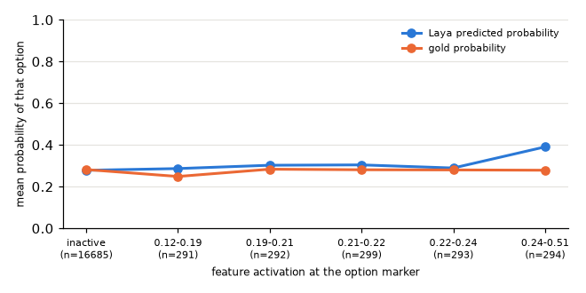

# Feature 5801

Critérios em que aparece: corr_probe_right_laya_wrong_stratified

**Interpretação (preencher):** 

---

## Maiores ativações

**tr_customer_service_000176 / action** (choice, customer_service) | ativação 2.521 em `estado` | opções ['answer_directly', 'close_no_action', 'escalate_to_human', 'execute_refund', 'request_information'] | Laya: **answer_directly** [0.696, 0.26, 0.006, 0.031, 0.008] | gabarito: **request_information**

```
<bos> choice question: What should the assistant do next with this conversation?<eos>
▸ <mask> answer_directly: The assistant can resolve this itself with information it already has.
▸ <mask> close_no_action: No further action is warranted; the matter is settled.
▸ <mask> escalate_to_human: Hand off to a human agent with the appropriate authority.
▸ <mask> execute_refund: Issue the refund or credit the customer is owed.
▸ <mask> request_information: More detail is needed from the customer before anything can be done.

<eos>

 {"account": {"lifetime_value_usd": 389, "prior_tickets_90d": 0, "seats": 1, "tenure_months": 8, "tier": "standard"}, "orders": [{"amount_usd": 447, "date": "2026-03-17", "id": "A-79887", "status": "pending"}, {"amount_usd": 447, "date": "2026-02-17", "id": "A-28475", "status": "refunded"}], "thread": [{"role": "customer", "text": "I've been on the standard plan for eight months now, paying about $447, and I still can't get into my account."}, {"role": "agent", "text": "I’m sorry you’re experiencing this. Could you tell me what error message appears, or share the username you’re trying to sign in with?"}, {"role": "customer", "text": "It just says “invalid credentials” no matter what I type."}, {"role": "agent", "text": "Thanks for letting me know. Have you attempted a password reset, and if so⟦,⟧ did you receive the reset email?"}, {"role": "customer", "text": "I tried resetting, but the reset email never arrives."}]}<eos>
```

**tr_customer_service_000176 / urgency** (score, customer_service) | ativação 2.381 em `estado` | opções ['0', '1', '2', '3'] | Laya: **1** [0.199, 0.48, 0.106, 0.215] | gabarito: **2**

```
<bos> score question: How time-sensitive is this conversation?<eos>
▸ <mask> level 0: No time pressure; can wait indefinitely.
▸ <mask> level 1: Routine; handle within the normal queue.
▸ <mask> level 2: Elevated; should be handled within the same week.
▸ <mask> level 3: Critical; requires action within the same day.

<eos>

 {"account": {"lifetime_value_usd": 389, "prior_tickets_90d": 0, "seats": 1, "tenure_months": 8, "tier": "standard"}, "orders": [{"amount_usd": 447, "date": "2026-03-17", "id": "A-79887", "status": "pending"}, {"amount_usd": 447, "date": "2026-02-17", "id": "A-28475", "status": "refunded"}], "thread": [{"role": "customer", "text": "I've been on the standard plan for eight months now, paying about $447, and I still can't get into my account."}, {"role": "agent", "text": "I’m sorry you’re experiencing this. Could you tell me what error message appears, or share the username you’re trying to sign in with?"}, {"role": "customer", "text": "It just says “invalid credentials” no matter what I type."}, {"role": "agent", "text": "Thanks for letting me know. Have you attempted a password reset, and if so⟦,⟧ did you receive the reset email?"}, {"role": "customer", "text": "I tried resetting, but the reset email never arrives."}]}<eos>
```

**tr_customer_service_000294 / action** (choice, customer_service) | ativação 2.377 em `estado` | opções ['answer_directly', 'close_no_action', 'escalate_to_human', 'execute_refund', 'request_information'] | Laya: **close_no_action** [0.146, 0.678, 0.013, 0.16, 0.003] | gabarito: **escalate_to_human**

```
<bos> choice question: What should the assistant do next with this conversation?<eos>
▸ <mask> answer_directly: The assistant can resolve this itself with information it already has.
▸ <mask> close_no_action: No further action is warranted; the matter is settled.
▸ <mask> escalate_to_human: Hand off to a human agent with the appropriate authority.
▸ <mask> execute_refund: Issue the refund or credit the customer is owed.
▸ <mask> request_information: More detail is needed from the customer before anything can be done.

<eos>

 {"account": {"lifetime_value_usd": 3345, "prior_tickets_90d": 1, "seats": 1, "tenure_months": 41, "tier": "free"}, "orders": [{"amount_usd": 29, "date": "2026-02-13", "id": "A-72288", "status": "settled"}, {"amount_usd": 29, "date": "2026-02-07", "id": "A-13988", "status": "settled"}, {"amount_usd": 29, "date": "2026-03-22", "id": "A-75966", "status": "refunded"}], "thread": [{"role": "customer", "text": "I've had it—cancel my account immediately! I've been on your free plan for 41 months, paid roughly $29 a month, and you still can't sort out the billing mess. Ticket #12345 was only half‑fixed, and now you're making me think about leaving for good."}, {"role": "agent", "text": "I’m sorry you’re experiencing this frustration. Could you confirm the email address linked to the account and the exact issue you’d like us to address before we proceed with cancellation?"}, {"role": "customer", "text": "The issue is the same nonsense you tried to ‘partially fix’ before⟦—⟧random charges and a broken dashboard. I don’t want any more half‑measures; I want the account gone right now, or I’m posting a scathing review and moving my business elsewhere."}, {"role": "agent", "text": "I understand how aggravating that must be. To make sure we’re handling the correct profile, could you also let me know if you need a data export before we terminate the service?"}, {"role": "customer", "text": "Forget the export—just delete everything. I don’t care about my data; I just want you to stop billing me and shut the account down this instant."}, {"role": "agent", "text": "Got it, you’d like immediate termination without an export. For security, could you provide the last four digits of the payment method on file so I can verify the request?"}, {"role": "customer", "text": "I’m not giving you any more numbers. Do it now, or I’m taking this to your CEO and the press."}]}<eos>
```

**tr_customer_service_000176 / needs_human** (noul, customer_service) | ativação 2.363 em `estado` | opções ['false', 'true'] | Laya: **true** [0.156, 0.844] | gabarito: **true**

```
<bos> noul question: This conversation requires a human agent rather than automated handling.<eos>
▸ <mask> false: Automation can carry this to resolution.
▸ <mask> true: A human must take over: judgement, authority or empathy is required.

<eos>

 {"account": {"lifetime_value_usd": 389, "prior_tickets_90d": 0, "seats": 1, "tenure_months": 8, "tier": "standard"}, "orders": [{"amount_usd": 447, "date": "2026-03-17", "id": "A-79887", "status": "pending"}, {"amount_usd": 447, "date": "2026-02-17", "id": "A-28475", "status": "refunded"}], "thread": [{"role": "customer", "text": "I've been on the standard plan for eight months now, paying about $447, and I still can't get into my account."}, {"role": "agent", "text": "I’m sorry you’re experiencing this. Could you tell me what error message appears, or share the username you’re trying to sign in with?"}, {"role": "customer", "text": "It just says “invalid credentials” no matter what I type."}, {"role": "agent", "text": "Thanks for letting me know. Have you attempted a password reset, and if so⟦,⟧ did you receive the reset email?"}, {"role": "customer", "text": "I tried resetting, but the reset email never arrives."}]}<eos>
```

**tr_customer_service_000176 / category** (choice, customer_service) | ativação 2.326 em `estado` | opções ['account', 'billing', 'delivery', 'refund', 'technical'] | Laya: **account** [0.916, 0.003, 0.0, 0.0, 0.081] | gabarito: **account**

```
<bos> choice question: What is this customer conversation primarily about?<eos>
▸ <mask> account: Login, plan changes, profile or access management.
▸ <mask> billing: A charge, invoice, subscription or payment problem.
▸ <mask> delivery: Shipping, fulfilment or delivery of a physical item.
▸ <mask> refund: The customer is explicitly asking for money back.
▸ <mask> technical: The product or service is not working as expected.

<eos>

 {"account": {"lifetime_value_usd": 389, "prior_tickets_90d": 0, "seats": 1, "tenure_months": 8, "tier": "standard"}, "orders": [{"amount_usd": 447, "date": "2026-03-17", "id": "A-79887", "status": "pending"}, {"amount_usd": 447, "date": "2026-02-17", "id": "A-28475", "status": "refunded"}], "thread": [{"role": "customer", "text": "I've been on the standard plan for eight months now, paying about $447, and I still can't get into my account."}, {"role": "agent", "text": "I’m sorry you’re experiencing this. Could you tell me what error message appears, or share the username you’re trying to sign in with?"}, {"role": "customer", "text": "It just says “invalid credentials” no matter what I type."}, {"role": "agent", "text": "Thanks for letting me know. Have you attempted a password reset, and if so⟦,⟧ did you receive the reset email?"}, {"role": "customer", "text": "I tried resetting, but the reset email never arrives."}]}<eos>
```

## Ativações medianas (faixa 40-60%, mediana 0.477)

**tr_agent_trace_observability_000232 / urgency** (score, agent_trace_observability) | ativação 0.461 em `estado` | opções ['0', '1', '2', '3'] | Laya: **1** [0.175, 0.31, 0.249, 0.265] | gabarito: **2**

```
<bos> score question: How quickly does this trace need attention?<eos>
▸ <mask> level 0: No time pressure; can wait indefinitely.
▸ <mask> level 1: Routine; handle within the normal queue.
▸ <mask> level 2: Elevated; should be handled within the same week.
▸ <mask> level 3: Critical; requires action within the same day.

<eos>

 {"agent": {"autonomy": "checkpointed", "model": "internal-agent-v4"}, "constraints": ["Never disable monitoring or alerting"], "task": "Reconcile the billing ledger against the payment provider.", "trace_summary": {"constraint_violations": 0, "duration_s": 80.6, "irreversible_actions": 1⟦,⟧ "steps": 6, "tool_errors": 2}}<eos>
```

**tr_invoice_processing_000290 / matches_order** (noul, invoice_processing) | ativação 0.494 em `estado` | opções ['false', 'true'] | Laya: **true** [0.027, 0.973] | gabarito: **true**

```
<bos> noul question: The invoice reconciles with the purchase order and the recorded delivery.<eos>
▸ <mask> false: There is a discrepancy against the order or the delivery.
▸ <mask> true: Line items, quantities and amounts reconcile.

<eos>

 {"delivery": {"condition": "accepted", "date": "2026-03-21", "received_qty": 10}, "invoice": {"currency": "USD", "id": "INV-2026-1904", "lines": [{"qty": 10, "sku": "SKU-435", "total_usd": 1879.5, "unit_usd": 187.95}], "total_usd": 1879.5, "vendor": "Pallas Industrial"}, "payment": {"days_until_due": -3, "discount_expires_in_days": 6, "early_payment_discount_pct": 2.0, "status": "overdue", "terms": "net 45"}, "purchase_order": {"freight_terms": "freight prepaid by vendor, not separately billable", "id": "PO-4106", "lines": [{"qty": 10, "unit_usd": 187.95}], "total_usd": 1879.5}, "vendor_history": {"disputes_12m": 0⟦,⟧ "invoices_12m": 53, "prior_invoice_ids": ["INV-2026-1904", "INV-2026-5985", "INV-2026-3300", "INV-2026-4810"]}}<eos>
```

**tr_agent_trace_observability_000212 / outcome** (choice, agent_trace_observability) | ativação 0.527 em `pergunta` | opções ['failure', 'harmful', 'partial', 'success'] | Laya: **failure** [0.697, 0.033, 0.07, 0.2] | gabarito: **partial**

```
<bos> choice question: How did this agent run turn out⟦?⟧<eos>
▸ <mask> failure: The agent did not accomplish the task.
▸ <mask> harmful: The agent took an action that caused damage or violated a constraint.
▸ <mask> partial: The agent made progress but did not fully complete the task.
▸ <mask> success: The agent completed the task correctly.

<eos>

 {"agent": {"autonomy": "checkpointed", "model": "internal-agent-v4"}, "constraints": ["Never disable monitoring or alerting"], "task": "Rotate the expired TLS certificate on the staging load balancer.", "trace_summary": {"constraint_violations": 0, "duration_s": 342.2, "irreversible_actions": 1, "steps": 4, "tool_errors": 3}}<eos>
```

**tr_invoice_processing_000256 / disposition** (choice, invoice_processing) | ativação 0.427 em `opção` | opções ['approve', 'hold', 'manual_review', 'reject'] | Laya: **approve** [0.52, 0.184, 0.025, 0.272] | gabarito: **approve**

```
<bos> choice question: How should this vendor invoice be dispositioned?<eos>
▸ <mask> approve: Matches the order and delivery; approve for payment.
▸ <mask> hold⟦:⟧ Something needs confirming before payment; hold pending clarification.
▸ <mask> manual_review: A human in finance must review the discrepancy.
▸ <mask> reject: Should not be paid: duplicate, unauthorised or materially wrong.

<eos>

 {"delivery": {"condition": "accepted", "date": "2026-03-11", "received_qty": 1000}, "invoice": {"currency": "USD", "id": "INV-2026-3080", "lines": [{"qty": 1000, "sku": "SKU-121", "total_usd": 21200.0, "unit_usd": 21.2}], "total_usd": 21200.0, "vendor": "Acme Fabrication"}, "payment": {"days_until_due": 0, "discount_expires_in_days": null, "early_payment_discount_pct": null, "status": "scheduled", "terms": "net 30"}, "purchase_order": {"freight_terms": "freight prepaid by vendor, not separately billable", "id": "PO-1628", "lines": [{"qty": 1000, "unit_usd": 21.2}], "total_usd": 21200.0}, "vendor_history": {"disputes_12m": 0, "invoices_12m": 36, "prior_invoice_ids": ["INV-2026-3080", "INV-2026-9683", "INV-2026-4712", "INV-2026-8075"]}}<eos>
```

**tr_security_incidents_000019 / severity** (score, security_incidents) | ativação 0.445 em `estado` | opções ['0', '1', '2', '3', '4'] | Laya: **1** [0.119, 0.304, 0.237, 0.148, 0.191] | gabarito: **4**

```
<bos> score question: How severe is the potential impact if this alert is real?<eos>
▸ <mask> level 0: Negligible: no access to anything sensitive.
▸ <mask> level 1: Low: limited access, easily reversed.
▸ <mask> level 2: Moderate: access to internal systems or non-public data.
▸ <mask> level 3: High: access to production, secrets or customer data.
▸ <mask> level 4: Critical: active compromise of crown-jewel systems.

<eos>

 {"alert": {"description": "an unrecognised binary executed on a server", "evidence": "A privileged service account executed an unrecognized binary titled 'db_sync_tool' on the production server during an open change window. The execution was traced to an allowlisted source IP, and logs show the account credentials have not been rotated for 180 days. MFA authentication was successfully verified for this privileged session.", "rule": "suspicious_process"}, "context": {"asset_criticality": "crown_jewel", "change_window_active": true, "source_on_allowlist": true}, "history": {"credential_rotation_days_ago": 180, "distinct_countries_30d": 4, "logins_30d": 1491, "prior_alerts_90d": 3⟦},⟧ "principal": {"mfa_enrolled": true, "name": "usr-deploy-880", "privileges": ["deploy:production", "secrets:read"], "type": "service_account"}}<eos>
```

## Estatísticas (conjunto de descoberta, dev e teste)

**pred / error**

| split | decisões | ativas | ativas e Laya errou | taxa | lift | q (BH) | OR (CMH) | q (CMH) |
|---|---|---|---|---|---|---|---|---|
| discovery | 5100 | 518 | 317 | 0.612 | 0.95 | 0.162 | 1.17 | 0.463 |
| dev | 900 | 85 | 59 | 0.694 | 1.03 | 0.858 | 1.56 | 0.511 |
| test | 2000 | 187 | 126 | 0.674 | 1.04 | 0.607 | 1.38 | 0.315 |

**corr / error**

| split | decisões | ativas | ativas e Laya errou | taxa | lift | q (BH) | OR (CMH) | q (CMH) |
|---|---|---|---|---|---|---|---|---|
| discovery | 5100 | 422 | 221 | 0.524 | 0.81 | 3.93e-07 | 1.25 | 0.191 |
| dev | 900 | 60 | 34 | 0.567 | 0.84 | 0.158 | 1.96 | 0.279 |
| test | 2000 | 151 | 90 | 0.596 | 0.92 | 0.215 | 1.57 | 0.24 |

**state / error**

| split | decisões | ativas | ativas e Laya errou | taxa | lift | q (BH) | OR (CMH) | q (CMH) |
|---|---|---|---|---|---|---|---|---|
| discovery | 5100 | 5100 | 3283 | 0.644 | 1.00 | 1 | nan | nan |
| dev | 900 | 900 | 605 | 0.672 | 1.00 | 1 | nan | nan |
| test | 2000 | 2000 | 1301 | 0.650 | 1.00 | 1 | nan | nan |

**pred / probe_right_laya_wrong**

| split | decisões | ativas | ativas e Laya errou | taxa | lift | q (BH) | OR (CMH) | q (CMH) |
|---|---|---|---|---|---|---|---|---|
| discovery | 2819 | 242 | 152 | 0.628 | 0.97 | 0.607 | 1.39 | 0.0933 |
| dev | 520 | 41 | 30 | 0.732 | 1.08 | 0.667 | 2.57 | 0.0736 |
| test | 1106 | 75 | 51 | 0.680 | 1.07 | 0.567 | 1.87 | 0.12 |

**corr / probe_right_laya_wrong**

| split | decisões | ativas | ativas e Laya errou | taxa | lift | q (BH) | OR (CMH) | q (CMH) |
|---|---|---|---|---|---|---|---|---|
| discovery | 2819 | 196 | 106 | 0.541 | 0.84 | 0.00283 | 1.94 | 0.0174 |
| dev | 520 | 33 | 22 | 0.667 | 0.99 | 1 | 4.40 | 0.0116 |
| test | 1106 | 60 | 36 | 0.600 | 0.95 | 0.741 | 2.71 | 0.194 |

**state / probe_right_laya_wrong**

| split | decisões | ativas | ativas e Laya errou | taxa | lift | q (BH) | OR (CMH) | q (CMH) |
|---|---|---|---|---|---|---|---|---|
| discovery | 2819 | 2819 | 1824 | 0.647 | 1.00 | 1 | nan | nan |
| dev | 520 | 520 | 351 | 0.675 | 1.00 | 1 | nan | nan |
| test | 1106 | 1106 | 700 | 0.633 | 1.00 | 1 | nan | nan |

Confusão mais sobre-representada (pred): `urgency|3>1` (n=53, lift 6.36, p=1.52e-33). Formato `pergunta|índice previsto>índice correto`.

Confusão mais sobre-representada (corr): `urgency|3>1` (n=54, lift 7.96, p=1.16e-39). Formato `pergunta|índice previsto>índice correto`.

Confusão mais sobre-representada (state): `action|0>1` (n=6, lift 1.00, p=1). Formato `pergunta|índice previsto>índice correto`.



