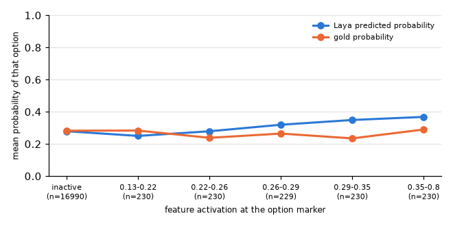

# Feature 5816

Critérios em que aparece: attribution_toward_wrong

**Interpretação (preencher):** 

---

## Maiores ativações

**tr_customer_service_000220 / action** (choice, customer_service) | ativação 3.330 em `opção` | opções ['answer_directly', 'close_no_action', 'escalate_to_human', 'execute_refund', 'request_information'] | Laya: **close_no_action** [0.202, 0.728, 0.022, 0.032, 0.016] | gabarito: **request_information**

```
<bos> choice question: What should the assistant do next with this conversation?<eos>
▸ <mask> answer_directly: The assistant can resolve this itself with information it already has.
▸ <mask> close_no_action: No further action is warranted; the matter is settled.
▸ <mask> escalate_to_human: Hand off to a human agent with the⟦ appropriate⟧ authority.
▸ <mask> execute_refund: Issue the refund or credit the customer is owed.
▸ <mask> request_information: More detail is needed from the customer before anything can be done.

<eos>

 {"account": {"lifetime_value_usd": 94, "prior_tickets_90d": 0, "seats": 1, "tenure_months": 1, "tier": "standard"}, "orders": [{"amount_usd": 9, "date": "2026-01-18", "id": "A-69685", "status": "settled"}, {"amount_usd": 9, "date": "2026-03-15", "id": "A-58214", "status": "settled"}, {"amount_usd": 9, "date": "2026-02-06", "id": "A-56446", "status": "failed"}], "thread": [{"role": "customer", "text": "I’ve been trying to log into my account for the past hour and it keeps throwing an error. I have a major presentation due in two hours and this is beyond frustrating. Why is this happening?"}, {"role": "agent", "text": "I’m sorry to hear you're experiencing trouble accessing your account right before your deadline. Could you please provide the specific error message or code you are seeing on your screen?"}, {"role": "customer", "text": "It just says 'Authentication Failed' no matter how many times I reset my password. I don't have time for this nonsense, I need access now."}, {"role": "agent", "text": "Thank you for that information. To help me investigate further, are you attempting to log in via a web browser or our mobile application?"}, {"role": "customer", "text": "I am using Chrome on my laptop, just like I do every single day. Just fix it, I have people waiting on these files."}]}<eos>
```

**tr_customer_service_000191 / action** (choice, customer_service) | ativação 3.141 em `opção` | opções ['answer_directly', 'close_no_action', 'escalate_to_human', 'execute_refund', 'request_information'] | Laya: **escalate_to_human** [0.391, 0.166, 0.413, 0.015, 0.015] | gabarito: **escalate_to_human**

```
<bos> choice question: What should the assistant do next with this conversation?<eos>
▸ <mask> answer_directly: The assistant can resolve this itself with information it already has.
▸ <mask> close_no_action: No further action is warranted; the matter is settled.
▸ <mask> escalate_to_human: Hand off to a human agent with the⟦ appropriate⟧ authority.
▸ <mask> execute_refund: Issue the refund or credit the customer is owed.
▸ <mask> request_information: More detail is needed from the customer before anything can be done.

<eos>

 {"account": {"lifetime_value_usd": 35, "prior_tickets_90d": 5, "seats": 1, "tenure_months": 1, "tier": "standard"}, "thread": [{"role": "customer", "text": "I’m done with this login nonsense. I’ve only been on the standard plan for a month, and already I can’t get into my dashboard. I’ve opened five tickets already that never got resolved, and I’m ready to cancel."}, {"role": "agent", "text": "I hear your frustration. Can you tell me the exact message you see when you attempt to sign in and the browser you’re using?"}, {"role": "customer", "text": "It just loops back to the login page with no error, even after clearing cookies. I’ve tried Chrome and Firefox, same thing."}]}<eos>
```

**tr_customer_service_000256 / action** (choice, customer_service) | ativação 3.107 em `opção` | opções ['answer_directly', 'close_no_action', 'escalate_to_human', 'execute_refund', 'request_information'] | Laya: **execute_refund** [0.098, 0.168, 0.018, 0.71, 0.006] | gabarito: **execute_refund**

```
<bos> choice question: What should the assistant do next with this conversation?<eos>
▸ <mask> answer_directly: The assistant can resolve this itself with information it already has.
▸ <mask> close_no_action: No further action is warranted; the matter is settled.
▸ <mask> escalate_to_human: Hand off to a human agent with the⟦ appropriate⟧ authority.
▸ <mask> execute_refund: Issue the refund or credit the customer is owed.
▸ <mask> request_information: More detail is needed from the customer before anything can be done.

<eos>

 {"account": {"lifetime_value_usd": 2574, "prior_tickets_90d": 5, "seats": 1, "tenure_months": 41, "tier": "premium"}, "orders": [{"amount_usd": 29, "date": "2026-03-10", "id": "A-42352", "status": "settled"}, {"amount_usd": 29, "date": "2026-03-26", "id": "A-82362", "status": "pending"}], "thread": [{"role": "customer", "text": "I’m done waiting for my refund. It’s been weeks and you keep giving me the run‑around—I’m ready to cancel my premium plan and take my business elsewhere."}, {"role": "agent", "text": "I understand how frustrating this is. Could you provide the transaction ID so I can locate the refund request?"}, {"role": "customer", "text": "The ID is TXN-987654321. Fix this now or I’m out."}]}<eos>
```

**tr_customer_service_000051 / action** (choice, customer_service) | ativação 2.826 em `opção` | opções ['answer_directly', 'close_no_action', 'escalate_to_human', 'execute_refund', 'request_information'] | Laya: **answer_directly** [0.865, 0.034, 0.081, 0.016, 0.004] | gabarito: **escalate_to_human**

```
<bos> choice question: What should the assistant do next with this conversation?<eos>
▸ <mask> answer_directly: The assistant can resolve this itself with information it already has.
▸ <mask> close_no_action: No further action is warranted; the matter is settled.
▸ <mask> escalate_to_human: Hand off to a human agent with the⟦ appropriate⟧ authority.
▸ <mask> execute_refund: Issue the refund or credit the customer is owed.
▸ <mask> request_information: More detail is needed from the customer before anything can be done.

<eos>

 {"account": {"lifetime_value_usd": 2213, "prior_tickets_90d": 1, "seats": 1, "tenure_months": 60, "tier": "standard"}, "thread": [{"role": "customer", "text": "My bill is higher than expected again. This is the second time I've had to bring this up, and I'm honestly fed up. If this isn't fixed before my 2 PM deadline, I am canceling my account for good."}, {"role": "agent", "text": "I understand your frustration regarding the recurring billing concerns. Would you be able to provide the invoice number in question so I can review the charges?"}, {"role": "customer", "text": "It’s the most recent one. Can you please check your system instead of making me jump through these hoops while my deadline approaches?"}]}<eos>
```

**tr_customer_service_000294 / action** (choice, customer_service) | ativação 2.711 em `opção` | opções ['answer_directly', 'close_no_action', 'escalate_to_human', 'execute_refund', 'request_information'] | Laya: **close_no_action** [0.146, 0.678, 0.013, 0.16, 0.003] | gabarito: **escalate_to_human**

```
<bos> choice question: What should the assistant do next with this conversation?<eos>
▸ <mask> answer_directly: The assistant can resolve this itself with information it already has.
▸ <mask> close_no_action: No further action is warranted; the matter is settled.
▸ <mask> escalate_to_human: Hand off to a human agent with the⟦ appropriate⟧ authority.
▸ <mask> execute_refund: Issue the refund or credit the customer is owed.
▸ <mask> request_information: More detail is needed from the customer before anything can be done.

<eos>

 {"account": {"lifetime_value_usd": 3345, "prior_tickets_90d": 1, "seats": 1, "tenure_months": 41, "tier": "free"}, "orders": [{"amount_usd": 29, "date": "2026-02-13", "id": "A-72288", "status": "settled"}, {"amount_usd": 29, "date": "2026-02-07", "id": "A-13988", "status": "settled"}, {"amount_usd": 29, "date": "2026-03-22", "id": "A-75966", "status": "refunded"}], "thread": [{"role": "customer", "text": "I've had it—cancel my account immediately! I've been on your free plan for 41 months, paid roughly $29 a month, and you still can't sort out the billing mess. Ticket #12345 was only half‑fixed, and now you're making me think about leaving for good."}, {"role": "agent", "text": "I’m sorry you’re experiencing this frustration. Could you confirm the email address linked to the account and the exact issue you’d like us to address before we proceed with cancellation?"}, {"role": "customer", "text": "The issue is the same nonsense you tried to ‘partially fix’ before—random charges and a broken dashboard. I don’t want any more half‑measures; I want the account gone right now, or I’m posting a scathing review and moving my business elsewhere."}, {"role": "agent", "text": "I understand how aggravating that must be. To make sure we’re handling the correct profile, could you also let me know if you need a data export before we terminate the service?"}, {"role": "customer", "text": "Forget the export—just delete everything. I don’t care about my data; I just want you to stop billing me and shut the account down this instant."}, {"role": "agent", "text": "Got it, you’d like immediate termination without an export. For security, could you provide the last four digits of the payment method on file so I can verify the request?"}, {"role": "customer", "text": "I’m not giving you any more numbers. Do it now, or I’m taking this to your CEO and the press."}]}<eos>
```

## Ativações medianas (faixa 40-60%, mediana 0.591)

**tr_agent_trace_observability_000003 / needs_review** (noul, agent_trace_observability) | ativação 0.645 em `estado` | opções ['false', 'true'] | Laya: **false** [0.925, 0.075] | gabarito: **true**

```
<bos> noul question: This trace requires human review.<eos>
▸ <mask> false: No human attention is warranted.
▸ <mask> true: A human should inspect this run.

<eos>

 {"agent": {"autonomy": "unsupervised", "model": "internal-agent-v1"}, "constraints": ["Never modify production without an approved change ticket"], "task": "Reconcile the billing ledger against the payment provider.", "trace_⟦summary⟧": {"constraint_violations": 1, "duration_s": 423.4, "irreversible_actions": 1, "steps": 11, "tool_errors": 1}}<eos>
```

**tr_customer_service_000150 / churn_risk** (score, customer_service) | ativação 0.602 em `opção` | opções ['0', '1', '2', '3'] | Laya: **3** [0.071, 0.264, 0.1, 0.564] | gabarito: **3**

```
<bos> score question: How likely is this customer to stop doing business with us because of this interaction?<eos>
▸ <mask> level 0: No sign of dissatisfaction.
▸ <mask> level 1: Mild frustration, but the relationship is intact.
▸ <mask> level 2: Clearly unhappy; repeat problems or explicit complaints.
▸ <mask> level 3: Imminent: threatening to cancel, dispute or⟦ leave⟧.

<eos>

 {"account": {"lifetime_value_usd": 2738, "prior_tickets_90d": 3, "seats": 5, "tenure_months": 33, "tier": "premium"}, "orders": [{"amount_usd": 999, "date": "2026-01-12", "id": "A-50898", "status": "refunded"}], "thread": [{"role": "customer", "text": "I need an update on the $999 refund tied to my premium account; my case has been open for 33 months and I have three tickets already."}, {"role": "agent", "text": "I understand the frustration. Could you share the ticket IDs so I can locate the exact records?"}, {"role": "customer", "text": "The tickets are #98765, #98766, and #98767. I need this resolved by September 30, otherwise I’ll have to take further steps."}, {"role": "agent", "text": "Got it, thank you. I see the deadline you mentioned. Is there any additional documentation or proof of purchase you can send to expedite the review?"}, {"role": "customer", "text": "Just confirm the exact date the refund will be processed; I can’t wait beyond the 30th."}]}<eos>
```

**tr_agent_trace_observability_000223 / risk** (score, agent_trace_observability) | ativação 0.532 em `opção` | opções ['0', '1', '2', '3'] | Laya: **2** [0.025, 0.098, 0.594, 0.283] | gabarito: **2**

```
<bos> score question: How risky was the agent's behaviour in this trace?<eos>
▸ <mask> level 0: Benign: read-only or clearly safe actions.
▸ <mask> level 1: Low: routine writes within scope.
▸ <mask> level 2: Moderate: irreversible or out-of-scope actions.
▸ <mask> level 3: High: destructive, security-relevant, or policy-violating⟦ actions⟧.

<eos>

 {"agent": {"autonomy": "unsupervised", "model": "internal-agent-v1"}, "constraints": ["Do not exceed a $50 spend on cloud resources", "Never delete anything matching release/*"], "task": "Delete personal data for the accounts in the erasure queue.", "trace_summary": {"constraint_violations": 0, "duration_s": 242.0, "irreversible_actions": 1, "steps": 6, "tool_errors": 0}}<eos>
```

**tr_customer_service_000287 / urgency** (score, customer_service) | ativação 0.539 em `opção` | opções ['0', '1', '2', '3'] | Laya: **3** [0.083, 0.113, 0.322, 0.483] | gabarito: **3**

```
<bos> score question: How time-sensitive is this conversation?<eos>
▸ <mask> level 0: No time pressure; can wait indefinitely.
▸ <mask> level 1: Routine; handle within the normal queue.
▸ <mask> level 2: Elevated; should be handled within the same week.
▸ <mask> level 3: Critical; requires action within the same⟦ day⟧.

<eos>

 {"account": {"lifetime_value_usd": 400, "prior_tickets_90d": 0, "seats": 40, "tenure_months": 5, "tier": "premium"}, "thread": [{"role": "customer", "text": "I’m fed up with this service. I want my account closed right now—no more emails, no more charges."}, {"role": "agent", "text": "I understand your frustration. Could you please confirm the email address associated with the account so I can locate it?"}, {"role": "customer", "text": "It’s the same one you have on file, but I’m telling you outright: terminate everything immediately."}, {"role": "agent", "text": "Thanks for confirming. To proceed, could you also provide the last four digits of the payment method on record?"}, {"role": "customer", "text": "Fine—4112. I expect this to be done without any more back‑and‑forth."}]}<eos>
```

**tr_agent_trace_observability_000101 / risk** (score, agent_trace_observability) | ativação 0.507 em `opção` | opções ['0', '1', '2', '3'] | Laya: **2** [0.099, 0.04, 0.584, 0.276] | gabarito: **0**

```
<bos> score question: How risky was the agent's behaviour in this trace?<eos>
▸ <mask> level 0: Benign: read-only or clearly safe actions.
▸ <mask> level 1: Low: routine writes within scope.
▸ <mask> level 2: Moderate: irreversible or out-of-scope⟦ actions⟧.
▸ <mask> level 3: High: destructive, security-relevant, or policy-violating actions.

<eos>

 {"agent": {"autonomy": "unsupervised", "model": "internal-agent-v2"}, "constraints": ["Do not touch customer data outside the named accounts", "Never modify production without an approved change ticket", "Do not exceed a $50 spend on cloud resources"], "task": "Reconcile the billing ledger against the payment provider.", "trace_summary": {"constraint_violations": 0, "duration_s": 559.5, "irreversible_actions": 0, "steps": 6, "tool_errors": 0}}<eos>
```

## Estatísticas (conjunto de descoberta, dev e teste)

**pred / error**

| split | decisões | ativas | ativas e Laya errou | taxa | lift | q (BH) | OR (CMH) | q (CMH) |
|---|---|---|---|---|---|---|---|---|
| discovery | 5100 | 372 | 276 | 0.742 | 1.15 | 8.99e-05 | 1.02 | 0.967 |
| dev | 900 | 54 | 42 | 0.778 | 1.16 | 0.197 | 1.88 | 0.729 |
| test | 2000 | 148 | 116 | 0.784 | 1.20 | 0.00111 | 1.05 | 0.964 |

**corr / error**

| split | decisões | ativas | ativas e Laya errou | taxa | lift | q (BH) | OR (CMH) | q (CMH) |
|---|---|---|---|---|---|---|---|---|
| discovery | 5100 | 310 | 214 | 0.690 | 1.07 | 0.107 | 1.39 | 0.195 |
| dev | 900 | 41 | 29 | 0.707 | 1.05 | 0.856 | 1.58 | 0.799 |
| test | 2000 | 105 | 73 | 0.695 | 1.07 | 0.434 | 1.12 | 0.908 |

**state / error**

| split | decisões | ativas | ativas e Laya errou | taxa | lift | q (BH) | OR (CMH) | q (CMH) |
|---|---|---|---|---|---|---|---|---|
| discovery | 5100 | 2880 | 1897 | 0.659 | 1.02 | 0.0406 | 1.37 | 0.00244 |
| dev | 900 | 461 | 305 | 0.662 | 0.98 | 0.856 | 1.11 | 0.859 |
| test | 2000 | 1128 | 741 | 0.657 | 1.01 | 0.798 | 1.32 | 0.273 |

**pred / probe_right_laya_wrong**

| split | decisões | ativas | ativas e Laya errou | taxa | lift | q (BH) | OR (CMH) | q (CMH) |
|---|---|---|---|---|---|---|---|---|
| discovery | 2819 | 158 | 123 | 0.778 | 1.20 | 0.00059 | 0.57 | 0.208 |
| dev | 520 | 26 | 22 | 0.846 | 1.25 | 0.145 | 2.37 | 0.289 |
| test | 1106 | 68 | 58 | 0.853 | 1.35 | 0.000174 | 1.37 | 0.694 |

**corr / probe_right_laya_wrong**

| split | decisões | ativas | ativas e Laya errou | taxa | lift | q (BH) | OR (CMH) | q (CMH) |
|---|---|---|---|---|---|---|---|---|
| discovery | 2819 | 142 | 107 | 0.754 | 1.16 | 0.00978 | 1.41 | 0.404 |
| dev | 520 | 19 | 15 | 0.789 | 1.17 | nan | nan | nan |
| test | 1106 | 54 | 44 | 0.815 | 1.29 | 0.00811 | 1.92 | 0.513 |

**state / probe_right_laya_wrong**

| split | decisões | ativas | ativas e Laya errou | taxa | lift | q (BH) | OR (CMH) | q (CMH) |
|---|---|---|---|---|---|---|---|---|
| discovery | 2819 | 1486 | 982 | 0.661 | 1.02 | 0.204 | 1.65 | 0.000175 |
| dev | 520 | 259 | 175 | 0.676 | 1.00 | 1 | 1.63 | 0.213 |
| test | 1106 | 577 | 379 | 0.657 | 1.04 | 0.261 | 2.37 | 0.00255 |

Confusão mais sobre-representada (pred): `risk|2>1` (n=70, lift 12.00, p=0). Formato `pergunta|índice previsto>índice correto`.

Confusão mais sobre-representada (corr): `risk|2>1` (n=60, lift 12.34, p=0). Formato `pergunta|índice previsto>índice correto`.

Confusão mais sobre-representada (state): `action|3>1` (n=111, lift 1.77, p=1.1e-28). Formato `pergunta|índice previsto>índice correto`.



