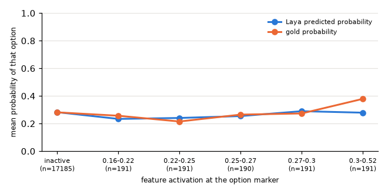

# Feature 5857

Critérios em que aparece: pred_probe_right_laya_wrong_stratified

**Interpretação (preencher):** 

---

## Maiores ativações

**tr_invoice_processing_000286 / discrepancy_severity** (score, invoice_processing) | ativação 2.258 em `SEP-fim` | opções ['0', '1', '2', '3'] | Laya: **2** [0.108, 0.334, 0.517, 0.041] | gabarito: **2**

```
<bos> score question: How material is any discrepancy between the invoice, the order and the delivery?<eos>
▸ <mask> level 0: None: everything reconciles.
▸ <mask> level 1: Trivial: rounding or a cosmetic difference.
▸ <mask> level 2: Moderate: a real difference worth confirming.
▸ <mask> level 3: Material: a large or unexplained difference.

<eos>

 {"delivery": {"condition": "accepted", "date": "2026-03-01", "received_qty": 250}, "invoice": {"currency": "USD", "id": "INV-2026-8786", "lines": [{"qty": 250, "sku": "SKU-448", "total_usd": 7165.0, "unit_usd": 28.66}, {"qty": 1, "sku": "FREIGHT", "total_usd": 401.46, "unit_usd": 401.46}], "total_usd": 7566.46, "vendor": "Northwind Components"}, "payment": {"days_until_due": 2, "discount_expires_in_days": 1, "early_payment_discount_pct": 2.0, "status": "scheduled", "terms": "net 60"}, "purchase_order": {"freight_terms": "freight prepaid by vendor, not separately billable", "id": "PO-7457", "lines": [{"qty": 250, "unit_usd": 28.66}], "total_usd": 7165.0}, "vendor_history": {"disputes_12m": 0, "invoices_12m": 13, "prior_invoice_ids": ["INV-2026-4234", "INV-2026-5783", "INV-2026-1864"]}}⟦<eos>⟧
```

**tr_invoice_processing_000147 / discrepancy_severity** (score, invoice_processing) | ativação 2.248 em `SEP-fim` | opções ['0', '1', '2', '3'] | Laya: **2** [0.068, 0.378, 0.509, 0.045] | gabarito: **3**

```
<bos> score question: How material is any discrepancy between the invoice, the order and the delivery?<eos>
▸ <mask> level 0: None: everything reconciles.
▸ <mask> level 1: Trivial: rounding or a cosmetic difference.
▸ <mask> level 2: Moderate: a real difference worth confirming.
▸ <mask> level 3: Material: a large or unexplained difference.

<eos>

 {"delivery": {"condition": "accepted", "date": "2026-03-01", "received_qty": 10}, "invoice": {"currency": "USD", "id": "INV-2026-5821", "lines": [{"qty": 10, "sku": "SKU-582", "total_usd": 1289.7, "unit_usd": 128.97}, {"qty": 1, "sku": "FREIGHT", "total_usd": 789.37, "unit_usd": 789.37}], "total_usd": 2079.07, "vendor": "Orbit Logistics"}, "payment": {"days_until_due": 11, "discount_expires_in_days": null, "early_payment_discount_pct": null, "status": "scheduled", "terms": "net 45"}, "purchase_order": {"freight_terms": "freight prepaid by vendor, not separately billable", "id": "PO-6078", "lines": [{"qty": 10, "unit_usd": 128.97}], "total_usd": 1289.7}, "vendor_history": {"disputes_12m": 0, "invoices_12m": 17, "prior_invoice_ids": ["INV-2026-8531", "INV-2026-5603", "INV-2026-2834", "INV-2026-2338"]}}⟦<eos>⟧
```

**tr_invoice_processing_000059 / disposition** (choice, invoice_processing) | ativação 2.246 em `SEP-fim` | opções ['approve', 'hold', 'manual_review', 'reject'] | Laya: **reject** [0.404, 0.138, 0.024, 0.433] | gabarito: **manual_review**

```
<bos> choice question: How should this vendor invoice be dispositioned?<eos>
▸ <mask> approve: Matches the order and delivery; approve for payment.
▸ <mask> hold: Something needs confirming before payment; hold pending clarification.
▸ <mask> manual_review: A human in finance must review the discrepancy.
▸ <mask> reject: Should not be paid: duplicate, unauthorised or materially wrong.

<eos>

 {"delivery": {"condition": "accepted", "date": "2026-03-20", "received_qty": 10}, "invoice": {"currency": "USD", "id": "INV-2026-7461", "lines": [{"qty": 10, "sku": "SKU-574", "total_usd": 2360.4, "unit_usd": 236.04}], "total_usd": 2360.4, "vendor": "Northwind Components"}, "payment": {"days_until_due": -21, "discount_expires_in_days": null, "early_payment_discount_pct": null, "status": "overdue", "terms": "net 60"}, "purchase_order": {"freight_terms": "freight prepaid by vendor, not separately billable", "id": "PO-4889", "lines": [{"qty": 10, "unit_usd": 210.75}], "total_usd": 2107.5}, "vendor_history": {"disputes_12m": 1, "invoices_12m": 46, "prior_invoice_ids": ["INV-2026-4701", "INV-2026-3120", "INV-2026-3642", "INV-2026-7974"]}}⟦<eos>⟧
```

**tr_invoice_processing_000243 / discrepancy_severity** (score, invoice_processing) | ativação 2.238 em `SEP-fim` | opções ['0', '1', '2', '3'] | Laya: **2** [0.05, 0.242, 0.663, 0.045] | gabarito: **2**

```
<bos> score question: How material is any discrepancy between the invoice, the order and the delivery?<eos>
▸ <mask> level 0: None: everything reconciles.
▸ <mask> level 1: Trivial: rounding or a cosmetic difference.
▸ <mask> level 2: Moderate: a real difference worth confirming.
▸ <mask> level 3: Material: a large or unexplained difference.

<eos>

 {"delivery": {"condition": "accepted", "date": "2026-03-21", "received_qty": 1000}, "invoice": {"currency": "USD", "id": "INV-2026-2996", "lines": [{"qty": 1000, "sku": "SKU-704", "total_usd": 347130.0, "unit_usd": 347.13}, {"qty": 1, "sku": "FREIGHT", "total_usd": 328.32, "unit_usd": 328.32}], "total_usd": 347458.32, "vendor": "Orbit Logistics"}, "payment": {"days_until_due": 0, "discount_expires_in_days": null, "early_payment_discount_pct": null, "status": "scheduled", "terms": "net 30"}, "purchase_order": {"freight_terms": "freight prepaid by vendor, not separately billable", "id": "PO-9513", "lines": [{"qty": 1000, "unit_usd": 347.13}], "total_usd": 347130.0}, "vendor_history": {"disputes_12m": 2, "invoices_12m": 16, "prior_invoice_ids": ["INV-2026-2361", "INV-2026-8993", "INV-2026-3050"]}}⟦<eos>⟧
```

**tr_invoice_processing_000175 / discrepancy_severity** (score, invoice_processing) | ativação 2.234 em `SEP-fim` | opções ['0', '1', '2', '3'] | Laya: **2** [0.091, 0.376, 0.495, 0.038] | gabarito: **2**

```
<bos> score question: How material is any discrepancy between the invoice, the order and the delivery?<eos>
▸ <mask> level 0: None: everything reconciles.
▸ <mask> level 1: Trivial: rounding or a cosmetic difference.
▸ <mask> level 2: Moderate: a real difference worth confirming.
▸ <mask> level 3: Material: a large or unexplained difference.

<eos>

 {"delivery": {"condition": "accepted with exceptions", "date": "2026-03-09", "received_qty": 50}, "invoice": {"currency": "USD", "id": "INV-2026-5139", "lines": [{"qty": 50, "sku": "SKU-975", "total_usd": 13907.0, "unit_usd": 278.14}, {"qty": 1, "sku": "FREIGHT", "total_usd": 1932.5, "unit_usd": 1932.5}], "total_usd": 15839.5, "vendor": "Kestrel Supply"}, "payment": {"days_until_due": 18, "discount_expires_in_days": null, "early_payment_discount_pct": null, "status": "scheduled", "terms": "net 60"}, "purchase_order": {"freight_terms": "freight prepaid by vendor, not separately billable", "id": "PO-2691", "lines": [{"qty": 50, "unit_usd": 278.14}], "total_usd": 13907.0}, "vendor_history": {"disputes_12m": 1, "invoices_12m": 18, "prior_invoice_ids": ["INV-2026-8887", "INV-2026-8850", "INV-2026-6069", "INV-2026-1563"]}}⟦<eos>⟧
```

## Ativações medianas (faixa 40-60%, mediana 0.971)

**tr_security_incidents_000207 / disposition** (choice, security_incidents) | ativação 0.906 em `SEP-cabeça` | opções ['close_benign', 'contain', 'investigate', 'monitor'] | Laya: **monitor** [0.016, 0.167, 0.132, 0.684] | gabarito: **investigate**

```
<bos> choice question: How should this security alert be dispositioned?<eos>
▸ <mask> close_benign: Expected, explainable activity; close without analyst time.
▸ <mask> contain: Contain the host or account immediately; do not wait for triage.
▸ <mask> investigate: Warrants an analyst opening an investigation.
▸ <mask> monitor: Not clearly malicious, but worth watching for recurrence.

⟦<eos>⟧

 {"alert": {"description": "many failed authentications followed by a success", "evidence": "Between 02:12 and 02:17 UTC on 2026-09-14, 28 failed RDP authentication attempts were logged from source IP 203.0.113.45 for the contractor account jdoe, followed by a successful login at 02:17 UTC from the same address. The successful authentication included a completed MFA challenge. The activity occurred while a scheduled change window was active.", "rule": "brute_force"}, "context": {"asset_criticality": "medium", "change_window_active": true, "source_on_allowlist": false}, "history": {"credential_rotation_days_ago": 90, "distinct_countries_30d": 1, "logins_30d": 17, "prior_alerts_90d": 0}, "principal": {"mfa_enrolled": true, "name": "adm-infra-376", "privileges": ["repo:read"], "type": "contractor"}}<eos>
```

**tr_customer_service_000027 / category** (choice, customer_service) | ativação 0.837 em `SEP-fim` | opções ['account', 'billing', 'delivery', 'refund', 'technical'] | Laya: **account** [0.996, 0.0, 0.0, 0.0, 0.003] | gabarito: **billing**

```
<bos> choice question: What is this customer conversation primarily about?<eos>
▸ <mask> account: Login, plan changes, profile or access management.
▸ <mask> billing: A charge, invoice, subscription or payment problem.
▸ <mask> delivery: Shipping, fulfilment or delivery of a physical item.
▸ <mask> refund: The customer is explicitly asking for money back.
▸ <mask> technical: The product or service is not working as expected.

<eos>

 {"account": {"lifetime_value_usd": 68, "prior_tickets_90d": 0, "seats": 1, "tenure_months": 2, "tier": "free"}, "thread": [{"role": "customer", "text": "I can't seem to find where you keep the invoices in this interface, so I guess I need you to send me a copy. Honestly, if it's going to be this difficult to manage my account, I'll probably just close it and move my data elsewhere."}]}⟦<eos>⟧
```

**tr_customer_service_000020 / urgency** (score, customer_service) | ativação 0.994 em `SEP-cabeça` | opções ['0', '1', '2', '3'] | Laya: **1** [0.192, 0.384, 0.299, 0.126] | gabarito: **3**

```
<bos> score question: How time-sensitive is this conversation?<eos>
▸ <mask> level 0: No time pressure; can wait indefinitely.
▸ <mask> level 1: Routine; handle within the normal queue.
▸ <mask> level 2: Elevated; should be handled within the same week.
▸ <mask> level 3: Critical; requires action within the same day.

⟦<eos>⟧

 {"account": {"lifetime_value_usd": 2714, "prior_tickets_90d": 0, "seats": 1, "tenure_months": 49, "tier": "standard"}, "orders": [{"amount_usd": 299, "date": "2026-02-07", "id": "A-58056", "status": "settled"}, {"amount_usd": 299, "date": "2026-02-07", "id": "A-95377", "status": "settled"}, {"amount_usd": 299, "date": "2026-03-25", "id": "A-65291", "status": "settled"}], "thread": [{"role": "customer", "text": "I need the full data export right now—my audit is tomorrow and I can't wait any longer. I've been on the standard plan for 49 months and this is unacceptable."}, {"role": "agent", "text": "I understand the pressure you’re under. Could you tell me exactly which data set you’re looking to export and the date range you need?"}, {"role": "customer", "text": "I need a CSV of every transaction and user action up through June 30th. If I don’t have it by end of day, my whole audit falls apart."}, {"role": "agent", "text": "Got it, I’ll look into the export queue for you. Are you seeing any error messages when you try to start the export yourself?"}, {"role": "customer", "text": "No errors, just a perpetual loading spinner. I can’t miss this deadline, so please let me know what’s happening."}]}<eos>
```

**tr_customer_service_000292 / churn_risk** (score, customer_service) | ativação 1.022 em `SEP-cabeça` | opções ['0', '1', '2', '3'] | Laya: **1** [0.14, 0.459, 0.279, 0.121] | gabarito: **2**

```
<bos> score question: How likely is this customer to stop doing business with us because of this interaction?<eos>
▸ <mask> level 0: No sign of dissatisfaction.
▸ <mask> level 1: Mild frustration, but the relationship is intact.
▸ <mask> level 2: Clearly unhappy; repeat problems or explicit complaints.
▸ <mask> level 3: Imminent: threatening to cancel, dispute or leave.

⟦<eos>⟧

 {"account": {"lifetime_value_usd": 5437, "prior_tickets_90d": 2, "seats": 5, "tenure_months": 72, "tier": "enterprise"}, "orders": [{"amount_usd": 38, "date": "2026-01-27", "id": "A-73191", "status": "pending"}, {"amount_usd": 38, "date": "2026-02-19", "id": "A-99477", "status": "pending"}], "thread": [{"role": "customer", "text": "I am looking to downgrade this Enterprise account to a lower tier, but the $38 credit that was promised in previous correspondence is still not appearing on my balance."}, {"role": "agent", "text": "I see you've been a partner with us for 72 months. To ensure I have the right context, could you tell me which department you were speaking with regarding that credit?"}, {"role": "customer", "text": "I spoke with billing twice and was told it would be applied, and I have a hard deadline to get this finalized before my next budget cycle closes this Friday."}, {"role": "agent", "text": "I understand the urgency of that Friday deadline. Do you happen to have the ticket numbers for those two previous conversations where the credit was discussed?"}, {"role": "customer", "text": "The ticket numbers are 8821 and 9044, and I need the account balance to accurately reflect the $38 reduction before the downgrade is processed."}]}<eos>
```

**tr_customer_service_000218 / needs_human** (noul, customer_service) | ativação 1.121 em `SEP-cabeça` | opções ['false', 'true'] | Laya: **true** [0.202, 0.798] | gabarito: **true**

```
<bos> noul question: This conversation requires a human agent rather than automated handling.<eos>
▸ <mask> false: Automation can carry this to resolution.
▸ <mask> true: A human must take over: judgement, authority or empathy is required.

⟦<eos>⟧

 {"account": {"lifetime_value_usd": 1493, "prior_tickets_90d": 0, "seats": 1, "tenure_months": 26, "tier": "enterprise"}, "orders": [{"amount_usd": 87, "date": "2026-02-14", "id": "A-33952", "status": "settled"}, {"amount_usd": 87, "date": "2026-02-17", "id": "A-46877", "status": "pending"}], "thread": [{"role": "customer", "text": "I just looked at my statement and you've charged me twice for the same subscription! This is completely unacceptable for an enterprise account."}, {"role": "agent", "text": "I understand your concern regarding the duplicate billing. To help me investigate, could you clarify if both charges show the same transaction ID or different ones?"}, {"role": "customer", "text": "They are both for $87 and they hit my account on the same day. Fix this immediately, I don't have time to play detective for your billing errors."}, {"role": "agent", "text": "I see the two entries for $87 you're referring to. Are there any other unexpected line items on your recent invoice that I should be aware of?"}, {"role": "customer", "text": "No, just these two. It's ridiculous that a company of your size can't manage basic accounting. I want my money back now."}, {"role": "agent", "text": "I am currently reviewing the ledger for the past 26 months of your service. Could you confirm the date the charges first appeared on your bank statement?"}, {"role": "customer", "text": "It was the 14th. Just look at the records, it's clear as day that I've been overcharged and I shouldn't have to keep explaining this to you."}]}<eos>
```

## Estatísticas (conjunto de descoberta, dev e teste)

**pred / error**

| split | decisões | ativas | ativas e Laya errou | taxa | lift | q (BH) | OR (CMH) | q (CMH) |
|---|---|---|---|---|---|---|---|---|
| discovery | 5100 | 271 | 154 | 0.568 | 0.88 | 0.0174 | 1.40 | 0.391 |
| dev | 900 | 41 | 30 | 0.732 | 1.09 | 0.664 | 3.84 | 0.44 |
| test | 2000 | 101 | 54 | 0.535 | 0.82 | 0.031 | 1.61 | 0.514 |

**corr / error**

| split | decisões | ativas | ativas e Laya errou | taxa | lift | q (BH) | OR (CMH) | q (CMH) |
|---|---|---|---|---|---|---|---|---|
| discovery | 5100 | 283 | 166 | 0.587 | 0.91 | 0.0608 | 1.06 | 0.86 |
| dev | 900 | 41 | 30 | 0.732 | 1.09 | 0.648 | 0.90 | 0.982 |
| test | 2000 | 104 | 57 | 0.548 | 0.84 | 0.0479 | 0.84 | 0.867 |

**state / error**

| split | decisões | ativas | ativas e Laya errou | taxa | lift | q (BH) | OR (CMH) | q (CMH) |
|---|---|---|---|---|---|---|---|---|
| discovery | 5100 | 9 | 7 | 0.778 | 1.21 | nan | nan | nan |
| dev | 900 | 3 | 3 | 1.000 | 1.49 | nan | nan | nan |
| test | 2000 | 1 | 1 | 1.000 | 1.54 | nan | nan | nan |

**pred / probe_right_laya_wrong**

| split | decisões | ativas | ativas e Laya errou | taxa | lift | q (BH) | OR (CMH) | q (CMH) |
|---|---|---|---|---|---|---|---|---|
| discovery | 2819 | 132 | 73 | 0.553 | 0.85 | 0.0385 | 2.51 | 0.0181 |
| dev | 520 | 24 | 18 | 0.750 | 1.11 | 0.712 | 4.79 | 0.0736 |
| test | 1106 | 41 | 19 | 0.463 | 0.73 | 0.0577 | 4.53 | 0.18 |

**corr / probe_right_laya_wrong**

| split | decisões | ativas | ativas e Laya errou | taxa | lift | q (BH) | OR (CMH) | q (CMH) |
|---|---|---|---|---|---|---|---|---|
| discovery | 2819 | 139 | 80 | 0.576 | 0.89 | 0.11 | 1.72 | 0.288 |
| dev | 520 | 22 | 16 | 0.727 | 1.08 | 0.89 | 2.11 | 0.731 |
| test | 1106 | 60 | 38 | 0.633 | 1.00 | 1 | 4.17 | 0.184 |

**state / probe_right_laya_wrong**

| split | decisões | ativas | ativas e Laya errou | taxa | lift | q (BH) | OR (CMH) | q (CMH) |
|---|---|---|---|---|---|---|---|---|
| discovery | 2819 | 8 | 7 | 0.875 | 1.35 | nan | nan | nan |
| dev | 520 | 3 | 3 | 1.000 | 1.48 | nan | nan | nan |
| test | 1106 | 1 | 1 | 1.000 | 1.58 | nan | nan | nan |

Confusão mais sobre-representada (pred): `urgency|3>1` (n=66, lift 15.15, p=0). Formato `pergunta|índice previsto>índice correto`.

Confusão mais sobre-representada (corr): `urgency|1>3` (n=92, lift 10.98, p=0). Formato `pergunta|índice previsto>índice correto`.

Confusão mais sobre-representada (state): `duplicate|1>0` (n=7, lift 18.28, p=nan). Formato `pergunta|índice previsto>índice correto`.



