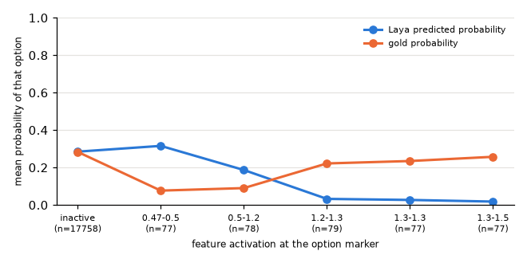

# Feature 5940

Critérios em que aparece: pred_error, corr_error, corr_error_stratified

**Interpretação (preencher):** 

---

## Maiores ativações

**tr_customer_service_000222 / churn_risk** (score, customer_service) | ativação 3.264 em `estado` | opções ['0', '1', '2', '3'] | Laya: **3** [0.046, 0.136, 0.195, 0.624] | gabarito: **3**

```
<bos> score question: How likely is this customer to stop doing business with us because of this interaction?<eos>
▸ <mask> level 0: No sign of dissatisfaction.
▸ <mask> level 1: Mild frustration, but the relationship is intact.
▸ <mask> level 2: Clearly unhappy; repeat problems or explicit complaints.
▸ <mask> level 3: Imminent: threatening to cancel, dispute or leave.

<eos>

 {"account": {"lifetime_value_usd": 3359, "prior_tickets_90d": 1, "seats": 12, "tenure_months": 41, "tier": "enterprise"}, "thread": [{"role": "customer", "text": "I am writing to request an immediate downgrade of my enterprise plan. Given that my previous request for service improvements was ignored, I am finding it difficult to justify continuing our partnership and may be⟦ forced⟧ to take my business elsewhere if this is not addressed promptly."}]}<eos>
```

**tr_customer_service_000222 / urgency** (score, customer_service) | ativação 3.139 em `estado` | opções ['0', '1', '2', '3'] | Laya: **2** [0.056, 0.072, 0.599, 0.274] | gabarito: **3**

```
<bos> score question: How time-sensitive is this conversation?<eos>
▸ <mask> level 0: No time pressure; can wait indefinitely.
▸ <mask> level 1: Routine; handle within the normal queue.
▸ <mask> level 2: Elevated; should be handled within the same week.
▸ <mask> level 3: Critical; requires action within the same day.

<eos>

 {"account": {"lifetime_value_usd": 3359, "prior_tickets_90d": 1, "seats": 12, "tenure_months": 41, "tier": "enterprise"}, "thread": [{"role": "customer", "text": "I am writing to request an immediate downgrade of my enterprise plan. Given that my previous request for service improvements was ignored, I am finding it difficult to justify continuing our partnership and may be⟦ forced⟧ to take my business elsewhere if this is not addressed promptly."}]}<eos>
```

**tr_customer_service_000186 / churn_risk** (score, customer_service) | ativação 3.119 em `estado` | opções ['0', '1', '2', '3'] | Laya: **3** [0.027, 0.073, 0.145, 0.755] | gabarito: **3**

```
<bos> score question: How likely is this customer to stop doing business with us because of this interaction?<eos>
▸ <mask> level 0: No sign of dissatisfaction.
▸ <mask> level 1: Mild frustration, but the relationship is intact.
▸ <mask> level 2: Clearly unhappy; repeat problems or explicit complaints.
▸ <mask> level 3: Imminent: threatening to cancel, dispute or leave.

<eos>

 {"account": {"lifetime_value_usd": 94, "prior_tickets_90d": 0, "seats": 1, "tenure_months": 2, "tier": "free"}, "orders": [{"amount_usd": 99, "date": "2026-03-11", "id": "A-98793", "status": "pending"}, {"amount_usd": 99, "date": "2026-03-28", "id": "A-39133", "status": "failed"}], "thread": [{"role": "customer", "text": "I’m sick of this platform—cancel my account immediately and stop charging me the $99 I’m being billed each month."}, {"role": "agent", "text": "I understand you want to close the account. Could you verify the email address linked to the subscription so I can locate the correct profile?"}, {"role": "customer", "text": "It’s john.doe@example.com. I’ve already told you this before; if you don’t process the cancellation right now I’ll be⟦ forced⟧ to dispute the charges."}]}<eos>
```

**tr_customer_service_000222 / needs_human** (noul, customer_service) | ativação 3.064 em `estado` | opções ['false', 'true'] | Laya: **true** [0.045, 0.955] | gabarito: **true**

```
<bos> noul question: This conversation requires a human agent rather than automated handling.<eos>
▸ <mask> false: Automation can carry this to resolution.
▸ <mask> true: A human must take over: judgement, authority or empathy is required.

<eos>

 {"account": {"lifetime_value_usd": 3359, "prior_tickets_90d": 1, "seats": 12, "tenure_months": 41, "tier": "enterprise"}, "thread": [{"role": "customer", "text": "I am writing to request an immediate downgrade of my enterprise plan. Given that my previous request for service improvements was ignored, I am finding it difficult to justify continuing our partnership and may be⟦ forced⟧ to take my business elsewhere if this is not addressed promptly."}]}<eos>
```

**tr_customer_service_000222 / action** (choice, customer_service) | ativação 3.053 em `estado` | opções ['answer_directly', 'close_no_action', 'escalate_to_human', 'execute_refund', 'request_information'] | Laya: **answer_directly** [0.765, 0.104, 0.041, 0.058, 0.033] | gabarito: **escalate_to_human**

```
<bos> choice question: What should the assistant do next with this conversation?<eos>
▸ <mask> answer_directly: The assistant can resolve this itself with information it already has.
▸ <mask> close_no_action: No further action is warranted; the matter is settled.
▸ <mask> escalate_to_human: Hand off to a human agent with the appropriate authority.
▸ <mask> execute_refund: Issue the refund or credit the customer is owed.
▸ <mask> request_information: More detail is needed from the customer before anything can be done.

<eos>

 {"account": {"lifetime_value_usd": 3359, "prior_tickets_90d": 1, "seats": 12, "tenure_months": 41, "tier": "enterprise"}, "thread": [{"role": "customer", "text": "I am writing to request an immediate downgrade of my enterprise plan. Given that my previous request for service improvements was ignored, I am finding it difficult to justify continuing our partnership and may be⟦ forced⟧ to take my business elsewhere if this is not addressed promptly."}]}<eos>
```

## Ativações medianas (faixa 40-60%, mediana 0.990)

**tr_customer_service_000158 / action** (choice, customer_service) | ativação 1.225 em `marcador` | opções ['answer_directly', 'close_no_action', 'escalate_to_human', 'execute_refund', 'request_information'] | Laya: **close_no_action** [0.13, 0.607, 0.048, 0.201, 0.015] | gabarito: **request_information**

```
<bos> choice question: What should the assistant do next with this conversation?<eos>
▸ <mask> answer_directly: The assistant can resolve this itself with information it already has.
▸ <mask> close_no_action: No further action is warranted; the matter is settled.
▸ <mask> escalate_to_human: Hand off to a human agent with the appropriate authority.
▸ <mask> execute_refund: Issue the refund or credit the customer is owed.
▸ ⟦<mask>⟧ request_information: More detail is needed from the customer before anything can be done.

<eos>

 {"account": {"lifetime_value_usd": 134, "prior_tickets_90d": 5, "seats": 5, "tenure_months": 3, "tier": "enterprise"}, "orders": [{"amount_usd": 49, "date": "2026-02-16", "id": "A-54178", "status": "settled"}, {"amount_usd": 49, "date": "2026-02-18", "id": "A-29578", "status": "settled"}, {"amount_usd": 49, "date": "2026-01-24", "id": "A-46676", "status": "refunded"}], "thread": [{"role": "customer", "text": "The bulk‑upload feature stopped accepting CSV files; it returns a generic error as soon as I click Submit."}]}<eos>
```

**tr_customer_service_000083 / action** (choice, customer_service) | ativação 1.228 em `marcador` | opções ['answer_directly', 'close_no_action', 'escalate_to_human', 'execute_refund', 'request_information'] | Laya: **execute_refund** [0.23, 0.176, 0.034, 0.53, 0.029] | gabarito: **request_information**

```
<bos> choice question: What should the assistant do next with this conversation?<eos>
▸ <mask> answer_directly: The assistant can resolve this itself with information it already has.
▸ <mask> close_no_action: No further action is warranted; the matter is settled.
▸ <mask> escalate_to_human: Hand off to a human agent with the appropriate authority.
▸ <mask> execute_refund: Issue the refund or credit the customer is owed.
▸ ⟦<mask>⟧ request_information: More detail is needed from the customer before anything can be done.

<eos>

 {"account": {"lifetime_value_usd": 275, "prior_tickets_90d": 2, "seats": 1, "tenure_months": 5, "tier": "standard"}, "thread": [{"role": "customer", "text": "I’m confused – I ordered the blue wireless mouse but received a black wired one, and I need the correct item by Friday for my project."}]}<eos>
```

**tr_customer_service_000138 / action** (choice, customer_service) | ativação 1.155 em `marcador` | opções ['answer_directly', 'close_no_action', 'escalate_to_human', 'execute_refund', 'request_information'] | Laya: **escalate_to_human** [0.405, 0.073, 0.409, 0.06, 0.053] | gabarito: **escalate_to_human**

```
<bos> choice question: What should the assistant do next with this conversation?<eos>
▸ <mask> answer_directly: The assistant can resolve this itself with information it already has.
▸ <mask> close_no_action: No further action is warranted; the matter is settled.
▸ <mask> escalate_to_human: Hand off to a human agent with the appropriate authority.
▸ <mask> execute_refund: Issue the refund or credit the customer is owed.
▸ ⟦<mask>⟧ request_information: More detail is needed from the customer before anything can be done.

<eos>

 {"account": {"lifetime_value_usd": 247, "prior_tickets_90d": 1, "seats": 1, "tenure_months": 3, "tier": "standard"}, "thread": [{"role": "customer", "text": "Good afternoon, I need the data export we discussed last month. This is my third month on the standard plan, and the previous ticket promised the export but never arrived."}, {"role": "agent", "text": "I’m sorry you haven’t received the export yet. Could you remind me of the ticket number so I can locate the original request?"}, {"role": "customer", "text": "The ticket was #7890, opened on July 20th. I was told it would be ready within 48 hours, but I still have nothing."}, {"role": "agent", "text": "Thank you for the details. I’ll pull up the logs for that ticket. In the meantime, could you confirm the email address you’d like the export sent to?"}, {"role": "customer", "text": "Please send it to me at alex.tan@example.com. I need the data before the end of the month, so any update would be great."}]}<eos>
```

**tr_customer_service_000134 / action** (choice, customer_service) | ativação 1.167 em `marcador` | opções ['answer_directly', 'close_no_action', 'escalate_to_human', 'execute_refund', 'request_information'] | Laya: **answer_directly** [0.99, 0.009, 0.001, 0.0, 0.0] | gabarito: **escalate_to_human**

```
<bos> choice question: What should the assistant do next with this conversation?<eos>
▸ <mask> answer_directly: The assistant can resolve this itself with information it already has.
▸ <mask> close_no_action: No further action is warranted; the matter is settled.
▸ <mask> escalate_to_human: Hand off to a human agent with the appropriate authority.
▸ <mask> execute_refund: Issue the refund or credit the customer is owed.
▸ ⟦<mask>⟧ request_information: More detail is needed from the customer before anything can be done.

<eos>

 {"account": {"lifetime_value_usd": 1659, "prior_tickets_90d": 0, "seats": 3, "tenure_months": 19, "tier": "enterprise"}, "thread": [{"role": "customer", "text": "I’m requesting a full export of all my company’s data by the end of the week; otherwise I’ll have to consider moving to a different platform."}, {"role": "agent", "text": "I understand the urgency. Could you specify which date range you need and whether you prefer CSV or JSON format?"}, {"role": "customer", "text": "We need everything from January 1 2023 through today, and CSV would be best. The deadline is Friday at 5 PM GMT."}, {"role": "agent", "text": "Got it. To ensure we’re exporting the correct records, could you confirm the primary account email you’d like the files sent to?"}, {"role": "customer", "text": "Please send the export to dataadmin@ourcompany.com. I’ll also be ready to verify my identity if you need any additional confirmation."}, {"role": "agent", "text": "Thank you for confirming. I’ll begin preparing the export and will follow up with any further questions."}, {"role": "customer", "text": "Great, just let me know the exact time you expect to have the files ready; we really can’t miss that Friday deadline."}]}<eos>
```

**tr_customer_service_000002 / action** (choice, customer_service) | ativação 1.235 em `marcador` | opções ['answer_directly', 'close_no_action', 'escalate_to_human', 'execute_refund', 'request_information'] | Laya: **answer_directly** [0.576, 0.256, 0.011, 0.046, 0.11] | gabarito: **answer_directly**

```
<bos> choice question: What should the assistant do next with this conversation?<eos>
▸ <mask> answer_directly: The assistant can resolve this itself with information it already has.
▸ <mask> close_no_action: No further action is warranted; the matter is settled.
▸ <mask> escalate_to_human: Hand off to a human agent with the appropriate authority.
▸ <mask> execute_refund: Issue the refund or credit the customer is owed.
▸ ⟦<mask>⟧ request_information: More detail is needed from the customer before anything can be done.

<eos>

 {"account": {"lifetime_value_usd": 37, "prior_tickets_90d": 0, "seats": 1, "tenure_months": 1, "tier": "standard"}, "thread": [{"role": "customer", "text": "Good afternoon, could you please arrange for a full export of all my data from the Standard plan? I’d like it in CSV format."}, {"role": "agent", "text": "Certainly, I can help with that. May I confirm the email address on the account and whether you need the export within a particular timeframe?"}, {"role": "customer", "text": "The account is under michael.brown@example.com, and I’d like to receive the file by the end of the week if possible."}, {"role": "agent", "text": "Got it, thank you. I’ll queue the export and will need to verify your identity – could you provide the last four digits of the payment method on file?"}, {"role": "customer", "text": "The last four digits are 4321. Please let me know when the download link is ready."}]}<eos>
```

## Estatísticas (conjunto de descoberta, dev e teste)

**pred / error**

| split | decisões | ativas | ativas e Laya errou | taxa | lift | q (BH) | OR (CMH) | q (CMH) |
|---|---|---|---|---|---|---|---|---|
| discovery | 5100 | 22 | 22 | 1.000 | 1.55 | 0.000292 | 3.24 | 0.488 |
| dev | 900 | 6 | 6 | 1.000 | 1.49 | nan | nan | nan |
| test | 2000 | 10 | 8 | 0.800 | 1.23 | nan | nan | nan |

**corr / error**

| split | decisões | ativas | ativas e Laya errou | taxa | lift | q (BH) | OR (CMH) | q (CMH) |
|---|---|---|---|---|---|---|---|---|
| discovery | 5100 | 60 | 60 | 1.000 | 1.55 | 1.95e-11 | inf | 0.00111 |
| dev | 900 | 7 | 7 | 1.000 | 1.49 | nan | nan | nan |
| test | 2000 | 27 | 25 | 0.926 | 1.42 | 0.00357 | 0.33 | 0.734 |

**state / error**

| split | decisões | ativas | ativas e Laya errou | taxa | lift | q (BH) | OR (CMH) | q (CMH) |
|---|---|---|---|---|---|---|---|---|
| discovery | 5100 | 185 | 98 | 0.530 | 0.82 | 0.007 | 0.73 | 0.253 |
| dev | 900 | 28 | 21 | 0.750 | 1.12 | 0.831 | 1.66 | 0.576 |
| test | 2000 | 70 | 42 | 0.600 | 0.92 | 0.727 | 0.84 | 0.819 |

**pred / probe_right_laya_wrong**

| split | decisões | ativas | ativas e Laya errou | taxa | lift | q (BH) | OR (CMH) | q (CMH) |
|---|---|---|---|---|---|---|---|---|
| discovery | 2819 | 8 | 8 | 1.000 | 1.55 | nan | nan | nan |
| dev | 520 | 2 | 2 | 1.000 | 1.48 | nan | nan | nan |
| test | 1106 | 4 | 4 | 1.000 | 1.58 | nan | nan | nan |

**corr / probe_right_laya_wrong**

| split | decisões | ativas | ativas e Laya errou | taxa | lift | q (BH) | OR (CMH) | q (CMH) |
|---|---|---|---|---|---|---|---|---|
| discovery | 2819 | 4 | 4 | 1.000 | 1.55 | nan | nan | nan |
| dev | 520 | 1 | 1 | 1.000 | 1.48 | nan | nan | nan |
| test | 1106 | 3 | 3 | 1.000 | 1.58 | nan | nan | nan |

**state / probe_right_laya_wrong**

| split | decisões | ativas | ativas e Laya errou | taxa | lift | q (BH) | OR (CMH) | q (CMH) |
|---|---|---|---|---|---|---|---|---|
| discovery | 2819 | 91 | 37 | 0.407 | 0.63 | 2.62e-05 | 0.53 | 0.0458 |
| dev | 520 | 13 | 9 | 0.692 | 1.03 | nan | nan | nan |
| test | 1106 | 38 | 20 | 0.526 | 0.83 | 0.453 | 0.73 | 0.658 |

Confusão mais sobre-representada (pred): `disposition|3>0` (n=7, lift 45.08, p=7.45e-11). Formato `pergunta|índice previsto>índice correto`.

Confusão mais sobre-representada (corr): `action|0>4` (n=27, lift 85.00, p=0). Formato `pergunta|índice previsto>índice correto`.

Confusão mais sobre-representada (state): `category|1>0` (n=3, lift 9.19, p=0.00336). Formato `pergunta|índice previsto>índice correto`.



