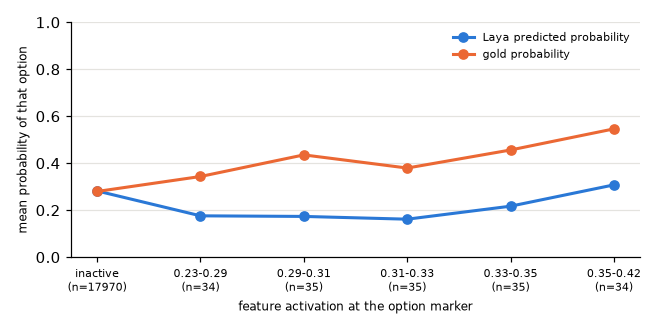

# Feature 5959

Critérios em que aparece: corr_error_stratified, corr_probe_right_laya_wrong_stratified

**Interpretação (preencher):** 

---

## Maiores ativações

**tr_security_incidents_000208 / severity** (score, security_incidents) | ativação 5.016 em `estado` | opções ['0', '1', '2', '3', '4'] | Laya: **1** [0.152, 0.308, 0.244, 0.148, 0.148] | gabarito: **3**

```
<bos> score question: How severe is the potential impact if this alert is real?<eos>
▸ <mask> level 0: Negligible: no access to anything sensitive.
▸ <mask> level 1: Low: limited access, easily reversed.
▸ <mask> level 2: Moderate: access to internal systems or non-public data.
▸ <mask> level 3: High: access to production, secrets or customer data.
▸ <mask> level 4: Critical: active compromise of crown-jewel systems.

<eos>

 {"alert": {"description": "a large transfer to an external destination", "evidence": "At 04:03 UTC on 2026-09-15, a service account named svc_backup transferred 4.8 GB of data to external IP 198.51.100.77 over port 443 using the process rsync.exe. The transfer completed in 7 minutes and originated from an⟦ unre⟧cognised host in the DMZ. The event took place during an open change window.", "rule": "data_egress"}, "context": {"asset_criticality": "low", "change_window_active": true, "source_on_allowlist": false}, "history": {"credential_rotation_days_ago": 30, "distinct_countries_30d": 3, "logins_30d": 873, "prior_alerts_90d": 3}, "principal": {"mfa_enrolled": false, "name": "ci-support-613", "privileges": ["deploy:production", "secrets:read"], "type": "service_account"}}<eos>
```

**tr_security_incidents_000208 / urgency** (score, security_incidents) | ativação 4.973 em `estado` | opções ['0', '1', '2', '3'] | Laya: **1** [0.216, 0.345, 0.223, 0.216] | gabarito: **2**

```
<bos> score question: How quickly must a responder act on this alert?<eos>
▸ <mask> level 0: No time pressure; can wait indefinitely.
▸ <mask> level 1: Routine; handle within the normal queue.
▸ <mask> level 2: Elevated; should be handled within the same week.
▸ <mask> level 3: Critical; requires action within the same day.

<eos>

 {"alert": {"description": "a large transfer to an external destination", "evidence": "At 04:03 UTC on 2026-09-15, a service account named svc_backup transferred 4.8 GB of data to external IP 198.51.100.77 over port 443 using the process rsync.exe. The transfer completed in 7 minutes and originated from an⟦ unre⟧cognised host in the DMZ. The event took place during an open change window.", "rule": "data_egress"}, "context": {"asset_criticality": "low", "change_window_active": true, "source_on_allowlist": false}, "history": {"credential_rotation_days_ago": 30, "distinct_countries_30d": 3, "logins_30d": 873, "prior_alerts_90d": 3}, "principal": {"mfa_enrolled": false, "name": "ci-support-613", "privileges": ["deploy:production", "secrets:read"], "type": "service_account"}}<eos>
```

**tr_security_incidents_000208 / credential_compromise** (noul, security_incidents) | ativação 4.945 em `estado` | opções ['false', 'true'] | Laya: **true** [0.187, 0.813] | gabarito: **true**

```
<bos> noul question: The evidence indicates a credential or account has been compromised.<eos>
▸ <mask> false: no, the statement does not hold
▸ <mask> true: yes, the statement holds

<eos>

 {"alert": {"description": "a large transfer to an external destination", "evidence": "At 04:03 UTC on 2026-09-15, a service account named svc_backup transferred 4.8 GB of data to external IP 198.51.100.77 over port 443 using the process rsync.exe. The transfer completed in 7 minutes and originated from an⟦ unre⟧cognised host in the DMZ. The event took place during an open change window.", "rule": "data_egress"}, "context": {"asset_criticality": "low", "change_window_active": true, "source_on_allowlist": false}, "history": {"credential_rotation_days_ago": 30, "distinct_countries_30d": 3, "logins_30d": 873, "prior_alerts_90d": 3}, "principal": {"mfa_enrolled": false, "name": "ci-support-613", "privileges": ["deploy:production", "secrets:read"], "type": "service_account"}}<eos>
```

**tr_security_incidents_000208 / true_positive** (noul, security_incidents) | ativação 4.910 em `estado` | opções ['false', 'true'] | Laya: **true** [0.078, 0.922] | gabarito: **true**

```
<bos> noul question: This alert reflects genuinely malicious or unauthorised activity.<eos>
▸ <mask> false: Benign activity, a misconfiguration, or a known false positive.
▸ <mask> true: The underlying behaviour is malicious or unauthorised.

<eos>

 {"alert": {"description": "a large transfer to an external destination", "evidence": "At 04:03 UTC on 2026-09-15, a service account named svc_backup transferred 4.8 GB of data to external IP 198.51.100.77 over port 443 using the process rsync.exe. The transfer completed in 7 minutes and originated from an⟦ unre⟧cognised host in the DMZ. The event took place during an open change window.", "rule": "data_egress"}, "context": {"asset_criticality": "low", "change_window_active": true, "source_on_allowlist": false}, "history": {"credential_rotation_days_ago": 30, "distinct_countries_30d": 3, "logins_30d": 873, "prior_alerts_90d": 3}, "principal": {"mfa_enrolled": false, "name": "ci-support-613", "privileges": ["deploy:production", "secrets:read"], "type": "service_account"}}<eos>
```

**tr_security_incidents_000140 / severity** (score, security_incidents) | ativação 4.812 em `estado` | opções ['0', '1', '2', '3', '4'] | Laya: **1** [0.137, 0.323, 0.24, 0.124, 0.176] | gabarito: **4**

```
<bos> score question: How severe is the potential impact if this alert is real?<eos>
▸ <mask> level 0: Negligible: no access to anything sensitive.
▸ <mask> level 1: Low: limited access, easily reversed.
▸ <mask> level 2: Moderate: access to internal systems or non-public data.
▸ <mask> level 3: High: access to production, secrets or customer data.
▸ <mask> level 4: Critical: active compromise of crown-jewel systems.

<eos>

 {"alert": {"description": "audit logging was turned off on a host", "evidence": "On 2026-09-16 at 01:07:58 UTC, the unprivileged service account svc-monitor on host 192.168.100.200 renamed the security log file C:\\Windows\\System32\\winevt\\Logs\\Security.evtx to Security.evtx.bak, effectively stopping audit logging. The action was initiated from an⟦ unre⟧cognised source IP 172.20.30.40, and the account’s credentials have not been rotated for 412 days.", "rule": "disabled_logging"}, "context": {"asset_criticality": "crown_jewel", "change_window_active": false, "source_on_allowlist": false}, "history": {"credential_rotation_days_ago": 412, "distinct_countries_30d": 3, "logins_30d": 1000, "prior_alerts_90d": 0}, "principal": {"mfa_enrolled": false, "name": "usr-support-416", "privileges": ["repo:read"], "type": "service_account"}}<eos>
```

## Ativações medianas (faixa 40-60%, mediana 0.700)

**tr_customer_service_000225 / category** (choice, customer_service) | ativação 0.917 em `estado` | opções ['account', 'billing', 'delivery', 'refund', 'technical'] | Laya: **technical** [0.392, 0.086, 0.004, 0.032, 0.486] | gabarito: **technical**

```
<bos> choice question: What is this customer conversation primarily about?<eos>
▸ <mask> account: Login, plan changes, profile or access management.
▸ <mask> billing: A charge, invoice, subscription or payment problem.
▸ <mask> delivery: Shipping, fulfilment or delivery of a physical item.
▸ <mask> refund: The customer is explicitly asking for money back.
▸ <mask> technical: The product or service is not working as expected.

<eos>

 {"account": {"lifetime_value_usd": 419, "prior_tickets_90d": 1, "seats": 1, "tenure_months": 5, "tier": "standard"}, "orders": [{"amount_usd": 99, "date": "2026-01-07", "id": "A-67520", "status": "settled"}, {"amount_usd": 99, "date": "2026-03-11", "id": "A-78780", "status": "settled"}, {"amount_usd": 99, "date": "2026-02-08", "id": "A-39325", "status": "settled"}], "thread": [{"role": "customer", "text": "Hello, I’m writing because I accidentally dropped the $99 device I bought five months ago, and the screen is now completely cracked."}, {"role": "agent", "text": "I’m sorry to hear that your device was damaged. Could you please provide your order number and a⟦ brief⟧ description of the current display functionality?"}, {"role": "customer", "text": "The order number is #88291, and while the touch screen is unresponsive, the device still powers on."}, {"role": "agent", "text": "Thank you for providing those details. Just to ensure I have the full picture, could you tell me if there is any visible damage to the charging port or the frame?"}, {"role": "customer", "text": "No, the frame and charging port look perfectly fine, it is just the screen."}]}<eos>
```

**tr_customer_service_000000 / action** (choice, customer_service) | ativação 0.731 em `estado` | opções ['answer_directly', 'close_no_action', 'escalate_to_human', 'execute_refund', 'request_information'] | Laya: **close_no_action** [0.047, 0.831, 0.111, 0.007, 0.004] | gabarito: **answer_directly**

```
<bos> choice question: What should the assistant do next with this conversation?<eos>
▸ <mask> answer_directly: The assistant can resolve this itself with information it already has.
▸ <mask> close_no_action: No further action is warranted; the matter is settled.
▸ <mask> escalate_to_human: Hand off to a human agent with the appropriate authority.
▸ <mask> execute_refund: Issue the refund or credit the customer is owed.
▸ <mask> request_information: More detail is needed from the customer before anything can be done.

<eos>

 {"account": {"lifetime_value_usd": 4642, "prior_tickets_90d": 2, "seats": 3, "tenure_months": 60, "tier": "enterprise"}, "thread": [{"role": "customer", "text": "Hello, after five years on the Enterprise plan I’ve decided it’s time to close my account. Could you please start the cancellation process?"}, {"role": "agent", "text": "I’m⟦ sorry⟧ to hear you want to leave. May I have the account number or the email associated with the subscription so I can locate it?"}, {"role": "customer", "text": "Sure, the account is registered to alice.smith@example.com, and the reference number is 987654. I’d appreciate a confirmation once the cancellation is underway."}, {"role": "agent", "text": "Thank you for that information. I’ve flagged the request; could you let me know if there’s any specific reason you’re closing, or any final data you need from us?"}, {"role": "customer", "text": "No particular issue, just moving to a different provider. I’ll wait for your follow‑up confirming the account is scheduled for termination."}]}<eos>
```

**tr_customer_service_000157 / category** (choice, customer_service) | ativação 1.100 em `estado` | opções ['account', 'billing', 'delivery', 'refund', 'technical'] | Laya: **account** [1.0, 0.0, 0.0, 0.0, 0.0] | gabarito: **account**

```
<bos> choice question: What is this customer conversation primarily about?<eos>
▸ <mask> account: Login, plan changes, profile or access management.
▸ <mask> billing: A charge, invoice, subscription or payment problem.
▸ <mask> delivery: Shipping, fulfilment or delivery of a physical item.
▸ <mask> refund: The customer is explicitly asking for money back.
▸ <mask> technical: The product or service is not working as expected.

<eos>

 {"account": {"lifetime_value_usd": 3086, "prior_tickets_90d": 3, "seats": 1, "tenure_months": 49, "tier": "standard"}, "thread": [{"role": "customer", "text": "I need to get into my account right now – the login page just keeps looping back to the password screen and I can’t access anything."}, {"role": "agent", "text": "I understand the urgency. Could you share the exact error message you’re seeing, or let me know if you’ve tried resetting the password?"}, {"role": "customer", "text": "The⟦ message⟧ says “authentication failed” after I enter my credentials, and I’ve already tried the password reset twice with no luck."}]}<eos>
```

**tr_customer_service_000062 / category** (choice, customer_service) | ativação 0.630 em `estado` | opções ['account', 'billing', 'delivery', 'refund', 'technical'] | Laya: **account** [0.989, 0.002, 0.0, 0.002, 0.008] | gabarito: **technical**

```
<bos> choice question: What is this customer conversation primarily about?<eos>
▸ <mask> account: Login, plan changes, profile or access management.
▸ <mask> billing: A charge, invoice, subscription or payment problem.
▸ <mask> delivery: Shipping, fulfilment or delivery of a physical item.
▸ <mask> refund: The customer is explicitly asking for money back.
▸ <mask> technical: The product or service is not working as expected.

<eos>

 {"account": {"lifetime_value_usd": 379, "prior_tickets_90d": 0, "seats": 1, "tenure_months": 11, "tier": "standard"}, "thread": [{"role": "customer", "text": "This service is a total joke and I want to cancel immediately before you charge me another dime."}, {"role": "agent", "text": "I am sorry to hear you're unhappy; could you tell me a bit more⟦ about⟧ what's prompted this decision today?"}, {"role": "customer", "text": "Everything is broken and the support is non-existent. I'm done."}, {"role": "agent", "text": "I understand your frustration. To better assist you, would you mind specifying which features have not been meeting your expectations?"}, {"role": "customer", "text": "All of them. Fix it or I'm taking my business elsewhere."}, {"role": "agent", "text": "I hear your concerns clearly. Could you please provide your account email address so I can pull up the details of your recent usage?"}, {"role": "customer", "text": "It's the same email I'm messaging from. Just process the cancellation."}]}<eos>
```

**tr_customer_service_000112 / needs_human** (noul, customer_service) | ativação 0.699 em `estado` | opções ['false', 'true'] | Laya: **true** [0.263, 0.737] | gabarito: **true**

```
<bos> noul question: This conversation requires a human agent rather than automated handling.<eos>
▸ <mask> false: Automation can carry this to resolution.
▸ <mask> true: A human must take over: judgement, authority or empathy is required.

<eos>

 {"account": {"lifetime_value_usd": 2088, "prior_tickets_90d": 5, "seats": 5, "tenure_months": 72, "tier": "premium"}, "thread": [{"role": "customer", "text": "I'm looking at my bank statement and I see two separate charges for my premium subscription again. This is the sixth time I've had to reach out about this specific double-billing issue, and I'm just tired of having to repeat the same conversation every month."}, {"role": "agent", "text": "I'm⟦ sorry⟧ to hear that you're seeing a duplicate transaction on your account again. To help me investigate, could you please confirm if both charges appeared on the same date?"}, {"role": "customer", "text": "They both showed up on the 14th. I've been a customer for six years and I really expected that after five previous tickets, someone would have found a permanent solution to stop this from happening."}, {"role": "agent", "text": "I appreciate your long-standing loyalty to our service. I'm looking into your billing history now; are you seeing two different invoice numbers in your account portal, or just one?"}, {"role": "customer", "text": "There is only one invoice listed in the portal, but the money has definitely left my account twice. I just want to know why this keeps recurring when I was told last month it was finally handled."}]}<eos>
```

## Estatísticas (conjunto de descoberta, dev e teste)

**pred / error**

| split | decisões | ativas | ativas e Laya errou | taxa | lift | q (BH) | OR (CMH) | q (CMH) |
|---|---|---|---|---|---|---|---|---|
| discovery | 5100 | 23 | 12 | 0.522 | 0.81 | 0.367 | 0.10 | 0.165 |
| dev | 900 | 6 | 3 | 0.500 | 0.74 | nan | nan | nan |
| test | 2000 | 8 | 4 | 0.500 | 0.77 | nan | nan | nan |

**corr / error**

| split | decisões | ativas | ativas e Laya errou | taxa | lift | q (BH) | OR (CMH) | q (CMH) |
|---|---|---|---|---|---|---|---|---|
| discovery | 5100 | 67 | 56 | 0.836 | 1.30 | 0.00129 | 5.37 | 2.35e-20 |
| dev | 900 | 11 | 8 | 0.727 | 1.08 | nan | nan | nan |
| test | 2000 | 20 | 16 | 0.800 | 1.23 | 0.288 | 5.14 | 3.27e-07 |

**state / error**

| split | decisões | ativas | ativas e Laya errou | taxa | lift | q (BH) | OR (CMH) | q (CMH) |
|---|---|---|---|---|---|---|---|---|
| discovery | 5100 | 265 | 137 | 0.517 | 0.80 | 0.000151 | 0.78 | 0.508 |
| dev | 900 | 26 | 12 | 0.462 | 0.69 | 0.257 | 0.60 | 0.805 |
| test | 2000 | 129 | 70 | 0.543 | 0.83 | 0.091 | 0.96 | 0.969 |

**pred / probe_right_laya_wrong**

| split | decisões | ativas | ativas e Laya errou | taxa | lift | q (BH) | OR (CMH) | q (CMH) |
|---|---|---|---|---|---|---|---|---|
| discovery | 2819 | 15 | 10 | 0.667 | 1.03 | nan | nan | nan |
| dev | 520 | 6 | 3 | 0.500 | 0.74 | nan | nan | nan |
| test | 1106 | 5 | 4 | 0.800 | 1.26 | nan | nan | nan |

**corr / probe_right_laya_wrong**

| split | decisões | ativas | ativas e Laya errou | taxa | lift | q (BH) | OR (CMH) | q (CMH) |
|---|---|---|---|---|---|---|---|---|
| discovery | 2819 | 39 | 34 | 0.872 | 1.35 | 0.00427 | 6.96 | 2.09e-21 |
| dev | 520 | 9 | 6 | 0.667 | 0.99 | nan | nan | nan |
| test | 1106 | 7 | 6 | 0.857 | 1.35 | nan | nan | nan |

**state / probe_right_laya_wrong**

| split | decisões | ativas | ativas e Laya errou | taxa | lift | q (BH) | OR (CMH) | q (CMH) |
|---|---|---|---|---|---|---|---|---|
| discovery | 2819 | 176 | 87 | 0.494 | 0.76 | 0.000159 | 0.82 | 0.713 |
| dev | 520 | 18 | 6 | 0.333 | 0.49 | nan | nan | nan |
| test | 1106 | 79 | 31 | 0.392 | 0.62 | 0.000718 | 0.51 | 0.439 |

Confusão mais sobre-representada (pred): `true_positive|0>1` (n=12, lift 120.95, p=1.34e-24). Formato `pergunta|índice previsto>índice correto`.

Confusão mais sobre-representada (corr): `true_positive|1>0` (n=56, lift 60.90, p=0). Formato `pergunta|índice previsto>índice correto`.

Confusão mais sobre-representada (state): `severity|1>4` (n=6, lift 5.77, p=0.000389). Formato `pergunta|índice previsto>índice correto`.



