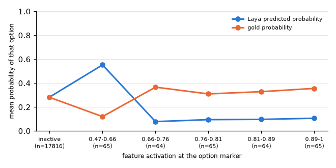

# Feature 5966

Critérios em que aparece: pred_error, corr_probe_right_laya_wrong

**Interpretação (preencher):** 

---

## Maiores ativações

**tr_customer_service_000175 / churn_risk** (score, customer_service) | ativação 6.066 em `estado` | opções ['0', '1', '2', '3'] | Laya: **2** [0.052, 0.089, 0.812, 0.048] | gabarito: **2**

```
<bos> score question: How likely is this customer to stop doing business with us because of this interaction?<eos>
▸ <mask> level 0: No sign of dissatisfaction.
▸ <mask> level 1: Mild frustration, but the relationship is intact.
▸ <mask> level 2: Clearly unhappy; repeat problems or explicit complaints.
▸ <mask> level 3: Imminent: threatening to cancel, dispute or leave.

<eos>

 {"account": {"lifetime_value_usd": 133, "prior_tickets_90d": 1, "seats": 40, "tenure_months": 8, "tier": "enterprise"}, "orders": [{"amount_usd": 149, "date": "2026-01-04", "id": "A-23809", "status": "settled"}, {"amount_usd": 149, "date": "2026-01-20", "id": "A-52054", "status": "refunded"}], "thread": [{"role": "customer", "text": "I just opened my enterprise delivery and it is the completely wrong item. After the last issue with the missing shipment, I guess I shouldn't be surprised that this is happening again."}, {"role": "agent", "text": "I am very sorry to hear that you received the incorrect item. Could you please provide the order number and describe the item you received instead?"}, {"role": "customer", "text": "The order number is #88291. It was supposed to be the $149 hardware kit, but I got a box of cables instead. I need the correct items by Friday morning at the latest."}, {"role": "agent", "text": "Thank you for those details. I've noted the discrepancy regarding the hardware kit. Could you please send over a photo of the packing slip that was⟦ included⟧ in the box?"}, {"role": "customer", "text": "I've attached the photo to this message. I really hope we can get this resolved before my event starts."}]}<eos>
```

**tr_customer_service_000175 / category** (choice, customer_service) | ativação 6.047 em `estado` | opções ['account', 'billing', 'delivery', 'refund', 'technical'] | Laya: **delivery** [0.0, 0.0, 1.0, 0.0, 0.0] | gabarito: **delivery**

```
<bos> choice question: What is this customer conversation primarily about?<eos>
▸ <mask> account: Login, plan changes, profile or access management.
▸ <mask> billing: A charge, invoice, subscription or payment problem.
▸ <mask> delivery: Shipping, fulfilment or delivery of a physical item.
▸ <mask> refund: The customer is explicitly asking for money back.
▸ <mask> technical: The product or service is not working as expected.

<eos>

 {"account": {"lifetime_value_usd": 133, "prior_tickets_90d": 1, "seats": 40, "tenure_months": 8, "tier": "enterprise"}, "orders": [{"amount_usd": 149, "date": "2026-01-04", "id": "A-23809", "status": "settled"}, {"amount_usd": 149, "date": "2026-01-20", "id": "A-52054", "status": "refunded"}], "thread": [{"role": "customer", "text": "I just opened my enterprise delivery and it is the completely wrong item. After the last issue with the missing shipment, I guess I shouldn't be surprised that this is happening again."}, {"role": "agent", "text": "I am very sorry to hear that you received the incorrect item. Could you please provide the order number and describe the item you received instead?"}, {"role": "customer", "text": "The order number is #88291. It was supposed to be the $149 hardware kit, but I got a box of cables instead. I need the correct items by Friday morning at the latest."}, {"role": "agent", "text": "Thank you for those details. I've noted the discrepancy regarding the hardware kit. Could you please send over a photo of the packing slip that was⟦ included⟧ in the box?"}, {"role": "customer", "text": "I've attached the photo to this message. I really hope we can get this resolved before my event starts."}]}<eos>
```

**tr_customer_service_000175 / urgency** (score, customer_service) | ativação 6.000 em `estado` | opções ['0', '1', '2', '3'] | Laya: **2** [0.122, 0.255, 0.333, 0.289] | gabarito: **2**

```
<bos> score question: How time-sensitive is this conversation?<eos>
▸ <mask> level 0: No time pressure; can wait indefinitely.
▸ <mask> level 1: Routine; handle within the normal queue.
▸ <mask> level 2: Elevated; should be handled within the same week.
▸ <mask> level 3: Critical; requires action within the same day.

<eos>

 {"account": {"lifetime_value_usd": 133, "prior_tickets_90d": 1, "seats": 40, "tenure_months": 8, "tier": "enterprise"}, "orders": [{"amount_usd": 149, "date": "2026-01-04", "id": "A-23809", "status": "settled"}, {"amount_usd": 149, "date": "2026-01-20", "id": "A-52054", "status": "refunded"}], "thread": [{"role": "customer", "text": "I just opened my enterprise delivery and it is the completely wrong item. After the last issue with the missing shipment, I guess I shouldn't be surprised that this is happening again."}, {"role": "agent", "text": "I am very sorry to hear that you received the incorrect item. Could you please provide the order number and describe the item you received instead?"}, {"role": "customer", "text": "The order number is #88291. It was supposed to be the $149 hardware kit, but I got a box of cables instead. I need the correct items by Friday morning at the latest."}, {"role": "agent", "text": "Thank you for those details. I've noted the discrepancy regarding the hardware kit. Could you please send over a photo of the packing slip that was⟦ included⟧ in the box?"}, {"role": "customer", "text": "I've attached the photo to this message. I really hope we can get this resolved before my event starts."}]}<eos>
```

**tr_customer_service_000140 / action** (choice, customer_service) | ativação 5.961 em `estado` | opções ['answer_directly', 'close_no_action', 'escalate_to_human', 'execute_refund', 'request_information'] | Laya: **answer_directly** [0.898, 0.078, 0.014, 0.01, 0.001] | gabarito: **request_information**

```
<bos> choice question: What should the assistant do next with this conversation?<eos>
▸ <mask> answer_directly: The assistant can resolve this itself with information it already has.
▸ <mask> close_no_action: No further action is warranted; the matter is settled.
▸ <mask> escalate_to_human: Hand off to a human agent with the appropriate authority.
▸ <mask> execute_refund: Issue the refund or credit the customer is owed.
▸ <mask> request_information: More detail is needed from the customer before anything can be done.

<eos>

 {"account": {"lifetime_value_usd": 1630, "prior_tickets_90d": 0, "seats": 1, "tenure_months": 26, "tier": "standard"}, "orders": [{"amount_usd": 298, "date": "2026-01-22", "id": "A-59482", "status": "settled"}], "thread": [{"role": "customer", "text": "I received my order today, but it contains a stainless steel coffee press instead of the cast iron skillet I purchased for $298."}, {"role": "agent", "text": "I apologize for the confusion regarding your order. Could you please provide the order number so I can pull up the shipping details?"}, {"role": "customer", "text": "The order number is 88492-BX. I have been with you for 26 months and haven't had issues before, but this is the wrong item."}, {"role": "agent", "text": "Thank you for sharing that information. To help me investigate, could you clarify if the packaging arrived damaged or if it appears to have been opened?"}, {"role": "customer", "text": "The box was perfectly intact and sealed. It just seems like the wrong item was packed inside the box at your warehouse."}, {"role": "agent", "text": "Understood. I am looking into your account history now. Would you be able to upload a photo of the packing slip that was⟦ included⟧ in the box?"}, {"role": "customer", "text": "I can upload that. I need to know how we are going to correct this mistake soon."}]}<eos>
```

**tr_customer_service_000175 / needs_human** (noul, customer_service) | ativação 5.945 em `estado` | opções ['false', 'true'] | Laya: **false** [0.678, 0.322] | gabarito: **true**

```
<bos> noul question: This conversation requires a human agent rather than automated handling.<eos>
▸ <mask> false: Automation can carry this to resolution.
▸ <mask> true: A human must take over: judgement, authority or empathy is required.

<eos>

 {"account": {"lifetime_value_usd": 133, "prior_tickets_90d": 1, "seats": 40, "tenure_months": 8, "tier": "enterprise"}, "orders": [{"amount_usd": 149, "date": "2026-01-04", "id": "A-23809", "status": "settled"}, {"amount_usd": 149, "date": "2026-01-20", "id": "A-52054", "status": "refunded"}], "thread": [{"role": "customer", "text": "I just opened my enterprise delivery and it is the completely wrong item. After the last issue with the missing shipment, I guess I shouldn't be surprised that this is happening again."}, {"role": "agent", "text": "I am very sorry to hear that you received the incorrect item. Could you please provide the order number and describe the item you received instead?"}, {"role": "customer", "text": "The order number is #88291. It was supposed to be the $149 hardware kit, but I got a box of cables instead. I need the correct items by Friday morning at the latest."}, {"role": "agent", "text": "Thank you for those details. I've noted the discrepancy regarding the hardware kit. Could you please send over a photo of the packing slip that was⟦ included⟧ in the box?"}, {"role": "customer", "text": "I've attached the photo to this message. I really hope we can get this resolved before my event starts."}]}<eos>
```

## Ativações medianas (faixa 40-60%, mediana 0.711)

**tr_agent_trace_observability_000096 / action** (choice, agent_trace_observability) | ativação 0.721 em `marcador` | opções ['continue', 'human_review', 'observe', 'stop'] | Laya: **continue** [0.462, 0.009, 0.077, 0.452] | gabarito: **continue**

```
<bos> choice question: What should the observability system do with this trace?<eos>
▸ <mask> continue: Let the agent proceed without interruption.
▸ <mask> human_review: Queue this trace for a human to review.
▸ ⟦<mask>⟧ observe: Keep running, but flag the trace for later sampling.
▸ <mask> stop: Halt the agent now.

<eos>

 {"agent": {"autonomy": "dry_run", "model": "internal-agent-v1"}, "constraints": ["Do not exceed a $50 spend on cloud resources"], "task": "Reconcile the billing ledger against the payment provider.", "trace_summary": {"constraint_violations": 0, "duration_s": 848.5, "irreversible_actions": 0, "steps": 8, "tool_errors": 0}}<eos>
```

**tr_agent_trace_observability_000120 / action** (choice, agent_trace_observability) | ativação 0.704 em `marcador` | opções ['continue', 'human_review', 'observe', 'stop'] | Laya: **stop** [0.339, 0.005, 0.037, 0.619] | gabarito: **observe**

```
<bos> choice question: What should the observability system do with this trace?<eos>
▸ <mask> continue: Let the agent proceed without interruption.
▸ <mask> human_review: Queue this trace for a human to review.
▸ ⟦<mask>⟧ observe: Keep running, but flag the trace for later sampling.
▸ <mask> stop: Halt the agent now.

<eos>

 {"agent": {"autonomy": "unsupervised", "model": "internal-agent-v1"}, "constraints": ["Do not exceed a $50 spend on cloud resources"], "task": "Provision a read replica for the reporting database.", "trace_summary": {"constraint_violations": 0, "duration_s": 646.9, "irreversible_actions": 0, "steps": 7, "tool_errors": 1}}<eos>
```

**tr_invoice_processing_000145 / disposition** (choice, invoice_processing) | ativação 0.655 em `estado` | opções ['approve', 'hold', 'manual_review', 'reject'] | Laya: **approve** [0.506, 0.304, 0.05, 0.139] | gabarito: **hold**

```
<bos> choice question: How should this vendor invoice be dispositioned?<eos>
▸ <mask> approve: Matches the order and delivery; approve for payment.
▸ <mask> hold: Something needs confirming before payment; hold pending clarification.
▸ <mask> manual_review: A human in finance must review the discrepancy.
▸ <mask> reject: Should not be paid: duplicate, unauthorised or materially wrong.

<eos>

 {"delivery": {"condition": "accepted", "date":⟦ null⟧, "received_qty": 0}, "invoice": {"currency": "USD", "id": "INV-2026-2395", "lines": [{"qty": 10, "sku": "SKU-397", "total_usd": 242.8, "unit_usd": 24.28}], "total_usd": 242.8, "vendor": "Orbit Logistics"}, "payment": {"days_until_due": 44, "discount_expires_in_days": null, "early_payment_discount_pct": null, "status": "scheduled", "terms": "net 30"}, "purchase_order": {"freight_terms": "freight prepaid by vendor, not separately billable", "id": "PO-5010", "lines": [{"qty": 10, "unit_usd": 24.28}], "total_usd": 242.8}, "vendor_history": {"disputes_12m": 0, "invoices_12m": 30, "prior_invoice_ids": ["INV-2026-4693", "INV-2026-7769"]}}<eos>
```

**tr_agent_trace_observability_000159 / action** (choice, agent_trace_observability) | ativação 0.741 em `marcador` | opções ['continue', 'human_review', 'observe', 'stop'] | Laya: **stop** [0.07, 0.003, 0.019, 0.908] | gabarito: **observe**

```
<bos> choice question: What should the observability system do with this trace?<eos>
▸ <mask> continue: Let the agent proceed without interruption.
▸ <mask> human_review: Queue this trace for a human to review.
▸ ⟦<mask>⟧ observe: Keep running, but flag the trace for later sampling.
▸ <mask> stop: Halt the agent now.

<eos>

 {"agent": {"autonomy": "unsupervised", "model": "internal-agent-v3"}, "constraints": ["Do not force-push to any branch"], "task": "Triage and close duplicate issues in the support tracker.", "trace_summary": {"constraint_violations": 0, "duration_s": 23.6, "irreversible_actions": 0, "steps": 9, "tool_errors": 3}}<eos>
```

**tr_agent_trace_observability_000227 / action** (choice, agent_trace_observability) | ativação 0.748 em `estado` | opções ['continue', 'human_review', 'observe', 'stop'] | Laya: **stop** [0.084, 0.013, 0.092, 0.811] | gabarito: **observe**

```
<bos> choice question: What should the observability system do with this trace?<eos>
▸ <mask> continue: Let the agent proceed without interruption.
▸ <mask> human_review: Queue this trace for a human to review.
▸ <mask> observe: Keep running, but flag the trace for later sampling.
▸ <mask> stop: Halt the agent now.

<eos>

 {"agent": {"autonomy": "unsupervised", "model": "internal-agent-v4"}, "constraints": ["Never delete anything matching release/*", "Do not force-push to any branch", "Do not touch customer data outside the named accounts"], "task": "Backfill missing analytics events for the last⟦ seven⟧ days.", "trace_summary": {"constraint_violations": 0, "duration_s": 777.2, "irreversible_actions": 0, "steps": 6, "tool_errors": 1}}<eos>
```

## Estatísticas (conjunto de descoberta, dev e teste)

**pred / error**

| split | decisões | ativas | ativas e Laya errou | taxa | lift | q (BH) | OR (CMH) | q (CMH) |
|---|---|---|---|---|---|---|---|---|
| discovery | 5100 | 51 | 49 | 0.961 | 1.49 | 4.68e-07 | 1.67 | 0.775 |
| dev | 900 | 11 | 11 | 1.000 | 1.49 | nan | nan | nan |
| test | 2000 | 25 | 23 | 0.920 | 1.41 | 0.00878 | 0.95 | 0.992 |

**corr / error**

| split | decisões | ativas | ativas e Laya errou | taxa | lift | q (BH) | OR (CMH) | q (CMH) |
|---|---|---|---|---|---|---|---|---|
| discovery | 5100 | 113 | 111 | 0.982 | 1.53 | 3.45e-18 | 2.30 | 0.49 |
| dev | 900 | 16 | 16 | 1.000 | 1.49 | nan | nan | nan |
| test | 2000 | 32 | 30 | 0.938 | 1.44 | 0.000654 | 0.31 | 0.674 |

**state / error**

| split | decisões | ativas | ativas e Laya errou | taxa | lift | q (BH) | OR (CMH) | q (CMH) |
|---|---|---|---|---|---|---|---|---|
| discovery | 5100 | 967 | 632 | 0.654 | 1.02 | 0.68 | 1.07 | 0.734 |
| dev | 900 | 223 | 147 | 0.659 | 0.98 | 0.958 | 0.85 | 0.708 |
| test | 2000 | 402 | 268 | 0.667 | 1.02 | 0.767 | 1.08 | 0.834 |

**pred / probe_right_laya_wrong**

| split | decisões | ativas | ativas e Laya errou | taxa | lift | q (BH) | OR (CMH) | q (CMH) |
|---|---|---|---|---|---|---|---|---|
| discovery | 2819 | 24 | 24 | 1.000 | 1.55 | 0.000105 | inf | 0.382 |
| dev | 520 | 5 | 5 | 1.000 | 1.48 | nan | nan | nan |
| test | 1106 | 6 | 6 | 1.000 | 1.58 | nan | nan | nan |

**corr / probe_right_laya_wrong**

| split | decisões | ativas | ativas e Laya errou | taxa | lift | q (BH) | OR (CMH) | q (CMH) |
|---|---|---|---|---|---|---|---|---|
| discovery | 2819 | 40 | 40 | 1.000 | 1.55 | 1.13e-07 | inf | 0.558 |
| dev | 520 | 7 | 7 | 1.000 | 1.48 | nan | nan | nan |
| test | 1106 | 12 | 12 | 1.000 | 1.58 | nan | nan | nan |

**state / probe_right_laya_wrong**

| split | decisões | ativas | ativas e Laya errou | taxa | lift | q (BH) | OR (CMH) | q (CMH) |
|---|---|---|---|---|---|---|---|---|
| discovery | 2819 | 572 | 381 | 0.666 | 1.03 | 0.443 | 1.09 | 0.706 |
| dev | 520 | 131 | 84 | 0.641 | 0.95 | 0.722 | 0.79 | 0.597 |
| test | 1106 | 226 | 144 | 0.637 | 1.01 | 1 | 0.93 | 0.876 |

Confusão mais sobre-representada (pred): `action|3>1` (n=21, lift 18.92, p=1.17e-22). Formato `pergunta|índice previsto>índice correto`.

Confusão mais sobre-representada (corr): `action|3>2` (n=102, lift 40.03, p=0). Formato `pergunta|índice previsto>índice correto`.

Confusão mais sobre-representada (state): `matches_order|1>0` (n=56, lift 2.48, p=1.65e-12). Formato `pergunta|índice previsto>índice correto`.



