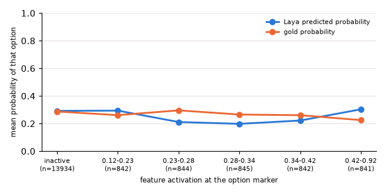

# Feature 6060

Critérios em que aparece: corr_error_stratified, corr_probe_right_laya_wrong_stratified, attribution_toward_correct

**Interpretação (preencher):** 

---

## Maiores ativações

**tr_customer_service_000203 / category** (choice, customer_service) | ativação 1.801 em `opção` | opções ['account', 'billing', 'delivery', 'refund', 'technical'] | Laya: **account** [0.995, 0.0, 0.0, 0.0, 0.004] | gabarito: **technical**

```
<bos> choice question: What is this customer conversation primarily about?<eos>
▸ <mask> account: Login, plan changes, profile or access management.
▸ <mask> billing: A charge, invoice, subscription or payment problem.
▸ <mask> delivery:⟦ Shipping⟧, fulfilment or delivery of a physical item.
▸ <mask> refund: The customer is explicitly asking for money back.
▸ <mask> technical: The product or service is not working as expected.

<eos>

 {"account": {"lifetime_value_usd": 303, "prior_tickets_90d": 1, "seats": 12, "tenure_months": 5, "tier": "premium"}, "thread": [{"role": "customer", "text": "Since the last update, the sync process has been taking around 15 minutes for a few megabytes, which is much slower than before."}]}<eos>
```

**tr_customer_service_000245 / category** (choice, customer_service) | ativação 1.729 em `opção` | opções ['account', 'billing', 'delivery', 'refund', 'technical'] | Laya: **account** [0.999, 0.0, 0.0, 0.0, 0.001] | gabarito: **account**

```
<bos> choice question: What is this customer conversation primarily about?<eos>
▸ <mask> account: Login, plan changes, profile or access management.
▸ <mask> billing: A charge, invoice, subscription or payment problem.
▸ <mask> delivery:⟦ Shipping⟧, fulfilment or delivery of a physical item.
▸ <mask> refund: The customer is explicitly asking for money back.
▸ <mask> technical: The product or service is not working as expected.

<eos>

 {"account": {"lifetime_value_usd": 1250, "prior_tickets_90d": 0, "seats": 1, "tenure_months": 14, "tier": "enterprise"}, "thread": [{"role": "customer", "text": "I'm a bit lost—I've been trying to log into our enterprise portal for the last twenty minutes but it keeps saying my credentials aren't recognized. I haven't changed anything since yesterday, and I'm not seeing any emails about account updates even though I've used this login for over a year. Is there something special I need to do to get back in?"}]}<eos>
```

**tr_customer_service_000252 / category** (choice, customer_service) | ativação 1.725 em `estado` | opções ['account', 'billing', 'delivery', 'refund', 'technical'] | Laya: **account** [0.993, 0.0, 0.0, 0.0, 0.007] | gabarito: **account**

```
<bos> choice question: What is this customer conversation primarily about?<eos>
▸ <mask> account: Login, plan changes, profile or access management.
▸ <mask> billing: A charge, invoice, subscription or payment problem.
▸ <mask> delivery: Shipping, fulfilment or delivery of a physical item.
▸ <mask> refund: The customer is explicitly asking for money back.
▸ <mask> technical: The product or service is not working as expected.

<eos>

 {"account": {"lifetime_value_usd": 3228, "prior_tickets_90d": 2, "seats": 1, "tenure_months": 49, "tier": "enterprise"}, "thread": [{"role": "customer", "text": "I’ve been paying for this enterprise account for 49 months, and now I’m locked out again. This is the third time this keeps happening, and I’m sick of wasting my time on these⟦ recurring⟧ login errors."}, {"role": "agent", "text": "I am sorry to hear you're experiencing this issue again. Could you please confirm if you are receiving a specific error code when you attempt to sign in?"}, {"role": "customer", "text": "There is no code, it just kicks me back to the landing page every single time I hit submit. Figure it out."}]}<eos>
```

**tr_customer_service_000250 / category** (choice, customer_service) | ativação 1.687 em `opção` | opções ['account', 'billing', 'delivery', 'refund', 'technical'] | Laya: **billing** [0.001, 0.998, 0.0, 0.0, 0.0] | gabarito: **billing**

```
<bos> choice question: What is this customer conversation primarily about?<eos>
▸ <mask> account: Login, plan changes, profile or access management.
▸ <mask> billing: A charge, invoice, subscription or payment problem.
▸ <mask> delivery:⟦ Shipping⟧, fulfilment or delivery of a physical item.
▸ <mask> refund: The customer is explicitly asking for money back.
▸ <mask> technical: The product or service is not working as expected.

<eos>

 {"account": {"lifetime_value_usd": 145, "prior_tickets_90d": 0, "seats": 1, "tenure_months": 2, "tier": "standard"}, "thread": [{"role": "customer", "text": "Could you please send me a copy of my latest invoice? Thank you!"}]}<eos>
```

**tr_customer_service_000067 / category** (choice, customer_service) | ativação 1.644 em `opção` | opções ['account', 'billing', 'delivery', 'refund', 'technical'] | Laya: **technical** [0.009, 0.14, 0.002, 0.01, 0.839] | gabarito: **refund**

```
<bos> choice question: What is this customer conversation primarily about?<eos>
▸ <mask> account: Login, plan changes, profile or access management.
▸ <mask> billing: A charge, invoice, subscription or payment problem.
▸ <mask> delivery:⟦ Shipping⟧, fulfilment or delivery of a physical item.
▸ <mask> refund: The customer is explicitly asking for money back.
▸ <mask> technical: The product or service is not working as expected.

<eos>

 {"account": {"lifetime_value_usd": 81, "prior_tickets_90d": 0, "seats": 12, "tenure_months": 2, "tier": "premium"}, "thread": [{"role": "customer", "text": "I was promised a refund last week for my premium subscription, but nothing has shown up yet. I need that money in my account by the end of day tomorrow."}, {"role": "agent", "text": "Understood, that’s frustrating. Could you provide the order ID or refund reference you received?"}, {"role": "customer", "text": "The order number is #PX-8429. I've been waiting and this delay is really disappointing."}, {"role": "agent", "text": "Thanks for the details. I’ll check the status on my end. Is there any other information, like the payment method you used, that could help speed this up?"}, {"role": "customer", "text": "I paid with the card ending 1234, and I’m counting on the refund being processed before tomorrow’s deadline."}]}<eos>
```

## Ativações medianas (faixa 40-60%, mediana 0.332)

**tr_agent_trace_observability_000131 / risk** (score, agent_trace_observability) | ativação 0.306 em `marcador` | opções ['0', '1', '2', '3'] | Laya: **2** [0.025, 0.331, 0.474, 0.17] | gabarito: **1**

```
<bos> score question: How risky was the agent's behaviour in this trace?<eos>
▸ <mask> level 0: Benign: read-only or clearly safe actions.
▸ <mask> level 1: Low: routine writes within scope.
▸ ⟦<mask>⟧ level 2: Moderate: irreversible or out-of-scope actions.
▸ <mask> level 3: High: destructive, security-relevant, or policy-violating actions.

<eos>

 {"agent": {"autonomy": "checkpointed", "model": "internal-agent-v3"}, "constraints": ["Do not exceed a $50 spend on cloud resources", "Do not touch customer data outside the named accounts"], "task": "Triage and close duplicate issues in the support tracker.", "trace_summary": {"constraint_violations": 0, "duration_s": 383.5, "irreversible_actions": 0, "steps": 8, "tool_errors": 1}}<eos>
```

**tr_invoice_processing_000265 / discrepancy_severity** (score, invoice_processing) | ativação 0.337 em `marcador` | opções ['0', '1', '2', '3'] | Laya: **2** [0.054, 0.338, 0.499, 0.11] | gabarito: **0**

```
<bos> score question: How material is any discrepancy between the invoice, the order and the delivery?<eos>
▸ <mask> level 0: None: everything reconciles.
▸ <mask> level 1: Trivial: rounding or a cosmetic difference.
▸ <mask> level 2: Moderate: a real difference worth confirming.
▸ ⟦<mask>⟧ level 3: Material: a large or unexplained difference.

<eos>

 {"delivery": {"condition": "accepted with exceptions", "date": "2026-03-21", "received_qty": 50}, "invoice": {"currency": "USD", "id": "INV-2026-3295", "lines": [{"qty": 50, "sku": "SKU-881", "total_usd": 3399.5, "unit_usd": 67.99}], "total_usd": 3399.5, "vendor": "Vantage Materials"}, "payment": {"days_until_due": 27, "discount_expires_in_days": null, "early_payment_discount_pct": null, "status": "scheduled", "terms": "net 30"}, "purchase_order": {"freight_terms": "freight prepaid by vendor, not separately billable", "id": "PO-6686", "lines": [{"qty": 50, "unit_usd": 67.99}], "total_usd": 3399.5}, "vendor_history": {"disputes_12m": 2, "invoices_12m": 53, "prior_invoice_ids": ["INV-2026-1513", "INV-2026-4980", "INV-2026-9048"]}}<eos>
```

**tr_agent_trace_observability_000158 / urgency** (score, agent_trace_observability) | ativação 0.351 em `marcador` | opções ['0', '1', '2', '3'] | Laya: **3** [0.19, 0.302, 0.204, 0.304] | gabarito: **1**

```
<bos> score question: How quickly does this trace need attention?<eos>
▸ <mask> level 0: No time pressure; can wait indefinitely.
▸ <mask> level 1: Routine; handle within the normal queue.
▸ ⟦<mask>⟧ level 2: Elevated; should be handled within the same week.
▸ <mask> level 3: Critical; requires action within the same day.

<eos>

 {"agent": {"autonomy": "unsupervised", "model": "internal-agent-v3"}, "constraints": ["Never disable monitoring or alerting", "Never delete anything matching release/*", "Do not touch customer data outside the named accounts"], "task": "Triage and close duplicate issues in the support tracker.", "trace_summary": {"constraint_violations": 0, "duration_s": 376.1, "irreversible_actions": 0, "steps": 10, "tool_errors": 3}}<eos>
```

**tr_agent_trace_observability_000090 / risk** (score, agent_trace_observability) | ativação 0.334 em `marcador` | opções ['0', '1', '2', '3'] | Laya: **3** [0.028, 0.054, 0.168, 0.751] | gabarito: **1**

```
<bos> score question: How risky was the agent's behaviour in this trace?<eos>
▸ <mask> level 0: Benign: read-only or clearly safe actions.
▸ <mask> level 1: Low: routine writes within scope.
▸ <mask> level 2: Moderate: irreversible or out-of-scope actions.
▸ ⟦<mask>⟧ level 3: High: destructive, security-relevant, or policy-violating actions.

<eos>

 {"agent": {"autonomy": "unsupervised", "model": "internal-agent-v3"}, "constraints": ["Never disable monitoring or alerting", "Do not touch customer data outside the named accounts"], "task": "Provision a read replica for the reporting database.", "trace_summary": {"constraint_violations": 0, "duration_s": 631.7, "irreversible_actions": 0, "steps": 10, "tool_errors": 3}}<eos>
```

**tr_invoice_processing_000046 / discrepancy_severity** (score, invoice_processing) | ativação 0.334 em `marcador` | opções ['0', '1', '2', '3'] | Laya: **2** [0.049, 0.16, 0.716, 0.075] | gabarito: **0**

```
<bos> score question: How material is any discrepancy between the invoice, the order and the delivery?<eos>
▸ <mask> level 0: None: everything reconciles.
▸ <mask> level 1: Trivial: rounding or a cosmetic difference.
▸ <mask> level 2: Moderate: a real difference worth confirming.
▸ ⟦<mask>⟧ level 3: Material: a large or unexplained difference.

<eos>

 {"delivery": {"condition": "accepted", "date": "2026-03-12", "received_qty": -25}, "invoice": {"currency": "USD", "id": "INV-2026-4544", "lines": [{"qty": -25, "sku": "SKU-695", "total_usd": -1475.25, "unit_usd": 59.01}], "total_usd": -1475.25, "vendor": "Northwind Components"}, "payment": {"days_until_due": -9, "discount_expires_in_days": null, "early_payment_discount_pct": null, "status": "overdue", "terms": "net 30"}, "purchase_order": {"freight_terms": "freight prepaid by vendor, not separately billable", "id": "PO-3009", "lines": [{"qty": 25, "unit_usd": 59.01}], "total_usd": 1475.25}, "vendor_history": {"disputes_12m": 0, "invoices_12m": 56, "prior_invoice_ids": ["INV-2026-8275"]}}<eos>
```

## Estatísticas (conjunto de descoberta, dev e teste)

**pred / error**

| split | decisões | ativas | ativas e Laya errou | taxa | lift | q (BH) | OR (CMH) | q (CMH) |
|---|---|---|---|---|---|---|---|---|
| discovery | 5100 | 947 | 662 | 0.699 | 1.09 | 0.000203 | 1.42 | 0.232 |
| dev | 900 | 166 | 119 | 0.717 | 1.07 | 0.318 | 1.21 | 0.834 |
| test | 2000 | 368 | 260 | 0.707 | 1.09 | 0.0247 | 1.15 | 0.906 |

**corr / error**

| split | decisões | ativas | ativas e Laya errou | taxa | lift | q (BH) | OR (CMH) | q (CMH) |
|---|---|---|---|---|---|---|---|---|
| discovery | 5100 | 1061 | 776 | 0.731 | 1.14 | 4.36e-11 | 2.35 | 0.000103 |
| dev | 900 | 204 | 157 | 0.770 | 1.14 | 0.002 | 1.25 | 0.78 |
| test | 2000 | 451 | 343 | 0.761 | 1.17 | 8.65e-08 | 1.26 | 0.703 |

**state / error**

| split | decisões | ativas | ativas e Laya errou | taxa | lift | q (BH) | OR (CMH) | q (CMH) |
|---|---|---|---|---|---|---|---|---|
| discovery | 5100 | 205 | 114 | 0.556 | 0.86 | 0.0352 | 0.97 | 0.959 |
| dev | 900 | 40 | 25 | 0.625 | 0.93 | 0.919 | 1.18 | 0.897 |
| test | 2000 | 68 | 39 | 0.574 | 0.88 | 0.503 | 1.00 | 0.999 |

**pred / probe_right_laya_wrong**

| split | decisões | ativas | ativas e Laya errou | taxa | lift | q (BH) | OR (CMH) | q (CMH) |
|---|---|---|---|---|---|---|---|---|
| discovery | 2819 | 440 | 329 | 0.748 | 1.16 | 3.08e-06 | 1.38 | 0.435 |
| dev | 520 | 83 | 62 | 0.747 | 1.11 | 0.253 | 0.60 | 0.887 |
| test | 1106 | 170 | 119 | 0.700 | 1.11 | 0.0884 | 0.47 | 0.541 |

**corr / probe_right_laya_wrong**

| split | decisões | ativas | ativas e Laya errou | taxa | lift | q (BH) | OR (CMH) | q (CMH) |
|---|---|---|---|---|---|---|---|---|
| discovery | 2819 | 454 | 343 | 0.756 | 1.17 | 2.07e-07 | 3.02 | 0.00134 |
| dev | 520 | 92 | 71 | 0.772 | 1.14 | 0.0582 | 3.54 | 0.546 |
| test | 1106 | 191 | 140 | 0.733 | 1.16 | 0.00331 | 0.35 | 0.453 |

**state / probe_right_laya_wrong**

| split | decisões | ativas | ativas e Laya errou | taxa | lift | q (BH) | OR (CMH) | q (CMH) |
|---|---|---|---|---|---|---|---|---|
| discovery | 2819 | 135 | 76 | 0.563 | 0.87 | 0.1 | 1.08 | 0.883 |
| dev | 520 | 26 | 13 | 0.500 | 0.74 | 0.354 | 0.78 | 0.814 |
| test | 1106 | 43 | 23 | 0.535 | 0.85 | 0.462 | 1.13 | 0.89 |

Confusão mais sobre-representada (pred): `risk|2>1` (n=79, lift 5.32, p=0). Formato `pergunta|índice previsto>índice correto`.

Confusão mais sobre-representada (corr): `risk|2>1` (n=77, lift 4.63, p=0). Formato `pergunta|índice previsto>índice correto`.

Confusão mais sobre-representada (state): `disposition|3>2` (n=28, lift 4.15, p=6.22e-11). Formato `pergunta|índice previsto>índice correto`.



