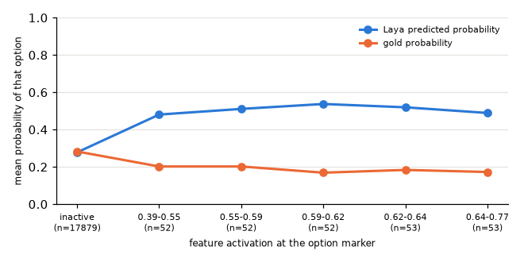

# Feature 6148

Critérios em que aparece: pred_probe_right_laya_wrong

**Interpretação (preencher):** 

---

## Maiores ativações

**tr_security_incidents_000170 / disposition** (choice, security_incidents) | ativação 2.139 em `estado` | opções ['close_benign', 'contain', 'investigate', 'monitor'] | Laya: **monitor** [0.068, 0.15, 0.05, 0.733] | gabarito: **investigate**

```
<bos> choice question: How should this security alert be dispositioned?<eos>
▸ <mask> close_benign: Expected, explainable activity; close without analyst time.
▸ <mask> contain: Contain the host or account immediately; do not wait for triage.
▸ <mask> investigate: Warrants an analyst opening an investigation.
▸ <mask> monitor: Not clearly malicious, but worth watching for recurrence.

<eos>

 {"alert": {"description": "a first-ever sign-in from an unfamiliar country", "evidence": "Service account svc_backup logged in from IP 45.77.22.9 (Russia) at 2026-09-16 08:45 UTC, representing the first sign‑in from that nation for this privileged service account. The authentication included MFA, and the source IP is not present in the allowlist⟦.⟧ Credential rotation for the account occurred three days earlier.", "rule": "new_country_login"}, "context": {"asset_criticality": "low", "change_window_active": false, "source_on_allowlist": false}, "history": {"credential_rotation_days_ago": 3, "distinct_countries_30d": 1, "logins_30d": 744, "prior_alerts_90d": 1}, "principal": {"mfa_enrolled": true, "name": "adm-infra-676", "privileges": ["deploy:production", "secrets:read"], "type": "service_account"}}<eos>
```

**tr_security_incidents_000170 / credential_compromise** (noul, security_incidents) | ativação 2.109 em `estado` | opções ['false', 'true'] | Laya: **false** [0.832, 0.168] | gabarito: **false**

```
<bos> noul question: The evidence indicates a credential or account has been compromised.<eos>
▸ <mask> false: no, the statement does not hold
▸ <mask> true: yes, the statement holds

<eos>

 {"alert": {"description": "a first-ever sign-in from an unfamiliar country", "evidence": "Service account svc_backup logged in from IP 45.77.22.9 (Russia) at 2026-09-16 08:45 UTC, representing the first sign‑in from that nation for this privileged service account. The authentication included MFA, and the source IP is not present in the allowlist⟦.⟧ Credential rotation for the account occurred three days earlier.", "rule": "new_country_login"}, "context": {"asset_criticality": "low", "change_window_active": false, "source_on_allowlist": false}, "history": {"credential_rotation_days_ago": 3, "distinct_countries_30d": 1, "logins_30d": 744, "prior_alerts_90d": 1}, "principal": {"mfa_enrolled": true, "name": "adm-infra-676", "privileges": ["deploy:production", "secrets:read"], "type": "service_account"}}<eos>
```

**tr_security_incidents_000170 / true_positive** (noul, security_incidents) | ativação 2.088 em `estado` | opções ['false', 'true'] | Laya: **false** [0.663, 0.337] | gabarito: **false**

```
<bos> noul question: This alert reflects genuinely malicious or unauthorised activity.<eos>
▸ <mask> false: Benign activity, a misconfiguration, or a known false positive.
▸ <mask> true: The underlying behaviour is malicious or unauthorised.

<eos>

 {"alert": {"description": "a first-ever sign-in from an unfamiliar country", "evidence": "Service account svc_backup logged in from IP 45.77.22.9 (Russia) at 2026-09-16 08:45 UTC, representing the first sign‑in from that nation for this privileged service account. The authentication included MFA, and the source IP is not present in the allowlist⟦.⟧ Credential rotation for the account occurred three days earlier.", "rule": "new_country_login"}, "context": {"asset_criticality": "low", "change_window_active": false, "source_on_allowlist": false}, "history": {"credential_rotation_days_ago": 3, "distinct_countries_30d": 1, "logins_30d": 744, "prior_alerts_90d": 1}, "principal": {"mfa_enrolled": true, "name": "adm-infra-676", "privileges": ["deploy:production", "secrets:read"], "type": "service_account"}}<eos>
```

**tr_security_incidents_000170 / urgency** (score, security_incidents) | ativação 2.033 em `estado` | opções ['0', '1', '2', '3'] | Laya: **1** [0.13, 0.504, 0.194, 0.172] | gabarito: **2**

```
<bos> score question: How quickly must a responder act on this alert?<eos>
▸ <mask> level 0: No time pressure; can wait indefinitely.
▸ <mask> level 1: Routine; handle within the normal queue.
▸ <mask> level 2: Elevated; should be handled within the same week.
▸ <mask> level 3: Critical; requires action within the same day.

<eos>

 {"alert": {"description": "a first-ever sign-in from an unfamiliar country", "evidence": "Service account svc_backup logged in from IP 45.77.22.9 (Russia) at 2026-09-16 08:45 UTC, representing the first sign‑in from that nation for this privileged service account. The authentication included MFA, and the source IP is not present in the allowlist⟦.⟧ Credential rotation for the account occurred three days earlier.", "rule": "new_country_login"}, "context": {"asset_criticality": "low", "change_window_active": false, "source_on_allowlist": false}, "history": {"credential_rotation_days_ago": 3, "distinct_countries_30d": 1, "logins_30d": 744, "prior_alerts_90d": 1}, "principal": {"mfa_enrolled": true, "name": "adm-infra-676", "privileges": ["deploy:production", "secrets:read"], "type": "service_account"}}<eos>
```

**tr_security_incidents_000005 / urgency** (score, security_incidents) | ativação 2.029 em `estado` | opções ['0', '1', '2', '3'] | Laya: **3** [0.063, 0.347, 0.152, 0.438] | gabarito: **2**

```
<bos> score question: How quickly must a responder act on this alert?<eos>
▸ <mask> level 0: No time pressure; can wait indefinitely.
▸ <mask> level 1: Routine; handle within the normal queue.
▸ <mask> level 2: Elevated; should be handled within the same week.
▸ <mask> level 3: Critical; requires action within the same day.

<eos>

 {"alert": {"description": "a session token was presented from a second address", "evidence": "Session token XYZ123 was presented to the API from internal address 10.0.0.5 at 2026-09-15 01:05:17 UTC, and the identical token was subsequently used from external address 198.51.100.22 at 01:06:12 UTC. The principal is an unprivileged CI runner with MFA active, the event occurred during an open change window, and the source is not on the recognised list⟦.⟧ Credential rotation for this token occurred 700 days ago.", "rule": "token_reuse"}, "context": {"asset_criticality": "low", "change_window_active": true, "source_on_allowlist": false}, "history": {"credential_rotation_days_ago": 700, "distinct_countries_30d": 1, "logins_30d": 1701, "prior_alerts_90d": 1}, "principal": {"mfa_enrolled": true, "name": "ci-deploy-438", "privileges": ["repo:read"], "type": "ci_runner"}}<eos>
```

## Ativações medianas (faixa 40-60%, mediana 0.468)

**tr_customer_service_000282 / category** (choice, customer_service) | ativação 0.500 em `opção` | opções ['account', 'billing', 'delivery', 'refund', 'technical'] | Laya: **technical** [0.091, 0.127, 0.004, 0.041, 0.737] | gabarito: **refund**

```
<bos> choice question: What is this customer conversation primarily about?<eos>
▸ <mask> account⟦:⟧ Login, plan changes, profile or access management.
▸ <mask> billing: A charge, invoice, subscription or payment problem.
▸ <mask> delivery: Shipping, fulfilment or delivery of a physical item.
▸ <mask> refund: The customer is explicitly asking for money back.
▸ <mask> technical: The product or service is not working as expected.

<eos>

 {"account": {"lifetime_value_usd": 53, "prior_tickets_90d": 0, "seats": 3, "tenure_months": 1, "tier": "premium"}, "thread": [{"role": "customer", "text": "I've been waiting for my refund to hit my account for days now and there's still nothing showing up. I signed up for the Premium plan last month and it's been nothing but a headache."}, {"role": "agent", "text": "I understand how concerning it is when expected funds don't appear. Could you please confirm the date you initially requested the transaction reversal?"}, {"role": "customer", "text": "I did it last Tuesday! It's ridiculous that I'm even having to ask about this because the confirmation email said it was processed immediately."}, {"role": "agent", "text": "Thank you for that information. To help me look into the status on our end, are you able to provide the transaction ID from that confirmation email?"}, {"role": "customer", "text": "I'm looking for it now, but I shouldn't have to jump through hoops just to get my money back from a service I barely used for four weeks."}]}<eos>
```

**tr_agent_trace_observability_000194 / outcome** (choice, agent_trace_observability) | ativação 0.436 em `estado` | opções ['failure', 'harmful', 'partial', 'success'] | Laya: **failure** [0.459, 0.059, 0.337, 0.145] | gabarito: **partial**

```
<bos> choice question: How did this agent run turn out?<eos>
▸ <mask> failure: The agent did not accomplish the task.
▸ <mask> harmful: The agent took an action that caused damage or violated a constraint.
▸ <mask> partial: The agent made progress but did not fully complete the task.
▸ <mask> success: The agent completed the task correctly.

<eos>

 {"agent": {"autonomy": "checkpointed", "model": "internal-agent-v1"},⟦ "⟧constraints": ["Do not force-push to any branch", "Do not exceed a $50 spend on cloud resources"], "task": "Backfill missing analytics events for the last seven days.", "trace_summary": {"constraint_violations": 0, "duration_s": 679.5, "irreversible_actions": 0, "steps": 4, "tool_errors": 2}}<eos>
```

**tr_security_incidents_000108 / disposition** (choice, security_incidents) | ativação 0.485 em `opção` | opções ['close_benign', 'contain', 'investigate', 'monitor'] | Laya: **monitor** [0.252, 0.094, 0.11, 0.543] | gabarito: **contain**

```
<bos> choice question: How should this security alert be dispositioned?<eos>
▸ <mask> close_benign⟦:⟧ Expected, explainable activity; close without analyst time.
▸ <mask> contain: Contain the host or account immediately; do not wait for triage.
▸ <mask> investigate: Warrants an analyst opening an investigation.
▸ <mask> monitor: Not clearly malicious, but worth watching for recurrence.

<eos>

 {"alert": {"description": "a large transfer to an external destination", "evidence": "A transfer of approximately 2.3 TB was recorded from internal address 10.12.45.78 to external destination 203.0.113.45 over TCP port 443, beginning at 2026-09-15 02:14 UTC and completing at 03:01 UTC. The activity originated from a shared_mailbox account with privileged rights, MFA enabled, and a password last rotated 90 days ago, occurring outside any defined change window.", "rule": "data_egress"}, "context": {"asset_criticality": "medium", "change_window_active": false, "source_on_allowlist": false}, "history": {"credential_rotation_days_ago": 90, "distinct_countries_30d": 1, "logins_30d": 1708, "prior_alerts_90d": 3}, "principal": {"mfa_enrolled": true, "name": "usr-support-496", "privileges": ["deploy:production", "secrets:read"], "type": "shared_mailbox"}}<eos>
```

**tr_security_incidents_000002 / severity** (score, security_incidents) | ativação 0.430 em `opção` | opções ['0', '1', '2', '3', '4'] | Laya: **1** [0.112, 0.503, 0.234, 0.085, 0.066] | gabarito: **3**

```
<bos> score question: How severe is the potential impact if this alert is real?<eos>
▸ <mask> level 0: Negligible: no access to anything sensitive.
▸ <mask> level 1: Low: limited access, easily reversed.
▸ <mask> level 2: Moderate: access to internal systems or non-public data.
▸ <mask> level 3: High: access to production, secrets or customer data.
▸ <mask> level 4⟦:⟧ Critical: active compromise of crown-jewel systems.

<eos>

 {"alert": {"description": "many failed authentications followed by a success", "evidence": "A sequence of 95 failed login attempts followed by a single successful authentication was recorded for the privileged `admin-shared-inbox` from an unknown source. The successful access utilized MFA-protected credentials that were last rotated 14 days prior to the event.", "rule": "brute_force"}, "context": {"asset_criticality": "medium", "change_window_active": false, "source_on_allowlist": false}, "history": {"credential_rotation_days_ago": 14, "distinct_countries_30d": 4, "logins_30d": 581, "prior_alerts_90d": 1}, "principal": {"mfa_enrolled": true, "name": "usr-support-225", "privileges": ["deploy:production", "secrets:read"], "type": "shared_mailbox"}}<eos>
```

**tr_security_incidents_000127 / true_positive** (noul, security_incidents) | ativação 0.447 em `estado` | opções ['false', 'true'] | Laya: **false** [0.651, 0.349] | gabarito: **true**

```
<bos> noul question: This alert reflects genuinely malicious or unauthorised activity.<eos>
▸ <mask> false: Benign activity, a misconfiguration, or a known false positive.
▸ <mask> true: The underlying behaviour is malicious or unauthorised.

<eos>

 {"alert": {"description": "a security group was opened to the public internet", "evidence": "On 2026‑09‑14 at 10:07 UTC, security group sg-0a1b2c3d was modified to allow inbound traffic from 0.0.0.0/0, exposing the associated resources publicly⟦.⟧ The change was applied by an admin account with privileged access, MFA enabled, from an unknown source IP, and the account’s password last rotation occurred 180 days ago.", "rule": "config_drift"}, "context": {"asset_criticality": "low", "change_window_active": false, "source_on_allowlist": false}, "history": {"credential_rotation_days_ago": 180, "distinct_countries_30d": 1, "logins_30d": 1581, "prior_alerts_90d": 0}, "principal": {"mfa_enrolled": true, "name": "adm-analytics-822", "privileges": ["deploy:production", "secrets:read"], "type": "admin"}}<eos>
```

## Estatísticas (conjunto de descoberta, dev e teste)

**pred / error**

| split | decisões | ativas | ativas e Laya errou | taxa | lift | q (BH) | OR (CMH) | q (CMH) |
|---|---|---|---|---|---|---|---|---|
| discovery | 5100 | 187 | 170 | 0.909 | 1.41 | 3.9e-16 | 0.49 | 0.507 |
| dev | 900 | 33 | 32 | 0.970 | 1.44 | 0.000355 | 0.00 | 0.729 |
| test | 2000 | 70 | 66 | 0.943 | 1.45 | 8.78e-08 | 1.10 | 0.976 |

**corr / error**

| split | decisões | ativas | ativas e Laya errou | taxa | lift | q (BH) | OR (CMH) | q (CMH) |
|---|---|---|---|---|---|---|---|---|
| discovery | 5100 | 22 | 5 | 0.227 | 0.35 | 0.000277 | 0.23 | 0.0744 |
| dev | 900 | 1 | 0 | 0.000 | 0.00 | nan | nan | nan |
| test | 2000 | 8 | 4 | 0.500 | 0.77 | nan | nan | nan |

**state / error**

| split | decisões | ativas | ativas e Laya errou | taxa | lift | q (BH) | OR (CMH) | q (CMH) |
|---|---|---|---|---|---|---|---|---|
| discovery | 5100 | 3103 | 1925 | 0.620 | 0.96 | 0.000128 | 1.13 | 0.425 |
| dev | 900 | 524 | 338 | 0.645 | 0.96 | 0.28 | 1.31 | 0.529 |
| test | 2000 | 1228 | 764 | 0.622 | 0.96 | 0.0183 | 1.10 | 0.785 |

**pred / probe_right_laya_wrong**

| split | decisões | ativas | ativas e Laya errou | taxa | lift | q (BH) | OR (CMH) | q (CMH) |
|---|---|---|---|---|---|---|---|---|
| discovery | 2819 | 130 | 130 | 1.000 | 1.55 | 2.07e-24 | nan | nan |
| dev | 520 | 23 | 23 | 1.000 | 1.48 | 0.000827 | nan | nan |
| test | 1106 | 53 | 52 | 0.981 | 1.55 | 7.26e-09 | 0.00 | 0.793 |

**corr / probe_right_laya_wrong**

| split | decisões | ativas | ativas e Laya errou | taxa | lift | q (BH) | OR (CMH) | q (CMH) |
|---|---|---|---|---|---|---|---|---|
| discovery | 2819 | 2 | 2 | 1.000 | 1.55 | nan | nan | nan |
| dev | 520 | 0 | 0 | nan | nan | nan | nan | nan |
| test | 1106 | 1 | 0 | 0.000 | 0.00 | nan | nan | nan |

**state / probe_right_laya_wrong**

| split | decisões | ativas | ativas e Laya errou | taxa | lift | q (BH) | OR (CMH) | q (CMH) |
|---|---|---|---|---|---|---|---|---|
| discovery | 2819 | 1726 | 1057 | 0.612 | 0.95 | 1.16e-05 | 1.47 | 0.00388 |
| dev | 520 | 303 | 196 | 0.647 | 0.96 | 0.423 | 1.75 | 0.148 |
| test | 1106 | 686 | 404 | 0.589 | 0.93 | 0.00277 | 1.42 | 0.217 |

Confusão mais sobre-representada (pred): `disposition|3>2` (n=133, lift 21.59, p=0). Formato `pergunta|índice previsto>índice correto`.

Confusão mais sobre-representada (corr): `disposition|1>3` (n=2, lift 154.55, p=5.32e-05). Formato `pergunta|índice previsto>índice correto`.

Confusão mais sobre-representada (state): `credential_compromise|1>0` (n=82, lift 1.64, p=1.32e-18). Formato `pergunta|índice previsto>índice correto`.



