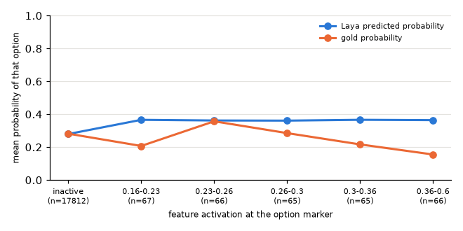

# Feature 6160

Critérios em que aparece: pred_probe_right_laya_wrong_stratified

**Interpretação (preencher):** 

---

## Maiores ativações

**tr_customer_service_000086 / needs_human** (noul, customer_service) | ativação 1.636 em `estado` | opções ['false', 'true'] | Laya: **true** [0.15, 0.85] | gabarito: **false**

```
<bos> noul question: This conversation requires a human agent rather than automated handling.<eos>
▸ <mask> false: Automation can carry this to resolution.
▸ <mask> true: A human must take over: judgement, authority or empathy is required.

<eos>

 {"account": {"lifetime_value_usd": 1071, "prior_tickets_90d": 2, "seats": 1, "tenure_months": 19, "tier": "standard"}, "thread": [{"role": "customer", "text": "I just got a bill that’s higher than what I expected, and I don’t understand why the charge jumped. Can⟦ someone⟧ explain what’s going on? I need this cleared up by tomorrow."}, {"role": "agent", "text": "I’m sorry for the surprise. Could you tell me the date and amount shown on the statement so I can compare it to your plan details?"}, {"role": "customer", "text": "It’s the charge dated 9/14 and I need to know if this is a mistake or a new fee before the end of the day."}]}<eos>
```

**tr_customer_service_000086 / category** (choice, customer_service) | ativação 1.593 em `estado` | opções ['account', 'billing', 'delivery', 'refund', 'technical'] | Laya: **billing** [0.0, 1.0, 0.0, 0.0, 0.0] | gabarito: **billing**

```
<bos> choice question: What is this customer conversation primarily about?<eos>
▸ <mask> account: Login, plan changes, profile or access management.
▸ <mask> billing: A charge, invoice, subscription or payment problem.
▸ <mask> delivery: Shipping, fulfilment or delivery of a physical item.
▸ <mask> refund: The customer is explicitly asking for money back.
▸ <mask> technical: The product or service is not working as expected.

<eos>

 {"account": {"lifetime_value_usd": 1071, "prior_tickets_90d": 2, "seats": 1, "tenure_months": 19, "tier": "standard"}, "thread": [{"role": "customer", "text": "I just got a bill that’s higher than what I expected, and I don’t understand why the charge jumped. Can⟦ someone⟧ explain what’s going on? I need this cleared up by tomorrow."}, {"role": "agent", "text": "I’m sorry for the surprise. Could you tell me the date and amount shown on the statement so I can compare it to your plan details?"}, {"role": "customer", "text": "It’s the charge dated 9/14 and I need to know if this is a mistake or a new fee before the end of the day."}]}<eos>
```

**tr_customer_service_000086 / churn_risk** (score, customer_service) | ativação 1.581 em `estado` | opções ['0', '1', '2', '3'] | Laya: **1** [0.081, 0.657, 0.221, 0.041] | gabarito: **1**

```
<bos> score question: How likely is this customer to stop doing business with us because of this interaction?<eos>
▸ <mask> level 0: No sign of dissatisfaction.
▸ <mask> level 1: Mild frustration, but the relationship is intact.
▸ <mask> level 2: Clearly unhappy; repeat problems or explicit complaints.
▸ <mask> level 3: Imminent: threatening to cancel, dispute or leave.

<eos>

 {"account": {"lifetime_value_usd": 1071, "prior_tickets_90d": 2, "seats": 1, "tenure_months": 19, "tier": "standard"}, "thread": [{"role": "customer", "text": "I just got a bill that’s higher than what I expected, and I don’t understand why the charge jumped. Can⟦ someone⟧ explain what’s going on? I need this cleared up by tomorrow."}, {"role": "agent", "text": "I’m sorry for the surprise. Could you tell me the date and amount shown on the statement so I can compare it to your plan details?"}, {"role": "customer", "text": "It’s the charge dated 9/14 and I need to know if this is a mistake or a new fee before the end of the day."}]}<eos>
```

**tr_customer_service_000086 / urgency** (score, customer_service) | ativação 1.581 em `estado` | opções ['0', '1', '2', '3'] | Laya: **1** [0.059, 0.503, 0.278, 0.161] | gabarito: **3**

```
<bos> score question: How time-sensitive is this conversation?<eos>
▸ <mask> level 0: No time pressure; can wait indefinitely.
▸ <mask> level 1: Routine; handle within the normal queue.
▸ <mask> level 2: Elevated; should be handled within the same week.
▸ <mask> level 3: Critical; requires action within the same day.

<eos>

 {"account": {"lifetime_value_usd": 1071, "prior_tickets_90d": 2, "seats": 1, "tenure_months": 19, "tier": "standard"}, "thread": [{"role": "customer", "text": "I just got a bill that’s higher than what I expected, and I don’t understand why the charge jumped. Can⟦ someone⟧ explain what’s going on? I need this cleared up by tomorrow."}, {"role": "agent", "text": "I’m sorry for the surprise. Could you tell me the date and amount shown on the statement so I can compare it to your plan details?"}, {"role": "customer", "text": "It’s the charge dated 9/14 and I need to know if this is a mistake or a new fee before the end of the day."}]}<eos>
```

**tr_customer_service_000086 / action** (choice, customer_service) | ativação 1.520 em `estado` | opções ['answer_directly', 'close_no_action', 'escalate_to_human', 'execute_refund', 'request_information'] | Laya: **answer_directly** [0.647, 0.181, 0.061, 0.021, 0.09] | gabarito: **request_information**

```
<bos> choice question: What should the assistant do next with this conversation?<eos>
▸ <mask> answer_directly: The assistant can resolve this itself with information it already has.
▸ <mask> close_no_action: No further action is warranted; the matter is settled.
▸ <mask> escalate_to_human: Hand off to a human agent with the appropriate authority.
▸ <mask> execute_refund: Issue the refund or credit the customer is owed.
▸ <mask> request_information: More detail is needed from the customer before anything can be done.

<eos>

 {"account": {"lifetime_value_usd": 1071, "prior_tickets_90d": 2, "seats": 1, "tenure_months": 19, "tier": "standard"}, "thread": [{"role": "customer", "text": "I just got a bill that’s higher than what I expected, and I don’t understand why the charge jumped. Can⟦ someone⟧ explain what’s going on? I need this cleared up by tomorrow."}, {"role": "agent", "text": "I’m sorry for the surprise. Could you tell me the date and amount shown on the statement so I can compare it to your plan details?"}, {"role": "customer", "text": "It’s the charge dated 9/14 and I need to know if this is a mistake or a new fee before the end of the day."}]}<eos>
```

## Ativações medianas (faixa 40-60%, mediana 0.630)

**tr_customer_service_000162 / churn_risk** (score, customer_service) | ativação 0.651 em `estado` | opções ['0', '1', '2', '3'] | Laya: **1** [0.168, 0.58, 0.2, 0.052] | gabarito: **3**

```
<bos> score question: How likely is this customer to stop doing business with us because of this interaction?<eos>
▸ <mask> level 0: No sign of dissatisfaction.
▸ <mask> level 1: Mild frustration, but the relationship is intact.
▸ <mask> level 2: Clearly unhappy; repeat problems or explicit complaints.
▸ <mask> level 3: Imminent: threatening to cancel, dispute or leave.

<eos>

 {"account": {"lifetime_value_usd": 155, "prior_tickets_90d": 2, "seats": 1, "tenure_months": 2, "tier": "standard"}, "orders": [{"amount_usd": 897, "date": "2026-03-22", "id": "A-96291", "status": "settled"}, {"amount_usd": 897, "date": "2026-03⟦-⟧09", "id": "A-39764", "status": "pending"}], "thread": [{"role": "customer", "text": "Good afternoon, could you please update me on the status of my $897 refund? I’ve opened two tickets already and haven’t heard back."}, {"role": "agent", "text": "Thank you for reaching out; may I have the ticket numbers so I can review what’s been done so far?"}, {"role": "customer", "text": "Sure, they’re 11234 and 11257. If this isn’t resolved soon I’ll have to think about moving to another provider."}]}<eos>
```

**tr_customer_service_000127 / urgency** (score, customer_service) | ativação 0.588 em `estado` | opções ['0', '1', '2', '3'] | Laya: **1** [0.235, 0.412, 0.217, 0.136] | gabarito: **3**

```
<bos> score question: How time-sensitive is this conversation?<eos>
▸ <mask> level 0: No time pressure; can wait indefinitely.
▸ <mask> level 1: Routine; handle within the normal queue.
▸ <mask> level 2: Elevated; should be handled within the same week.
▸ <mask> level 3: Critical; requires action within the same day.

<eos>

 {"account": {"lifetime_value_usd": 283, "prior_tickets_90d": 1, "seats": 1, "tenure_months": 3, "tier": "premium"}, "orders": [{"amount_usd": 38, "date": "2026-03-03", "id": "A-56312", "status": "failed"}, {"amount_usd": 38, "date": "2026-01⟦-⟧05", "id": "A-75782", "status": "failed"}], "thread": [{"role": "customer", "text": "I’m still seeing the same sluggishness in the dashboard, even after the last ticket where you promised a fix. It’s really holding us up."}, {"role": "agent", "text": "I’m sorry you’re experiencing that. Could you tell me which parts of the dashboard are loading slowly?"}, {"role": "customer", "text": "The main analytics view takes ages to render, and with our deadline coming up I can’t afford the delay."}]}<eos>
```

**tr_customer_service_000033 / action** (choice, customer_service) | ativação 0.591 em `estado` | opções ['answer_directly', 'close_no_action', 'escalate_to_human', 'execute_refund', 'request_information'] | Laya: **close_no_action** [0.067, 0.893, 0.015, 0.015, 0.01] | gabarito: **escalate_to_human**

```
<bos> choice question: What should the assistant do next with this conversation?<eos>
▸ <mask> answer_directly: The assistant can resolve this itself with information it already has.
▸ <mask> close_no_action: No further action is warranted; the matter is settled.
▸ <mask> escalate_to_human: Hand off to a human agent with the appropriate authority.
▸ <mask> execute_refund: Issue the refund or credit the customer is owed.
▸ <mask> request_information: More detail is needed from the customer before anything can be done.

<eos>

 {"account": {"lifetime_value_usd": 972, "prior_tickets_90d": 3, "seats": 1, "tenure_months": 49, "tier": "free"}, "orders": [{"amount_usd": 999, "date": "2026-03⟦-⟧06", "id": "A-72271", "status": "settled"}, {"amount_usd": 999, "date": "2026-02-16", "id": "A-14198", "status": "settled"}, {"amount_usd": 999, "date": "2026-01-05", "id": "A-90678", "status": "settled"}], "thread": [{"role": "customer", "text": "I've been trying to downgrade to the free plan for three days now and the website just keeps looping me back to the dashboard. This is incredibly annoying given I've been a loyal user for over four years."}, {"role": "agent", "text": "I'm sorry for the frustration the downgrade process is causing. Could you tell me if you are seeing any specific error codes or pop-up messages when the page refreshes?"}, {"role": "customer", "text": "There are no codes, it just fails silently. I've spent almost a thousand dollars with you guys over 49 months, and after having three previous tickets only 'partially' addressed, I really expected a simple plan change to actually work."}, {"role": "agent", "text": "I appreciate your long-term history with us. To help me investigate the account block, would you mind specifying which features from those three previous tickets are still causing you issues on your current plan?"}, {"role": "customer", "text": "The seat management and the data exports never worked right, which is why I'm trying to scale back. I'm just tired of paying for a service that feels broken every time I try to adjust my settings."}]}<eos>
```

**tr_invoice_processing_000108 / urgency** (score, invoice_processing) | ativação 0.548 em `opção` | opções ['0', '1', '2', '3'] | Laya: **1** [0.086, 0.548, 0.278, 0.088] | gabarito: **2**

```
<bos> score question: How time-sensitive is processing this invoice?<eos>
▸ <mask> level 0: No time pressure; can wait indefinitely.
▸ <mask> level 1:⟦ Routine⟧; handle within the normal queue.
▸ <mask> level 2: Elevated; should be handled within the same week.
▸ <mask> level 3: Critical; requires action within the same day.

<eos>

 {"delivery": {"condition": "accepted with exceptions", "date": "2026-03-13", "received_qty": 400}, "invoice": {"currency": "USD", "id": "INV-2026-7363", "lines": [{"qty": 400, "sku": "SKU-513", "total_usd": 140000.0, "unit_usd": 350.0}], "total_usd": 140000.0, "vendor": "Orbit Logistics"}, "payment": {"days_until_due": 2, "discount_expires_in_days": 6, "early_payment_discount_pct": 2.0, "status": "scheduled", "terms": "net 30"}, "purchase_order": {"freight_terms": "freight prepaid by vendor, not separately billable", "id": "PO-9819", "lines": [{"qty": 400, "unit_usd": 350.0}], "total_usd": 140000.0}, "vendor_history": {"disputes_12m": 2, "invoices_12m": 45, "prior_invoice_ids": ["INV-2026-4378"]}}<eos>
```

**tr_invoice_processing_000140 / urgency** (score, invoice_processing) | ativação 0.602 em `opção` | opções ['0', '1', '2', '3'] | Laya: **1** [0.13, 0.509, 0.217, 0.145] | gabarito: **2**

```
<bos> score question: How time-sensitive is processing this invoice?<eos>
▸ <mask> level 0: No time pressure; can wait indefinitely.
▸ <mask> level 1:⟦ Routine⟧; handle within the normal queue.
▸ <mask> level 2: Elevated; should be handled within the same week.
▸ <mask> level 3: Critical; requires action within the same day.

<eos>

 {"delivery": {"condition": "accepted", "date": "2026-03-02", "received_qty": 100}, "invoice": {"currency": "USD", "id": "INV-2026-6639", "lines": [{"qty": 100, "sku": "SKU-142", "total_usd": 15539.0, "unit_usd": 155.39}], "total_usd": 15539.0, "vendor": "Vantage Materials"}, "payment": {"days_until_due": -3, "discount_expires_in_days": 6, "early_payment_discount_pct": 2.0, "status": "overdue", "terms": "net 15"}, "purchase_order": {"freight_terms": "freight prepaid by vendor, not separately billable", "id": "PO-7923", "lines": [{"qty": 100, "unit_usd": 155.39}], "total_usd": 15539.0}, "vendor_history": {"disputes_12m": 0, "invoices_12m": 28, "prior_invoice_ids": ["INV-2026-2424", "INV-2026-3153", "INV-2026-4355"]}}<eos>
```

## Estatísticas (conjunto de descoberta, dev e teste)

**pred / error**

| split | decisões | ativas | ativas e Laya errou | taxa | lift | q (BH) | OR (CMH) | q (CMH) |
|---|---|---|---|---|---|---|---|---|
| discovery | 5100 | 174 | 108 | 0.621 | 0.96 | 0.623 | 1.95 | 0.06 |
| dev | 900 | 25 | 20 | 0.800 | 1.19 | 0.354 | 4.89 | 0.437 |
| test | 2000 | 61 | 36 | 0.590 | 0.91 | 0.462 | 1.92 | 0.382 |

**corr / error**

| split | decisões | ativas | ativas e Laya errou | taxa | lift | q (BH) | OR (CMH) | q (CMH) |
|---|---|---|---|---|---|---|---|---|
| discovery | 5100 | 101 | 35 | 0.347 | 0.54 | 4.75e-09 | 0.30 | 2.35e-05 |
| dev | 900 | 10 | 5 | 0.500 | 0.74 | nan | nan | nan |
| test | 2000 | 38 | 13 | 0.342 | 0.53 | 0.000391 | 0.30 | 0.0692 |

**state / error**

| split | decisões | ativas | ativas e Laya errou | taxa | lift | q (BH) | OR (CMH) | q (CMH) |
|---|---|---|---|---|---|---|---|---|
| discovery | 5100 | 454 | 282 | 0.621 | 0.96 | 0.493 | 1.03 | 0.948 |
| dev | 900 | 77 | 54 | 0.701 | 1.04 | 0.941 | 1.32 | 0.692 |
| test | 2000 | 194 | 113 | 0.582 | 0.90 | 0.197 | 0.81 | 0.59 |

**pred / probe_right_laya_wrong**

| split | decisões | ativas | ativas e Laya errou | taxa | lift | q (BH) | OR (CMH) | q (CMH) |
|---|---|---|---|---|---|---|---|---|
| discovery | 2819 | 84 | 59 | 0.702 | 1.09 | 0.377 | 7.77 | 2.67e-07 |
| dev | 520 | 15 | 13 | 0.867 | 1.28 | nan | nan | nan |
| test | 1106 | 29 | 16 | 0.552 | 0.87 | 0.568 | 7.79 | 0.0499 |

**corr / probe_right_laya_wrong**

| split | decisões | ativas | ativas e Laya errou | taxa | lift | q (BH) | OR (CMH) | q (CMH) |
|---|---|---|---|---|---|---|---|---|
| discovery | 2819 | 38 | 13 | 0.342 | 0.53 | 0.000363 | 0.46 | 0.265 |
| dev | 520 | 6 | 4 | 0.667 | 0.99 | nan | nan | nan |
| test | 1106 | 22 | 9 | 0.409 | 0.65 | 0.0709 | 0.51 | 0.523 |

**state / probe_right_laya_wrong**

| split | decisões | ativas | ativas e Laya errou | taxa | lift | q (BH) | OR (CMH) | q (CMH) |
|---|---|---|---|---|---|---|---|---|
| discovery | 2819 | 247 | 151 | 0.611 | 0.94 | 0.374 | 1.02 | 0.964 |
| dev | 520 | 41 | 28 | 0.683 | 1.01 | 1 | 1.31 | 0.687 |
| test | 1106 | 116 | 58 | 0.500 | 0.79 | 0.0208 | 0.63 | 0.233 |

Confusão mais sobre-representada (pred): `urgency|3>1` (n=58, lift 20.73, p=0). Formato `pergunta|índice previsto>índice correto`.

Confusão mais sobre-representada (corr): `urgency|1>3` (n=32, lift 10.70, p=1.65e-25). Formato `pergunta|índice previsto>índice correto`.

Confusão mais sobre-representada (state): `action|1>2` (n=20, lift 3.16, p=1.98e-06). Formato `pergunta|índice previsto>índice correto`.



