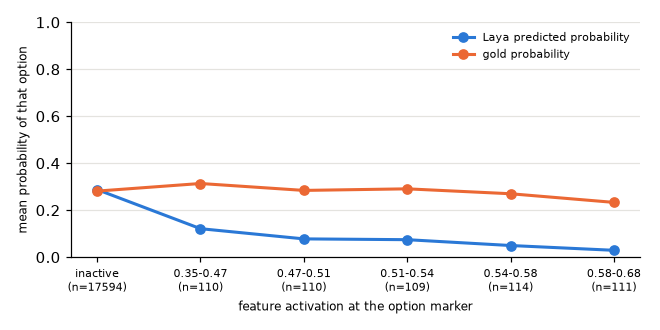

# Feature 6470

Critérios em que aparece: corr_probe_right_laya_wrong

**Interpretação (preencher):** 

---

## Maiores ativações

**tr_customer_service_000019 / churn_risk** (score, customer_service) | ativação 2.082 em `estado` | opções ['0', '1', '2', '3'] | Laya: **2** [0.017, 0.319, 0.614, 0.05] | gabarito: **2**

```
<bos> score question: How likely is this customer to stop doing business with us because of this interaction?<eos>
▸ <mask> level 0: No sign of dissatisfaction.
▸ <mask> level 1: Mild frustration, but the relationship is intact.
▸ <mask> level 2: Clearly unhappy; repeat problems or explicit complaints.
▸ <mask> level 3: Imminent: threatening to cancel, dispute or leave.

<eos>

 {"account": {"lifetime_value_usd": 510, "prior_tickets_90d": 0, "seats": 1, "tenure_months": 19, "tier": "standard"}, "thread": [{"role": "customer", "text": "Looks like my payment didn’t go through again. I’ve been on the standard plan for 19 months, and I’m just kind of fed⟦ up⟧ with this happening."}, {"role": "agent", "text": "I’m sorry you’re experiencing this. Could you tell me the email address linked to your account or the transaction ID you saw?"}, {"role": "customer", "text": "The account email is user@example.com. I tried a couple of different cards, but each attempt ends with an error."}, {"role": "agent", "text": "Thanks for the details. Would you like me to walk you through updating the payment method, or is there another way you’d prefer to proceed?"}, {"role": "customer", "text": "Yes, please. I need guidance on how to add a new card or fix the current one. Thanks."}]}<eos>
```

**tr_customer_service_000019 / urgency** (score, customer_service) | ativação 2.012 em `estado` | opções ['0', '1', '2', '3'] | Laya: **1** [0.155, 0.488, 0.187, 0.17] | gabarito: **1**

```
<bos> score question: How time-sensitive is this conversation?<eos>
▸ <mask> level 0: No time pressure; can wait indefinitely.
▸ <mask> level 1: Routine; handle within the normal queue.
▸ <mask> level 2: Elevated; should be handled within the same week.
▸ <mask> level 3: Critical; requires action within the same day.

<eos>

 {"account": {"lifetime_value_usd": 510, "prior_tickets_90d": 0, "seats": 1, "tenure_months": 19, "tier": "standard"}, "thread": [{"role": "customer", "text": "Looks like my payment didn’t go through again. I’ve been on the standard plan for 19 months, and I’m just kind of fed⟦ up⟧ with this happening."}, {"role": "agent", "text": "I’m sorry you’re experiencing this. Could you tell me the email address linked to your account or the transaction ID you saw?"}, {"role": "customer", "text": "The account email is user@example.com. I tried a couple of different cards, but each attempt ends with an error."}, {"role": "agent", "text": "Thanks for the details. Would you like me to walk you through updating the payment method, or is there another way you’d prefer to proceed?"}, {"role": "customer", "text": "Yes, please. I need guidance on how to add a new card or fix the current one. Thanks."}]}<eos>
```

**tr_customer_service_000019 / needs_human** (noul, customer_service) | ativação 1.966 em `estado` | opções ['false', 'true'] | Laya: **true** [0.083, 0.917] | gabarito: **false**

```
<bos> noul question: This conversation requires a human agent rather than automated handling.<eos>
▸ <mask> false: Automation can carry this to resolution.
▸ <mask> true: A human must take over: judgement, authority or empathy is required.

<eos>

 {"account": {"lifetime_value_usd": 510, "prior_tickets_90d": 0, "seats": 1, "tenure_months": 19, "tier": "standard"}, "thread": [{"role": "customer", "text": "Looks like my payment didn’t go through again. I’ve been on the standard plan for 19 months, and I’m just kind of fed⟦ up⟧ with this happening."}, {"role": "agent", "text": "I’m sorry you’re experiencing this. Could you tell me the email address linked to your account or the transaction ID you saw?"}, {"role": "customer", "text": "The account email is user@example.com. I tried a couple of different cards, but each attempt ends with an error."}, {"role": "agent", "text": "Thanks for the details. Would you like me to walk you through updating the payment method, or is there another way you’d prefer to proceed?"}, {"role": "customer", "text": "Yes, please. I need guidance on how to add a new card or fix the current one. Thanks."}]}<eos>
```

**tr_customer_service_000019 / action** (choice, customer_service) | ativação 1.930 em `estado` | opções ['answer_directly', 'close_no_action', 'escalate_to_human', 'execute_refund', 'request_information'] | Laya: **answer_directly** [0.708, 0.174, 0.036, 0.066, 0.015] | gabarito: **answer_directly**

```
<bos> choice question: What should the assistant do next with this conversation?<eos>
▸ <mask> answer_directly: The assistant can resolve this itself with information it already has.
▸ <mask> close_no_action: No further action is warranted; the matter is settled.
▸ <mask> escalate_to_human: Hand off to a human agent with the appropriate authority.
▸ <mask> execute_refund: Issue the refund or credit the customer is owed.
▸ <mask> request_information: More detail is needed from the customer before anything can be done.

<eos>

 {"account": {"lifetime_value_usd": 510, "prior_tickets_90d": 0, "seats": 1, "tenure_months": 19, "tier": "standard"}, "thread": [{"role": "customer", "text": "Looks like my payment didn’t go through again. I’ve been on the standard plan for 19 months, and I’m just kind of fed⟦ up⟧ with this happening."}, {"role": "agent", "text": "I’m sorry you’re experiencing this. Could you tell me the email address linked to your account or the transaction ID you saw?"}, {"role": "customer", "text": "The account email is user@example.com. I tried a couple of different cards, but each attempt ends with an error."}, {"role": "agent", "text": "Thanks for the details. Would you like me to walk you through updating the payment method, or is there another way you’d prefer to proceed?"}, {"role": "customer", "text": "Yes, please. I need guidance on how to add a new card or fix the current one. Thanks."}]}<eos>
```

**tr_customer_service_000019 / category** (choice, customer_service) | ativação 1.835 em `estado` | opções ['account', 'billing', 'delivery', 'refund', 'technical'] | Laya: **account** [0.843, 0.011, 0.001, 0.001, 0.144] | gabarito: **billing**

```
<bos> choice question: What is this customer conversation primarily about?<eos>
▸ <mask> account: Login, plan changes, profile or access management.
▸ <mask> billing: A charge, invoice, subscription or payment problem.
▸ <mask> delivery: Shipping, fulfilment or delivery of a physical item.
▸ <mask> refund: The customer is explicitly asking for money back.
▸ <mask> technical: The product or service is not working as expected.

<eos>

 {"account": {"lifetime_value_usd": 510, "prior_tickets_90d": 0, "seats": 1, "tenure_months": 19, "tier": "standard"}, "thread": [{"role": "customer", "text": "Looks like my payment didn’t go through again. I’ve been on the standard plan for 19 months, and I’m just kind of fed⟦ up⟧ with this happening."}, {"role": "agent", "text": "I’m sorry you’re experiencing this. Could you tell me the email address linked to your account or the transaction ID you saw?"}, {"role": "customer", "text": "The account email is user@example.com. I tried a couple of different cards, but each attempt ends with an error."}, {"role": "agent", "text": "Thanks for the details. Would you like me to walk you through updating the payment method, or is there another way you’d prefer to proceed?"}, {"role": "customer", "text": "Yes, please. I need guidance on how to add a new card or fix the current one. Thanks."}]}<eos>
```

## Ativações medianas (faixa 40-60%, mediana 0.532)

**tr_customer_service_000221 / action** (choice, customer_service) | ativação 0.548 em `pergunta` | opções ['answer_directly', 'close_no_action', 'escalate_to_human', 'execute_refund', 'request_information'] | Laya: **close_no_action** [0.305, 0.517, 0.037, 0.031, 0.11] | gabarito: **escalate_to_human**

```
<bos> choice question: What should the assistant do next⟦ with⟧ this conversation?<eos>
▸ <mask> answer_directly: The assistant can resolve this itself with information it already has.
▸ <mask> close_no_action: No further action is warranted; the matter is settled.
▸ <mask> escalate_to_human: Hand off to a human agent with the appropriate authority.
▸ <mask> execute_refund: Issue the refund or credit the customer is owed.
▸ <mask> request_information: More detail is needed from the customer before anything can be done.

<eos>

 {"account": {"lifetime_value_usd": 1327, "prior_tickets_90d": 0, "seats": 1, "tenure_months": 14, "tier": "standard"}, "orders": [{"amount_usd": 149, "date": "2026-02-16", "id": "A-75209", "status": "pending"}, {"amount_usd": 149, "date": "2026-02-14", "id": "A-62252", "status": "settled"}], "thread": [{"role": "customer", "text": "My order arrived this afternoon, but the contents are incorrect. I received a blue thermal carafe instead of the stainless steel model I ordered."}, {"role": "agent", "text": "I apologize for the mix-up with your shipment. I’d like to look into this for you; could you please share your order number and the SKU listed on the box you received?"}, {"role": "customer", "text": "The order number is #88492-AX. The box says SKU-992-B, but my invoice clearly lists SKU-992-S."}, {"role": "agent", "text": "Thank you for verifying those details. Are you able to upload a photo of the item you received so I can confirm the discrepancy for our records?"}, {"role": "customer", "text": "I've attached the photo to this message. Please let me know what the next steps are once you have verified it."}]}<eos>
```

**tr_security_incidents_000065 / disposition** (choice, security_incidents) | ativação 0.522 em `opção` | opções ['close_benign', 'contain', 'investigate', 'monitor'] | Laya: **monitor** [0.218, 0.055, 0.221, 0.506] | gabarito: **investigate**

```
<bos> choice question: How should this security alert be dispositioned?<eos>
▸ <mask> close_benign⟦:⟧ Expected, explainable activity; close without analyst time.
▸ <mask> contain: Contain the host or account immediately; do not wait for triage.
▸ <mask> investigate: Warrants an analyst opening an investigation.
▸ <mask> monitor: Not clearly malicious, but worth watching for recurrence.

<eos>

 {"alert": {"description": "an unrecognised binary executed on a server", "evidence": "At 2026-09-15 14:23:08 UTC, an employee workstation \"workstation-12\" launched the unknown binary \"/tmp/lsass_helper\" (PID 5874) on server \"app-prod-01\" during an open change window. The execution originated from an unrecognised source IP 192.0.2.55, and the employee’s MFA token was validated. The user’s credentials were last rotated 90 days ago.", "rule": "suspicious_process"}, "context": {"asset_criticality": "low", "change_window_active": true, "source_on_allowlist": false}, "history": {"credential_rotation_days_ago": 90, "distinct_countries_30d": 4, "logins_30d": 1617, "prior_alerts_90d": 0}, "principal": {"mfa_enrolled": true, "name": "usr-billing-187", "privileges": ["repo:read"], "type": "employee"}}<eos>
```

**tr_customer_service_000001 / category** (choice, customer_service) | ativação 0.539 em `opção` | opções ['account', 'billing', 'delivery', 'refund', 'technical'] | Laya: **account** [0.999, 0.0, 0.0, 0.0, 0.0] | gabarito: **account**

```
<bos> choice question: What is this customer conversation primarily about?<eos>
▸ <mask> account: Login, plan changes, profile or access management.
▸ <mask> billing: A charge, invoice, subscription⟦ or⟧ payment problem.
▸ <mask> delivery: Shipping, fulfilment or delivery of a physical item.
▸ <mask> refund: The customer is explicitly asking for money back.
▸ <mask> technical: The product or service is not working as expected.

<eos>

 {"account": {"lifetime_value_usd": 1646, "prior_tickets_90d": 1, "seats": 5, "tenure_months": 26, "tier": "premium"}, "orders": [{"amount_usd": 9, "date": "2026-01-23", "id": "A-68034", "status": "settled"}, {"amount_usd": 9, "date": "2026-03-16", "id": "A-14370", "status": "settled"}, {"amount_usd": 9, "date": "2026-03-08", "id": "A-24814", "status": "refunded"}], "thread": [{"role": "customer", "text": "I can’t log in to my premium dashboard at all – I need access immediately, this is urgent."}, {"role": "agent", "text": "I understand the urgency. Are you seeing any error message when you try to sign in?"}, {"role": "customer", "text": "It just says “Invalid credentials” even though I’m sure my password is correct. My account is tied to jason.lee@example.com."}]}<eos>
```

**tr_security_incidents_000257 / disposition** (choice, security_incidents) | ativação 0.484 em `opção` | opções ['close_benign', 'contain', 'investigate', 'monitor'] | Laya: **monitor** [0.086, 0.244, 0.074, 0.595] | gabarito: **investigate**

```
<bos> choice question: How should this security alert be dispositioned?<eos>
▸ <mask> close_benign⟦:⟧ Expected, explainable activity; close without analyst time.
▸ <mask> contain: Contain the host or account immediately; do not wait for triage.
▸ <mask> investigate: Warrants an analyst opening an investigation.
▸ <mask> monitor: Not clearly malicious, but worth watching for recurrence.

<eos>

 {"alert": {"description": "a first-ever sign-in from an unfamiliar country", "evidence": "The 'svc-deploy-01' service account authenticated from a previously unseen country via an allowlisted endpoint. This login occurred without multi-factor authentication using credentials rotated 3 days ago, and no official change window was in effect.", "rule": "new_country_login"}, "context": {"asset_criticality": "medium", "change_window_active": false, "source_on_allowlist": true}, "history": {"credential_rotation_days_ago": 3, "distinct_countries_30d": 1, "logins_30d": 1839, "prior_alerts_90d": 1}, "principal": {"mfa_enrolled": false, "name": "usr-support-915", "privileges": ["deploy:production", "secrets:read"], "type": "service_account"}}<eos>
```

**tr_security_incidents_000246 / severity** (score, security_incidents) | ativação 0.504 em `estado` | opções ['0', '1', '2', '3', '4'] | Laya: **1** [0.091, 0.506, 0.186, 0.1, 0.117] | gabarito: **4**

```
<bos> score question: How severe is the potential impact if this alert is real?<eos>
▸ <mask> level 0: Negligible: no access to anything sensitive.
▸ <mask> level 1: Low: limited access, easily reversed.
▸ <mask> level 2: Moderate: access to internal systems or non-public data.
▸ <mask> level 3: High: access to production, secrets or customer data.
▸ <mask> level 4: Critical: active compromise of crown-jewel systems.

<eos>

 {"alert": {"description": "two successful logins from distant locations too close together", "evidence": "The privileged service account successfully authenticated from IP 192.0.2.1 at 10:00 UTC and from 203.0.113.5 at 10:15 UTC. These login events originated from unrecognized sources during a period with no scheduled maintenance, and the account lacks MFA protection.", "rule": "impossible_travel"}, "context": {"asset_criticality": "crown_jewel", "change_window_active": false, "source_on_allowlist": false}, "history": {"credential_rotation_days_ago": 30, "distinct_countries_30d": 2, "logins_30d": 649, "prior_alerts_90d": 0}, "principal": {"mfa_enrolled": false, "name": "svc⟦-⟧infra-129", "privileges": ["deploy:production", "secrets:read"], "type": "service_account"}}<eos>
```

## Estatísticas (conjunto de descoberta, dev e teste)

**pred / error**

| split | decisões | ativas | ativas e Laya errou | taxa | lift | q (BH) | OR (CMH) | q (CMH) |
|---|---|---|---|---|---|---|---|---|
| discovery | 5100 | 17 | 16 | 0.941 | 1.46 | nan | nan | nan |
| dev | 900 | 7 | 7 | 1.000 | 1.49 | nan | nan | nan |
| test | 2000 | 9 | 7 | 0.778 | 1.20 | nan | nan | nan |

**corr / error**

| split | decisões | ativas | ativas e Laya errou | taxa | lift | q (BH) | OR (CMH) | q (CMH) |
|---|---|---|---|---|---|---|---|---|
| discovery | 5100 | 162 | 161 | 0.994 | 1.54 | 7.29e-29 | 3.96 | 0.347 |
| dev | 900 | 22 | 22 | 1.000 | 1.49 | 0.000812 | inf | 0.982 |
| test | 2000 | 57 | 55 | 0.965 | 1.48 | 7.88e-08 | 0.69 | 0.907 |

**state / error**

| split | decisões | ativas | ativas e Laya errou | taxa | lift | q (BH) | OR (CMH) | q (CMH) |
|---|---|---|---|---|---|---|---|---|
| discovery | 5100 | 2635 | 1671 | 0.634 | 0.99 | 0.283 | 0.98 | 0.937 |
| dev | 900 | 504 | 333 | 0.661 | 0.98 | 0.791 | 0.81 | 0.604 |
| test | 2000 | 1026 | 669 | 0.652 | 1.00 | 1 | 0.93 | 0.819 |

**pred / probe_right_laya_wrong**

| split | decisões | ativas | ativas e Laya errou | taxa | lift | q (BH) | OR (CMH) | q (CMH) |
|---|---|---|---|---|---|---|---|---|
| discovery | 2819 | 13 | 13 | 1.000 | 1.55 | nan | nan | nan |
| dev | 520 | 2 | 2 | 1.000 | 1.48 | nan | nan | nan |
| test | 1106 | 7 | 7 | 1.000 | 1.58 | nan | nan | nan |

**corr / probe_right_laya_wrong**

| split | decisões | ativas | ativas e Laya errou | taxa | lift | q (BH) | OR (CMH) | q (CMH) |
|---|---|---|---|---|---|---|---|---|
| discovery | 2819 | 42 | 42 | 1.000 | 1.55 | 4.89e-08 | inf | 0.574 |
| dev | 520 | 6 | 6 | 1.000 | 1.48 | nan | nan | nan |
| test | 1106 | 15 | 15 | 1.000 | 1.58 | nan | nan | nan |

**state / probe_right_laya_wrong**

| split | decisões | ativas | ativas e Laya errou | taxa | lift | q (BH) | OR (CMH) | q (CMH) |
|---|---|---|---|---|---|---|---|---|
| discovery | 2819 | 1473 | 916 | 0.622 | 0.96 | 0.0122 | 0.77 | 0.0368 |
| dev | 520 | 298 | 194 | 0.651 | 0.96 | 0.52 | 0.70 | 0.384 |
| test | 1106 | 580 | 367 | 0.633 | 1.00 | 1 | 0.91 | 0.776 |

Confusão mais sobre-representada (pred): `disposition|3>2` (n=10, lift 17.86, p=nan). Formato `pergunta|índice previsto>índice correto`.

Confusão mais sobre-representada (corr): `action|3>2` (n=102, lift 27.92, p=0). Formato `pergunta|índice previsto>índice correto`.

Confusão mais sobre-representada (state): `discrepancy_severity|2>0` (n=98, lift 1.76, p=1.17e-18). Formato `pergunta|índice previsto>índice correto`.



