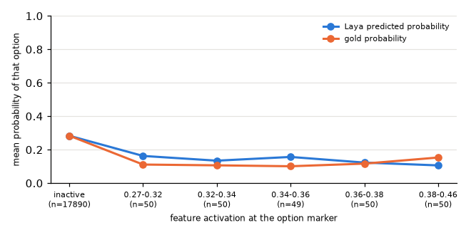

# Feature 6612

Critérios em que aparece: corr_error_stratified

**Interpretação (preencher):** 

---

## Maiores ativações

**tr_security_incidents_000273 / credential_compromise** (noul, security_incidents) | ativação 3.355 em `estado` | opções ['false', 'true'] | Laya: **true** [0.01, 0.99] | gabarito: **true**

```
<bos> noul question: The evidence indicates a credential or account has been compromised.<eos>
▸ <mask> false: no, the statement does not hold
▸ <mask> true: yes, the statement holds

<eos>

 {"alert": {"description": "an endpoint agent matched a known signature", "evidence": "Endpoint sensor on workstation WKS-07 detected a file named '⟦sv⟧chost64.dll' in C:\\Users\\temp that matched the known malware signature 'Trojan:Win32/Emotet.A' at 2026-09-15 08:17:02 UTC. The detection was generated by an unregistered source. The associated admin account, which has MFA enabled and was last rotated 14 days prior, was not in a scheduled change window.", "rule": "malware_signature"}, "context": {"asset_criticality": "medium", "change_window_active": false, "source_on_allowlist": false}, "history": {"credential_rotation_days_ago": 14, "distinct_countries_30d": 2, "logins_30d": 1414, "prior_alerts_90d": 0}, "principal": {"mfa_enrolled": true, "name": "adm-infra-828", "privileges": ["deploy:production", "secrets:read"], "type": "admin"}}<eos>
```

**tr_security_incidents_000273 / disposition** (choice, security_incidents) | ativação 3.330 em `estado` | opções ['close_benign', 'contain', 'investigate', 'monitor'] | Laya: **monitor** [0.0, 0.0, 0.035, 0.964] | gabarito: **contain**

```
<bos> choice question: How should this security alert be dispositioned?<eos>
▸ <mask> close_benign: Expected, explainable activity; close without analyst time.
▸ <mask> contain: Contain the host or account immediately; do not wait for triage.
▸ <mask> investigate: Warrants an analyst opening an investigation.
▸ <mask> monitor: Not clearly malicious, but worth watching for recurrence.

<eos>

 {"alert": {"description": "an endpoint agent matched a known signature", "evidence": "Endpoint sensor on workstation WKS-07 detected a file named '⟦sv⟧chost64.dll' in C:\\Users\\temp that matched the known malware signature 'Trojan:Win32/Emotet.A' at 2026-09-15 08:17:02 UTC. The detection was generated by an unregistered source. The associated admin account, which has MFA enabled and was last rotated 14 days prior, was not in a scheduled change window.", "rule": "malware_signature"}, "context": {"asset_criticality": "medium", "change_window_active": false, "source_on_allowlist": false}, "history": {"credential_rotation_days_ago": 14, "distinct_countries_30d": 2, "logins_30d": 1414, "prior_alerts_90d": 0}, "principal": {"mfa_enrolled": true, "name": "adm-infra-828", "privileges": ["deploy:production", "secrets:read"], "type": "admin"}}<eos>
```

**tr_security_incidents_000273 / severity** (score, security_incidents) | ativação 3.125 em `estado` | opções ['0', '1', '2', '3', '4'] | Laya: **1** [0.126, 0.352, 0.262, 0.172, 0.089] | gabarito: **3**

```
<bos> score question: How severe is the potential impact if this alert is real?<eos>
▸ <mask> level 0: Negligible: no access to anything sensitive.
▸ <mask> level 1: Low: limited access, easily reversed.
▸ <mask> level 2: Moderate: access to internal systems or non-public data.
▸ <mask> level 3: High: access to production, secrets or customer data.
▸ <mask> level 4: Critical: active compromise of crown-jewel systems.

<eos>

 {"alert": {"description": "an endpoint agent matched a known signature", "evidence": "Endpoint sensor on workstation WKS-07 detected a file named '⟦sv⟧chost64.dll' in C:\\Users\\temp that matched the known malware signature 'Trojan:Win32/Emotet.A' at 2026-09-15 08:17:02 UTC. The detection was generated by an unregistered source. The associated admin account, which has MFA enabled and was last rotated 14 days prior, was not in a scheduled change window.", "rule": "malware_signature"}, "context": {"asset_criticality": "medium", "change_window_active": false, "source_on_allowlist": false}, "history": {"credential_rotation_days_ago": 14, "distinct_countries_30d": 2, "logins_30d": 1414, "prior_alerts_90d": 0}, "principal": {"mfa_enrolled": true, "name": "adm-infra-828", "privileges": ["deploy:production", "secrets:read"], "type": "admin"}}<eos>
```

**tr_security_incidents_000273 / urgency** (score, security_incidents) | ativação 3.119 em `estado` | opções ['0', '1', '2', '3'] | Laya: **3** [0.118, 0.188, 0.122, 0.572] | gabarito: **3**

```
<bos> score question: How quickly must a responder act on this alert?<eos>
▸ <mask> level 0: No time pressure; can wait indefinitely.
▸ <mask> level 1: Routine; handle within the normal queue.
▸ <mask> level 2: Elevated; should be handled within the same week.
▸ <mask> level 3: Critical; requires action within the same day.

<eos>

 {"alert": {"description": "an endpoint agent matched a known signature", "evidence": "Endpoint sensor on workstation WKS-07 detected a file named '⟦sv⟧chost64.dll' in C:\\Users\\temp that matched the known malware signature 'Trojan:Win32/Emotet.A' at 2026-09-15 08:17:02 UTC. The detection was generated by an unregistered source. The associated admin account, which has MFA enabled and was last rotated 14 days prior, was not in a scheduled change window.", "rule": "malware_signature"}, "context": {"asset_criticality": "medium", "change_window_active": false, "source_on_allowlist": false}, "history": {"credential_rotation_days_ago": 14, "distinct_countries_30d": 2, "logins_30d": 1414, "prior_alerts_90d": 0}, "principal": {"mfa_enrolled": true, "name": "adm-infra-828", "privileges": ["deploy:production", "secrets:read"], "type": "admin"}}<eos>
```

**tr_security_incidents_000273 / true_positive** (noul, security_incidents) | ativação 2.938 em `estado` | opções ['false', 'true'] | Laya: **true** [0.008, 0.992] | gabarito: **true**

```
<bos> noul question: This alert reflects genuinely malicious or unauthorised activity.<eos>
▸ <mask> false: Benign activity, a misconfiguration, or a known false positive.
▸ <mask> true: The underlying behaviour is malicious or unauthorised.

<eos>

 {"alert": {"description": "an endpoint agent matched a known signature", "evidence": "Endpoint sensor on workstation WKS-07 detected a file named '⟦sv⟧chost64.dll' in C:\\Users\\temp that matched the known malware signature 'Trojan:Win32/Emotet.A' at 2026-09-15 08:17:02 UTC. The detection was generated by an unregistered source. The associated admin account, which has MFA enabled and was last rotated 14 days prior, was not in a scheduled change window.", "rule": "malware_signature"}, "context": {"asset_criticality": "medium", "change_window_active": false, "source_on_allowlist": false}, "history": {"credential_rotation_days_ago": 14, "distinct_countries_30d": 2, "logins_30d": 1414, "prior_alerts_90d": 0}, "principal": {"mfa_enrolled": true, "name": "adm-infra-828", "privileges": ["deploy:production", "secrets:read"], "type": "admin"}}<eos>
```

## Ativações medianas (faixa 40-60%, mediana 0.861)

**tr_invoice_processing_000275 / matches_order** (noul, invoice_processing) | ativação 0.920 em `estado` | opções ['false', 'true'] | Laya: **true** [0.078, 0.922] | gabarito: **false**

```
<bos> noul question: The invoice reconciles with the purchase order and the recorded delivery.<eos>
▸ <mask> false: There is a discrepancy against the order or the delivery.
▸ <mask> true: Line items, quantities and amounts reconcile.

<eos>

 {"delivery": {"condition": "accepted", "date": "2026-03-18", "received_qty": 10}, "invoice": {"currency": "USD", "id": "INV-2026-9822", "lines": [{"qty": 30, "sku": "SKU-895", "total_usd": 4659.9, "unit_usd": 155.33}], "total_usd": 4659.9, "vendor": "Orbit Logistics"}, "payment": {"days_until_due": 18, "discount_expires_in_days": null, "early_payment_discount_pct": null, "status": "scheduled", "terms": "net 45"}, "purchase_order": {"freight_terms": "freight prepaid by vendor, not separately billable", "id": "PO-1770", "lines": [{"qty": 10, "unit_usd": 155.33}], "total_usd": 1553.3}, "vendor_history": {"⟦dis⟧putes_12m": 0, "invoices_12m": 30, "prior_invoice_ids": ["INV-2026-8011", "INV-2026-6467", "INV-2026-9516", "INV-2026-3771"]}}<eos>
```

**tr_customer_service_000159 / action** (choice, customer_service) | ativação 0.868 em `opção` | opções ['answer_directly', 'close_no_action', 'escalate_to_human', 'execute_refund', 'request_information'] | Laya: **close_no_action** [0.316, 0.501, 0.072, 0.071, 0.04] | gabarito: **escalate_to_human**

```
<bos> choice question: What should the assistant do next with this conversation?<eos>
▸ <mask> answer_directly: The assistant can resolve this itself with information it already has.
▸ <mask>⟦ close⟧_no_action: No further action is warranted; the matter is settled.
▸ <mask> escalate_to_human: Hand off to a human agent with the appropriate authority.
▸ <mask> execute_refund: Issue the refund or credit the customer is owed.
▸ <mask> request_information: More detail is needed from the customer before anything can be done.

<eos>

 {"account": {"lifetime_value_usd": 89, "prior_tickets_90d": 1, "seats": 1, "tenure_months": 5, "tier": "enterprise"}, "orders": [{"amount_usd": 87, "date": "2026-01-01", "id": "A-56225", "status": "settled"}, {"amount_usd": 87, "date": "2026-03-06", "id": "A-51942", "status": "settled"}], "thread": [{"role": "customer", "text": "I’m really frustrated – I can’t log in and I have a client presentation in two hours. Every time I try, the system says my credentials are invalid."}, {"role": "agent", "text": "I’m sorry you’re dealing with this, especially with the deadline. Could you let me know if you’re using single‑sign‑on or the standard login, and whether you’ve cleared your cache recently?"}, {"role": "customer", "text": "I’m using the standard login, and I cleared the cache this morning, but the same message appears. I need this fixed before my meeting."}]}<eos>
```

**tr_security_incidents_000294 / severity** (score, security_incidents) | ativação 0.810 em `estado` | opções ['0', '1', '2', '3', '4'] | Laya: **4** [0.099, 0.132, 0.274, 0.09, 0.405] | gabarito: **2**

```
<bos> score question: How severe is the potential impact if this alert is real?<eos>
▸ <mask> level 0: Negligible: no access to anything sensitive.
▸ <mask> level 1: Low: limited access, easily reversed.
▸ <mask> level 2: Moderate: access to internal systems or non-public data.
▸ <mask> level 3: High: access to production, secrets or customer data.
▸ <mask> level 4: Critical: active compromise of crown-jewel systems.

<eos>

 {"alert": {"description": "audit logging was turned off on a host", "evidence": "The audit logging service was disabled on the host at 02:14 UTC during an active change window. The operation was performed by the shared mailbox account 'svc_archive', which accessed the system from an unrecognized IP address.", "rule": "disabled_logging"}, "context": {"asset_criticality": "medium", "change_window_active": true, "source_on_allowlist": false}, "history": {"credential_rotation_days_ago": 90, "distinct_countries_30d": 1, "⟦login⟧s_30d": 1770, "prior_alerts_90d": 8}, "principal": {"mfa_enrolled": true, "name": "adm-support-964", "privileges": ["repo:read"], "type": "shared_mailbox"}}<eos>
```

**tr_customer_service_000273 / action** (choice, customer_service) | ativação 0.868 em `opção` | opções ['answer_directly', 'close_no_action', 'escalate_to_human', 'execute_refund', 'request_information'] | Laya: **close_no_action** [0.014, 0.973, 0.003, 0.007, 0.003] | gabarito: **escalate_to_human**

```
<bos> choice question: What should the assistant do next with this conversation?<eos>
▸ <mask> answer_directly: The assistant can resolve this itself with information it already has.
▸ <mask>⟦ close⟧_no_action: No further action is warranted; the matter is settled.
▸ <mask> escalate_to_human: Hand off to a human agent with the appropriate authority.
▸ <mask> execute_refund: Issue the refund or credit the customer is owed.
▸ <mask> request_information: More detail is needed from the customer before anything can be done.

<eos>

 {"account": {"lifetime_value_usd": 278, "prior_tickets_90d": 2, "seats": 1, "tenure_months": 8, "tier": "free"}, "orders": [{"amount_usd": 598, "date": "2026-02-17", "id": "A-18443", "status": "pending"}, {"amount_usd": 598, "date": "2026-02-01", "id": "A-75942", "status": "refunded"}], "thread": [{"role": "customer", "text": "I’d like to cancel the account. I’ve been on the free plan for about eight months, and there’s roughly $598 tied up. There are two older tickets that haven’t been resolved."}, {"role": "agent", "text": "I’m sorry to hear that. Could you confirm the account email so I can look at the open items?"}, {"role": "customer", "text": "It’s the email on the billing page. I’m not in a hurry, but I need the cancellation request to stay open until those tickets are handled."}]}<eos>
```

**tr_security_incidents_000154 / severity** (score, security_incidents) | ativação 0.922 em `opção` | opções ['0', '1', '2', '3', '4'] | Laya: **1** [0.169, 0.27, 0.18, 0.169, 0.211] | gabarito: **1**

```
<bos> score question: How severe is the potential impact if this alert is real?<eos>
▸ <mask> level 0: Negligible: no access to anything sensitive.
▸ <mask> level 1: Low: limited access, easily reversed.
▸ <mask> level 2: Moderate: access to internal systems or non-public data.
▸ <mask> level 3: High: access to⟦ production⟧, secrets or customer data.
▸ <mask> level 4: Critical: active compromise of crown-jewel systems.

<eos>

 {"alert": {"description": "audit logging was turned off on a host", "evidence": "Audit logging services were terminated on host SRV-LRN-09 at 14:22 UTC while a valid change window was active. This action was initiated by a shared mailbox account accessing the system from an unrecognized source address.", "rule": "disabled_logging"}, "context": {"asset_criticality": "low", "change_window_active": true, "source_on_allowlist": false}, "history": {"credential_rotation_days_ago": 3, "distinct_countries_30d": 2, "logins_30d": 1152, "prior_alerts_90d": 0}, "principal": {"mfa_enrolled": true, "name": "ci-analytics-263", "privileges": ["repo:read"], "type": "shared_mailbox"}}<eos>
```

## Estatísticas (conjunto de descoberta, dev e teste)

**pred / error**

| split | decisões | ativas | ativas e Laya errou | taxa | lift | q (BH) | OR (CMH) | q (CMH) |
|---|---|---|---|---|---|---|---|---|
| discovery | 5100 | 15 | 14 | 0.933 | 1.45 | nan | nan | nan |
| dev | 900 | 6 | 6 | 1.000 | 1.49 | nan | nan | nan |
| test | 2000 | 1 | 1 | 1.000 | 1.54 | nan | nan | nan |

**corr / error**

| split | decisões | ativas | ativas e Laya errou | taxa | lift | q (BH) | OR (CMH) | q (CMH) |
|---|---|---|---|---|---|---|---|---|
| discovery | 5100 | 24 | 23 | 0.958 | 1.49 | 0.00115 | 90.85 | 4.21e-10 |
| dev | 900 | 5 | 5 | 1.000 | 1.49 | nan | nan | nan |
| test | 2000 | 3 | 3 | 1.000 | 1.54 | nan | nan | nan |

**state / error**

| split | decisões | ativas | ativas e Laya errou | taxa | lift | q (BH) | OR (CMH) | q (CMH) |
|---|---|---|---|---|---|---|---|---|
| discovery | 5100 | 3837 | 2413 | 0.629 | 0.98 | 0.00075 | 1.17 | 0.308 |
| dev | 900 | 699 | 460 | 0.658 | 0.98 | 0.378 | 0.94 | 0.914 |
| test | 2000 | 1513 | 963 | 0.636 | 0.98 | 0.139 | 0.94 | 0.894 |

**pred / probe_right_laya_wrong**

| split | decisões | ativas | ativas e Laya errou | taxa | lift | q (BH) | OR (CMH) | q (CMH) |
|---|---|---|---|---|---|---|---|---|
| discovery | 2819 | 12 | 12 | 1.000 | 1.55 | nan | nan | nan |
| dev | 520 | 6 | 6 | 1.000 | 1.48 | nan | nan | nan |
| test | 1106 | 1 | 1 | 1.000 | 1.58 | nan | nan | nan |

**corr / probe_right_laya_wrong**

| split | decisões | ativas | ativas e Laya errou | taxa | lift | q (BH) | OR (CMH) | q (CMH) |
|---|---|---|---|---|---|---|---|---|
| discovery | 2819 | 0 | 0 | nan | nan | nan | nan | nan |
| dev | 520 | 0 | 0 | nan | nan | nan | nan | nan |
| test | 1106 | 0 | 0 | nan | nan | nan | nan | nan |

**state / probe_right_laya_wrong**

| split | decisões | ativas | ativas e Laya errou | taxa | lift | q (BH) | OR (CMH) | q (CMH) |
|---|---|---|---|---|---|---|---|---|
| discovery | 2819 | 2162 | 1340 | 0.620 | 0.96 | 3.43e-07 | 1.23 | 0.295 |
| dev | 520 | 401 | 262 | 0.653 | 0.97 | 0.309 | 1.04 | 0.948 |
| test | 1106 | 860 | 524 | 0.609 | 0.96 | 0.0203 | 1.08 | 0.868 |

Confusão mais sobre-representada (pred): `disposition|0>2` (n=8, lift 46.90, p=nan). Formato `pergunta|índice previsto>índice correto`.

Confusão mais sobre-representada (corr): `disposition|3>0` (n=16, lift 94.44, p=5.34e-31). Formato `pergunta|índice previsto>índice correto`.

Confusão mais sobre-representada (state): `action|1>2` (n=71, lift 1.33, p=1.43e-09). Formato `pergunta|índice previsto>índice correto`.



