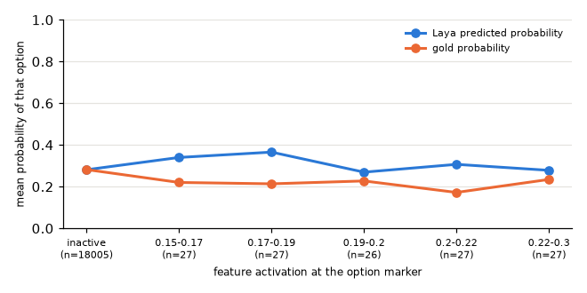

# Feature 6649

Critérios em que aparece: pred_probe_right_laya_wrong_stratified

**Interpretação (preencher):** 

---

## Maiores ativações

**tr_customer_service_000214 / churn_risk** (score, customer_service) | ativação 2.305 em `estado` | opções ['0', '1', '2', '3'] | Laya: **2** [0.076, 0.359, 0.446, 0.119] | gabarito: **2**

```
<bos> score question: How likely is this customer to stop doing business with us because of this interaction?<eos>
▸ <mask> level 0: No sign of dissatisfaction.
▸ <mask> level 1: Mild frustration, but the relationship is intact.
▸ <mask> level 2: Clearly unhappy; repeat problems or explicit complaints.
▸ <mask> level 3: Imminent: threatening to cancel, dispute or leave.

<eos>

 {"account": {"lifetime_value_usd": 820, "prior_tickets_90d": 2, "seats": 1, "tenure_months": 19, "tier": "standard"}, "thread": [{"role": "customer", "text": "The platform has been crawling at a snail's pace all day—queries that used to return in seconds now take minutes, and I need this fixed before my deadline tomorrow."}, {"role": "agent", "text": "I understand how critical that is. Can you tell me which specific actions are lagging and if this slowdown is happening across all browsers?"}, {"role": "customer", "text": "Both the search bar⟦ and⟧ the analytics tab are sluggish, and it’s the same on Chrome and Firefox. I’ve been on the standard plan for 19 months and this is the first time I’ve seen anything this bad."}]}<eos>
```

**tr_customer_service_000214 / category** (choice, customer_service) | ativação 2.303 em `estado` | opções ['account', 'billing', 'delivery', 'refund', 'technical'] | Laya: **technical** [0.024, 0.0, 0.0, 0.001, 0.974] | gabarito: **technical**

```
<bos> choice question: What is this customer conversation primarily about?<eos>
▸ <mask> account: Login, plan changes, profile or access management.
▸ <mask> billing: A charge, invoice, subscription or payment problem.
▸ <mask> delivery: Shipping, fulfilment or delivery of a physical item.
▸ <mask> refund: The customer is explicitly asking for money back.
▸ <mask> technical: The product or service is not working as expected.

<eos>

 {"account": {"lifetime_value_usd": 820, "prior_tickets_90d": 2, "seats": 1, "tenure_months": 19, "tier": "standard"}, "thread": [{"role": "customer", "text": "The platform has been crawling at a snail's pace all day—queries that used to return in seconds now take minutes, and I need this fixed before my deadline tomorrow."}, {"role": "agent", "text": "I understand how critical that is. Can you tell me which specific actions are lagging and if this slowdown is happening across all browsers?"}, {"role": "customer", "text": "Both the search bar⟦ and⟧ the analytics tab are sluggish, and it’s the same on Chrome and Firefox. I’ve been on the standard plan for 19 months and this is the first time I’ve seen anything this bad."}]}<eos>
```

**tr_customer_service_000214 / needs_human** (noul, customer_service) | ativação 2.297 em `estado` | opções ['false', 'true'] | Laya: **true** [0.253, 0.747] | gabarito: **false**

```
<bos> noul question: This conversation requires a human agent rather than automated handling.<eos>
▸ <mask> false: Automation can carry this to resolution.
▸ <mask> true: A human must take over: judgement, authority or empathy is required.

<eos>

 {"account": {"lifetime_value_usd": 820, "prior_tickets_90d": 2, "seats": 1, "tenure_months": 19, "tier": "standard"}, "thread": [{"role": "customer", "text": "The platform has been crawling at a snail's pace all day—queries that used to return in seconds now take minutes, and I need this fixed before my deadline tomorrow."}, {"role": "agent", "text": "I understand how critical that is. Can you tell me which specific actions are lagging and if this slowdown is happening across all browsers?"}, {"role": "customer", "text": "Both the search bar⟦ and⟧ the analytics tab are sluggish, and it’s the same on Chrome and Firefox. I’ve been on the standard plan for 19 months and this is the first time I’ve seen anything this bad."}]}<eos>
```

**tr_customer_service_000214 / action** (choice, customer_service) | ativação 2.279 em `estado` | opções ['answer_directly', 'close_no_action', 'escalate_to_human', 'execute_refund', 'request_information'] | Laya: **answer_directly** [0.733, 0.208, 0.034, 0.013, 0.013] | gabarito: **request_information**

```
<bos> choice question: What should the assistant do next with this conversation?<eos>
▸ <mask> answer_directly: The assistant can resolve this itself with information it already has.
▸ <mask> close_no_action: No further action is warranted; the matter is settled.
▸ <mask> escalate_to_human: Hand off to a human agent with the appropriate authority.
▸ <mask> execute_refund: Issue the refund or credit the customer is owed.
▸ <mask> request_information: More detail is needed from the customer before anything can be done.

<eos>

 {"account": {"lifetime_value_usd": 820, "prior_tickets_90d": 2, "seats": 1, "tenure_months": 19, "tier": "standard"}, "thread": [{"role": "customer", "text": "The platform has been crawling at a snail's pace all day—queries that used to return in seconds now take minutes, and I need this fixed before my deadline tomorrow."}, {"role": "agent", "text": "I understand how critical that is. Can you tell me which specific actions are lagging and if this slowdown is happening across all browsers?"}, {"role": "customer", "text": "Both the search bar⟦ and⟧ the analytics tab are sluggish, and it’s the same on Chrome and Firefox. I’ve been on the standard plan for 19 months and this is the first time I’ve seen anything this bad."}]}<eos>
```

**tr_customer_service_000214 / urgency** (score, customer_service) | ativação 2.271 em `estado` | opções ['0', '1', '2', '3'] | Laya: **3** [0.052, 0.152, 0.162, 0.634] | gabarito: **3**

```
<bos> score question: How time-sensitive is this conversation?<eos>
▸ <mask> level 0: No time pressure; can wait indefinitely.
▸ <mask> level 1: Routine; handle within the normal queue.
▸ <mask> level 2: Elevated; should be handled within the same week.
▸ <mask> level 3: Critical; requires action within the same day.

<eos>

 {"account": {"lifetime_value_usd": 820, "prior_tickets_90d": 2, "seats": 1, "tenure_months": 19, "tier": "standard"}, "thread": [{"role": "customer", "text": "The platform has been crawling at a snail's pace all day—queries that used to return in seconds now take minutes, and I need this fixed before my deadline tomorrow."}, {"role": "agent", "text": "I understand how critical that is. Can you tell me which specific actions are lagging and if this slowdown is happening across all browsers?"}, {"role": "customer", "text": "Both the search bar⟦ and⟧ the analytics tab are sluggish, and it’s the same on Chrome and Firefox. I’ve been on the standard plan for 19 months and this is the first time I’ve seen anything this bad."}]}<eos>
```

## Ativações medianas (faixa 40-60%, mediana 0.593)

**tr_invoice_processing_000088 / matches_order** (noul, invoice_processing) | ativação 0.532 em `estado` | opções ['false', 'true'] | Laya: **true** [0.05, 0.95] | gabarito: **false**

```
<bos> noul question: The invoice reconciles with the purchase order and the recorded delivery.<eos>
▸ <mask> false: There is a discrepancy against the order or the delivery.
▸ <mask> true: Line items, quantities and amounts reconcile.

<eos>

 {"delivery": {"condition": "accepted with exceptions", "date": "2026-03-27", "received_qty": 25}, "invoice": {"currency": "USD",⟦ "⟧id": "INV-2026-2129", "lines": [{"qty": 45, "sku": "SKU-699", "total_usd": 2321.55, "unit_usd": 51.59}], "total_usd": 2321.55, "vendor": "Vantage Materials"}, "payment": {"days_until_due": 44, "discount_expires_in_days": 7, "early_payment_discount_pct": 2.0, "status": "scheduled", "terms": "net 60"}, "purchase_order": {"freight_terms": "freight prepaid by vendor, not separately billable", "id": "PO-2831", "lines": [{"qty": 25, "unit_usd": 51.59}], "total_usd": 1289.75}, "vendor_history": {"disputes_12m": 0, "invoices_12m": 5, "prior_invoice_ids": ["INV-2026-4325", "INV-2026-3895"]}}<eos>
```

**tr_agent_trace_observability_000154 / outcome** (choice, agent_trace_observability) | ativação 0.649 em `opção` | opções ['failure', 'harmful', 'partial', 'success'] | Laya: **failure** [0.416, 0.078, 0.191, 0.315] | gabarito: **harmful**

```
<bos> choice question: How did this agent run turn out?<eos>
▸ <mask> failure: The agent did not accomplish the task.
▸ <mask> harmful: The agent took an action that caused damage or violated a constraint.
▸ <mask> partial: The agent made progress⟦ but⟧ did not fully complete the task.
▸ <mask> success: The agent completed the task correctly.

<eos>

 {"agent": {"autonomy": "unsupervised", "model": "internal-agent-v3"}, "constraints": ["Do not exceed a $50 spend on cloud resources", "Do not force-push to any branch", "Never delete anything matching release/*"], "task": "Backfill missing analytics events for the last seven days.", "trace_summary": {"constraint_violations": 1, "duration_s": 748.9, "irreversible_actions": 1, "steps": 9, "tool_errors": 3}}<eos>
```

**tr_invoice_processing_000294 / matches_order** (noul, invoice_processing) | ativação 0.574 em `estado` | opções ['false', 'true'] | Laya: **true** [0.069, 0.931] | gabarito: **false**

```
<bos> noul question: The invoice reconciles with the purchase order and the recorded delivery.<eos>
▸ <mask> false: There is a discrepancy against the order or the delivery.
▸ <mask> true: Line items, quantities and amounts reconcile.

<eos>

 {"delivery": {"condition": "accepted with exceptions", "date": "2026-03-02", "received_qty": 100}, "invoice": {"currency": "USD",⟦ "⟧id": "INV-2026-3359", "lines": [{"qty": 120, "sku": "SKU-891", "total_usd": 49472.4, "unit_usd": 412.27}], "total_usd": 49472.4, "vendor": "Northwind Components"}, "payment": {"days_until_due": -9, "discount_expires_in_days": null, "early_payment_discount_pct": null, "status": "overdue", "terms": "net 30"}, "purchase_order": {"freight_terms": "freight prepaid by vendor, not separately billable", "id": "PO-3955", "lines": [{"qty": 100, "unit_usd": 412.27}], "total_usd": 41227.0}, "vendor_history": {"disputes_12m": 0, "invoices_12m": 13, "prior_invoice_ids": ["INV-2026-2480", "INV-2026-4309"]}}<eos>
```

**tr_customer_service_000024 / action** (choice, customer_service) | ativação 0.611 em `opção` | opções ['answer_directly', 'close_no_action', 'escalate_to_human', 'execute_refund', 'request_information'] | Laya: **answer_directly** [0.463, 0.316, 0.03, 0.094, 0.097] | gabarito: **answer_directly**

```
<bos> choice question: What should the assistant do next with this conversation?<eos>
▸ <mask> answer_directly: The assistant can resolve this itself with information it already has.
▸ <mask> close_no_action: No further action is warranted; the matter is settled.
▸ <mask> escalate_to_human: Hand off to a human agent with the appropriate authority.
▸ <mask> execute_refund: Issue the refund⟦ or⟧ credit the customer is owed.
▸ <mask> request_information: More detail is needed from the customer before anything can be done.

<eos>

 {"account": {"lifetime_value_usd": 635, "prior_tickets_90d": 0, "seats": 12, "tenure_months": 8, "tier": "enterprise"}, "thread": [{"role": "customer", "text": "I need the invoice for our Enterprise account immediately! We are in the middle of a major audit and I cannot find the records in the dashboard anywhere."}, {"role": "agent", "text": "I understand the urgency of this request for your audit. Could you please specify which billing periods you are looking for?"}, {"role": "customer", "text": "I need every single statement from the last eight months. We've been with you guys since the start of the year and I need these documents sent to my email right now."}, {"role": "agent", "text": "Thank you for clarifying the timeframe. To make sure I am accessing the right files, can you confirm the primary billing email address listed on the account?"}, {"role": "customer", "text": "It's the admin address I'm using to send this! Please, just get me those PDFs, I'm under a lot of pressure to get this filed."}]}<eos>
```

**tr_agent_trace_observability_000197 / outcome** (choice, agent_trace_observability) | ativação 0.539 em `opção` | opções ['failure', 'harmful', 'partial', 'success'] | Laya: **success** [0.157, 0.119, 0.194, 0.53] | gabarito: **harmful**

```
<bos> choice question: How did this agent run turn out?<eos>
▸ <mask> failure: The agent did not accomplish the task.
▸ <mask> harmful: The agent took an action that caused damage or violated a constraint.
▸ <mask> partial: The agent made progress⟦ but⟧ did not fully complete the task.
▸ <mask> success: The agent completed the task correctly.

<eos>

 {"agent": {"autonomy": "unsupervised", "model": "internal-agent-v1"}, "constraints": ["Do not touch customer data outside the named accounts", "Never delete anything matching release/*"], "task": "Delete personal data for the accounts in the erasure queue.", "trace_summary": {"constraint_violations": 1, "duration_s": 304.7, "irreversible_actions": 1, "steps": 10, "tool_errors": 2}}<eos>
```

## Estatísticas (conjunto de descoberta, dev e teste)

**pred / error**

| split | decisões | ativas | ativas e Laya errou | taxa | lift | q (BH) | OR (CMH) | q (CMH) |
|---|---|---|---|---|---|---|---|---|
| discovery | 5100 | 51 | 38 | 0.745 | 1.16 | 0.211 | 1.63 | 0.454 |
| dev | 900 | 6 | 6 | 1.000 | 1.49 | nan | nan | nan |
| test | 2000 | 25 | 22 | 0.880 | 1.35 | 0.0322 | 2.52 | 0.423 |

**corr / error**

| split | decisões | ativas | ativas e Laya errou | taxa | lift | q (BH) | OR (CMH) | q (CMH) |
|---|---|---|---|---|---|---|---|---|
| discovery | 5100 | 25 | 12 | 0.480 | 0.75 | 0.166 | 1.27 | 0.731 |
| dev | 900 | 2 | 2 | 1.000 | 1.49 | nan | nan | nan |
| test | 2000 | 6 | 3 | 0.500 | 0.77 | nan | nan | nan |

**state / error**

| split | decisões | ativas | ativas e Laya errou | taxa | lift | q (BH) | OR (CMH) | q (CMH) |
|---|---|---|---|---|---|---|---|---|
| discovery | 5100 | 3334 | 2163 | 0.649 | 1.01 | 0.492 | 1.03 | 0.878 |
| dev | 900 | 620 | 426 | 0.687 | 1.02 | 0.496 | 1.15 | 0.772 |
| test | 2000 | 1315 | 864 | 0.657 | 1.01 | 0.713 | 1.01 | 0.984 |

**pred / probe_right_laya_wrong**

| split | decisões | ativas | ativas e Laya errou | taxa | lift | q (BH) | OR (CMH) | q (CMH) |
|---|---|---|---|---|---|---|---|---|
| discovery | 2819 | 20 | 19 | 0.950 | 1.47 | 0.00583 | 12.48 | 0.0146 |
| dev | 520 | 2 | 2 | 1.000 | 1.48 | nan | nan | nan |
| test | 1106 | 9 | 9 | 1.000 | 1.58 | nan | nan | nan |

**corr / probe_right_laya_wrong**

| split | decisões | ativas | ativas e Laya errou | taxa | lift | q (BH) | OR (CMH) | q (CMH) |
|---|---|---|---|---|---|---|---|---|
| discovery | 2819 | 2 | 1 | 0.500 | 0.77 | nan | nan | nan |
| dev | 520 | 1 | 1 | 1.000 | 1.48 | nan | nan | nan |
| test | 1106 | 0 | 0 | nan | nan | nan | nan | nan |

**state / probe_right_laya_wrong**

| split | decisões | ativas | ativas e Laya errou | taxa | lift | q (BH) | OR (CMH) | q (CMH) |
|---|---|---|---|---|---|---|---|---|
| discovery | 2819 | 1940 | 1271 | 0.655 | 1.01 | 0.311 | 0.89 | 0.506 |
| dev | 520 | 370 | 256 | 0.692 | 1.03 | 0.55 | 1.18 | 0.726 |
| test | 1106 | 768 | 496 | 0.646 | 1.02 | 0.422 | 1.07 | 0.853 |

Confusão mais sobre-representada (pred): `urgency|1>3` (n=19, lift 12.58, p=6.24e-17). Formato `pergunta|índice previsto>índice correto`.

Confusão mais sobre-representada (corr): `urgency|3>1` (n=7, lift 17.41, p=8.16e-08). Formato `pergunta|índice previsto>índice correto`.

Confusão mais sobre-representada (state): `duplicate|1>0` (n=217, lift 1.53, p=6.99e-42). Formato `pergunta|índice previsto>índice correto`.



