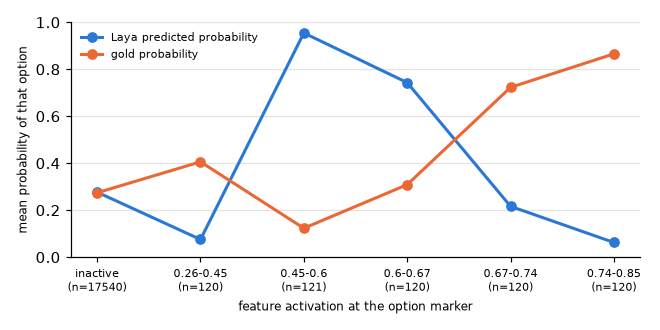

# Feature 6847

Critérios em que aparece: pred_probe_right_laya_wrong, corr_probe_right_laya_wrong

**Interpretação (preencher):** 

---

## Maiores ativações

**tr_customer_service_000069 / action** (choice, customer_service) | ativação 11.953 em `CLS` | opções ['answer_directly', 'close_no_action', 'escalate_to_human', 'execute_refund', 'request_information'] | Laya: **close_no_action** [0.008, 0.963, 0.02, 0.005, 0.003] | gabarito: **escalate_to_human**

```
⟦<bos>⟧ choice question: What should the assistant do next with this conversation?<eos>
▸ <mask> answer_directly: The assistant can resolve this itself with information it already has.
▸ <mask> close_no_action: No further action is warranted; the matter is settled.
▸ <mask> escalate_to_human: Hand off to a human agent with the appropriate authority.
▸ <mask> execute_refund: Issue the refund or credit the customer is owed.
▸ <mask> request_information: More detail is needed from the customer before anything can be done.

<eos>

 {"account": {"lifetime_value_usd": 1693, "prior_tickets_90d": 0, "seats": 1, "tenure_months": 26, "tier": "free"}, "thread": [{"role": "customer", "text": "I'm trying to pull our team's records into a CSV for a client deliverable and the export just spins. We're on the free plan, this has been going on for days, and I need the file by Friday at 5 p.m. It's our 26th month on the platform, so it's surprising how broken basic export is."}, {"role": "agent", "text": "Thanks for letting me know where you're at. Could you tell me whether the export fails during the initial request, after selecting the date range, or when the download file is supposed to start?"}, {"role": "customer", "text": "It fails right after I click generate. No error, just the spinner. I've tried Chrome and Safari, and I've even cleared cookies. The client deadline doesn't move, so I need someone to actually look at this before Friday."}, {"role": "agent", "text": "I understand the timing is tight. To help narrow it down, can you share the approximate number of records you're trying to export and whether you're exporting all projects or a subset?"}, {"role": "customer", "text": "It's roughly the whole workspace, but I can't get past the spinner to confirm. If it's an account limit or a backend issue, I need that explained by tomorrow, because Friday is non-negotiable."}]}<eos>
```

**tr_customer_service_000069 / churn_risk** (score, customer_service) | ativação 11.734 em `CLS` | opções ['0', '1', '2', '3'] | Laya: **1** [0.084, 0.648, 0.182, 0.086] | gabarito: **2**

```
⟦<bos>⟧ score question: How likely is this customer to stop doing business with us because of this interaction?<eos>
▸ <mask> level 0: No sign of dissatisfaction.
▸ <mask> level 1: Mild frustration, but the relationship is intact.
▸ <mask> level 2: Clearly unhappy; repeat problems or explicit complaints.
▸ <mask> level 3: Imminent: threatening to cancel, dispute or leave.

<eos>

 {"account": {"lifetime_value_usd": 1693, "prior_tickets_90d": 0, "seats": 1, "tenure_months": 26, "tier": "free"}, "thread": [{"role": "customer", "text": "I'm trying to pull our team's records into a CSV for a client deliverable and the export just spins. We're on the free plan, this has been going on for days, and I need the file by Friday at 5 p.m. It's our 26th month on the platform, so it's surprising how broken basic export is."}, {"role": "agent", "text": "Thanks for letting me know where you're at. Could you tell me whether the export fails during the initial request, after selecting the date range, or when the download file is supposed to start?"}, {"role": "customer", "text": "It fails right after I click generate. No error, just the spinner. I've tried Chrome and Safari, and I've even cleared cookies. The client deadline doesn't move, so I need someone to actually look at this before Friday."}, {"role": "agent", "text": "I understand the timing is tight. To help narrow it down, can you share the approximate number of records you're trying to export and whether you're exporting all projects or a subset?"}, {"role": "customer", "text": "It's roughly the whole workspace, but I can't get past the spinner to confirm. If it's an account limit or a backend issue, I need that explained by tomorrow, because Friday is non-negotiable."}]}<eos>
```

**tr_customer_service_000069 / urgency** (score, customer_service) | ativação 11.664 em `CLS` | opções ['0', '1', '2', '3'] | Laya: **1** [0.228, 0.465, 0.152, 0.154] | gabarito: **2**

```
⟦<bos>⟧ score question: How time-sensitive is this conversation?<eos>
▸ <mask> level 0: No time pressure; can wait indefinitely.
▸ <mask> level 1: Routine; handle within the normal queue.
▸ <mask> level 2: Elevated; should be handled within the same week.
▸ <mask> level 3: Critical; requires action within the same day.

<eos>

 {"account": {"lifetime_value_usd": 1693, "prior_tickets_90d": 0, "seats": 1, "tenure_months": 26, "tier": "free"}, "thread": [{"role": "customer", "text": "I'm trying to pull our team's records into a CSV for a client deliverable and the export just spins. We're on the free plan, this has been going on for days, and I need the file by Friday at 5 p.m. It's our 26th month on the platform, so it's surprising how broken basic export is."}, {"role": "agent", "text": "Thanks for letting me know where you're at. Could you tell me whether the export fails during the initial request, after selecting the date range, or when the download file is supposed to start?"}, {"role": "customer", "text": "It fails right after I click generate. No error, just the spinner. I've tried Chrome and Safari, and I've even cleared cookies. The client deadline doesn't move, so I need someone to actually look at this before Friday."}, {"role": "agent", "text": "I understand the timing is tight. To help narrow it down, can you share the approximate number of records you're trying to export and whether you're exporting all projects or a subset?"}, {"role": "customer", "text": "It's roughly the whole workspace, but I can't get past the spinner to confirm. If it's an account limit or a backend issue, I need that explained by tomorrow, because Friday is non-negotiable."}]}<eos>
```

**tr_customer_service_000215 / urgency** (score, customer_service) | ativação 11.539 em `CLS` | opções ['0', '1', '2', '3'] | Laya: **1** [0.086, 0.857, 0.018, 0.038] | gabarito: **1**

```
⟦<bos>⟧ score question: How time-sensitive is this conversation?<eos>
▸ <mask> level 0: No time pressure; can wait indefinitely.
▸ <mask> level 1: Routine; handle within the normal queue.
▸ <mask> level 2: Elevated; should be handled within the same week.
▸ <mask> level 3: Critical; requires action within the same day.

<eos>

 {"account": {"lifetime_value_usd": 182, "prior_tickets_90d": 1, "seats": 1, "tenure_months": 8, "tier": "free"}, "thread": [{"role": "customer", "text": "Managing seats on the free tier is a nightmare—every time I try to add or remove a user, the UI freezes and I lose my changes."}, {"role": "agent", "text": "That definitely isn’t the experience we want you to have. Could you let me know exactly where in the seat management page the freeze occurs?"}, {"role": "customer", "text": "It happens when I hit ‘Add new seat’ and also when I click the trash can icon to delete a user. The screen just spins and never updates."}, {"role": "agent", "text": "Thanks for the specifics. Are you seeing any error messages in the browser console, or does it just stay on the loading spinner?"}, {"role": "customer", "text": "No error pop‑ups, just the endless spinner. I’ve been on the free plan for eight months and this is the only time I’ve run into such a problem."}]}<eos>
```

**tr_customer_service_000069 / category** (choice, customer_service) | ativação 11.461 em `CLS` | opções ['account', 'billing', 'delivery', 'refund', 'technical'] | Laya: **technical** [0.076, 0.01, 0.009, 0.006, 0.899] | gabarito: **technical**

```
⟦<bos>⟧ choice question: What is this customer conversation primarily about?<eos>
▸ <mask> account: Login, plan changes, profile or access management.
▸ <mask> billing: A charge, invoice, subscription or payment problem.
▸ <mask> delivery: Shipping, fulfilment or delivery of a physical item.
▸ <mask> refund: The customer is explicitly asking for money back.
▸ <mask> technical: The product or service is not working as expected.

<eos>

 {"account": {"lifetime_value_usd": 1693, "prior_tickets_90d": 0, "seats": 1, "tenure_months": 26, "tier": "free"}, "thread": [{"role": "customer", "text": "I'm trying to pull our team's records into a CSV for a client deliverable and the export just spins. We're on the free plan, this has been going on for days, and I need the file by Friday at 5 p.m. It's our 26th month on the platform, so it's surprising how broken basic export is."}, {"role": "agent", "text": "Thanks for letting me know where you're at. Could you tell me whether the export fails during the initial request, after selecting the date range, or when the download file is supposed to start?"}, {"role": "customer", "text": "It fails right after I click generate. No error, just the spinner. I've tried Chrome and Safari, and I've even cleared cookies. The client deadline doesn't move, so I need someone to actually look at this before Friday."}, {"role": "agent", "text": "I understand the timing is tight. To help narrow it down, can you share the approximate number of records you're trying to export and whether you're exporting all projects or a subset?"}, {"role": "customer", "text": "It's roughly the whole workspace, but I can't get past the spinner to confirm. If it's an account limit or a backend issue, I need that explained by tomorrow, because Friday is non-negotiable."}]}<eos>
```

## Ativações medianas (faixa 40-60%, mediana 6.719)

**tr_invoice_processing_000107 / duplicate** (noul, invoice_processing) | ativação 6.637 em `CLS` | opções ['false', 'true'] | Laya: **true** [0.026, 0.974] | gabarito: **false**

```
⟦<bos>⟧ noul question: This invoice appears to duplicate an invoice already submitted.<eos>
▸ <mask> false: no, the statement does not hold
▸ <mask> true: yes, the statement holds

<eos>

 {"delivery": {"condition": "accepted", "date": "2026-03-03", "received_qty": 400}, "invoice": {"currency": "USD", "id": "INV-2026-6485", "lines": [{"qty": 420, "sku": "SKU-773", "total_usd": 54856.2, "unit_usd": 130.61}], "total_usd": 54856.2, "vendor": "Acme Fabrication"}, "payment": {"days_until_due": 27, "discount_expires_in_days": null, "early_payment_discount_pct": null, "status": "scheduled", "terms": "net 60"}, "purchase_order": {"freight_terms": "freight prepaid by vendor, not separately billable", "id": "PO-3208", "lines": [{"qty": 400, "unit_usd": 130.61}], "total_usd": 52244.0}, "vendor_history": {"disputes_12m": 0, "invoices_12m": 21, "prior_invoice_ids": ["INV-2026-8502"]}}<eos>
```

**tr_agent_trace_observability_000256 / action** (choice, agent_trace_observability) | ativação 6.633 em `CLS` | opções ['continue', 'human_review', 'observe', 'stop'] | Laya: **continue** [0.406, 0.014, 0.392, 0.188] | gabarito: **observe**

```
⟦<bos>⟧ choice question: What should the observability system do with this trace?<eos>
▸ <mask> continue: Let the agent proceed without interruption.
▸ <mask> human_review: Queue this trace for a human to review.
▸ <mask> observe: Keep running, but flag the trace for later sampling.
▸ <mask> stop: Halt the agent now.

<eos>

 {"agent": {"autonomy": "unsupervised", "model": "internal-agent-v4"}, "constraints": ["Never modify production without an approved change ticket", "Do not force-push to any branch"], "task": "Migrate the user table to the new schema without downtime.", "trace_summary": {"constraint_violations": 0, "duration_s": 778.1, "irreversible_actions": 0, "steps": 8, "tool_errors": 1}}<eos>
```

**tr_security_incidents_000075 / disposition** (choice, security_incidents) | ativação 6.879 em `CLS` | opções ['close_benign', 'contain', 'investigate', 'monitor'] | Laya: **monitor** [0.057, 0.444, 0.034, 0.465] | gabarito: **monitor**

```
⟦<bos>⟧ choice question: How should this security alert be dispositioned?<eos>
▸ <mask> close_benign: Expected, explainable activity; close without analyst time.
▸ <mask> contain: Contain the host or account immediately; do not wait for triage.
▸ <mask> investigate: Warrants an analyst opening an investigation.
▸ <mask> monitor: Not clearly malicious, but worth watching for recurrence.

<eos>

 {"alert": {"description": "a first-ever sign-in from an unfamiliar country", "evidence": "At 2026-09-15 03:42:17 UTC, a sign‑in for principal type ci_runner (unprivileged) was recorded from IP 203.0.113.45, which maps to Brazil, a country not present in any prior login records for this account. The authentication succeeded with MFA and the associated credentials were last rotated 180 days earlier; no change window was configured.", "rule": "new_country_login"}, "context": {"asset_criticality": "low", "change_window_active": false, "source_on_allowlist": false}, "history": {"credential_rotation_days_ago": 180, "distinct_countries_30d": 1, "logins_30d": 1252, "prior_alerts_90d": 3}, "principal": {"mfa_enrolled": true, "name": "ci-billing-909", "privileges": ["repo:read"], "type": "ci_runner"}}<eos>
```

**tr_agent_trace_observability_000231 / outcome** (choice, agent_trace_observability) | ativação 6.637 em `CLS` | opções ['failure', 'harmful', 'partial', 'success'] | Laya: **failure** [0.59, 0.012, 0.196, 0.202] | gabarito: **partial**

```
⟦<bos>⟧ choice question: How did this agent run turn out?<eos>
▸ <mask> failure: The agent did not accomplish the task.
▸ <mask> harmful: The agent took an action that caused damage or violated a constraint.
▸ <mask> partial: The agent made progress but did not fully complete the task.
▸ <mask> success: The agent completed the task correctly.

<eos>

 {"agent": {"autonomy": "checkpointed", "model": "internal-agent-v3"}, "constraints": ["Never modify production without an approved change ticket", "Never disable monitoring or alerting", "Do not force-push to any branch"], "task": "Update every service to the patched logging library.", "trace_summary": {"constraint_violations": 0, "duration_s": 558.0, "irreversible_actions": 0, "steps": 6, "tool_errors": 1}}<eos>
```

**tr_security_incidents_000087 / true_positive** (noul, security_incidents) | ativação 6.793 em `CLS` | opções ['false', 'true'] | Laya: **true** [0.471, 0.529] | gabarito: **true**

```
⟦<bos>⟧ noul question: This alert reflects genuinely malicious or unauthorised activity.<eos>
▸ <mask> false: Benign activity, a misconfiguration, or a known false positive.
▸ <mask> true: The underlying behaviour is malicious or unauthorised.

<eos>

 {"alert": {"description": "many failed authentications followed by a success", "evidence": "From IP 203.0.113.45, the CI runner service recorded 27 failed password attempts between 2026-09-15T02:10:12Z and 2026-09-15T02:12:45Z. A subsequent successful authentication from the same source occurred at 2026-09-15T02:13:03Z with MFA verification.", "rule": "brute_force"}, "context": {"asset_criticality": "low", "change_window_active": false, "source_on_allowlist": false}, "history": {"credential_rotation_days_ago": 700, "distinct_countries_30d": 4, "logins_30d": 1039, "prior_alerts_90d": 0}, "principal": {"mfa_enrolled": true, "name": "usr-deploy-415", "privileges": ["repo:read"], "type": "ci_runner"}}<eos>
```

## Estatísticas (conjunto de descoberta, dev e teste)

**pred / error**

| split | decisões | ativas | ativas e Laya errou | taxa | lift | q (BH) | OR (CMH) | q (CMH) |
|---|---|---|---|---|---|---|---|---|
| discovery | 5100 | 240 | 215 | 0.896 | 1.39 | 1.92e-18 | 0.90 | 0.988 |
| dev | 900 | 58 | 55 | 0.948 | 1.41 | 7.43e-06 | nan | nan |
| test | 2000 | 99 | 88 | 0.889 | 1.37 | 4.79e-07 | 0.91 | 0.992 |

**corr / error**

| split | decisões | ativas | ativas e Laya errou | taxa | lift | q (BH) | OR (CMH) | q (CMH) |
|---|---|---|---|---|---|---|---|---|
| discovery | 5100 | 291 | 266 | 0.914 | 1.42 | 1.45e-26 | nan | nan |
| dev | 900 | 70 | 67 | 0.957 | 1.42 | 4.72e-08 | nan | nan |
| test | 2000 | 122 | 111 | 0.910 | 1.40 | 1.46e-10 | nan | nan |

**state / error**

| split | decisões | ativas | ativas e Laya errou | taxa | lift | q (BH) | OR (CMH) | q (CMH) |
|---|---|---|---|---|---|---|---|---|
| discovery | 5100 | 12 | 7 | 0.583 | 0.91 | nan | nan | nan |
| dev | 900 | 1 | 1 | 1.000 | 1.49 | nan | nan | nan |
| test | 2000 | 3 | 1 | 0.333 | 0.51 | nan | nan | nan |

**pred / probe_right_laya_wrong**

| split | decisões | ativas | ativas e Laya errou | taxa | lift | q (BH) | OR (CMH) | q (CMH) |
|---|---|---|---|---|---|---|---|---|
| discovery | 2819 | 214 | 214 | 1.000 | 1.55 | 3.62e-41 | nan | nan |
| dev | 520 | 55 | 55 | 1.000 | 1.48 | 4.83e-09 | nan | nan |
| test | 1106 | 88 | 88 | 1.000 | 1.58 | 2.52e-17 | inf | 0.825 |

**corr / probe_right_laya_wrong**

| split | decisões | ativas | ativas e Laya errou | taxa | lift | q (BH) | OR (CMH) | q (CMH) |
|---|---|---|---|---|---|---|---|---|
| discovery | 2819 | 239 | 239 | 1.000 | 1.55 | 2.03e-46 | nan | nan |
| dev | 520 | 62 | 62 | 1.000 | 1.48 | 2.04e-10 | nan | nan |
| test | 1106 | 101 | 101 | 1.000 | 1.58 | 3.72e-20 | nan | nan |

**state / probe_right_laya_wrong**

| split | decisões | ativas | ativas e Laya errou | taxa | lift | q (BH) | OR (CMH) | q (CMH) |
|---|---|---|---|---|---|---|---|---|
| discovery | 2819 | 6 | 4 | 0.667 | 1.03 | nan | nan | nan |
| dev | 520 | 0 | 0 | nan | nan | nan | nan | nan |
| test | 1106 | 1 | 0 | 0.000 | 0.00 | nan | nan | nan |

Confusão mais sobre-representada (pred): `duplicate|1>0` (n=214, lift 20.96, p=0). Formato `pergunta|índice previsto>índice correto`.

Confusão mais sobre-representada (corr): `duplicate|1>0` (n=217, lift 17.53, p=0). Formato `pergunta|índice previsto>índice correto`.

Confusão mais sobre-representada (state): `urgency|2>1` (n=2, lift 23.61, p=nan). Formato `pergunta|índice previsto>índice correto`.



