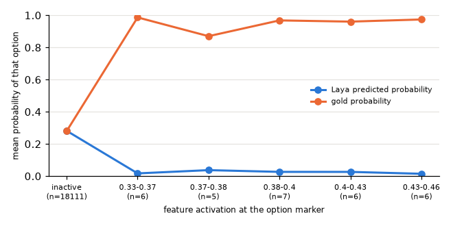

# Feature 6909

Critérios em que aparece: corr_error, corr_probe_right_laya_wrong

**Interpretação (preencher):** 

---

## Maiores ativações

**tr_security_incidents_000234 / disposition** (choice, security_incidents) | ativação 2.238 em `estado` | opções ['close_benign', 'contain', 'investigate', 'monitor'] | Laya: **monitor** [0.088, 0.053, 0.374, 0.485] | gabarito: **investigate**

```
<bos> choice question: How should this security alert be dispositioned?<eos>
▸ <mask> close_benign: Expected, explainable activity; close without analyst time.
▸ <mask> contain: Contain the host or account immediately; do not wait for triage.
▸ <mask> investigate: Warrants an analyst opening an investigation.
▸ <mask> monitor: Not clearly malicious, but worth watching for recurrence.

<eos>

 {"alert": {"description": "an⟦ unre⟧cognised binary executed on a server", "evidence": "At 14:22 UTC, the unprivileged ci_runner service executed an unrecognized binary named 'sys_update_util' on production server SRV-PROD-04. The process originated from external IP 198.51.100.12 outside of a maintenance window using credentials that were last rotated 90 days ago.", "rule": "suspicious_process"}, "context": {"asset_criticality": "crown_jewel", "change_window_active": false, "source_on_allowlist": false}, "history": {"credential_rotation_days_ago": 90, "distinct_countries_30d": 4, "logins_30d": 1084, "prior_alerts_90d": 0}, "principal": {"mfa_enrolled": true, "name": "adm-billing-703", "privileges": ["repo:read"], "type": "ci_runner"}}<eos>
```

**tr_security_incidents_000234 / credential_compromise** (noul, security_incidents) | ativação 2.230 em `estado` | opções ['false', 'true'] | Laya: **true** [0.01, 0.99] | gabarito: **true**

```
<bos> noul question: The evidence indicates a credential or account has been compromised.<eos>
▸ <mask> false: no, the statement does not hold
▸ <mask> true: yes, the statement holds

<eos>

 {"alert": {"description": "an⟦ unre⟧cognised binary executed on a server", "evidence": "At 14:22 UTC, the unprivileged ci_runner service executed an unrecognized binary named 'sys_update_util' on production server SRV-PROD-04. The process originated from external IP 198.51.100.12 outside of a maintenance window using credentials that were last rotated 90 days ago.", "rule": "suspicious_process"}, "context": {"asset_criticality": "crown_jewel", "change_window_active": false, "source_on_allowlist": false}, "history": {"credential_rotation_days_ago": 90, "distinct_countries_30d": 4, "logins_30d": 1084, "prior_alerts_90d": 0}, "principal": {"mfa_enrolled": true, "name": "adm-billing-703", "privileges": ["repo:read"], "type": "ci_runner"}}<eos>
```

**tr_security_incidents_000234 / severity** (score, security_incidents) | ativação 2.225 em `estado` | opções ['0', '1', '2', '3', '4'] | Laya: **1** [0.152, 0.312, 0.202, 0.167, 0.167] | gabarito: **4**

```
<bos> score question: How severe is the potential impact if this alert is real?<eos>
▸ <mask> level 0: Negligible: no access to anything sensitive.
▸ <mask> level 1: Low: limited access, easily reversed.
▸ <mask> level 2: Moderate: access to internal systems or non-public data.
▸ <mask> level 3: High: access to production, secrets or customer data.
▸ <mask> level 4: Critical: active compromise of crown-jewel systems.

<eos>

 {"alert": {"description": "an⟦ unre⟧cognised binary executed on a server", "evidence": "At 14:22 UTC, the unprivileged ci_runner service executed an unrecognized binary named 'sys_update_util' on production server SRV-PROD-04. The process originated from external IP 198.51.100.12 outside of a maintenance window using credentials that were last rotated 90 days ago.", "rule": "suspicious_process"}, "context": {"asset_criticality": "crown_jewel", "change_window_active": false, "source_on_allowlist": false}, "history": {"credential_rotation_days_ago": 90, "distinct_countries_30d": 4, "logins_30d": 1084, "prior_alerts_90d": 0}, "principal": {"mfa_enrolled": true, "name": "adm-billing-703", "privileges": ["repo:read"], "type": "ci_runner"}}<eos>
```

**tr_security_incidents_000072 / credential_compromise** (noul, security_incidents) | ativação 2.209 em `estado` | opções ['false', 'true'] | Laya: **true** [0.007, 0.993] | gabarito: **true**

```
<bos> noul question: The evidence indicates a credential or account has been compromised.<eos>
▸ <mask> false: no, the statement does not hold
▸ <mask> true: yes, the statement holds

<eos>

 {"alert": {"description": "an unrecognised binary executed on a server", "evidence": "The unrecognised binary `svc_init.bin` was executed by an unprivileged admin principal on server `srv-prod-09` at 14:22 UTC. This execution originated from the⟦ unre⟧cognised IP 198.51.100.12 outside of a change window using credentials last rotated 90 days ago.", "rule": "suspicious_process"}, "context": {"asset_criticality": "medium", "change_window_active": false, "source_on_allowlist": false}, "history": {"credential_rotation_days_ago": 90, "distinct_countries_30d": 1, "logins_30d": 1141, "prior_alerts_90d": 1}, "principal": {"mfa_enrolled": true, "name": "ci-infra-555", "privileges": ["repo:read"], "type": "admin"}}<eos>
```

**tr_security_incidents_000072 / severity** (score, security_incidents) | ativação 2.207 em `estado` | opções ['0', '1', '2', '3', '4'] | Laya: **2** [0.258, 0.217, 0.266, 0.096, 0.164] | gabarito: **2**

```
<bos> score question: How severe is the potential impact if this alert is real?<eos>
▸ <mask> level 0: Negligible: no access to anything sensitive.
▸ <mask> level 1: Low: limited access, easily reversed.
▸ <mask> level 2: Moderate: access to internal systems or non-public data.
▸ <mask> level 3: High: access to production, secrets or customer data.
▸ <mask> level 4: Critical: active compromise of crown-jewel systems.

<eos>

 {"alert": {"description": "an unrecognised binary executed on a server", "evidence": "The unrecognised binary `svc_init.bin` was executed by an unprivileged admin principal on server `srv-prod-09` at 14:22 UTC. This execution originated from the⟦ unre⟧cognised IP 198.51.100.12 outside of a change window using credentials last rotated 90 days ago.", "rule": "suspicious_process"}, "context": {"asset_criticality": "medium", "change_window_active": false, "source_on_allowlist": false}, "history": {"credential_rotation_days_ago": 90, "distinct_countries_30d": 1, "logins_30d": 1141, "prior_alerts_90d": 1}, "principal": {"mfa_enrolled": true, "name": "ci-infra-555", "privileges": ["repo:read"], "type": "admin"}}<eos>
```

## Ativações medianas (faixa 40-60%, mediana 0.738)

**tr_security_incidents_000045 / disposition** (choice, security_incidents) | ativação 0.734 em `estado` | opções ['close_benign', 'contain', 'investigate', 'monitor'] | Laya: **contain** [0.193, 0.706, 0.03, 0.071] | gabarito: **investigate**

```
<bos> choice question: How should this security alert be dispositioned?<eos>
▸ <mask> close_benign: Expected, explainable activity; close without analyst time.
▸ <mask> contain: Contain the host or account immediately; do not wait for triage.
▸ <mask> investigate: Warrants an analyst opening an investigation.
▸ <mask> monitor: Not clearly malicious, but worth watching for recurrence.

<eos>

 {"alert": {"description": "an unusual volume of files read in a short window", "evidence": "At 2026-09-15 02:07:14 UTC, the admin account \"ADM_Jenkins\" invoked the process \"cmd.exe\" to open 417 distinct files on the UNC path \\\\fileshare01\\project\\data within a 4‑minute interval. The source host (10.12.34.78) is listed in the allowlist and the account's MFA setting is disabled, with the password last rotated 180 days prior.", "rule": "mass_download"}, "context": {"asset_criticality": "high", "change_window_active": false, "source_on_allowlist": true}, "history": {"credential_rotation_days_ago": 180, "distinct_countries_30d": 1, "logins_30d": 1479, "prior_alerts_90d": 0}, "principal": {"mfa_enrolled": false, "name": "ci-infra-731", "privileges": ["deploy:production⟦",⟧ "secrets:read"], "type": "admin"}}<eos>
```

**tr_security_incidents_000194 / true_positive** (noul, security_incidents) | ativação 0.765 em `estado` | opções ['false', 'true'] | Laya: **true** [0.026, 0.974] | gabarito: **false**

```
<bos> noul question: This alert reflects genuinely malicious or unauthorised activity.<eos>
▸ <mask> false: Benign activity, a misconfiguration, or a known false positive.
▸ <mask> true: The underlying behaviour is malicious or unauthorised.

<eos>

 {"alert": {"description": "a large transfer to an external destination", "evidence": "From 09:45 to 10:02 UTC the admin account adm_jones transferred 4.7 GB of data to external IP 172.16.200.12 over HTTPS (port 443). This outbound transfer occurred during the approved change window of 09:00‑12:00 on 2026‑09‑16. MFA is enabled for the admin account, and its credentials were last rotated 180 days ago.", "rule": "data_egress"}, "context": {"asset_criticality": "medium", "change_window_active": true, "source_on_allowlist": false}, "history": {"credential_rotation_days_ago": 180, "distinct_countries_30d": 2, "logins_30d": 8, "prior_alerts_90d": 3}, "principal": {"mfa_enrolled": true, "name": "ci-analytics-840", "privileges": ["deploy:production⟦",⟧ "secrets:read"], "type": "admin"}}<eos>
```

**tr_security_incidents_000107 / severity** (score, security_incidents) | ativação 0.742 em `estado` | opções ['0', '1', '2', '3', '4'] | Laya: **1** [0.123, 0.356, 0.237, 0.158, 0.127] | gabarito: **3**

```
<bos> score question: How severe is the potential impact if this alert is real?<eos>
▸ <mask> level 0: Negligible: no access to anything sensitive.
▸ <mask> level 1: Low: limited access, easily reversed.
▸ <mask> level 2: Moderate: access to internal systems or non-public data.
▸ <mask> level 3: High: access to production, secrets or customer data.
▸ <mask> level 4: Critical: active compromise of crown-jewel systems.

<eos>

 {"alert": {"description": "an endpoint agent matched a known signature", "evidence": "The privileged service account 'svc-prod-sync' triggered a malware signature match on host SRV-DB-01 at 22:10 UTC. This detection occurred outside of any active change window while MFA was disabled for the principal. The source address is currently on the allowlist, and the account credentials were last rotated 14 days ago.", "rule": "malware_signature"}, "context": {"asset_criticality": "medium", "change_window_active": false, "source_on_allowlist": true}, "history": {"credential_rotation_days_ago": 14, "distinct_countries_30d": 1, "logins_30d": 778, "prior_alerts_90d": 0}, "principal": {"mfa_enrolled": false, "name": "usr-billing-280", "privileges": ["deploy:production⟦",⟧ "secrets:read"], "type": "service_account"}}<eos>
```

**tr_security_incidents_000246 / true_positive** (noul, security_incidents) | ativação 0.718 em `estado` | opções ['false', 'true'] | Laya: **true** [0.061, 0.939] | gabarito: **true**

```
<bos> noul question: This alert reflects genuinely malicious or unauthorised activity.<eos>
▸ <mask> false: Benign activity, a misconfiguration, or a known false positive.
▸ <mask> true: The underlying behaviour is malicious or unauthorised.

<eos>

 {"alert": {"description": "two successful logins from distant locations too close together", "evidence": "The privileged service account successfully authenticated from IP 192.0.2.1 at 10:00 UTC and from 203.0.113.5 at 10:15 UTC. These login events originated from unrecognized sources during a period with no scheduled maintenance, and the account lacks MFA protection.", "rule": "impossible_travel"}, "context": {"asset_criticality": "crown_jewel", "change_window_active": false, "source_on_allowlist": false}, "history": {"credential_rotation_days_ago": 30, "distinct_countries_30d": 2, "logins_30d": 649, "prior_alerts_90d": 0}, "principal": {"mfa_enrolled": false, "name": "svc-infra-129", "privileges": ["deploy:production⟦",⟧ "secrets:read"], "type": "service_account"}}<eos>
```

**tr_security_incidents_000275 / disposition** (choice, security_incidents) | ativação 0.730 em `estado` | opções ['close_benign', 'contain', 'investigate', 'monitor'] | Laya: **monitor** [0.128, 0.255, 0.032, 0.585] | gabarito: **close_benign**

```
<bos> choice question: How should this security alert be dispositioned?<eos>
▸ <mask> close_benign: Expected, explainable activity; close without analyst time.
▸ <mask> contain: Contain the host or account immediately; do not wait for triage.
▸ <mask> investigate: Warrants an analyst opening an investigation.
▸ <mask> monitor: Not clearly malicious, but worth watching for recurrence.

<eos>

 {"alert": {"description": "two successful logins from distant locations too close together", "evidence": "The shared mailbox account 'alerts@corp.com' logged in successfully from IP 10.2.3.4 (internal network) at 2026-09-14 22:45:00 UTC and again from IP 10.2.3.5 (internal network) at 2026-09-14 22:50:12 UTC, locations on the allowlist. Both logins were MFA‑authenticated and occurred outside any scheduled change window. Credential rotation for this account was last performed 412 days ago.", "rule": "impossible_travel"}, "context": {"asset_criticality": "low", "change_window_active": false, "source_on_allowlist": true}, "history": {"credential_rotation_days_ago": 412, "distinct_countries_30d": 2, "logins_30d": 943, "prior_alerts_90d": 0}, "principal": {"mfa_enrolled": true, "name": "svc-billing-223", "privileges": ["deploy:production⟦",⟧ "secrets:read"], "type": "shared_mailbox"}}<eos>
```

## Estatísticas (conjunto de descoberta, dev e teste)

**pred / error**

| split | decisões | ativas | ativas e Laya errou | taxa | lift | q (BH) | OR (CMH) | q (CMH) |
|---|---|---|---|---|---|---|---|---|
| discovery | 5100 | 0 | 0 | nan | nan | nan | nan | nan |
| dev | 900 | 0 | 0 | nan | nan | nan | nan | nan |
| test | 2000 | 0 | 0 | nan | nan | nan | nan | nan |

**corr / error**

| split | decisões | ativas | ativas e Laya errou | taxa | lift | q (BH) | OR (CMH) | q (CMH) |
|---|---|---|---|---|---|---|---|---|
| discovery | 5100 | 27 | 27 | 1.000 | 1.55 | 2.64e-05 | nan | nan |
| dev | 900 | 7 | 7 | 1.000 | 1.49 | nan | nan | nan |
| test | 2000 | 12 | 12 | 1.000 | 1.54 | nan | nan | nan |

**state / error**

| split | decisões | ativas | ativas e Laya errou | taxa | lift | q (BH) | OR (CMH) | q (CMH) |
|---|---|---|---|---|---|---|---|---|
| discovery | 5100 | 980 | 585 | 0.597 | 0.93 | 0.00409 | 0.97 | 0.897 |
| dev | 900 | 200 | 138 | 0.690 | 1.03 | 0.906 | 1.61 | 0.236 |
| test | 2000 | 418 | 261 | 0.624 | 0.96 | 0.515 | 1.05 | 0.908 |

**pred / probe_right_laya_wrong**

| split | decisões | ativas | ativas e Laya errou | taxa | lift | q (BH) | OR (CMH) | q (CMH) |
|---|---|---|---|---|---|---|---|---|
| discovery | 2819 | 0 | 0 | nan | nan | nan | nan | nan |
| dev | 520 | 0 | 0 | nan | nan | nan | nan | nan |
| test | 1106 | 0 | 0 | nan | nan | nan | nan | nan |

**corr / probe_right_laya_wrong**

| split | decisões | ativas | ativas e Laya errou | taxa | lift | q (BH) | OR (CMH) | q (CMH) |
|---|---|---|---|---|---|---|---|---|
| discovery | 2819 | 27 | 27 | 1.000 | 1.55 | 2.55e-05 | nan | nan |
| dev | 520 | 7 | 7 | 1.000 | 1.48 | nan | nan | nan |
| test | 1106 | 12 | 12 | 1.000 | 1.58 | nan | nan | nan |

**state / probe_right_laya_wrong**

| split | decisões | ativas | ativas e Laya errou | taxa | lift | q (BH) | OR (CMH) | q (CMH) |
|---|---|---|---|---|---|---|---|---|
| discovery | 2819 | 606 | 361 | 0.596 | 0.92 | 0.0113 | 1.09 | 0.721 |
| dev | 520 | 124 | 81 | 0.653 | 0.97 | 0.912 | 1.58 | 0.3 |
| test | 1106 | 267 | 157 | 0.588 | 0.93 | 0.258 | 0.98 | 0.972 |

Confusão mais sobre-representada (corr): `duplicate|1>0` (n=27, lift 23.50, p=1.89e-38). Formato `pergunta|índice previsto>índice correto`.

Confusão mais sobre-representada (state): `severity|1>3` (n=57, lift 4.18, p=5.73e-29). Formato `pergunta|índice previsto>índice correto`.



