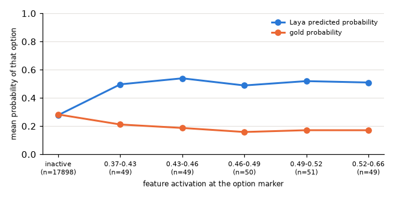

# Feature 6973

Critérios em que aparece: pred_probe_right_laya_wrong

**Interpretação (preencher):** 

---

## Maiores ativações

**tr_security_incidents_000072 / disposition** (choice, security_incidents) | ativação 0.661 em `marcador` | opções ['close_benign', 'contain', 'investigate', 'monitor'] | Laya: **monitor** [0.202, 0.242, 0.191, 0.366] | gabarito: **investigate**

```
<bos> choice question: How should this security alert be dispositioned?<eos>
▸ <mask> close_benign: Expected, explainable activity; close without analyst time.
▸ <mask> contain: Contain the host or account immediately; do not wait for triage.
▸ <mask> investigate: Warrants an analyst opening an investigation.
▸ ⟦<mask>⟧ monitor: Not clearly malicious, but worth watching for recurrence.

<eos>

 {"alert": {"description": "an unrecognised binary executed on a server", "evidence": "The unrecognised binary `svc_init.bin` was executed by an unprivileged admin principal on server `srv-prod-09` at 14:22 UTC. This execution originated from the unrecognised IP 198.51.100.12 outside of a change window using credentials last rotated 90 days ago.", "rule": "suspicious_process"}, "context": {"asset_criticality": "medium", "change_window_active": false, "source_on_allowlist": false}, "history": {"credential_rotation_days_ago": 90, "distinct_countries_30d": 1, "logins_30d": 1141, "prior_alerts_90d": 1}, "principal": {"mfa_enrolled": true, "name": "ci-infra-555", "privileges": ["repo:read"], "type": "admin"}}<eos>
```

**tr_security_incidents_000059 / disposition** (choice, security_incidents) | ativação 0.636 em `marcador` | opções ['close_benign', 'contain', 'investigate', 'monitor'] | Laya: **monitor** [0.043, 0.242, 0.024, 0.692] | gabarito: **investigate**

```
<bos> choice question: How should this security alert be dispositioned?<eos>
▸ <mask> close_benign: Expected, explainable activity; close without analyst time.
▸ <mask> contain: Contain the host or account immediately; do not wait for triage.
▸ <mask> investigate: Warrants an analyst opening an investigation.
▸ ⟦<mask>⟧ monitor: Not clearly malicious, but worth watching for recurrence.

<eos>

 {"alert": {"description": "many failed authentications followed by a success", "evidence": "At 14:02 UTC on 2026-05-19, IIS worker process w3wp.exe on EXCH-02 recorded 63 failed OWA logons for shared mailbox accountsales@corp.example from 192.0.2.77, followed by one successful MFA logon at 14:05 UTC from the same address. The mailbox password was last changed 365 days ago, and no change window was active on EXCH-02 during that period. The source IP was not in the known office, VPN, or partner address lists.", "rule": "brute_force"}, "context": {"asset_criticality": "medium", "change_window_active": false, "source_on_allowlist": false}, "history": {"credential_rotation_days_ago": 365, "distinct_countries_30d": 1, "logins_30d": 1177, "prior_alerts_90d": 1}, "principal": {"mfa_enrolled": true, "name": "svc-support-100", "privileges": ["repo:read"], "type": "shared_mailbox"}}<eos>
```

**tr_security_incidents_000120 / disposition** (choice, security_incidents) | ativação 0.626 em `marcador` | opções ['close_benign', 'contain', 'investigate', 'monitor'] | Laya: **monitor** [0.088, 0.092, 0.242, 0.579] | gabarito: **contain**

```
<bos> choice question: How should this security alert be dispositioned?<eos>
▸ <mask> close_benign: Expected, explainable activity; close without analyst time.
▸ <mask> contain: Contain the host or account immediately; do not wait for triage.
▸ <mask> investigate: Warrants an analyst opening an investigation.
▸ ⟦<mask>⟧ monitor: Not clearly malicious, but worth watching for recurrence.

<eos>

 {"alert": {"description": "an endpoint agent matched a known signature", "evidence": "The endpoint agent on CI runner host 'runner-7x2' identified a signature match for 'malware.linux.syslog' during an active session. This connection originated from an unrecognized IP address (203.0.113.88) using unprivileged credentials that were last rotated 90 days ago.", "rule": "malware_signature"}, "context": {"asset_criticality": "high", "change_window_active": false, "source_on_allowlist": false}, "history": {"credential_rotation_days_ago": 90, "distinct_countries_30d": 1, "logins_30d": 1882, "prior_alerts_90d": 8}, "principal": {"mfa_enrolled": true, "name": "usr-billing-642", "privileges": ["repo:read"], "type": "ci_runner"}}<eos>
```

**tr_security_incidents_000071 / disposition** (choice, security_incidents) | ativação 0.602 em `marcador` | opções ['close_benign', 'contain', 'investigate', 'monitor'] | Laya: **monitor** [0.046, 0.066, 0.058, 0.83] | gabarito: **monitor**

```
<bos> choice question: How should this security alert be dispositioned?<eos>
▸ <mask> close_benign: Expected, explainable activity; close without analyst time.
▸ <mask> contain: Contain the host or account immediately; do not wait for triage.
▸ <mask> investigate: Warrants an analyst opening an investigation.
▸ ⟦<mask>⟧ monitor: Not clearly malicious, but worth watching for recurrence.

<eos>

 {"alert": {"description": "a session token was presented from a second address", "evidence": "During an active change window, a session token for a ci_runner principal was observed at an unrecognized network address distinct from the original login source. This unprivileged account has MFA disabled and is utilizing a credential set that was last rotated 365 days ago.", "rule": "token_reuse"}, "context": {"asset_criticality": "low", "change_window_active": true, "source_on_allowlist": false}, "history": {"credential_rotation_days_ago": 365, "distinct_countries_30d": 2, "logins_30d": 1596, "prior_alerts_90d": 25}, "principal": {"mfa_enrolled": false, "name": "ci-deploy-913", "privileges": ["repo:read"], "type": "ci_runner"}}<eos>
```

**tr_security_incidents_000121 / disposition** (choice, security_incidents) | ativação 0.602 em `marcador` | opções ['close_benign', 'contain', 'investigate', 'monitor'] | Laya: **monitor** [0.098, 0.114, 0.093, 0.695] | gabarito: **investigate**

```
<bos> choice question: How should this security alert be dispositioned?<eos>
▸ <mask> close_benign: Expected, explainable activity; close without analyst time.
▸ <mask> contain: Contain the host or account immediately; do not wait for triage.
▸ <mask> investigate: Warrants an analyst opening an investigation.
▸ ⟦<mask>⟧ monitor: Not clearly malicious, but worth watching for recurrence.

<eos>

 {"alert": {"description": "a security group was opened to the public internet", "evidence": "During an active change window, the privileged service account 'svc-automation' modified security group 'sg-web-ingress' to allow traffic from 0.0.0.0/0. The command was issued from a known allowlist source and authenticated via MFA using credentials rotated 14 days ago.", "rule": "config_drift"}, "context": {"asset_criticality": "crown_jewel", "change_window_active": true, "source_on_allowlist": true}, "history": {"credential_rotation_days_ago": 14, "distinct_countries_30d": 3, "logins_30d": 1632, "prior_alerts_90d": 0}, "principal": {"mfa_enrolled": true, "name": "adm-infra-171", "privileges": ["deploy:production", "secrets:read"], "type": "service_account"}}<eos>
```

## Ativações medianas (faixa 40-60%, mediana 0.472)

**tr_security_incidents_000269 / disposition** (choice, security_incidents) | ativação 0.475 em `marcador` | opções ['close_benign', 'contain', 'investigate', 'monitor'] | Laya: **investigate** [0.205, 0.047, 0.499, 0.249] | gabarito: **investigate**

```
<bos> choice question: How should this security alert be dispositioned?<eos>
▸ <mask> close_benign: Expected, explainable activity; close without analyst time.
▸ <mask> contain: Contain the host or account immediately; do not wait for triage.
▸ <mask> investigate: Warrants an analyst opening an investigation.
▸ ⟦<mask>⟧ monitor: Not clearly malicious, but worth watching for recurrence.

<eos>

 {"alert": {"description": "an unrecognised binary executed on a server", "evidence": "A binary not present in the approved inventory, located at /var/tmp/abcdef (SHA256 = d1e2f3a4…), executed on server 192.168.100.9 at 2026-09-15 22:18:03 UTC. The launch was performed by admin user \"bob\" using an MFA‑authenticated session, and the user’s credentials have not been rotated for 365 days (last rotation 2025-09-16).", "rule": "suspicious_process"}, "context": {"asset_criticality": "low", "change_window_active": false, "source_on_allowlist": true}, "history": {"credential_rotation_days_ago": 365, "distinct_countries_30d": 2, "logins_30d": 948, "prior_alerts_90d": 0}, "principal": {"mfa_enrolled": true, "name": "adm-infra-548", "privileges": ["repo:read"], "type": "admin"}}<eos>
```

**tr_security_incidents_000106 / disposition** (choice, security_incidents) | ativação 0.474 em `marcador` | opções ['close_benign', 'contain', 'investigate', 'monitor'] | Laya: **monitor** [0.186, 0.087, 0.022, 0.705] | gabarito: **close_benign**

```
<bos> choice question: How should this security alert be dispositioned?<eos>
▸ <mask> close_benign: Expected, explainable activity; close without analyst time.
▸ <mask> contain: Contain the host or account immediately; do not wait for triage.
▸ <mask> investigate: Warrants an analyst opening an investigation.
▸ ⟦<mask>⟧ monitor: Not clearly malicious, but worth watching for recurrence.

<eos>

 {"alert": {"description": "a long-unused account became active", "evidence": "At 14:22 UTC, the contractor account 'c-smith' successfully authenticated from an allowlisted source despite being inactive for 120 days. Multi-factor authentication was verified during the session, which took place during a scheduled change window. The account's credentials were last rotated 30 days prior to this access.", "rule": "dormant_account_use"}, "context": {"asset_criticality": "low", "change_window_active": true, "source_on_allowlist": true}, "history": {"credential_rotation_days_ago": 30, "distinct_countries_30d": 1, "logins_30d": 1999, "prior_alerts_90d": 0}, "principal": {"mfa_enrolled": true, "name": "svc-infra-357", "privileges": ["repo:read"], "type": "contractor"}}<eos>
```

**tr_security_incidents_000186 / disposition** (choice, security_incidents) | ativação 0.484 em `marcador` | opções ['close_benign', 'contain', 'investigate', 'monitor'] | Laya: **monitor** [0.112, 0.184, 0.068, 0.637] | gabarito: **investigate**

```
<bos> choice question: How should this security alert be dispositioned?<eos>
▸ <mask> close_benign: Expected, explainable activity; close without analyst time.
▸ <mask> contain: Contain the host or account immediately; do not wait for triage.
▸ <mask> investigate: Warrants an analyst opening an investigation.
▸ ⟦<mask>⟧ monitor: Not clearly malicious, but worth watching for recurrence.

<eos>

 {"alert": {"description": "an account granted itself or received elevated permissions", "evidence": "On 2026-09-15 at 02:48:37 UTC, employee account \"asmith\" was added to the \"Domain Admins\" group on server 10.2.5.17 via a PowerShell command \"Add-ADGroupMember\" executed from an unrecognized source IP 203.0.113.45. The action occurred while the scheduled change window was active and the account's password had not been rotated in the past 365 days.", "rule": "privilege_escalation"}, "context": {"asset_criticality": "high", "change_window_active": true, "source_on_allowlist": false}, "history": {"credential_rotation_days_ago": 365, "distinct_countries_30d": 2, "logins_30d": 308, "prior_alerts_90d": 3}, "principal": {"mfa_enrolled": true, "name": "svc-analytics-581", "privileges": ["repo:read"], "type": "employee"}}<eos>
```

**tr_security_incidents_000092 / disposition** (choice, security_incidents) | ativação 0.456 em `marcador` | opções ['close_benign', 'contain', 'investigate', 'monitor'] | Laya: **monitor** [0.035, 0.109, 0.032, 0.824] | gabarito: **investigate**

```
<bos> choice question: How should this security alert be dispositioned?<eos>
▸ <mask> close_benign: Expected, explainable activity; close without analyst time.
▸ <mask> contain: Contain the host or account immediately; do not wait for triage.
▸ <mask> investigate: Warrants an analyst opening an investigation.
▸ ⟦<mask>⟧ monitor: Not clearly malicious, but worth watching for recurrence.

<eos>

 {"alert": {"description": "a long-unused account became active", "evidence": "An employee account that had no recorded activity since 2024-02-01 generated a successful login at 2026-09-15 11:45:27 UTC from IP 198.51.100.99, which is not recognized in the known source list. The account is unprivileged, MFA was satisfied, and there was no active change window. The password for this account was last rotated on 2024-09-10, 700 days prior to the event.", "rule": "dormant_account_use"}, "context": {"asset_criticality": "medium", "change_window_active": false, "source_on_allowlist": false}, "history": {"credential_rotation_days_ago": 700, "distinct_countries_30d": 1, "logins_30d": 181, "prior_alerts_90d": 0}, "principal": {"mfa_enrolled": true, "name": "adm-billing-260", "privileges": ["repo:read"], "type": "employee"}}<eos>
```

**tr_security_incidents_000295 / disposition** (choice, security_incidents) | ativação 0.463 em `marcador` | opções ['close_benign', 'contain', 'investigate', 'monitor'] | Laya: **monitor** [0.082, 0.259, 0.103, 0.557] | gabarito: **investigate**

```
<bos> choice question: How should this security alert be dispositioned?<eos>
▸ <mask> close_benign: Expected, explainable activity; close without analyst time.
▸ <mask> contain: Contain the host or account immediately; do not wait for triage.
▸ <mask> investigate: Warrants an analyst opening an investigation.
▸ ⟦<mask>⟧ monitor: Not clearly malicious, but worth watching for recurrence.

<eos>

 {"alert": {"description": "a large transfer to an external destination", "evidence": "A CI runner account initiated a 4.2GB data transfer to an external, unrecognized destination IP at 11:45 UTC. No authorized change window is currently scheduled, and the account credentials were last updated 14 days ago.", "rule": "data_egress"}, "context": {"asset_criticality": "medium", "change_window_active": false, "source_on_allowlist": false}, "history": {"credential_rotation_days_ago": 14, "distinct_countries_30d": 1, "logins_30d": 586, "prior_alerts_90d": 0}, "principal": {"mfa_enrolled": true, "name": "svc-billing-408", "privileges": ["repo:read"], "type": "ci_runner"}}<eos>
```

## Estatísticas (conjunto de descoberta, dev e teste)

**pred / error**

| split | decisões | ativas | ativas e Laya errou | taxa | lift | q (BH) | OR (CMH) | q (CMH) |
|---|---|---|---|---|---|---|---|---|
| discovery | 5100 | 174 | 160 | 0.920 | 1.43 | 2.23e-16 | 0.88 | 0.932 |
| dev | 900 | 32 | 31 | 0.969 | 1.44 | 0.000507 | 0.00 | 0.729 |
| test | 2000 | 64 | 60 | 0.938 | 1.44 | 6.93e-07 | 0.83 | 0.964 |

**corr / error**

| split | decisões | ativas | ativas e Laya errou | taxa | lift | q (BH) | OR (CMH) | q (CMH) |
|---|---|---|---|---|---|---|---|---|
| discovery | 5100 | 17 | 3 | 0.176 | 0.27 | nan | nan | nan |
| dev | 900 | 1 | 0 | 0.000 | 0.00 | nan | nan | nan |
| test | 2000 | 8 | 4 | 0.500 | 0.77 | nan | nan | nan |

**state / error**

| split | decisões | ativas | ativas e Laya errou | taxa | lift | q (BH) | OR (CMH) | q (CMH) |
|---|---|---|---|---|---|---|---|---|
| discovery | 5100 | 27 | 20 | 0.741 | 1.15 | 0.578 | 1.26 | 0.885 |
| dev | 900 | 5 | 3 | 0.600 | 0.89 | nan | nan | nan |
| test | 2000 | 31 | 24 | 0.774 | 1.19 | 0.473 | 2.41 | 0.392 |

**pred / probe_right_laya_wrong**

| split | decisões | ativas | ativas e Laya errou | taxa | lift | q (BH) | OR (CMH) | q (CMH) |
|---|---|---|---|---|---|---|---|---|
| discovery | 2819 | 123 | 123 | 1.000 | 1.55 | 4.26e-23 | nan | nan |
| dev | 520 | 22 | 22 | 1.000 | 1.48 | 0.00122 | nan | nan |
| test | 1106 | 48 | 47 | 0.979 | 1.55 | 6.72e-08 | 0.00 | 0.768 |

**corr / probe_right_laya_wrong**

| split | decisões | ativas | ativas e Laya errou | taxa | lift | q (BH) | OR (CMH) | q (CMH) |
|---|---|---|---|---|---|---|---|---|
| discovery | 2819 | 0 | 0 | nan | nan | nan | nan | nan |
| dev | 520 | 0 | 0 | nan | nan | nan | nan | nan |
| test | 1106 | 1 | 0 | 0.000 | 0.00 | nan | nan | nan |

**state / probe_right_laya_wrong**

| split | decisões | ativas | ativas e Laya errou | taxa | lift | q (BH) | OR (CMH) | q (CMH) |
|---|---|---|---|---|---|---|---|---|
| discovery | 2819 | 21 | 16 | 0.762 | 1.18 | 0.523 | 1.47 | 0.764 |
| dev | 520 | 3 | 2 | 0.667 | 0.99 | nan | nan | nan |
| test | 1106 | 17 | 13 | 0.765 | 1.21 | nan | nan | nan |

Confusão mais sobre-representada (pred): `disposition|3>2` (n=124, lift 21.63, p=0). Formato `pergunta|índice previsto>índice correto`.

Confusão mais sobre-representada (corr): `disposition|1>3` (n=2, lift 200.00, p=nan). Formato `pergunta|índice previsto>índice correto`.

Confusão mais sobre-representada (state): `duplicate|1>0` (n=8, lift 6.96, p=1.04e-05). Formato `pergunta|índice previsto>índice correto`.



