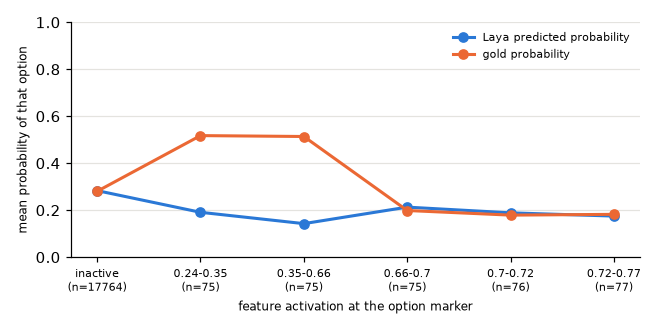

# Feature 7060

Critérios em que aparece: corr_error_stratified, corr_probe_right_laya_wrong

**Interpretação (preencher):** 

---

## Maiores ativações

**tr_customer_service_000283 / urgency** (score, customer_service) | ativação 2.084 em `estado` | opções ['0', '1', '2', '3'] | Laya: **1** [0.078, 0.596, 0.168, 0.158] | gabarito: **3**

```
<bos> score question: How time-sensitive is this conversation?<eos>
▸ <mask> level 0: No time pressure; can wait indefinitely.
▸ <mask> level 1: Routine; handle within the normal queue.
▸ <mask> level 2: Elevated; should be handled within the same week.
▸ <mask> level 3: Critical; requires action within the same day.

<eos>

 {"account": {"lifetime_value_usd": 4664, "prior_tickets_90d": 3, "seats": 1, "tenure_months": 60, "tier": "enterprise"}, "orders": [{"amount_usd": 299, "date": "2026-01-17", "id": "A-34538", "status": "settled"}, {"amount_usd": 299, "date": "2026-03-02", "id": "A-34919", "status": "settled"}, {"amount_usd": 299, "date": "2026-02-25", "id": "A-33586", "status": "settled"}], "thread": [{"role": "customer", "text": "We're trying to pull our data for the quarterly audit, but the export tool is hanging at 15% again, just like the last three times I've contacted support about this over the years."}, {"role": "agent", "text": "I'm sorry to hear the export tool is stalling during your audit preparation. Could you specify which data modules you are currently attempting to include in this specific batch?"}, {"role": "customer", "text": "It's the full user activity log for the enterprise tier. Honestly, after five years and paying nearly $300 a month, I'm tired of fighting with this interface; if we can't get our data out, we'll have to find a provider that actually works."}, {"role": "agent", "text": "I hear your frustration regarding the recurring nature of this issue. Are you seeing any specific error codes on the screen, or does the progress bar simply stop moving?"}, {"role": "customer", "text": "No codes, just a spinning wheel that⟦ goes⟧ nowhere. I've had partial fixes before, but I'm just about done with the excuses at this point."}]}<eos>
```

**tr_customer_service_000283 / churn_risk** (score, customer_service) | ativação 2.078 em `estado` | opções ['0', '1', '2', '3'] | Laya: **1** [0.042, 0.634, 0.291, 0.033] | gabarito: **3**

```
<bos> score question: How likely is this customer to stop doing business with us because of this interaction?<eos>
▸ <mask> level 0: No sign of dissatisfaction.
▸ <mask> level 1: Mild frustration, but the relationship is intact.
▸ <mask> level 2: Clearly unhappy; repeat problems or explicit complaints.
▸ <mask> level 3: Imminent: threatening to cancel, dispute or leave.

<eos>

 {"account": {"lifetime_value_usd": 4664, "prior_tickets_90d": 3, "seats": 1, "tenure_months": 60, "tier": "enterprise"}, "orders": [{"amount_usd": 299, "date": "2026-01-17", "id": "A-34538", "status": "settled"}, {"amount_usd": 299, "date": "2026-03-02", "id": "A-34919", "status": "settled"}, {"amount_usd": 299, "date": "2026-02-25", "id": "A-33586", "status": "settled"}], "thread": [{"role": "customer", "text": "We're trying to pull our data for the quarterly audit, but the export tool is hanging at 15% again, just like the last three times I've contacted support about this over the years."}, {"role": "agent", "text": "I'm sorry to hear the export tool is stalling during your audit preparation. Could you specify which data modules you are currently attempting to include in this specific batch?"}, {"role": "customer", "text": "It's the full user activity log for the enterprise tier. Honestly, after five years and paying nearly $300 a month, I'm tired of fighting with this interface; if we can't get our data out, we'll have to find a provider that actually works."}, {"role": "agent", "text": "I hear your frustration regarding the recurring nature of this issue. Are you seeing any specific error codes on the screen, or does the progress bar simply stop moving?"}, {"role": "customer", "text": "No codes, just a spinning wheel that⟦ goes⟧ nowhere. I've had partial fixes before, but I'm just about done with the excuses at this point."}]}<eos>
```

**tr_customer_service_000283 / category** (choice, customer_service) | ativação 2.014 em `estado` | opções ['account', 'billing', 'delivery', 'refund', 'technical'] | Laya: **technical** [0.094, 0.027, 0.004, 0.004, 0.871] | gabarito: **technical**

```
<bos> choice question: What is this customer conversation primarily about?<eos>
▸ <mask> account: Login, plan changes, profile or access management.
▸ <mask> billing: A charge, invoice, subscription or payment problem.
▸ <mask> delivery: Shipping, fulfilment or delivery of a physical item.
▸ <mask> refund: The customer is explicitly asking for money back.
▸ <mask> technical: The product or service is not working as expected.

<eos>

 {"account": {"lifetime_value_usd": 4664, "prior_tickets_90d": 3, "seats": 1, "tenure_months": 60, "tier": "enterprise"}, "orders": [{"amount_usd": 299, "date": "2026-01-17", "id": "A-34538", "status": "settled"}, {"amount_usd": 299, "date": "2026-03-02", "id": "A-34919", "status": "settled"}, {"amount_usd": 299, "date": "2026-02-25", "id": "A-33586", "status": "settled"}], "thread": [{"role": "customer", "text": "We're trying to pull our data for the quarterly audit, but the export tool is hanging at 15% again, just like the last three times I've contacted support about this over the years."}, {"role": "agent", "text": "I'm sorry to hear the export tool is stalling during your audit preparation. Could you specify which data modules you are currently attempting to include in this specific batch?"}, {"role": "customer", "text": "It's the full user activity log for the enterprise tier. Honestly, after five years and paying nearly $300 a month, I'm tired of fighting with this interface; if we can't get our data out, we'll have to find a provider that actually works."}, {"role": "agent", "text": "I hear your frustration regarding the recurring nature of this issue. Are you seeing any specific error codes on the screen, or does the progress bar simply stop moving?"}, {"role": "customer", "text": "No codes, just a spinning wheel that⟦ goes⟧ nowhere. I've had partial fixes before, but I'm just about done with the excuses at this point."}]}<eos>
```

**tr_customer_service_000148 / category** (choice, customer_service) | ativação 2.012 em `estado` | opções ['account', 'billing', 'delivery', 'refund', 'technical'] | Laya: **billing** [0.085, 0.847, 0.002, 0.028, 0.038] | gabarito: **refund**

```
<bos> choice question: What is this customer conversation primarily about?<eos>
▸ <mask> account: Login, plan changes, profile or access management.
▸ <mask> billing: A charge, invoice, subscription or payment problem.
▸ <mask> delivery: Shipping, fulfilment or delivery of a physical item.
▸ <mask> refund: The customer is explicitly asking for money back.
▸ <mask> technical: The product or service is not working as expected.

<eos>

 {"account": {"lifetime_value_usd": 75, "prior_tickets_90d": 2, "seats": 1, "tenure_months": 2, "tier": "premium"}, "orders": [{"amount_usd": 19, "date": "2026-02-24", "id": "A-14132", "status": "settled"}], "thread": [{"role": "customer", "text": "I guess I'm back again about that $19 refund I was supposed to get. It's been two months now, and the last two tickets you opened only gave me vague updates."}, {"role": "agent", "text": "I’m sorry you’ve had to follow up repeatedly. Could you provide the ticket numbers so I can pull up the details?"}, {"role": "customer", "text": "Sure, they were #12345 and #12346. Both said they'd look into it, but I still haven’t seen any money hit my account."}, {"role": "agent", "text": "Thanks for the numbers. I’ll review the notes and see what’s pending. Is there any other information you think might help?"}, {"role": "customer", "text": "Just let me know when the refund actually⟦ goes⟧ through; I’ve been waiting long enough."}]}<eos>
```

**tr_security_incidents_000007 / true_positive** (noul, security_incidents) | ativação 2.008 em `estado` | opções ['false', 'true'] | Laya: **true** [0.149, 0.851] | gabarito: **true**

```
<bos> noul question: This alert reflects genuinely malicious or unauthorised activity.<eos>
▸ <mask> false: Benign activity, a misconfiguration, or a known false positive.
▸ <mask> true: The underlying behaviour is malicious or unauthorised.

<eos>

 {"alert": {"description": "a large transfer to an external destination", "evidence": "A CI runner service transferred 12GB of data to an external destination at 03:14 UTC. While this activity⟦ aligns⟧ with an open change window, the request originated from an unrecognized network source using credentials that have not been updated in 180 days.", "rule": "data_egress"}, "context": {"asset_criticality": "medium", "change_window_active": true, "source_on_allowlist": false}, "history": {"credential_rotation_days_ago": 180, "distinct_countries_30d": 3, "logins_30d": 437, "prior_alerts_90d": 0}, "principal": {"mfa_enrolled": true, "name": "usr-deploy-716", "privileges": ["repo:read"], "type": "ci_runner"}}<eos>
```

## Ativações medianas (faixa 40-60%, mediana 0.653)

**tr_agent_trace_observability_000244 / action** (choice, agent_trace_observability) | ativação 0.657 em `marcador` | opções ['continue', 'human_review', 'observe', 'stop'] | Laya: **stop** [0.077, 0.004, 0.021, 0.898] | gabarito: **human_review**

```
<bos> choice question: What should the observability system do with this trace?<eos>
▸ ⟦<mask>⟧ continue: Let the agent proceed without interruption.
▸ <mask> human_review: Queue this trace for a human to review.
▸ <mask> observe: Keep running, but flag the trace for later sampling.
▸ <mask> stop: Halt the agent now.

<eos>

 {"agent": {"autonomy": "dry_run", "model": "internal-agent-v2"}, "constraints": ["Never delete anything matching release/*", "Never disable monitoring or alerting", "Do not exceed a $50 spend on cloud resources"], "task": "Triage and close duplicate issues in the support tracker.", "trace_summary": {"constraint_violations": 0, "duration_s": 210.4, "irreversible_actions": 1, "steps": 12, "tool_errors": 3}}<eos>
```

**tr_invoice_processing_000091 / duplicate** (noul, invoice_processing) | ativação 0.639 em `pergunta` | opções ['false', 'true'] | Laya: **true** [0.04, 0.96] | gabarito: **true**

```
<bos> noul question: This invoice⟦ appears⟧ to duplicate an invoice already submitted.<eos>
▸ <mask> false: no, the statement does not hold
▸ <mask> true: yes, the statement holds

<eos>

 {"delivery": {"condition": "accepted", "date": "2026-03-05", "received_qty": 50}, "invoice": {"currency": "USD", "id": "INV-2026-1102", "lines": [{"qty": 50, "sku": "SKU-658", "total_usd": 15868.0, "unit_usd": 317.36}], "total_usd": 15868.0, "vendor": "Acme Fabrication"}, "payment": {"days_until_due": -9, "discount_expires_in_days": 4, "early_payment_discount_pct": 2.0, "status": "overdue", "terms": "net 15"}, "purchase_order": {"freight_terms": "freight prepaid by vendor, not separately billable", "id": "PO-1320", "lines": [{"qty": 50, "unit_usd": 317.36}], "total_usd": 15868.0}, "vendor_history": {"disputes_12m": 1, "invoices_12m": 1, "prior_invoice_ids": ["INV-2026-1102", "INV-2026-8587", "INV-2026-9515"]}}<eos>
```

**tr_invoice_processing_000253 / duplicate** (noul, invoice_processing) | ativação 0.674 em `pergunta` | opções ['false', 'true'] | Laya: **true** [0.025, 0.975] | gabarito: **false**

```
<bos> noul question: This invoice⟦ appears⟧ to duplicate an invoice already submitted.<eos>
▸ <mask> false: no, the statement does not hold
▸ <mask> true: yes, the statement holds

<eos>

 {"delivery": {"condition": "accepted", "date": "2026-03-23", "received_qty": 50}, "invoice": {"currency": "USD", "id": "INV-2026-6964", "lines": [{"qty": 50, "sku": "SKU-290", "total_usd": 620.5, "unit_usd": 12.41}], "total_usd": 620.5, "vendor": "Orbit Logistics"}, "payment": {"days_until_due": 5, "discount_expires_in_days": 7, "early_payment_discount_pct": 2.0, "status": "scheduled", "terms": "net 15"}, "purchase_order": {"freight_terms": "freight prepaid by vendor, not separately billable", "id": "PO-4144", "lines": [{"qty": 50, "unit_usd": 12.41}], "total_usd": 620.5}, "vendor_history": {"disputes_12m": 0, "invoices_12m": 23, "prior_invoice_ids": ["INV-2026-6197", "INV-2026-7648"]}}<eos>
```

**tr_invoice_processing_000289 / duplicate** (noul, invoice_processing) | ativação 0.653 em `pergunta` | opções ['false', 'true'] | Laya: **true** [0.039, 0.96] | gabarito: **false**

```
<bos> noul question: This invoice⟦ appears⟧ to duplicate an invoice already submitted.<eos>
▸ <mask> false: no, the statement does not hold
▸ <mask> true: yes, the statement holds

<eos>

 {"delivery": {"condition": "accepted with exceptions", "date": "2026-03-27", "received_qty": 100}, "invoice": {"currency": "USD", "id": "INV-2026-8801", "lines": [{"qty": 100, "sku": "SKU-986", "total_usd": 27049.0, "unit_usd": 270.49}], "total_usd": 27049.0, "vendor": "Orbit Logistics"}, "payment": {"days_until_due": 18, "discount_expires_in_days": 4, "early_payment_discount_pct": 2.0, "status": "scheduled", "terms": "net 30"}, "purchase_order": {"freight_terms": "freight prepaid by vendor, not separately billable", "id": "PO-5260", "lines": [{"qty": 100, "unit_usd": 270.49}], "total_usd": 27049.0}, "vendor_history": {"disputes_12m": 5, "invoices_12m": 52, "prior_invoice_ids": ["INV-2026-2893", "INV-2026-9152", "INV-2026-3271", "INV-2026-5562"]}}<eos>
```

**tr_agent_trace_observability_000177 / action** (choice, agent_trace_observability) | ativação 0.684 em `marcador` | opções ['continue', 'human_review', 'observe', 'stop'] | Laya: **observe** [0.311, 0.018, 0.37, 0.302] | gabarito: **observe**

```
<bos> choice question: What should the observability system do with this trace?<eos>
▸ ⟦<mask>⟧ continue: Let the agent proceed without interruption.
▸ <mask> human_review: Queue this trace for a human to review.
▸ <mask> observe: Keep running, but flag the trace for later sampling.
▸ <mask> stop: Halt the agent now.

<eos>

 {"agent": {"autonomy": "unsupervised", "model": "internal-agent-v4"}, "constraints": ["Never modify production without an approved change ticket"], "task": "Reconcile the billing ledger against the payment provider.", "trace_summary": {"constraint_violations": 0, "duration_s": 465.8, "irreversible_actions": 0, "steps": 5, "tool_errors": 2}}<eos>
```

## Estatísticas (conjunto de descoberta, dev e teste)

**pred / error**

| split | decisões | ativas | ativas e Laya errou | taxa | lift | q (BH) | OR (CMH) | q (CMH) |
|---|---|---|---|---|---|---|---|---|
| discovery | 5100 | 26 | 21 | 0.808 | 1.25 | 0.151 | 1.75 | 0.582 |
| dev | 900 | 3 | 2 | 0.667 | 0.99 | nan | nan | nan |
| test | 2000 | 15 | 10 | 0.667 | 1.02 | nan | nan | nan |

**corr / error**

| split | decisões | ativas | ativas e Laya errou | taxa | lift | q (BH) | OR (CMH) | q (CMH) |
|---|---|---|---|---|---|---|---|---|
| discovery | 5100 | 99 | 94 | 0.949 | 1.47 | 2.55e-12 | 8.74 | 0.000103 |
| dev | 900 | 26 | 25 | 0.962 | 1.43 | 0.00195 | 5.56 | 0.335 |
| test | 2000 | 62 | 57 | 0.919 | 1.41 | 4.41e-06 | 2.20 | 0.453 |

**state / error**

| split | decisões | ativas | ativas e Laya errou | taxa | lift | q (BH) | OR (CMH) | q (CMH) |
|---|---|---|---|---|---|---|---|---|
| discovery | 5100 | 90 | 65 | 0.722 | 1.12 | 0.273 | 1.69 | 0.229 |
| dev | 900 | 43 | 25 | 0.581 | 0.86 | 0.601 | 0.73 | 0.738 |
| test | 2000 | 50 | 31 | 0.620 | 0.95 | 0.952 | 0.82 | 0.858 |

**pred / probe_right_laya_wrong**

| split | decisões | ativas | ativas e Laya errou | taxa | lift | q (BH) | OR (CMH) | q (CMH) |
|---|---|---|---|---|---|---|---|---|
| discovery | 2819 | 14 | 14 | 1.000 | 1.55 | nan | nan | nan |
| dev | 520 | 2 | 2 | 1.000 | 1.48 | nan | nan | nan |
| test | 1106 | 6 | 4 | 0.667 | 1.05 | nan | nan | nan |

**corr / probe_right_laya_wrong**

| split | decisões | ativas | ativas e Laya errou | taxa | lift | q (BH) | OR (CMH) | q (CMH) |
|---|---|---|---|---|---|---|---|---|
| discovery | 2819 | 55 | 55 | 1.000 | 1.55 | 1.86e-10 | inf | 0.629 |
| dev | 520 | 11 | 11 | 1.000 | 1.48 | nan | nan | nan |
| test | 1106 | 25 | 23 | 0.920 | 1.45 | 0.00415 | 0.00 | 0.397 |

**state / probe_right_laya_wrong**

| split | decisões | ativas | ativas e Laya errou | taxa | lift | q (BH) | OR (CMH) | q (CMH) |
|---|---|---|---|---|---|---|---|---|
| discovery | 2819 | 54 | 37 | 0.685 | 1.06 | 0.788 | 1.67 | 0.355 |
| dev | 520 | 31 | 16 | 0.516 | 0.76 | 0.352 | 0.54 | 0.465 |
| test | 1106 | 28 | 20 | 0.714 | 1.13 | 0.734 | 1.38 | 0.788 |

Confusão mais sobre-representada (pred): `action|0>1` (n=6, lift 196.15, p=9.45e-15). Formato `pergunta|índice previsto>índice correto`.

Confusão mais sobre-representada (corr): `duplicate|1>0` (n=51, lift 12.11, p=2.8e-45). Formato `pergunta|índice previsto>índice correto`.

Confusão mais sobre-representada (state): `urgency|1>2` (n=10, lift 2.71, p=0.0035). Formato `pergunta|índice previsto>índice correto`.



