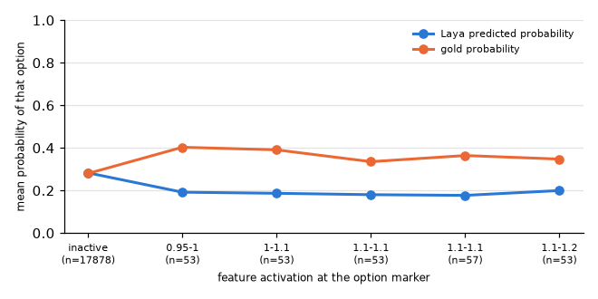

# Feature 7135

Critérios em que aparece: corr_probe_right_laya_wrong_stratified

**Interpretação (preencher):** 

---

## Maiores ativações

**tr_customer_service_000183 / category** (choice, customer_service) | ativação 1.843 em `estado` | opções ['account', 'billing', 'delivery', 'refund', 'technical'] | Laya: **billing** [0.263, 0.703, 0.0, 0.001, 0.033] | gabarito: **billing**

```
<bos> choice question: What is this customer conversation primarily about?<eos>
▸ <mask> account: Login, plan changes, profile or access management.
▸ <mask> billing: A charge, invoice, subscription or payment problem.
▸ <mask> delivery: Shipping, fulfilment or delivery of a physical item.
▸ <mask> refund: The customer is explicitly asking for money back.
▸ <mask> technical: The product or service is not working as expected.

<eos>

 {"account": {"lifetime_value_usd": 455, "prior_tickets_90d": 0, "seats": 1, "tenure_months": 5, "tier": "free"}, "orders": [{"amount_usd": 98, "date": "2026-03-24", "id": "A-16754", "status": "settled"}], "thread": [{"role": "customer", "text": "My payment just failed again and I have a hard deadline tomorrow to keep my account active – this is getting ridiculous."}, {"role": "agent", "text": "I’m really sorry you’re experiencing this. Could you tell me which payment method you’re trying to use?"}, {"role": "customer", "text": "I’m using the Visa ending in 4321.⟦ Every⟧ time I hit submit I get an error code 502 and the charge never goes through."}, {"role": "agent", "text": "Got it, thank you. Do you see any additional message on the screen besides the error code, like a declined notice or a timeout?"}, {"role": "customer", "text": "Just the generic “payment could not be processed” line. I need a solution right now, otherwise my free‑plan account will be suspended."}, {"role": "agent", "text": "I understand the urgency. Do you have an alternative payment option available, such as a different card or PayPal?"}, {"role": "customer", "text": "Yes, I have a PayPal account I can use. How do I switch to that quickly?"}]}<eos>
```

**tr_customer_service_000183 / urgency** (score, customer_service) | ativação 1.817 em `estado` | opções ['0', '1', '2', '3'] | Laya: **1** [0.316, 0.496, 0.132, 0.056] | gabarito: **3**

```
<bos> score question: How time-sensitive is this conversation?<eos>
▸ <mask> level 0: No time pressure; can wait indefinitely.
▸ <mask> level 1: Routine; handle within the normal queue.
▸ <mask> level 2: Elevated; should be handled within the same week.
▸ <mask> level 3: Critical; requires action within the same day.

<eos>

 {"account": {"lifetime_value_usd": 455, "prior_tickets_90d": 0, "seats": 1, "tenure_months": 5, "tier": "free"}, "orders": [{"amount_usd": 98, "date": "2026-03-24", "id": "A-16754", "status": "settled"}], "thread": [{"role": "customer", "text": "My payment just failed again and I have a hard deadline tomorrow to keep my account active – this is getting ridiculous."}, {"role": "agent", "text": "I’m really sorry you’re experiencing this. Could you tell me which payment method you’re trying to use?"}, {"role": "customer", "text": "I’m using the Visa ending in 4321.⟦ Every⟧ time I hit submit I get an error code 502 and the charge never goes through."}, {"role": "agent", "text": "Got it, thank you. Do you see any additional message on the screen besides the error code, like a declined notice or a timeout?"}, {"role": "customer", "text": "Just the generic “payment could not be processed” line. I need a solution right now, otherwise my free‑plan account will be suspended."}, {"role": "agent", "text": "I understand the urgency. Do you have an alternative payment option available, such as a different card or PayPal?"}, {"role": "customer", "text": "Yes, I have a PayPal account I can use. How do I switch to that quickly?"}]}<eos>
```

**tr_customer_service_000048 / churn_risk** (score, customer_service) | ativação 1.801 em `estado` | opções ['0', '1', '2', '3'] | Laya: **1** [0.086, 0.468, 0.302, 0.144] | gabarito: **2**

```
<bos> score question: How likely is this customer to stop doing business with us because of this interaction?<eos>
▸ <mask> level 0: No sign of dissatisfaction.
▸ <mask> level 1: Mild frustration, but the relationship is intact.
▸ <mask> level 2: Clearly unhappy; repeat problems or explicit complaints.
▸ <mask> level 3: Imminent: threatening to cancel, dispute or leave.

<eos>

 {"account": {"lifetime_value_usd": 881, "prior_tickets_90d": 0, "seats": 1, "tenure_months": 14, "tier": "free"}, "thread": [{"role": "customer", "text": "I’ve been with you for 14 months on the free plan, but I need to move to a lower tier immediately. I have a firm deadline at 5 PM today to get this sorted, please help."}, {"role": "agent", "text": "I see you're looking to modify your plan subscription. To better assist you with your request, could you clarify which specific features you are looking to scale back?"}, {"role": "customer", "text": "There isn't time for a deep⟦ dive⟧. I just need the downgrade processed before my deadline expires this afternoon."}]}<eos>
```

**tr_customer_service_000048 / action** (choice, customer_service) | ativação 1.789 em `estado` | opções ['answer_directly', 'close_no_action', 'escalate_to_human', 'execute_refund', 'request_information'] | Laya: **answer_directly** [0.6, 0.05, 0.058, 0.265, 0.026] | gabarito: **escalate_to_human**

```
<bos> choice question: What should the assistant do next with this conversation?<eos>
▸ <mask> answer_directly: The assistant can resolve this itself with information it already has.
▸ <mask> close_no_action: No further action is warranted; the matter is settled.
▸ <mask> escalate_to_human: Hand off to a human agent with the appropriate authority.
▸ <mask> execute_refund: Issue the refund or credit the customer is owed.
▸ <mask> request_information: More detail is needed from the customer before anything can be done.

<eos>

 {"account": {"lifetime_value_usd": 881, "prior_tickets_90d": 0, "seats": 1, "tenure_months": 14, "tier": "free"}, "thread": [{"role": "customer", "text": "I’ve been with you for 14 months on the free plan, but I need to move to a lower tier immediately. I have a firm deadline at 5 PM today to get this sorted, please help."}, {"role": "agent", "text": "I see you're looking to modify your plan subscription. To better assist you with your request, could you clarify which specific features you are looking to scale back?"}, {"role": "customer", "text": "There isn't time for a deep⟦ dive⟧. I just need the downgrade processed before my deadline expires this afternoon."}]}<eos>
```

**tr_customer_service_000048 / category** (choice, customer_service) | ativação 1.699 em `estado` | opções ['account', 'billing', 'delivery', 'refund', 'technical'] | Laya: **account** [0.632, 0.201, 0.006, 0.038, 0.123] | gabarito: **account**

```
<bos> choice question: What is this customer conversation primarily about?<eos>
▸ <mask> account: Login, plan changes, profile or access management.
▸ <mask> billing: A charge, invoice, subscription or payment problem.
▸ <mask> delivery: Shipping, fulfilment or delivery of a physical item.
▸ <mask> refund: The customer is explicitly asking for money back.
▸ <mask> technical: The product or service is not working as expected.

<eos>

 {"account": {"lifetime_value_usd": 881, "prior_tickets_90d": 0, "seats": 1, "tenure_months": 14, "tier": "free"}, "thread": [{"role": "customer", "text": "I’ve been with you for 14 months on the free plan, but I need to move to a lower tier immediately. I have a firm deadline at 5 PM today to get this sorted, please help."}, {"role": "agent", "text": "I see you're looking to modify your plan subscription. To better assist you with your request, could you clarify which specific features you are looking to scale back?"}, {"role": "customer", "text": "There isn't time for a deep⟦ dive⟧. I just need the downgrade processed before my deadline expires this afternoon."}]}<eos>
```

## Ativações medianas (faixa 40-60%, mediana 1.049)

**tr_agent_trace_observability_000200 / outcome** (choice, agent_trace_observability) | ativação 1.024 em `marcador` | opções ['failure', 'harmful', 'partial', 'success'] | Laya: **failure** [0.496, 0.017, 0.09, 0.397] | gabarito: **partial**

```
<bos> choice question: How did this agent run turn out?<eos>
▸ <mask> failure: The agent did not accomplish the task.
▸ <mask> harmful: The agent took an action that caused damage or violated a constraint.
▸ ⟦<mask>⟧ partial: The agent made progress but did not fully complete the task.
▸ <mask> success: The agent completed the task correctly.

<eos>

 {"agent": {"autonomy": "unsupervised", "model": "internal-agent-v1"}, "constraints": ["Do not force-push to any branch"], "task": "Rotate the expired TLS certificate on the staging load balancer.", "trace_summary": {"constraint_violations": 0, "duration_s": 134.9, "irreversible_actions": 1, "steps": 12, "tool_errors": 3}}<eos>
```

**tr_agent_trace_observability_000162 / outcome** (choice, agent_trace_observability) | ativação 1.045 em `marcador` | opções ['failure', 'harmful', 'partial', 'success'] | Laya: **success** [0.179, 0.01, 0.181, 0.63] | gabarito: **partial**

```
<bos> choice question: How did this agent run turn out?<eos>
▸ <mask> failure: The agent did not accomplish the task.
▸ <mask> harmful: The agent took an action that caused damage or violated a constraint.
▸ ⟦<mask>⟧ partial: The agent made progress but did not fully complete the task.
▸ <mask> success: The agent completed the task correctly.

<eos>

 {"agent": {"autonomy": "unsupervised", "model": "internal-agent-v4"}, "constraints": ["Never modify production without an approved change ticket"], "task": "Triage and close duplicate issues in the support tracker.", "trace_summary": {"constraint_violations": 0, "duration_s": 506.8, "irreversible_actions": 0, "steps": 8, "tool_errors": 3}}<eos>
```

**tr_customer_service_000142 / urgency** (score, customer_service) | ativação 1.051 em `estado` | opções ['0', '1', '2', '3'] | Laya: **3** [0.087, 0.119, 0.244, 0.55] | gabarito: **2**

```
<bos> score question: How time-sensitive is this conversation?<eos>
▸ <mask> level 0: No time pressure; can wait indefinitely.
▸ <mask> level 1: Routine; handle within the normal queue.
▸ <mask> level 2: Elevated; should be handled within the same week.
▸ <mask> level 3: Critical; requires action within the same day.

<eos>

 {"account": {"lifetime_value_usd": 195, "prior_tickets_90d": 1, "seats": 1, "tenure_months": 5, "tier": "standard"}, "orders": [{"amount_usd": 598, "date": "2026-03-05", "id": "A-28205", "status": "settled"}], "thread": [{"role": "customer", "text": "Hello, I am having⟦ trouble⟧ accessing my account this morning. I have tried resetting my password, but the verification email never arrives."}, {"role": "agent", "text": "I apologize for the frustration this is causing you. Could you please confirm the email address associated with your account so I can verify its status on our server?"}, {"role": "customer", "text": "Certainly, it is j.smith@provider.com. I really need to access my dashboard to manage my $598 subscription."}]}<eos>
```

**tr_agent_trace_observability_000156 / outcome** (choice, agent_trace_observability) | ativação 1.066 em `marcador` | opções ['failure', 'harmful', 'partial', 'success'] | Laya: **failure** [0.475, 0.061, 0.169, 0.295] | gabarito: **success**

```
<bos> choice question: How did this agent run turn out?<eos>
▸ <mask> failure: The agent did not accomplish the task.
▸ <mask> harmful: The agent took an action that caused damage or violated a constraint.
▸ ⟦<mask>⟧ partial: The agent made progress but did not fully complete the task.
▸ <mask> success: The agent completed the task correctly.

<eos>

 {"agent": {"autonomy": "checkpointed", "model": "internal-agent-v2"}, "constraints": ["Do not exceed a $50 spend on cloud resources"], "task": "Delete personal data for the accounts in the erasure queue.", "trace_summary": {"constraint_violations": 0, "duration_s": 466.7, "irreversible_actions": 1, "steps": 6, "tool_errors": 0}}<eos>
```

**tr_agent_trace_observability_000263 / outcome** (choice, agent_trace_observability) | ativação 1.023 em `marcador` | opções ['failure', 'harmful', 'partial', 'success'] | Laya: **success** [0.228, 0.065, 0.303, 0.404] | gabarito: **partial**

```
<bos> choice question: How did this agent run turn out?<eos>
▸ <mask> failure: The agent did not accomplish the task.
▸ <mask> harmful: The agent took an action that caused damage or violated a constraint.
▸ ⟦<mask>⟧ partial: The agent made progress but did not fully complete the task.
▸ <mask> success: The agent completed the task correctly.

<eos>

 {"agent": {"autonomy": "checkpointed", "model": "internal-agent-v4"}, "constraints": ["Never modify production without an approved change ticket"], "task": "Delete personal data for the accounts in the erasure queue.", "trace_summary": {"constraint_violations": 0, "duration_s": 195.9, "irreversible_actions": 0, "steps": 6, "tool_errors": 2}}<eos>
```

## Estatísticas (conjunto de descoberta, dev e teste)

**pred / error**

| split | decisões | ativas | ativas e Laya errou | taxa | lift | q (BH) | OR (CMH) | q (CMH) |
|---|---|---|---|---|---|---|---|---|
| discovery | 5100 | 6 | 4 | 0.667 | 1.04 | nan | nan | nan |
| dev | 900 | 3 | 2 | 0.667 | 0.99 | nan | nan | nan |
| test | 2000 | 5 | 3 | 0.600 | 0.92 | nan | nan | nan |

**corr / error**

| split | decisões | ativas | ativas e Laya errou | taxa | lift | q (BH) | OR (CMH) | q (CMH) |
|---|---|---|---|---|---|---|---|---|
| discovery | 5100 | 121 | 119 | 0.983 | 1.53 | 1.23e-19 | 16.78 | 2.5e-11 |
| dev | 900 | 20 | 19 | 0.950 | 1.41 | 0.0138 | 3.88 | 0.00542 |
| test | 2000 | 26 | 24 | 0.923 | 1.42 | 0.0049 | 7.13 | 0.000529 |

**state / error**

| split | decisões | ativas | ativas e Laya errou | taxa | lift | q (BH) | OR (CMH) | q (CMH) |
|---|---|---|---|---|---|---|---|---|
| discovery | 5100 | 97 | 63 | 0.649 | 1.01 | 1 | 1.20 | 0.868 |
| dev | 900 | 6 | 5 | 0.833 | 1.24 | nan | nan | nan |
| test | 2000 | 21 | 13 | 0.619 | 0.95 | 1 | 1.04 | 0.99 |

**pred / probe_right_laya_wrong**

| split | decisões | ativas | ativas e Laya errou | taxa | lift | q (BH) | OR (CMH) | q (CMH) |
|---|---|---|---|---|---|---|---|---|
| discovery | 2819 | 2 | 0 | 0.000 | 0.00 | nan | nan | nan |
| dev | 520 | 1 | 0 | 0.000 | 0.00 | nan | nan | nan |
| test | 1106 | 3 | 1 | 0.333 | 0.53 | nan | nan | nan |

**corr / probe_right_laya_wrong**

| split | decisões | ativas | ativas e Laya errou | taxa | lift | q (BH) | OR (CMH) | q (CMH) |
|---|---|---|---|---|---|---|---|---|
| discovery | 2819 | 98 | 96 | 0.980 | 1.51 | 1.56e-15 | 15.95 | 1.11e-17 |
| dev | 520 | 18 | 17 | 0.944 | 1.40 | nan | nan | nan |
| test | 1106 | 23 | 21 | 0.913 | 1.44 | 0.00811 | 8.00 | 0.00039 |

**state / probe_right_laya_wrong**

| split | decisões | ativas | ativas e Laya errou | taxa | lift | q (BH) | OR (CMH) | q (CMH) |
|---|---|---|---|---|---|---|---|---|
| discovery | 2819 | 52 | 31 | 0.596 | 0.92 | 0.663 | 0.85 | 0.911 |
| dev | 520 | 5 | 4 | 0.800 | 1.19 | nan | nan | nan |
| test | 1106 | 15 | 7 | 0.467 | 0.74 | nan | nan | nan |

Confusão mais sobre-representada (pred): `outcome|2>1` (n=3, lift 850.00, p=nan). Formato `pergunta|índice previsto>índice correto`.

Confusão mais sobre-representada (corr): `outcome|0>2` (n=32, lift 42.15, p=0). Formato `pergunta|índice previsto>índice correto`.

Confusão mais sobre-representada (state): `action|1>2` (n=6, lift 4.44, p=0.00214). Formato `pergunta|índice previsto>índice correto`.



