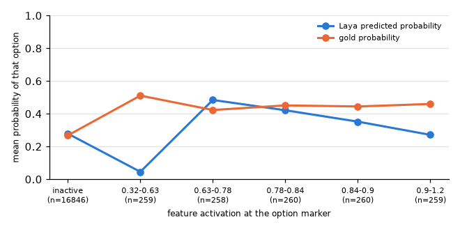

# Feature 7302

Critérios em que aparece: corr_error_stratified, corr_probe_right_laya_wrong_stratified

**Interpretação (preencher):** 

---

## Maiores ativações

**tr_security_incidents_000233 / disposition** (choice, security_incidents) | ativação 3.945 em `estado` | opções ['close_benign', 'contain', 'investigate', 'monitor'] | Laya: **investigate** [0.01, 0.076, 0.592, 0.322] | gabarito: **contain**

```
<bos> choice question: How should this security alert be dispositioned?<eos>
▸ <mask> close_benign: Expected, explainable activity; close without analyst time.
▸ <mask> contain: Contain the host or account immediately; do not wait for triage.
▸ <mask> investigate: Warrants an analyst opening an investigation.
▸ <mask> monitor: Not clearly malicious, but worth watching for recurrence.

<eos>

 {"alert": {"description": "an endpoint agent matched a known signature", "evidence": "On 2026-09-15 09:17:03 UTC, the endpoint detection agent on host \"WIN-DC01\" flagged a match to the \"Em⟦ote⟧t\" malware signature (SHA256: a1b2c3d4e5f6g7h8i9j0...), detected in the file \"C:\\Windows\\Temp\\svchost.exe\". The suspicious file was launched by process \"msiexec.exe\" with PID 6420, the event was recorded as originating from an unrecognized source, and the associated admin account \"svc_admin\" had MFA enabled with its password last changed on 2026-09-12.", "rule": "malware_signature"}, "context": {"asset_criticality": "medium", "change_window_active": false, "source_on_allowlist": false}, "history": {"credential_rotation_days_ago": 3, "distinct_countries_30d": 4, "logins_30d": 695, "prior_alerts_90d": 0}, "principal": {"mfa_enrolled": true, "name": "svc-deploy-569", "privileges": ["deploy:production", "secrets:read"], "type": "admin"}}<eos>
```

**tr_security_incidents_000233 / credential_compromise** (noul, security_incidents) | ativação 3.908 em `estado` | opções ['false', 'true'] | Laya: **true** [0.008, 0.992] | gabarito: **true**

```
<bos> noul question: The evidence indicates a credential or account has been compromised.<eos>
▸ <mask> false: no, the statement does not hold
▸ <mask> true: yes, the statement holds

<eos>

 {"alert": {"description": "an endpoint agent matched a known signature", "evidence": "On 2026-09-15 09:17:03 UTC, the endpoint detection agent on host \"WIN-DC01\" flagged a match to the \"Em⟦ote⟧t\" malware signature (SHA256: a1b2c3d4e5f6g7h8i9j0...), detected in the file \"C:\\Windows\\Temp\\svchost.exe\". The suspicious file was launched by process \"msiexec.exe\" with PID 6420, the event was recorded as originating from an unrecognized source, and the associated admin account \"svc_admin\" had MFA enabled with its password last changed on 2026-09-12.", "rule": "malware_signature"}, "context": {"asset_criticality": "medium", "change_window_active": false, "source_on_allowlist": false}, "history": {"credential_rotation_days_ago": 3, "distinct_countries_30d": 4, "logins_30d": 695, "prior_alerts_90d": 0}, "principal": {"mfa_enrolled": true, "name": "svc-deploy-569", "privileges": ["deploy:production", "secrets:read"], "type": "admin"}}<eos>
```

**tr_security_incidents_000233 / urgency** (score, security_incidents) | ativação 3.859 em `estado` | opções ['0', '1', '2', '3'] | Laya: **3** [0.097, 0.216, 0.11, 0.577] | gabarito: **3**

```
<bos> score question: How quickly must a responder act on this alert?<eos>
▸ <mask> level 0: No time pressure; can wait indefinitely.
▸ <mask> level 1: Routine; handle within the normal queue.
▸ <mask> level 2: Elevated; should be handled within the same week.
▸ <mask> level 3: Critical; requires action within the same day.

<eos>

 {"alert": {"description": "an endpoint agent matched a known signature", "evidence": "On 2026-09-15 09:17:03 UTC, the endpoint detection agent on host \"WIN-DC01\" flagged a match to the \"Em⟦ote⟧t\" malware signature (SHA256: a1b2c3d4e5f6g7h8i9j0...), detected in the file \"C:\\Windows\\Temp\\svchost.exe\". The suspicious file was launched by process \"msiexec.exe\" with PID 6420, the event was recorded as originating from an unrecognized source, and the associated admin account \"svc_admin\" had MFA enabled with its password last changed on 2026-09-12.", "rule": "malware_signature"}, "context": {"asset_criticality": "medium", "change_window_active": false, "source_on_allowlist": false}, "history": {"credential_rotation_days_ago": 3, "distinct_countries_30d": 4, "logins_30d": 695, "prior_alerts_90d": 0}, "principal": {"mfa_enrolled": true, "name": "svc-deploy-569", "privileges": ["deploy:production", "secrets:read"], "type": "admin"}}<eos>
```

**tr_security_incidents_000233 / true_positive** (noul, security_incidents) | ativação 3.846 em `estado` | opções ['false', 'true'] | Laya: **true** [0.016, 0.984] | gabarito: **true**

```
<bos> noul question: This alert reflects genuinely malicious or unauthorised activity.<eos>
▸ <mask> false: Benign activity, a misconfiguration, or a known false positive.
▸ <mask> true: The underlying behaviour is malicious or unauthorised.

<eos>

 {"alert": {"description": "an endpoint agent matched a known signature", "evidence": "On 2026-09-15 09:17:03 UTC, the endpoint detection agent on host \"WIN-DC01\" flagged a match to the \"Em⟦ote⟧t\" malware signature (SHA256: a1b2c3d4e5f6g7h8i9j0...), detected in the file \"C:\\Windows\\Temp\\svchost.exe\". The suspicious file was launched by process \"msiexec.exe\" with PID 6420, the event was recorded as originating from an unrecognized source, and the associated admin account \"svc_admin\" had MFA enabled with its password last changed on 2026-09-12.", "rule": "malware_signature"}, "context": {"asset_criticality": "medium", "change_window_active": false, "source_on_allowlist": false}, "history": {"credential_rotation_days_ago": 3, "distinct_countries_30d": 4, "logins_30d": 695, "prior_alerts_90d": 0}, "principal": {"mfa_enrolled": true, "name": "svc-deploy-569", "privileges": ["deploy:production", "secrets:read"], "type": "admin"}}<eos>
```

**tr_security_incidents_000273 / disposition** (choice, security_incidents) | ativação 3.799 em `estado` | opções ['close_benign', 'contain', 'investigate', 'monitor'] | Laya: **monitor** [0.0, 0.0, 0.035, 0.964] | gabarito: **contain**

```
<bos> choice question: How should this security alert be dispositioned?<eos>
▸ <mask> close_benign: Expected, explainable activity; close without analyst time.
▸ <mask> contain: Contain the host or account immediately; do not wait for triage.
▸ <mask> investigate: Warrants an analyst opening an investigation.
▸ <mask> monitor: Not clearly malicious, but worth watching for recurrence.

<eos>

 {"alert": {"description": "an endpoint agent matched a known signature", "evidence": "Endpoint sensor on workstation WKS-07 detected a file named 'svchost64.dll' in C:\\Users\\temp that matched the known malware signature 'Trojan:Win32/Em⟦ote⟧t.A' at 2026-09-15 08:17:02 UTC. The detection was generated by an unregistered source. The associated admin account, which has MFA enabled and was last rotated 14 days prior, was not in a scheduled change window.", "rule": "malware_signature"}, "context": {"asset_criticality": "medium", "change_window_active": false, "source_on_allowlist": false}, "history": {"credential_rotation_days_ago": 14, "distinct_countries_30d": 2, "logins_30d": 1414, "prior_alerts_90d": 0}, "principal": {"mfa_enrolled": true, "name": "adm-infra-828", "privileges": ["deploy:production", "secrets:read"], "type": "admin"}}<eos>
```

## Ativações medianas (faixa 40-60%, mediana 1.460)

**tr_customer_service_000145 / needs_human** (noul, customer_service) | ativação 1.245 em `estado` | opções ['false', 'true'] | Laya: **false** [0.708, 0.292] | gabarito: **true**

```
<bos> noul question: This conversation requires a human agent rather than automated handling.<eos>
▸ <mask> false: Automation can carry this to resolution.
▸ <mask> true: A human must take over: judgement, authority or empathy is required.

<eos>

 {"account": {"lifetime_value_usd": 1881, "prior_tickets_90d": 1, "seats": 1, "tenure_months": 41, "tier": "free"}, "orders": [{"amount_usd": 29, "date": "2026-03-03", "id": "A-31049", "status": "settled"}, {"amount_usd": 29, "date": "2026-03-09", "id": "A-25889", "status": "settled"}, {"amount_usd": 29, "date": "2026-03-23", "id": "A-16677", "status": "settled"}], "thread": [{"role": "customer", "text": "Hi, I’m writing again because the “Export to CSV” button on my dashboard has been broken for a few days now. I’ve been on the Free plan for 41 months, paying about $29 annually, and I already opened Ticket #2098 which never got resolved. If this can’t be fixed soon, I’ll have to look elsewhere."}, {"role": "agent", "text": "I understand how frustrating that must be, especially after waiting on Ticket #2098. Could you tell me exactly what happens when you click the export button—any error messages or just no response?"}, {"role": "customer", "text": "When I click it, the page just spins for a while and then nothing happens. There’s no error pop‑up, just⟦ silence⟧."}, {"role": "agent", "text": "Thanks for the detail. Are you seeing this issue on all browsers, or have you tried a different one to see if the behavior changes?"}, {"role": "customer", "text": "I tried Chrome and Firefox, same result on both. I also cleared my cache, but the button still does nothing."}]}<eos>
```

**tr_security_incidents_000289 / urgency** (score, security_incidents) | ativação 1.498 em `estado` | opções ['0', '1', '2', '3'] | Laya: **1** [0.079, 0.526, 0.168, 0.226] | gabarito: **2**

```
<bos> score question: How quickly must a responder act on this alert?<eos>
▸ <mask> level 0: No time pressure; can wait indefinitely.
▸ <mask> level 1: Routine; handle within the normal queue.
▸ <mask> level 2: Elevated; should be handled within the same week.
▸ <mask> level 3: Critical; requires action within the same day.

<eos>

 {"alert": {"description": "a long-unused account became active", "evidence": "On 2026-09-14 18:42:09 UTC an admin‑type account (admin_user_7) that had no activity for the prior 180 days executed a successful console login. The login used MFA, the credentials were last rotated on 2026-08-15, and the source IP 198.51.100.22 is on the approved allowlist; no change window was configured at the time.", "rule": "dormant_account_use"}, "context": {"asset_criticality": "high", "change_window_active": false, "source_on_allowlist": true}, "history": {"credential_rotation_days_ago": 30, "distinct_countries_30d": 3, "logins_30d": 1275, "prior_alerts_90d": 0}, "principal": {"mfa_enrolled": true, "⟦name⟧": "ci-infra-189", "privileges": ["repo:read"], "type": "admin"}}<eos>
```

**tr_customer_service_000279 / category** (choice, customer_service) | ativação 1.209 em `estado` | opções ['account', 'billing', 'delivery', 'refund', 'technical'] | Laya: **account** [0.613, 0.014, 0.004, 0.012, 0.357] | gabarito: **account**

```
<bos> choice question: What is this customer conversation primarily about?<eos>
▸ <mask> account: Login, plan changes, profile or access management.
▸ <mask> billing: A charge, invoice, subscription or payment problem.
▸ <mask> delivery: Shipping, fulfilment or delivery of a physical item.
▸ <mask> refund: The customer is explicitly asking for money back.
▸ <mask> technical: The product or service is not working as expected.

<eos>

 {"account": {"lifetime_value_usd": 2237, "prior_tickets_90d": 2, "seats": 1, "tenure_months": 33, "tier": "free"}, "thread": [{"role": "customer", "text": "Hi there, I’ve been using the free plan for 33 months now and I’m hoping to download my full data history. Could you let me know the steps to initiate an export?"}, {"role": "agent", "text": "Hello, thank you for reaching out. I see you've been with us for quite a while now. Could you please clarify if you are looking to export a specific date⟦ range⟧ or your entire account archive?"}, {"role": "customer", "text": "I would like to pull everything from the very beginning if that is possible."}]}<eos>
```

**tr_customer_service_000248 / churn_risk** (score, customer_service) | ativação 1.286 em `estado` | opções ['0', '1', '2', '3'] | Laya: **0** [0.487, 0.353, 0.143, 0.017] | gabarito: **1**

```
<bos> score question: How likely is this customer to stop doing business with us because of this interaction?<eos>
▸ <mask> level 0: No sign of dissatisfaction.
▸ <mask> level 1: Mild frustration, but the relationship is intact.
▸ <mask> level 2: Clearly unhappy; repeat problems or explicit complaints.
▸ <mask> level 3: Imminent: threatening to cancel, dispute or leave.

<eos>

 {"account": {"lifetime_value_usd": 5956, "prior_tickets_90d": 0, "seats": 1, "tenure_months": 72, "tier": "standard"}, "orders": [{"amount_usd": 19, "date": "2026-02-20", "id": "A-97410", "status": "pending"}], "thread": [{"role": "customer", "text": "I just opened my package and I'm quite puzzled, I ordered the matte black frame but the one in the box is a very bright glossy silver."}, {"role": "agent", "text": "I appreciate you reaching out about this discrepancy. Could you let me know if the SKU number printed on the external packaging matches your order confirmation?"}, {"role": "customer", "text": "Let's see... the box says SKU-992, but I'm looking at the email I got when I ordered it and that says I should have received SKU-995."}, {"role": "agent", "text": "Thank you for checking that. Besides the color being incorrect, does the frame appear to be the correct size that you requested, or is that different as well?"}, {"role": "customer", "text": "The size seems to be the 11x14 I wanted, it's just the finish that's totally wrong and won't work for where I wanted to hang it."}, {"role": "agent", "text": "I understand. To help me document this correctly for our warehouse team, could you describe any other labels or markings you see on the inner protective wrapping?"}, {"role": "customer", "text": "There aren't really any other labels on the inside, just the clear plastic sleeve, so I'm still trying to⟦ figure⟧ out how I ended up with silver instead of black."}]}<eos>
```

**tr_customer_service_000276 / action** (choice, customer_service) | ativação 1.466 em `estado` | opções ['answer_directly', 'close_no_action', 'escalate_to_human', 'execute_refund', 'request_information'] | Laya: **close_no_action** [0.256, 0.504, 0.116, 0.082, 0.042] | gabarito: **execute_refund**

```
<bos> choice question: What should the assistant do next with this conversation?<eos>
▸ <mask> answer_directly: The assistant can resolve this itself with information it already has.
▸ <mask> close_no_action: No further action is warranted; the matter is settled.
▸ <mask> escalate_to_human: Hand off to a human agent with the appropriate authority.
▸ <mask> execute_refund: Issue the refund or credit the customer is owed.
▸ <mask> request_information: More detail is needed from the customer before anything can be done.

<eos>

 {"account": {"lifetime_value_usd": 2578, "prior_tickets_90d": 2, "seats": 1, "tenure_months": 33, "tier": "free"}, "orders": [{"amount_usd": 19, "date": "2026-02-10", "id": "A-44819", "status": "pending"}, {"amount_usd": 19, "⟦date⟧": "2026-02-04", "id": "A-86947", "status": "refunded"}, {"amount_usd": 19, "date": "2026-03-02", "id": "A-96218", "status": "refunded"}], "thread": [{"role": "customer", "text": "Hi there. I’m checking in on the $19 refund I requested a while back. I’ve been with you for 33 months on the free plan, and since I have a hard deadline for my accounting this Friday, I was hoping for an update."}, {"role": "agent", "text": "Hello. I appreciate your long-standing loyalty over the last few years. I can certainly look into the status of that refund request for you; could you please provide the reference number from your previous inquiries?"}, {"role": "customer", "text": "I’ve opened two tickets already, but they seem to have stalled. I’m trying to keep my records clean before my deadline at the end of the week, so any movement on this would be greatly appreciated."}, {"role": "agent", "text": "Thank you for that clarification. I am currently reviewing your account history and the previous tickets mentioned to see where the hold-up might be occurring."}, {"role": "customer", "text": "I understand. I’m just really concerned about hitting that Friday cutoff, so please let me know as soon as you find anything out."}]}<eos>
```

## Estatísticas (conjunto de descoberta, dev e teste)

**pred / error**

| split | decisões | ativas | ativas e Laya errou | taxa | lift | q (BH) | OR (CMH) | q (CMH) |
|---|---|---|---|---|---|---|---|---|
| discovery | 5100 | 369 | 203 | 0.550 | 0.85 | 0.000348 | nan | nan |
| dev | 900 | 65 | 32 | 0.492 | 0.73 | 0.00935 | nan | nan |
| test | 2000 | 137 | 73 | 0.533 | 0.82 | 0.00897 | nan | nan |

**corr / error**

| split | decisões | ativas | ativas e Laya errou | taxa | lift | q (BH) | OR (CMH) | q (CMH) |
|---|---|---|---|---|---|---|---|---|
| discovery | 5100 | 542 | 376 | 0.694 | 1.08 | 0.0152 | 2.44 | 6.04e-48 |
| dev | 900 | 108 | 75 | 0.694 | 1.03 | 0.782 | 2.37 | 3.39e-08 |
| test | 2000 | 209 | 145 | 0.694 | 1.07 | 0.234 | 2.63 | 2.41e-21 |

**state / error**

| split | decisões | ativas | ativas e Laya errou | taxa | lift | q (BH) | OR (CMH) | q (CMH) |
|---|---|---|---|---|---|---|---|---|
| discovery | 5100 | 5100 | 3283 | 0.644 | 1.00 | 1 | nan | nan |
| dev | 900 | 900 | 605 | 0.672 | 1.00 | 1 | nan | nan |
| test | 2000 | 2000 | 1301 | 0.650 | 1.00 | 1 | nan | nan |

**pred / probe_right_laya_wrong**

| split | decisões | ativas | ativas e Laya errou | taxa | lift | q (BH) | OR (CMH) | q (CMH) |
|---|---|---|---|---|---|---|---|---|
| discovery | 2819 | 222 | 151 | 0.680 | 1.05 | 0.356 | nan | nan |
| dev | 520 | 45 | 27 | 0.600 | 0.89 | 0.458 | nan | nan |
| test | 1106 | 77 | 51 | 0.662 | 1.05 | 0.769 | nan | nan |

**corr / probe_right_laya_wrong**

| split | decisões | ativas | ativas e Laya errou | taxa | lift | q (BH) | OR (CMH) | q (CMH) |
|---|---|---|---|---|---|---|---|---|
| discovery | 2819 | 276 | 205 | 0.743 | 1.15 | 0.000698 | 2.75 | 2.93e-35 |
| dev | 520 | 59 | 41 | 0.695 | 1.03 | 0.938 | 2.12 | 0.000233 |
| test | 1106 | 102 | 76 | 0.745 | 1.18 | 0.0245 | 2.90 | 2.1e-14 |

**state / probe_right_laya_wrong**

| split | decisões | ativas | ativas e Laya errou | taxa | lift | q (BH) | OR (CMH) | q (CMH) |
|---|---|---|---|---|---|---|---|---|
| discovery | 2819 | 2819 | 1824 | 0.647 | 1.00 | 1 | nan | nan |
| dev | 520 | 520 | 351 | 0.675 | 1.00 | 1 | nan | nan |
| test | 1106 | 1106 | 700 | 0.633 | 1.00 | 1 | nan | nan |

Confusão mais sobre-representada (pred): `needs_human|0>1` (n=54, lift 13.82, p=0). Formato `pergunta|índice previsto>índice correto`.

Confusão mais sobre-representada (corr): `credential_compromise|1>0` (n=82, lift 9.41, p=0). Formato `pergunta|índice previsto>índice correto`.

Confusão mais sobre-representada (state): `action|0>1` (n=6, lift 1.00, p=1). Formato `pergunta|índice previsto>índice correto`.



