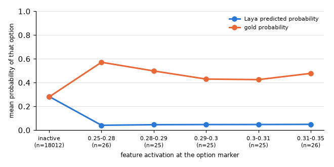

# Feature 7306

Critérios em que aparece: corr_error, corr_probe_right_laya_wrong

**Interpretação (preencher):** 

---

## Maiores ativações

**tr_security_incidents_000065 / true_positive** (noul, security_incidents) | ativação 2.262 em `estado` | opções ['false', 'true'] | Laya: **true** [0.09, 0.91] | gabarito: **true**

```
<bos> noul question: This alert reflects genuinely malicious or unauthorised activity.<eos>
▸ <mask> false: Benign activity, a misconfiguration, or a known false positive.
▸ <mask> true: The underlying behaviour is malicious or unauthorised.

<eos>

 {"alert": {"description": "an unrecognised binary executed on a server", "evidence": "At 2026-09-15 14:23:08 UTC, an employee⟦ workstation⟧ \"workstation-12\" launched the unknown binary \"/tmp/lsass_helper\" (PID 5874) on server \"app-prod-01\" during an open change window. The execution originated from an unrecognised source IP 192.0.2.55, and the employee’s MFA token was validated. The user’s credentials were last rotated 90 days ago.", "rule": "suspicious_process"}, "context": {"asset_criticality": "low", "change_window_active": true, "source_on_allowlist": false}, "history": {"credential_rotation_days_ago": 90, "distinct_countries_30d": 4, "logins_30d": 1617, "prior_alerts_90d": 0}, "principal": {"mfa_enrolled": true, "name": "usr-billing-187", "privileges": ["repo:read"], "type": "employee"}}<eos>
```

**tr_security_incidents_000065 / urgency** (score, security_incidents) | ativação 2.256 em `estado` | opções ['0', '1', '2', '3'] | Laya: **3** [0.137, 0.188, 0.319, 0.356] | gabarito: **2**

```
<bos> score question: How quickly must a responder act on this alert?<eos>
▸ <mask> level 0: No time pressure; can wait indefinitely.
▸ <mask> level 1: Routine; handle within the normal queue.
▸ <mask> level 2: Elevated; should be handled within the same week.
▸ <mask> level 3: Critical; requires action within the same day.

<eos>

 {"alert": {"description": "an unrecognised binary executed on a server", "evidence": "At 2026-09-15 14:23:08 UTC, an employee⟦ workstation⟧ \"workstation-12\" launched the unknown binary \"/tmp/lsass_helper\" (PID 5874) on server \"app-prod-01\" during an open change window. The execution originated from an unrecognised source IP 192.0.2.55, and the employee’s MFA token was validated. The user’s credentials were last rotated 90 days ago.", "rule": "suspicious_process"}, "context": {"asset_criticality": "low", "change_window_active": true, "source_on_allowlist": false}, "history": {"credential_rotation_days_ago": 90, "distinct_countries_30d": 4, "logins_30d": 1617, "prior_alerts_90d": 0}, "principal": {"mfa_enrolled": true, "name": "usr-billing-187", "privileges": ["repo:read"], "type": "employee"}}<eos>
```

**tr_security_incidents_000065 / severity** (score, security_incidents) | ativação 2.250 em `estado` | opções ['0', '1', '2', '3', '4'] | Laya: **2** [0.146, 0.261, 0.296, 0.146, 0.151] | gabarito: **2**

```
<bos> score question: How severe is the potential impact if this alert is real?<eos>
▸ <mask> level 0: Negligible: no access to anything sensitive.
▸ <mask> level 1: Low: limited access, easily reversed.
▸ <mask> level 2: Moderate: access to internal systems or non-public data.
▸ <mask> level 3: High: access to production, secrets or customer data.
▸ <mask> level 4: Critical: active compromise of crown-jewel systems.

<eos>

 {"alert": {"description": "an unrecognised binary executed on a server", "evidence": "At 2026-09-15 14:23:08 UTC, an employee⟦ workstation⟧ \"workstation-12\" launched the unknown binary \"/tmp/lsass_helper\" (PID 5874) on server \"app-prod-01\" during an open change window. The execution originated from an unrecognised source IP 192.0.2.55, and the employee’s MFA token was validated. The user’s credentials were last rotated 90 days ago.", "rule": "suspicious_process"}, "context": {"asset_criticality": "low", "change_window_active": true, "source_on_allowlist": false}, "history": {"credential_rotation_days_ago": 90, "distinct_countries_30d": 4, "logins_30d": 1617, "prior_alerts_90d": 0}, "principal": {"mfa_enrolled": true, "name": "usr-billing-187", "privileges": ["repo:read"], "type": "employee"}}<eos>
```

**tr_security_incidents_000065 / disposition** (choice, security_incidents) | ativação 2.211 em `estado` | opções ['close_benign', 'contain', 'investigate', 'monitor'] | Laya: **monitor** [0.218, 0.055, 0.221, 0.506] | gabarito: **investigate**

```
<bos> choice question: How should this security alert be dispositioned?<eos>
▸ <mask> close_benign: Expected, explainable activity; close without analyst time.
▸ <mask> contain: Contain the host or account immediately; do not wait for triage.
▸ <mask> investigate: Warrants an analyst opening an investigation.
▸ <mask> monitor: Not clearly malicious, but worth watching for recurrence.

<eos>

 {"alert": {"description": "an unrecognised binary executed on a server", "evidence": "At 2026-09-15 14:23:08 UTC, an employee⟦ workstation⟧ \"workstation-12\" launched the unknown binary \"/tmp/lsass_helper\" (PID 5874) on server \"app-prod-01\" during an open change window. The execution originated from an unrecognised source IP 192.0.2.55, and the employee’s MFA token was validated. The user’s credentials were last rotated 90 days ago.", "rule": "suspicious_process"}, "context": {"asset_criticality": "low", "change_window_active": true, "source_on_allowlist": false}, "history": {"credential_rotation_days_ago": 90, "distinct_countries_30d": 4, "logins_30d": 1617, "prior_alerts_90d": 0}, "principal": {"mfa_enrolled": true, "name": "usr-billing-187", "privileges": ["repo:read"], "type": "employee"}}<eos>
```

**tr_security_incidents_000065 / credential_compromise** (noul, security_incidents) | ativação 2.174 em `estado` | opções ['false', 'true'] | Laya: **true** [0.056, 0.944] | gabarito: **true**

```
<bos> noul question: The evidence indicates a credential or account has been compromised.<eos>
▸ <mask> false: no, the statement does not hold
▸ <mask> true: yes, the statement holds

<eos>

 {"alert": {"description": "an unrecognised binary executed on a server", "evidence": "At 2026-09-15 14:23:08 UTC, an employee⟦ workstation⟧ \"workstation-12\" launched the unknown binary \"/tmp/lsass_helper\" (PID 5874) on server \"app-prod-01\" during an open change window. The execution originated from an unrecognised source IP 192.0.2.55, and the employee’s MFA token was validated. The user’s credentials were last rotated 90 days ago.", "rule": "suspicious_process"}, "context": {"asset_criticality": "low", "change_window_active": true, "source_on_allowlist": false}, "history": {"credential_rotation_days_ago": 90, "distinct_countries_30d": 4, "logins_30d": 1617, "prior_alerts_90d": 0}, "principal": {"mfa_enrolled": true, "name": "usr-billing-187", "privileges": ["repo:read"], "type": "employee"}}<eos>
```

## Ativações medianas (faixa 40-60%, mediana 0.516)

**tr_customer_service_000259 / churn_risk** (score, customer_service) | ativação 0.428 em `estado` | opções ['0', '1', '2', '3'] | Laya: **2** [0.034, 0.446, 0.491, 0.028] | gabarito: **2**

```
<bos> score question: How likely is this customer to stop doing business with us because of this interaction?<eos>
▸ <mask> level 0: No sign of dissatisfaction.
▸ <mask> level 1: Mild frustration, but the relationship is intact.
▸ <mask> level 2: Clearly unhappy; repeat problems or explicit complaints.
▸ <mask> level 3: Imminent: threatening to cancel, dispute or leave.

<eos>

 {"account": {"lifetime_value_usd": 2451, "prior_tickets_90d": 3, "⟦seats⟧": 1, "tenure_months": 26, "tier": "standard"}, "thread": [{"role": "customer", "text": "I was promised a refund for the double charge last month and I still haven’t seen any money back—what's the status?"}, {"role": "agent", "text": "I understand your frustration. Could you provide the transaction ID or the date of the charge so I can look it up?"}, {"role": "customer", "text": "The charge was on March 12th, reference #TXN‑20230312‑07. I need to know what’s happening with my refund right now."}]}<eos>
```

**tr_customer_service_000279 / needs_human** (noul, customer_service) | ativação 0.506 em `pergunta` | opções ['false', 'true'] | Laya: **true** [0.048, 0.952] | gabarito: **false**

```
<bos> noul question: This conversation requires a human agent⟦ rather⟧ than automated handling.<eos>
▸ <mask> false: Automation can carry this to resolution.
▸ <mask> true: A human must take over: judgement, authority or empathy is required.

<eos>

 {"account": {"lifetime_value_usd": 2237, "prior_tickets_90d": 2, "seats": 1, "tenure_months": 33, "tier": "free"}, "thread": [{"role": "customer", "text": "Hi there, I’ve been using the free plan for 33 months now and I’m hoping to download my full data history. Could you let me know the steps to initiate an export?"}, {"role": "agent", "text": "Hello, thank you for reaching out. I see you've been with us for quite a while now. Could you please clarify if you are looking to export a specific date range or your entire account archive?"}, {"role": "customer", "text": "I would like to pull everything from the very beginning if that is possible."}]}<eos>
```

**tr_invoice_processing_000279 / matches_order** (noul, invoice_processing) | ativação 0.330 em `marcador` | opções ['false', 'true'] | Laya: **true** [0.033, 0.967] | gabarito: **false**

```
<bos> noul question: The invoice reconciles with the purchase order and the recorded delivery.<eos>
▸ ⟦<mask>⟧ false: There is a discrepancy against the order or the delivery.
▸ <mask> true: Line items, quantities and amounts reconcile.

<eos>

 {"delivery": {"condition": "accepted", "date": "2026-03-09", "received_qty": 250}, "invoice": {"currency": "USD", "id": "INV-2026-8442", "lines": [{"qty": 250, "sku": "SKU-335", "total_usd": 60245.0, "unit_usd": 240.98}], "total_usd": 60245.0, "vendor": "Acme Fabrication"}, "payment": {"days_until_due": 5, "discount_expires_in_days": 1, "early_payment_discount_pct": 2.0, "status": "scheduled", "terms": "net 30"}, "purchase_order": {"freight_terms": "freight prepaid by vendor, not separately billable", "id": "PO-8153", "lines": [{"qty": 250, "unit_usd": 215.16}], "total_usd": 53790.0}, "vendor_history": {"disputes_12m": 1, "invoices_12m": 36, "prior_invoice_ids": ["INV-2026-1204"]}}<eos>
```

**tr_customer_service_000059 / needs_human** (noul, customer_service) | ativação 0.538 em `pergunta` | opções ['false', 'true'] | Laya: **true** [0.009, 0.991] | gabarito: **true**

```
<bos> noul question: This conversation requires a human agent⟦ rather⟧ than automated handling.<eos>
▸ <mask> false: Automation can carry this to resolution.
▸ <mask> true: A human must take over: judgement, authority or empathy is required.

<eos>

 {"account": {"lifetime_value_usd": 169, "prior_tickets_90d": 3, "seats": 1, "tenure_months": 5, "tier": "enterprise"}, "thread": [{"role": "customer", "text": "I need my account cancelled immediately; this can’t wait any longer."}, {"role": "agent", "text": "I understand. May I ask the reason you’re choosing to cancel?"}, {"role": "customer", "text": "I’ve dealt with the same problems over and over despite three prior tickets being closed; I want confirmation that the account will be terminated."}, {"role": "agent", "text": "Got it. Could you provide the email address associated with the account so I can verify your request?"}, {"role": "customer", "text": "myname@example.com – please proceed right away."}]}<eos>
```

**tr_invoice_processing_000091 / matches_order** (noul, invoice_processing) | ativação 0.334 em `marcador` | opções ['false', 'true'] | Laya: **true** [0.02, 0.98] | gabarito: **true**

```
<bos> noul question: The invoice reconciles with the purchase order and the recorded delivery.<eos>
▸ ⟦<mask>⟧ false: There is a discrepancy against the order or the delivery.
▸ <mask> true: Line items, quantities and amounts reconcile.

<eos>

 {"delivery": {"condition": "accepted", "date": "2026-03-05", "received_qty": 50}, "invoice": {"currency": "USD", "id": "INV-2026-1102", "lines": [{"qty": 50, "sku": "SKU-658", "total_usd": 15868.0, "unit_usd": 317.36}], "total_usd": 15868.0, "vendor": "Acme Fabrication"}, "payment": {"days_until_due": -9, "discount_expires_in_days": 4, "early_payment_discount_pct": 2.0, "status": "overdue", "terms": "net 15"}, "purchase_order": {"freight_terms": "freight prepaid by vendor, not separately billable", "id": "PO-1320", "lines": [{"qty": 50, "unit_usd": 317.36}], "total_usd": 15868.0}, "vendor_history": {"disputes_12m": 1, "invoices_12m": 1, "prior_invoice_ids": ["INV-2026-1102", "INV-2026-8587", "INV-2026-9515"]}}<eos>
```

## Estatísticas (conjunto de descoberta, dev e teste)

**pred / error**

| split | decisões | ativas | ativas e Laya errou | taxa | lift | q (BH) | OR (CMH) | q (CMH) |
|---|---|---|---|---|---|---|---|---|
| discovery | 5100 | 0 | 0 | nan | nan | nan | nan | nan |
| dev | 900 | 0 | 0 | nan | nan | nan | nan | nan |
| test | 2000 | 0 | 0 | nan | nan | nan | nan | nan |

**corr / error**

| split | decisões | ativas | ativas e Laya errou | taxa | lift | q (BH) | OR (CMH) | q (CMH) |
|---|---|---|---|---|---|---|---|---|
| discovery | 5100 | 63 | 63 | 1.000 | 1.55 | 5.33e-12 | nan | nan |
| dev | 900 | 19 | 19 | 1.000 | 1.49 | nan | nan | nan |
| test | 2000 | 25 | 25 | 1.000 | 1.54 | 0.000102 | nan | nan |

**state / error**

| split | decisões | ativas | ativas e Laya errou | taxa | lift | q (BH) | OR (CMH) | q (CMH) |
|---|---|---|---|---|---|---|---|---|
| discovery | 5100 | 93 | 56 | 0.602 | 0.94 | 0.64 | 1.10 | 0.905 |
| dev | 900 | 21 | 16 | 0.762 | 1.13 | 0.853 | 2.55 | 0.438 |
| test | 2000 | 68 | 39 | 0.574 | 0.88 | 0.503 | 0.96 | 0.973 |

**pred / probe_right_laya_wrong**

| split | decisões | ativas | ativas e Laya errou | taxa | lift | q (BH) | OR (CMH) | q (CMH) |
|---|---|---|---|---|---|---|---|---|
| discovery | 2819 | 0 | 0 | nan | nan | nan | nan | nan |
| dev | 520 | 0 | 0 | nan | nan | nan | nan | nan |
| test | 1106 | 0 | 0 | nan | nan | nan | nan | nan |

**corr / probe_right_laya_wrong**

| split | decisões | ativas | ativas e Laya errou | taxa | lift | q (BH) | OR (CMH) | q (CMH) |
|---|---|---|---|---|---|---|---|---|
| discovery | 2819 | 36 | 36 | 1.000 | 1.55 | 5.87e-07 | nan | nan |
| dev | 520 | 7 | 7 | 1.000 | 1.48 | nan | nan | nan |
| test | 1106 | 14 | 14 | 1.000 | 1.58 | nan | nan | nan |

**state / probe_right_laya_wrong**

| split | decisões | ativas | ativas e Laya errou | taxa | lift | q (BH) | OR (CMH) | q (CMH) |
|---|---|---|---|---|---|---|---|---|
| discovery | 2819 | 56 | 30 | 0.536 | 0.83 | 0.196 | 0.98 | 0.98 |
| dev | 520 | 16 | 12 | 0.750 | 1.11 | nan | nan | nan |
| test | 1106 | 47 | 27 | 0.574 | 0.91 | 0.731 | 1.18 | 0.836 |

Confusão mais sobre-representada (corr): `matches_order|1>0` (n=63, lift 42.86, p=0). Formato `pergunta|índice previsto>índice correto`.

Confusão mais sobre-representada (state): `churn_risk|1>3` (n=3, lift 7.83, p=0.00615). Formato `pergunta|índice previsto>índice correto`.



