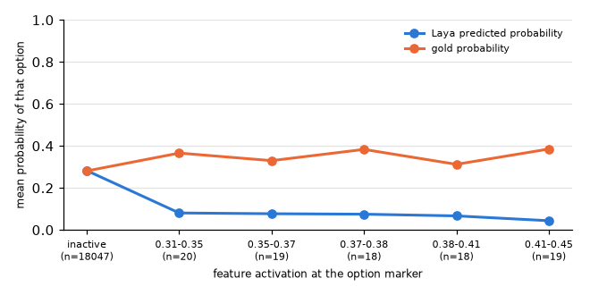

# Feature 7403

Critérios em que aparece: corr_error

**Interpretação (preencher):** 

---

## Maiores ativações

**tr_customer_service_000147 / category** (choice, customer_service) | ativação 3.648 em `estado` | opções ['account', 'billing', 'delivery', 'refund', 'technical'] | Laya: **account** [0.999, 0.0, 0.0, 0.001, 0.0] | gabarito: **account**

```
<bos> choice question: What is this customer conversation primarily about?<eos>
▸ <mask> account: Login, plan changes, profile or access management.
▸ <mask> billing: A charge, invoice, subscription or payment problem.
▸ <mask> delivery: Shipping, fulfilment or delivery of a physical item.
▸ <mask> refund: The customer is explicitly asking for money back.
▸ <mask> technical: The product or service is not working as expected.

<eos>

 {"account": {"lifetime_value_usd": 117, "prior_tickets_90d": 3, "seats": 1, "tenure_months": 5, "tier": "premium"}, "thread": [{"role": "customer", "text": "I’m writing to let you know I’d like to⟦ cancel⟧ my account. I’ve been on the Premium plan for five months, and after three unresolved tickets I’ve decided to move on."}, {"role": "agent", "text": "I’m sorry to hear you want to cancel. Can you confirm the email address associated with the account so I can pull up the correct details?"}, {"role": "customer", "text": "The account is registered to jane.doe@example.com. Please let me know what the next steps are for the cancellation."}]}<eos>
```

**tr_customer_service_000147 / needs_human** (noul, customer_service) | ativação 3.602 em `estado` | opções ['false', 'true'] | Laya: **true** [0.05, 0.95] | gabarito: **true**

```
<bos> noul question: This conversation requires a human agent rather than automated handling.<eos>
▸ <mask> false: Automation can carry this to resolution.
▸ <mask> true: A human must take over: judgement, authority or empathy is required.

<eos>

 {"account": {"lifetime_value_usd": 117, "prior_tickets_90d": 3, "seats": 1, "tenure_months": 5, "tier": "premium"}, "thread": [{"role": "customer", "text": "I’m writing to let you know I’d like to⟦ cancel⟧ my account. I’ve been on the Premium plan for five months, and after three unresolved tickets I’ve decided to move on."}, {"role": "agent", "text": "I’m sorry to hear you want to cancel. Can you confirm the email address associated with the account so I can pull up the correct details?"}, {"role": "customer", "text": "The account is registered to jane.doe@example.com. Please let me know what the next steps are for the cancellation."}]}<eos>
```

**tr_customer_service_000147 / action** (choice, customer_service) | ativação 3.580 em `estado` | opções ['answer_directly', 'close_no_action', 'escalate_to_human', 'execute_refund', 'request_information'] | Laya: **answer_directly** [0.508, 0.256, 0.025, 0.012, 0.198] | gabarito: **escalate_to_human**

```
<bos> choice question: What should the assistant do next with this conversation?<eos>
▸ <mask> answer_directly: The assistant can resolve this itself with information it already has.
▸ <mask> close_no_action: No further action is warranted; the matter is settled.
▸ <mask> escalate_to_human: Hand off to a human agent with the appropriate authority.
▸ <mask> execute_refund: Issue the refund or credit the customer is owed.
▸ <mask> request_information: More detail is needed from the customer before anything can be done.

<eos>

 {"account": {"lifetime_value_usd": 117, "prior_tickets_90d": 3, "seats": 1, "tenure_months": 5, "tier": "premium"}, "thread": [{"role": "customer", "text": "I’m writing to let you know I’d like to⟦ cancel⟧ my account. I’ve been on the Premium plan for five months, and after three unresolved tickets I’ve decided to move on."}, {"role": "agent", "text": "I’m sorry to hear you want to cancel. Can you confirm the email address associated with the account so I can pull up the correct details?"}, {"role": "customer", "text": "The account is registered to jane.doe@example.com. Please let me know what the next steps are for the cancellation."}]}<eos>
```

**tr_customer_service_000147 / needs_human** (noul, customer_service) | ativação 3.496 em `estado` | opções ['false', 'true'] | Laya: **true** [0.05, 0.95] | gabarito: **true**

```
<bos> noul question: This conversation requires a human agent rather than automated handling.<eos>
▸ <mask> false: Automation can carry this to resolution.
▸ <mask> true: A human must take over: judgement, authority or empathy is required.

<eos>

 {"account": {"lifetime_value_usd": 117, "prior_tickets_90d": 3, "seats": 1, "tenure_months": 5, "tier": "premium"}, "thread": [{"role": "customer", "text": "I’m writing to let you know I’d like to cancel my account. I’ve been on the Premium plan for five months, and after three unresolved tickets I’ve decided to move on."}, {"role": "agent", "text": "I’m sorry to hear you want to⟦ cancel⟧. Can you confirm the email address associated with the account so I can pull up the correct details?"}, {"role": "customer", "text": "The account is registered to jane.doe@example.com. Please let me know what the next steps are for the cancellation."}]}<eos>
```

**tr_customer_service_000147 / urgency** (score, customer_service) | ativação 3.455 em `estado` | opções ['0', '1', '2', '3'] | Laya: **2** [0.055, 0.35, 0.397, 0.198] | gabarito: **2**

```
<bos> score question: How time-sensitive is this conversation?<eos>
▸ <mask> level 0: No time pressure; can wait indefinitely.
▸ <mask> level 1: Routine; handle within the normal queue.
▸ <mask> level 2: Elevated; should be handled within the same week.
▸ <mask> level 3: Critical; requires action within the same day.

<eos>

 {"account": {"lifetime_value_usd": 117, "prior_tickets_90d": 3, "seats": 1, "tenure_months": 5, "tier": "premium"}, "thread": [{"role": "customer", "text": "I’m writing to let you know I’d like to⟦ cancel⟧ my account. I’ve been on the Premium plan for five months, and after three unresolved tickets I’ve decided to move on."}, {"role": "agent", "text": "I’m sorry to hear you want to cancel. Can you confirm the email address associated with the account so I can pull up the correct details?"}, {"role": "customer", "text": "The account is registered to jane.doe@example.com. Please let me know what the next steps are for the cancellation."}]}<eos>
```

## Ativações medianas (faixa 40-60%, mediana 2.381)

**tr_customer_service_000013 / churn_risk** (score, customer_service) | ativação 2.549 em `opção` | opções ['0', '1', '2', '3'] | Laya: **1** [0.135, 0.659, 0.152, 0.054] | gabarito: **3**

```
<bos> score question: How likely is this customer to stop doing business with us because of this interaction?<eos>
▸ <mask> level 0: No sign of dissatisfaction.
▸ <mask> level 1: Mild frustration, but the relationship is intact.
▸ <mask> level 2: Clearly unhappy; repeat problems or explicit complaints.
▸ <mask> level 3: Imminent: threatening to⟦ cancel⟧, dispute or leave.

<eos>

 {"account": {"lifetime_value_usd": 148, "prior_tickets_90d": 0, "seats": 40, "tenure_months": 3, "tier": "enterprise"}, "orders": [{"amount_usd": 198, "date": "2026-03-15", "id": "A-40361", "status": "failed"}, {"amount_usd": 198, "date": "2026-01-06", "id": "A-31584", "status": "settled"}, {"amount_usd": 198, "date": "2026-03-27", "id": "A-12899", "status": "pending"}], "thread": [{"role": "customer", "text": "Our latest invoice shows $198 for the enterprise plan, but my contract says $149. This discrepancy needs fixing, or I’ll have to look elsewhere; I need this resolved by the 15th."}, {"role": "agent", "text": "I understand the pricing concern. Can you confirm the billing period the invoice covers and attach the invoice file?"}, {"role": "customer", "text": "It covers March to May, and I’ve attached the PDF. I’m also considering canceling if we can’t sort it out quickly."}, {"role": "agent", "text": "Thanks for the details. Do you have a copy of the original agreement or any previous invoices for comparison?"}, {"role": "customer", "text": "Yes, the original agreement is in the email from January; I’ll forward it. I need a clear answer before the 15th deadline we discussed."}, {"role": "agent", "text": "Got it. I’ll review the documents. In the meantime, could you tell me if any discounts were applied that you’re aware of?"}, {"role": "customer", "text": "No discounts that I know of. I’m waiting for your clarification so I can decide whether to stay or move on."}]}<eos>
```

**tr_customer_service_000169 / churn_risk** (score, customer_service) | ativação 2.545 em `opção` | opções ['0', '1', '2', '3'] | Laya: **2** [0.091, 0.376, 0.409, 0.124] | gabarito: **1**

```
<bos> score question: How likely is this customer to stop doing business with us because of this interaction?<eos>
▸ <mask> level 0: No sign of dissatisfaction.
▸ <mask> level 1: Mild frustration, but the relationship is intact.
▸ <mask> level 2: Clearly unhappy; repeat problems or explicit complaints.
▸ <mask> level 3: Imminent: threatening to⟦ cancel⟧, dispute or leave.

<eos>

 {"account": {"lifetime_value_usd": 188, "prior_tickets_90d": 0, "seats": 1, "tenure_months": 2, "tier": "free"}, "thread": [{"role": "customer", "text": "I’m not sure what's happening with my refund. I thought I’d already got it, but I don’t see any money back yet."}, {"role": "agent", "text": "I understand the confusion. Could you let me know when you originally requested the refund?"}, {"role": "customer", "text": "I submitted the request about two weeks ago after I cancelled the free plan trial."}, {"role": "agent", "text": "Thanks for that. Do you have a transaction or reference number from the original request?"}, {"role": "customer", "text": "No, I don’t think I was given one—just the email I used to sign up."}, {"role": "agent", "text": "Alright, did you receive any confirmation email when you filed the refund request?"}, {"role": "customer", "text": "I didn’t get any confirmation, and I’m still unsure if it’s being processed. Can you check what’s going on?"}]}<eos>
```

**tr_customer_service_000091 / churn_risk** (score, customer_service) | ativação 2.541 em `opção` | opções ['0', '1', '2', '3'] | Laya: **1** [0.068, 0.54, 0.323, 0.07] | gabarito: **1**

```
<bos> score question: How likely is this customer to stop doing business with us because of this interaction?<eos>
▸ <mask> level 0: No sign of dissatisfaction.
▸ <mask> level 1: Mild frustration, but the relationship is intact.
▸ <mask> level 2: Clearly unhappy; repeat problems or explicit complaints.
▸ <mask> level 3: Imminent: threatening to⟦ cancel⟧, dispute or leave.

<eos>

 {"account": {"lifetime_value_usd": 59, "prior_tickets_90d": 0, "seats": 1, "tenure_months": 2, "tier": "standard"}, "thread": [{"role": "customer", "text": "I’m checking in about the refund I was promised last week – the deadline for the credit to hit my account is tomorrow, and I haven’t seen anything yet."}, {"role": "agent", "text": "I understand your concern. Could you provide the refund reference number that was emailed to you?"}, {"role": "customer", "text": "The reference is REF‑20230910‑01. I need to know when the money will actually be posted."}]}<eos>
```

**tr_customer_service_000147 / urgency** (score, customer_service) | ativação 2.129 em `estado` | opções ['0', '1', '2', '3'] | Laya: **2** [0.055, 0.35, 0.397, 0.198] | gabarito: **2**

```
<bos> score question: How time-sensitive is this conversation?<eos>
▸ <mask> level 0: No time pressure; can wait indefinitely.
▸ <mask> level 1: Routine; handle within the normal queue.
▸ <mask> level 2: Elevated; should be handled within the same week.
▸ <mask> level 3: Critical; requires action within the same day.

<eos>

 {"account": {"lifetime_value_usd": 117, "prior_tickets_90d": 3, "seats": 1, "tenure_months": 5, "tier": "premium"}, "thread": [{"role": "customer", "text": "I’m writing to let you know I’d like to cancel my account. I’ve been on the Premium plan for five months, and after three unresolved tickets I’ve decided to move on."}, {"role": "agent", "text": "I’m sorry to hear you want to cancel. Can you confirm the email address associated with the account so I can pull up the correct details?"}, {"role": "customer", "text": "The account is registered to jane.doe@example.com. Please let me know what the next steps are for the⟦ cancellation⟧."}]}<eos>
```

**tr_customer_service_000291 / churn_risk** (score, customer_service) | ativação 2.539 em `opção` | opções ['0', '1', '2', '3'] | Laya: **1** [0.062, 0.636, 0.25, 0.052] | gabarito: **2**

```
<bos> score question: How likely is this customer to stop doing business with us because of this interaction?<eos>
▸ <mask> level 0: No sign of dissatisfaction.
▸ <mask> level 1: Mild frustration, but the relationship is intact.
▸ <mask> level 2: Clearly unhappy; repeat problems or explicit complaints.
▸ <mask> level 3: Imminent: threatening to⟦ cancel⟧, dispute or leave.

<eos>

 {"account": {"lifetime_value_usd": 403, "prior_tickets_90d": 1, "seats": 1, "tenure_months": 5, "tier": "standard"}, "thread": [{"role": "customer", "text": "My recent order, number 992-BX, has not arrived by the scheduled date of Tuesday and the tracking hasn't updated."}, {"role": "agent", "text": "I can look into that for you. Could you please provide the email address associated with your standard plan account?"}, {"role": "customer", "text": "The email is j.smith@example.com. I'm checking back because when I had a delay last month, the ticket was only partially addressed and I still haven't seen the full resolution."}, {"role": "agent", "text": "I see that prior ticket in our records. To help me narrow this down, has the tracking status changed at all in the last 24 hours?"}, {"role": "customer", "text": "The tracking has stayed at 'Processing' since Monday morning, so I would like to know the current location of the package."}]}<eos>
```

## Estatísticas (conjunto de descoberta, dev e teste)

**pred / error**

| split | decisões | ativas | ativas e Laya errou | taxa | lift | q (BH) | OR (CMH) | q (CMH) |
|---|---|---|---|---|---|---|---|---|
| discovery | 5100 | 0 | 0 | nan | nan | nan | nan | nan |
| dev | 900 | 0 | 0 | nan | nan | nan | nan | nan |
| test | 2000 | 0 | 0 | nan | nan | nan | nan | nan |

**corr / error**

| split | decisões | ativas | ativas e Laya errou | taxa | lift | q (BH) | OR (CMH) | q (CMH) |
|---|---|---|---|---|---|---|---|---|
| discovery | 5100 | 42 | 42 | 1.000 | 1.55 | 4.43e-08 | inf | 0.455 |
| dev | 900 | 9 | 9 | 1.000 | 1.49 | nan | nan | nan |
| test | 2000 | 7 | 7 | 1.000 | 1.54 | nan | nan | nan |

**state / error**

| split | decisões | ativas | ativas e Laya errou | taxa | lift | q (BH) | OR (CMH) | q (CMH) |
|---|---|---|---|---|---|---|---|---|
| discovery | 5100 | 324 | 180 | 0.556 | 0.86 | 0.00438 | 0.93 | 0.86 |
| dev | 900 | 43 | 28 | 0.651 | 0.97 | 1 | 1.46 | 0.704 |
| test | 2000 | 135 | 84 | 0.622 | 0.96 | 0.806 | 1.10 | 0.88 |

**pred / probe_right_laya_wrong**

| split | decisões | ativas | ativas e Laya errou | taxa | lift | q (BH) | OR (CMH) | q (CMH) |
|---|---|---|---|---|---|---|---|---|
| discovery | 2819 | 0 | 0 | nan | nan | nan | nan | nan |
| dev | 520 | 0 | 0 | nan | nan | nan | nan | nan |
| test | 1106 | 0 | 0 | nan | nan | nan | nan | nan |

**corr / probe_right_laya_wrong**

| split | decisões | ativas | ativas e Laya errou | taxa | lift | q (BH) | OR (CMH) | q (CMH) |
|---|---|---|---|---|---|---|---|---|
| discovery | 2819 | 10 | 10 | 1.000 | 1.55 | nan | nan | nan |
| dev | 520 | 2 | 2 | 1.000 | 1.48 | nan | nan | nan |
| test | 1106 | 1 | 1 | 1.000 | 1.58 | nan | nan | nan |

**state / probe_right_laya_wrong**

| split | decisões | ativas | ativas e Laya errou | taxa | lift | q (BH) | OR (CMH) | q (CMH) |
|---|---|---|---|---|---|---|---|---|
| discovery | 2819 | 178 | 74 | 0.416 | 0.64 | 2.04e-09 | 0.59 | 0.0388 |
| dev | 520 | 19 | 13 | 0.684 | 1.01 | nan | nan | nan |
| test | 1106 | 81 | 49 | 0.605 | 0.96 | 0.88 | 1.74 | 0.238 |

Confusão mais sobre-representada (corr): `action|3>2` (n=41, lift 43.29, p=0). Formato `pergunta|índice previsto>índice correto`.

Confusão mais sobre-representada (state): `churn_risk|1>3` (n=14, lift 10.49, p=1.03e-12). Formato `pergunta|índice previsto>índice correto`.



