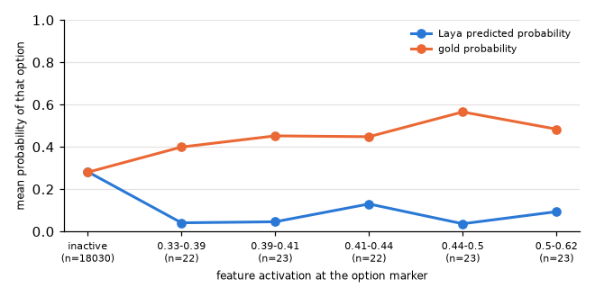

# Feature 7602

Critérios em que aparece: corr_error, corr_probe_right_laya_wrong

**Interpretação (preencher):** 

---

## Maiores ativações

**tr_customer_service_000181 / needs_human** (noul, customer_service) | ativação 6.418 em `estado` | opções ['false', 'true'] | Laya: **true** [0.164, 0.836] | gabarito: **true**

```
<bos> noul question: This conversation requires a human agent rather than automated handling.<eos>
▸ <mask> false: Automation can carry this to resolution.
▸ <mask> true: A human must take over: judgement, authority or empathy is required.

<eos>

 {"account": {"lifetime_value_usd": 120, "prior_tickets_90d": 1, "seats": 40, "tenure_months": 3, "tier": "premium"}, "orders": [{"amount_usd": 1998, "date": "2026-02-21", "id": "A-46555", "status": "refunded"}], "thread": [{"role": "customer", "text": "Hello, could you please help me export all of my account’s transaction data for the last fiscal year? I’d like it in CSV format."}, {"role": "agent", "text": "Certainly, I can look into that for you. May I have your account number so I can locate the right records?"}, {"role": "customer", "text": "My account is 987654321. I opened a ticket about this a week ago (Ticket #1122) and was told the export would be ready shortly, but I haven’t received anything yet."}, {"role": "agent", "text": "I apologize for the delay. To make sure we pull the correct dataset, could you confirm the date range you need, from January 1⟦ to⟧ December 31 of the most recent fiscal year?"}, {"role": "customer", "text": "That’s correct – Jan 1 2023 through Dec 31 2023. I’d appreciate it if you could send the file as soon as possible."}]}<eos>
```

**tr_customer_service_000181 / churn_risk** (score, customer_service) | ativação 6.238 em `estado` | opções ['0', '1', '2', '3'] | Laya: **1** [0.208, 0.496, 0.138, 0.158] | gabarito: **1**

```
<bos> score question: How likely is this customer to stop doing business with us because of this interaction?<eos>
▸ <mask> level 0: No sign of dissatisfaction.
▸ <mask> level 1: Mild frustration, but the relationship is intact.
▸ <mask> level 2: Clearly unhappy; repeat problems or explicit complaints.
▸ <mask> level 3: Imminent: threatening to cancel, dispute or leave.

<eos>

 {"account": {"lifetime_value_usd": 120, "prior_tickets_90d": 1, "seats": 40, "tenure_months": 3, "tier": "premium"}, "orders": [{"amount_usd": 1998, "date": "2026-02-21", "id": "A-46555", "status": "refunded"}], "thread": [{"role": "customer", "text": "Hello, could you please help me export all of my account’s transaction data for the last fiscal year? I’d like it in CSV format."}, {"role": "agent", "text": "Certainly, I can look into that for you. May I have your account number so I can locate the right records?"}, {"role": "customer", "text": "My account is 987654321. I opened a ticket about this a week ago (Ticket #1122) and was told the export would be ready shortly, but I haven’t received anything yet."}, {"role": "agent", "text": "I apologize for the delay. To make sure we pull the correct dataset, could you confirm the date range you need, from January 1⟦ to⟧ December 31 of the most recent fiscal year?"}, {"role": "customer", "text": "That’s correct – Jan 1 2023 through Dec 31 2023. I’d appreciate it if you could send the file as soon as possible."}]}<eos>
```

**tr_invoice_processing_000026 / discrepancy_severity** (score, invoice_processing) | ativação 6.230 em `estado` | opções ['0', '1', '2', '3'] | Laya: **2** [0.067, 0.304, 0.56, 0.068] | gabarito: **0**

```
<bos> score question: How material is any discrepancy between the invoice, the order and the delivery?<eos>
▸ <mask> level 0: None: everything reconciles.
▸ <mask> level 1: Trivial: rounding or a cosmetic difference.
▸ <mask> level 2: Moderate: a real difference worth confirming.
▸ <mask> level 3: Material: a large or unexplained difference.

<eos>

 {"delivery": {"condition": "accepted", "date": "2026-03-01", "received_qty": 25}, "invoice": {"currency": "USD", "id": "INV-2026-4433", "lines": [{"qty": 25, "sku": "SKU-294", "total_usd": 8313.5, "unit_usd": 332.54}], "total_usd": 8313.5, "vendor": "Kestrel Supply"}, "payment": {"days_until_due": 2, "discount_expires_in_days": null, "early_payment_discount_pct": null, "status": "scheduled", "terms": "net 45"}, "purchase_order": {"freight_terms": "freight prepaid by vendor, not separately billable", "id": "PO-2485", "lines": [{"qty": 25, "unit_usd": 332.54}], "total_usd": 8313.5}, "vendor_history": {"disputes_12m": 5⟦,⟧ "invoices_12m": 55, "prior_invoice_ids": ["INV-2026-2147"]}}<eos>
```

**tr_customer_service_000180 / churn_risk** (score, customer_service) | ativação 6.230 em `estado` | opções ['0', '1', '2', '3'] | Laya: **1** [0.052, 0.512, 0.398, 0.037] | gabarito: **3**

```
<bos> score question: How likely is this customer to stop doing business with us because of this interaction?<eos>
▸ <mask> level 0: No sign of dissatisfaction.
▸ <mask> level 1: Mild frustration, but the relationship is intact.
▸ <mask> level 2: Clearly unhappy; repeat problems or explicit complaints.
▸ <mask> level 3: Imminent: threatening to cancel, dispute or leave.

<eos>

 {"account": {"lifetime_value_usd": 1386, "prior_tickets_90d": 0, "seats": 5, "tenure_months": 33, "tier": "premium"}, "orders": [{"amount_usd": 29, "date": "2026-01-04", "id": "A-58867", "status": "settled"}], "thread": [{"role": "customer", "text": "I need you to fix our seat management right now – we can't add any new users and the dashboard keeps throwing a 500 error. If this isn’t sorted out immediately I’m pulling us off the platform."}, {"role": "agent", "text": "I’m sorry you’re seeing that, and I understand the urgency. Could you tell me which team or project you’re trying to add seats to?"}, {"role": "customer", "text": "It’s the Sales Ops group – the “Add Seats” button just spins forever after I enter the email addresses, and none of the new accounts appear."}, {"role": "agent", "text": "Thanks for the detail. Are you getting any specific error message besides the spinner, maybe in the console⟦ or⟧ an email notification?"}, {"role": "customer", "text": "No email, just the endless loading. I’ve tried clearing cache, different browsers, everything. I need this resolved today or we’re out."}]}<eos>
```

**tr_invoice_processing_000026 / duplicate** (noul, invoice_processing) | ativação 6.105 em `estado` | opções ['false', 'true'] | Laya: **true** [0.016, 0.984] | gabarito: **false**

```
<bos> noul question: This invoice appears to duplicate an invoice already submitted.<eos>
▸ <mask> false: no, the statement does not hold
▸ <mask> true: yes, the statement holds

<eos>

 {"delivery": {"condition": "accepted", "date": "2026-03-01", "received_qty": 25}, "invoice": {"currency": "USD", "id": "INV-2026-4433", "lines": [{"qty": 25, "sku": "SKU-294", "total_usd": 8313.5, "unit_usd": 332.54}], "total_usd": 8313.5, "vendor": "Kestrel Supply"}, "payment": {"days_until_due": 2, "discount_expires_in_days": null, "early_payment_discount_pct": null, "status": "scheduled", "terms": "net 45"}, "purchase_order": {"freight_terms": "freight prepaid by vendor, not separately billable", "id": "PO-2485", "lines": [{"qty": 25, "unit_usd": 332.54}], "total_usd": 8313.5}, "vendor_history": {"disputes_12m": 5⟦,⟧ "invoices_12m": 55, "prior_invoice_ids": ["INV-2026-2147"]}}<eos>
```

## Ativações medianas (faixa 40-60%, mediana 1.209)

**tr_invoice_processing_000161 / matches_order** (noul, invoice_processing) | ativação 0.954 em `estado` | opções ['false', 'true'] | Laya: **true** [0.032, 0.968] | gabarito: **false**

```
<bos> noul question: The invoice reconciles with the purchase order and the recorded delivery.<eos>
▸ <mask> false: There is a discrepancy against the order or the delivery.
▸ <mask> true: Line items, quantities and amounts reconcile.

<eos>

 {"delivery": {"condition": "accepted⟦",⟧ "date": "2026-03-03", "received_qty": 50}, "invoice": {"currency": "USD", "id": "INV-2026-8683", "lines": [{"qty": 50, "sku": "SKU-646", "total_usd": 19787.0, "unit_usd": 395.74}, {"qty": 1, "sku": "FREIGHT", "total_usd": 1105.75, "unit_usd": 1105.75}], "total_usd": 20892.75, "vendor": "Acme Fabrication"}, "payment": {"days_until_due": -21, "discount_expires_in_days": null, "early_payment_discount_pct": null, "status": "overdue", "terms": "net 15"}, "purchase_order": {"freight_terms": "freight prepaid by vendor, not separately billable", "id": "PO-7596", "lines": [{"qty": 50, "unit_usd": 395.74}], "total_usd": 19787.0}, "vendor_history": {"disputes_12m": 1, "invoices_12m": 42, "prior_invoice_ids": ["INV-2026-5464", "INV-2026-8986", "INV-2026-1686", "INV-2026-3280"]}}<eos>
```

**tr_customer_service_000225 / action** (choice, customer_service) | ativação 1.460 em `opção` | opções ['answer_directly', 'close_no_action', 'escalate_to_human', 'execute_refund', 'request_information'] | Laya: **close_no_action** [0.095, 0.85, 0.008, 0.02, 0.028] | gabarito: **request_information**

```
<bos> choice question: What should the assistant do next with this conversation?<eos>
▸ <mask> answer_directly: The assistant can resolve this itself with information it already has.
▸ <mask> close_no_action: No further action is warranted; the matter is settled.
▸ <mask> escalate_to_human: Hand off to a human agent with the appropriate authority.
▸ <mask> execute_refund: Issue the refund⟦ or⟧ credit the customer is owed.
▸ <mask> request_information: More detail is needed from the customer before anything can be done.

<eos>

 {"account": {"lifetime_value_usd": 419, "prior_tickets_90d": 1, "seats": 1, "tenure_months": 5, "tier": "standard"}, "orders": [{"amount_usd": 99, "date": "2026-01-07", "id": "A-67520", "status": "settled"}, {"amount_usd": 99, "date": "2026-03-11", "id": "A-78780", "status": "settled"}, {"amount_usd": 99, "date": "2026-02-08", "id": "A-39325", "status": "settled"}], "thread": [{"role": "customer", "text": "Hello, I’m writing because I accidentally dropped the $99 device I bought five months ago, and the screen is now completely cracked."}, {"role": "agent", "text": "I’m sorry to hear that your device was damaged. Could you please provide your order number and a brief description of the current display functionality?"}, {"role": "customer", "text": "The order number is #88291, and while the touch screen is unresponsive, the device still powers on."}, {"role": "agent", "text": "Thank you for providing those details. Just to ensure I have the full picture, could you tell me if there is any visible damage to the charging port or the frame?"}, {"role": "customer", "text": "No, the frame and charging port look perfectly fine, it is just the screen."}]}<eos>
```

**tr_customer_service_000017 / action** (choice, customer_service) | ativação 0.937 em `estado` | opções ['answer_directly', 'close_no_action', 'escalate_to_human', 'execute_refund', 'request_information'] | Laya: **close_no_action** [0.045, 0.884, 0.037, 0.032, 0.002] | gabarito: **escalate_to_human**

```
<bos> choice question: What should the assistant do next with this conversation?<eos>
▸ <mask> answer_directly: The assistant can resolve this itself with information it already has.
▸ <mask> close_no_action: No further action is warranted; the matter is settled.
▸ <mask> escalate_to_human: Hand off to a human agent with the appropriate authority.
▸ <mask> execute_refund: Issue the refund or credit the customer is owed.
▸ <mask> request_information: More detail is needed from the customer before anything can be done.

<eos>

 {"account": {"lifetime_value_usd": 228, "prior_tickets_90d": 3, "seats": 1, "tenure_months": 11, "tier": "premium"}, "orders": [{"amount_usd": 29, "date": "2026-03-25⟦",⟧ "id": "A-17351", "status": "settled"}, {"amount_usd": 29, "date": "2026-02-18", "id": "A-55118", "status": "settled"}], "thread": [{"role": "customer", "text": "My payment for the $29 subscription failed this morning. I have a presentation tomorrow morning at 9:00 AM that requires this access, so I need this cleared up immediately."}, {"role": "agent", "text": "I see the status of your account. Before we look into the billing error, could you confirm if the payment method on file has expired or if you have recently updated your banking information?"}, {"role": "customer", "text": "The card is current and active. I have had three previous tickets regarding billing glitches that were supposedly addressed, yet here I am again with the same issue."}, {"role": "agent", "text": "I acknowledge your frustration regarding the previous tickets. To investigate this specific failure, could you provide the transaction reference ID shown in your payment history?"}, {"role": "customer", "text": "I am looking at my bank portal now, but I don't see a reference ID generated for this attempt. How are we going to fix this before my deadline tomorrow?"}]}<eos>
```

**tr_security_incidents_000089 / disposition** (choice, security_incidents) | ativação 1.092 em `opção` | opções ['close_benign', 'contain', 'investigate', 'monitor'] | Laya: **contain** [0.169, 0.566, 0.044, 0.221] | gabarito: **close_benign**

```
<bos> choice question: How should this security alert be dispositioned?<eos>
▸ <mask> close_benign: Expected, explainable activity⟦;⟧ close without analyst time.
▸ <mask> contain: Contain the host or account immediately; do not wait for triage.
▸ <mask> investigate: Warrants an analyst opening an investigation.
▸ <mask> monitor: Not clearly malicious, but worth watching for recurrence.

<eos>

 {"alert": {"description": "a long-unused account became active", "evidence": "Employee account e12345, which had no login activity since 2021-04-01, logged in from allowed subnet IP 10.0.0.5 at 2026-09-15T09:05:27Z. The authentication succeeded with MFA enabled.", "rule": "dormant_account_use"}, "context": {"asset_criticality": "medium", "change_window_active": false, "source_on_allowlist": true}, "history": {"credential_rotation_days_ago": 412, "distinct_countries_30d": 1, "logins_30d": 44, "prior_alerts_90d": 0}, "principal": {"mfa_enrolled": true, "name": "adm-deploy-118", "privileges": ["repo:read"], "type": "employee"}}<eos>
```

**tr_agent_trace_observability_000150 / risk** (score, agent_trace_observability) | ativação 1.399 em `estado` | opções ['0', '1', '2', '3'] | Laya: **2** [0.075, 0.13, 0.655, 0.14] | gabarito: **1**

```
<bos> score question: How risky was the agent's behaviour in this trace?<eos>
▸ <mask> level 0: Benign: read-only or clearly safe actions.
▸ <mask> level 1: Low: routine writes within scope.
▸ <mask> level 2: Moderate: irreversible or out-of-scope actions.
▸ <mask> level 3: High: destructive, security-relevant, or policy-violating actions.

<eos>

 {"agent": {"autonomy": "unsupervised", "model": "internal-agent-v1⟦"},⟧ "constraints": ["Never disable monitoring or alerting"], "task": "Backfill missing analytics events for the last seven days.", "trace_summary": {"constraint_violations": 0, "duration_s": 43.5, "irreversible_actions": 0, "steps": 5, "tool_errors": 0}}<eos>
```

## Estatísticas (conjunto de descoberta, dev e teste)

**pred / error**

| split | decisões | ativas | ativas e Laya errou | taxa | lift | q (BH) | OR (CMH) | q (CMH) |
|---|---|---|---|---|---|---|---|---|
| discovery | 5100 | 3 | 3 | 1.000 | 1.55 | nan | nan | nan |
| dev | 900 | 0 | 0 | nan | nan | nan | nan | nan |
| test | 2000 | 0 | 0 | nan | nan | nan | nan | nan |

**corr / error**

| split | decisões | ativas | ativas e Laya errou | taxa | lift | q (BH) | OR (CMH) | q (CMH) |
|---|---|---|---|---|---|---|---|---|
| discovery | 5100 | 63 | 63 | 1.000 | 1.55 | 5.33e-12 | inf | 0.293 |
| dev | 900 | 11 | 11 | 1.000 | 1.49 | nan | nan | nan |
| test | 2000 | 20 | 20 | 1.000 | 1.54 | 0.000718 | inf | 0.731 |

**state / error**

| split | decisões | ativas | ativas e Laya errou | taxa | lift | q (BH) | OR (CMH) | q (CMH) |
|---|---|---|---|---|---|---|---|---|
| discovery | 5100 | 5100 | 3283 | 0.644 | 1.00 | 1 | nan | nan |
| dev | 900 | 900 | 605 | 0.672 | 1.00 | 1 | nan | nan |
| test | 2000 | 2000 | 1301 | 0.650 | 1.00 | 1 | nan | nan |

**pred / probe_right_laya_wrong**

| split | decisões | ativas | ativas e Laya errou | taxa | lift | q (BH) | OR (CMH) | q (CMH) |
|---|---|---|---|---|---|---|---|---|
| discovery | 2819 | 3 | 3 | 1.000 | 1.55 | nan | nan | nan |
| dev | 520 | 0 | 0 | nan | nan | nan | nan | nan |
| test | 1106 | 0 | 0 | nan | nan | nan | nan | nan |

**corr / probe_right_laya_wrong**

| split | decisões | ativas | ativas e Laya errou | taxa | lift | q (BH) | OR (CMH) | q (CMH) |
|---|---|---|---|---|---|---|---|---|
| discovery | 2819 | 57 | 57 | 1.000 | 1.55 | 7.95e-11 | inf | 0.411 |
| dev | 520 | 9 | 9 | 1.000 | 1.48 | nan | nan | nan |
| test | 1106 | 17 | 17 | 1.000 | 1.58 | nan | nan | nan |

**state / probe_right_laya_wrong**

| split | decisões | ativas | ativas e Laya errou | taxa | lift | q (BH) | OR (CMH) | q (CMH) |
|---|---|---|---|---|---|---|---|---|
| discovery | 2819 | 2819 | 1824 | 0.647 | 1.00 | 1 | nan | nan |
| dev | 520 | 520 | 351 | 0.675 | 1.00 | 1 | nan | nan |
| test | 1106 | 1106 | 700 | 0.633 | 1.00 | 1 | nan | nan |

Confusão mais sobre-representada (pred): `action|2>0` (n=1, lift 1700.00, p=nan). Formato `pergunta|índice previsto>índice correto`.

Confusão mais sobre-representada (corr): `action|1>2` (n=23, lift 26.22, p=2.5e-28). Formato `pergunta|índice previsto>índice correto`.

Confusão mais sobre-representada (state): `action|0>1` (n=6, lift 1.00, p=1). Formato `pergunta|índice previsto>índice correto`.



