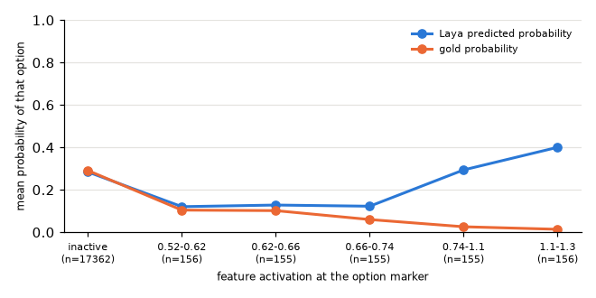

# Feature 7763

Critérios em que aparece: pred_error, corr_error_stratified, pred_probe_right_laya_wrong, pred_probe_right_laya_wrong_stratified

**Interpretação (preencher):** 

---

## Maiores ativações

**tr_security_incidents_000109 / credential_compromise** (noul, security_incidents) | ativação 5.277 em `estado` | opções ['false', 'true'] | Laya: **true** [0.007, 0.993] | gabarito: **true**

```
<bos> noul question: The evidence indicates a credential or account has been compromised.<eos>
▸ <mask> false: no, the statement does not hold
▸ <mask> true: yes, the statement holds

<eos>

 {"alert": {"description": "two successful logins from distant locations too close together", "evidence": "Successful VPN logins were observed for the contractor account \"jdoe_cont\" at 2026-09-16 08:02 UTC from IP 198.51.100.22 (Chicago) and again at 08:07 UTC from IP 203.0.113.77 (Tokyo), representing a distance of⟦ over⟧ 9,000 km within a five‑minute interval. The account is unprivileged, MFA is active, credentials were rotated 14 days prior, and the source devices are not on the recognized inventory list.", "rule": "impossible_travel"}, "context": {"asset_criticality": "medium", "change_window_active": false, "source_on_allowlist": false}, "history": {"credential_rotation_days_ago": 14, "distinct_countries_30d": 2, "logins_30d": 650, "prior_alerts_90d": 0}, "principal": {"mfa_enrolled": true, "name": "adm-billing-167", "privileges": ["repo:read"], "type": "contractor"}}<eos>
```

**tr_security_incidents_000046 / disposition** (choice, security_incidents) | ativação 5.273 em `estado` | opções ['close_benign', 'contain', 'investigate', 'monitor'] | Laya: **monitor** [0.156, 0.334, 0.056, 0.454] | gabarito: **investigate**

```
<bos> choice question: How should this security alert be dispositioned?<eos>
▸ <mask> close_benign: Expected, explainable activity; close without analyst time.
▸ <mask> contain: Contain the host or account immediately; do not wait for triage.
▸ <mask> investigate: Warrants an analyst opening an investigation.
▸ <mask> monitor: Not clearly malicious, but worth watching for recurrence.

<eos>

 {"alert": {"description": "a large transfer to an external destination", "evidence": "On 2026-09-15 09:22:03 UTC, a shared mailbox credential \"svc_mailbox\" initiated an outbound TCP session to 203.0.113.45:443, transferring approximately 1.3 TB of data⟦ over⟧ 38 minutes. The connection originated from the allowlisted IP 192.168.10.55, MFA was off for the account, and its password was last changed 14 days ago.", "rule": "data_egress"}, "context": {"asset_criticality": "medium", "change_window_active": false, "source_on_allowlist": true}, "history": {"credential_rotation_days_ago": 14, "distinct_countries_30d": 3, "logins_30d": 1058, "prior_alerts_90d": 8}, "principal": {"mfa_enrolled": false, "name": "svc-support-440", "privileges": ["deploy:production", "secrets:read"], "type": "shared_mailbox"}}<eos>
```

**tr_security_incidents_000046 / credential_compromise** (noul, security_incidents) | ativação 5.270 em `estado` | opções ['false', 'true'] | Laya: **false** [0.656, 0.344] | gabarito: **true**

```
<bos> noul question: The evidence indicates a credential or account has been compromised.<eos>
▸ <mask> false: no, the statement does not hold
▸ <mask> true: yes, the statement holds

<eos>

 {"alert": {"description": "a large transfer to an external destination", "evidence": "On 2026-09-15 09:22:03 UTC, a shared mailbox credential \"svc_mailbox\" initiated an outbound TCP session to 203.0.113.45:443, transferring approximately 1.3 TB of data⟦ over⟧ 38 minutes. The connection originated from the allowlisted IP 192.168.10.55, MFA was off for the account, and its password was last changed 14 days ago.", "rule": "data_egress"}, "context": {"asset_criticality": "medium", "change_window_active": false, "source_on_allowlist": true}, "history": {"credential_rotation_days_ago": 14, "distinct_countries_30d": 3, "logins_30d": 1058, "prior_alerts_90d": 8}, "principal": {"mfa_enrolled": false, "name": "svc-support-440", "privileges": ["deploy:production", "secrets:read"], "type": "shared_mailbox"}}<eos>
```

**tr_security_incidents_000046 / true_positive** (noul, security_incidents) | ativação 5.215 em `estado` | opções ['false', 'true'] | Laya: **true** [0.083, 0.917] | gabarito: **true**

```
<bos> noul question: This alert reflects genuinely malicious or unauthorised activity.<eos>
▸ <mask> false: Benign activity, a misconfiguration, or a known false positive.
▸ <mask> true: The underlying behaviour is malicious or unauthorised.

<eos>

 {"alert": {"description": "a large transfer to an external destination", "evidence": "On 2026-09-15 09:22:03 UTC, a shared mailbox credential \"svc_mailbox\" initiated an outbound TCP session to 203.0.113.45:443, transferring approximately 1.3 TB of data⟦ over⟧ 38 minutes. The connection originated from the allowlisted IP 192.168.10.55, MFA was off for the account, and its password was last changed 14 days ago.", "rule": "data_egress"}, "context": {"asset_criticality": "medium", "change_window_active": false, "source_on_allowlist": true}, "history": {"credential_rotation_days_ago": 14, "distinct_countries_30d": 3, "logins_30d": 1058, "prior_alerts_90d": 8}, "principal": {"mfa_enrolled": false, "name": "svc-support-440", "privileges": ["deploy:production", "secrets:read"], "type": "shared_mailbox"}}<eos>
```

**tr_security_incidents_000109 / disposition** (choice, security_incidents) | ativação 5.199 em `estado` | opções ['close_benign', 'contain', 'investigate', 'monitor'] | Laya: **contain** [0.055, 0.6, 0.144, 0.201] | gabarito: **investigate**

```
<bos> choice question: How should this security alert be dispositioned?<eos>
▸ <mask> close_benign: Expected, explainable activity; close without analyst time.
▸ <mask> contain: Contain the host or account immediately; do not wait for triage.
▸ <mask> investigate: Warrants an analyst opening an investigation.
▸ <mask> monitor: Not clearly malicious, but worth watching for recurrence.

<eos>

 {"alert": {"description": "two successful logins from distant locations too close together", "evidence": "Successful VPN logins were observed for the contractor account \"jdoe_cont\" at 2026-09-16 08:02 UTC from IP 198.51.100.22 (Chicago) and again at 08:07 UTC from IP 203.0.113.77 (Tokyo), representing a distance of⟦ over⟧ 9,000 km within a five‑minute interval. The account is unprivileged, MFA is active, credentials were rotated 14 days prior, and the source devices are not on the recognized inventory list.", "rule": "impossible_travel"}, "context": {"asset_criticality": "medium", "change_window_active": false, "source_on_allowlist": false}, "history": {"credential_rotation_days_ago": 14, "distinct_countries_30d": 2, "logins_30d": 650, "prior_alerts_90d": 0}, "principal": {"mfa_enrolled": true, "name": "adm-billing-167", "privileges": ["repo:read"], "type": "contractor"}}<eos>
```

## Ativações medianas (faixa 40-60%, mediana 1.136)

**tr_security_incidents_000010 / urgency** (score, security_incidents) | ativação 1.419 em `estado` | opções ['0', '1', '2', '3'] | Laya: **3** [0.146, 0.273, 0.226, 0.356] | gabarito: **3**

```
<bos> score question: How quickly must a responder act on this alert?<eos>
▸ <mask> level 0: No time pressure; can wait indefinitely.
▸ <mask> level 1: Routine; handle within the normal queue.
▸ <mask> level 2: Elevated; should be handled within the same week.
▸ <mask> level 3: Critical; requires action within the same day.

<eos>

 {"alert": {"description": "an account granted itself or received elevated permissions", "evidence": "An unprivileged CI runner account successfully executed a privilege⟦ escalation⟧ operation, granting itself elevated permissions. This activity originated from an unrecognized source address and occurred outside of defined change management windows.", "rule": "privilege_escalation"}, "context": {"asset_criticality": "low", "change_window_active": false, "source_on_allowlist": false}, "history": {"credential_rotation_days_ago": 90, "distinct_countries_30d": 1, "logins_30d": 1579, "prior_alerts_90d": 0}, "principal": {"mfa_enrolled": true, "name": "usr-support-518", "privileges": ["repo:read"], "type": "ci_runner"}}<eos>
```

**tr_customer_service_000142 / category** (choice, customer_service) | ativação 0.969 em `estado` | opções ['account', 'billing', 'delivery', 'refund', 'technical'] | Laya: **account** [0.662, 0.294, 0.0, 0.021, 0.022] | gabarito: **account**

```
<bos> choice question: What is this customer conversation primarily about?<eos>
▸ <mask> account: Login, plan changes, profile or access management.
▸ <mask> billing: A charge, invoice, subscription or payment problem.
▸ <mask> delivery: Shipping, fulfilment or delivery of a physical item.
▸ <mask> refund: The customer is explicitly asking for money back.
▸ <mask> technical: The product or service is not working as expected.

<eos>

 {"account": {"lifetime_value_usd": 195, "prior_tickets_90d": 1, "seats": 1, "tenure_months": 5, "tier": "standard"}, "orders": [{"amount_usd": 598, "date": "2026-03-05", "id": "A-28205", "status": "settled"}], "thread": [{"role": "customer", "text": "Hello, I am⟦ having⟧ trouble accessing my account this morning. I have tried resetting my password, but the verification email never arrives."}, {"role": "agent", "text": "I apologize for the frustration this is causing you. Could you please confirm the email address associated with your account so I can verify its status on our server?"}, {"role": "customer", "text": "Certainly, it is j.smith@provider.com. I really need to access my dashboard to manage my $598 subscription."}]}<eos>
```

**tr_invoice_processing_000128 / duplicate** (noul, invoice_processing) | ativação 1.609 em `estado` | opções ['false', 'true'] | Laya: **true** [0.028, 0.972] | gabarito: **false**

```
<bos> noul question: This invoice appears to duplicate an invoice already submitted.<eos>
▸ <mask> false: no, the statement does not hold
▸ <mask> true: yes, the statement holds

<eos>

 {"delivery": {"condition": "accepted", "date": "2026-03-03", "received_qty": 10}, "invoice": {"currency": "USD", "id": "INV-2026-1573", "lines": [{"qty": 10, "sku": "SKU-688", "total_usd": 4081.5, "unit_usd": 408.15}], "total_usd": 4081.5, "vendor": "Acme Fabrication"}, "payment": {"days_until_due": -9, "discount_expires_in_days": null, "early_payment_discount_pct": null, "status": "⟦over⟧due", "terms": "net 45"}, "purchase_order": {"freight_terms": "freight prepaid by vendor, not separately billable", "id": "PO-6996", "lines": [{"qty": 10, "unit_usd": 408.15}], "total_usd": 4081.5}, "vendor_history": {"disputes_12m": 0, "invoices_12m": 27, "prior_invoice_ids": ["INV-2026-1107", "INV-2026-4586", "INV-2026-5918"]}}<eos>
```

**tr_customer_service_000083 / action** (choice, customer_service) | ativação 1.014 em `marcador` | opções ['answer_directly', 'close_no_action', 'escalate_to_human', 'execute_refund', 'request_information'] | Laya: **execute_refund** [0.23, 0.176, 0.034, 0.53, 0.029] | gabarito: **request_information**

```
<bos> choice question: What should the assistant do next with this conversation?<eos>
▸ <mask> answer_directly: The assistant can resolve this itself with information it already has.
▸ ⟦<mask>⟧ close_no_action: No further action is warranted; the matter is settled.
▸ <mask> escalate_to_human: Hand off to a human agent with the appropriate authority.
▸ <mask> execute_refund: Issue the refund or credit the customer is owed.
▸ <mask> request_information: More detail is needed from the customer before anything can be done.

<eos>

 {"account": {"lifetime_value_usd": 275, "prior_tickets_90d": 2, "seats": 1, "tenure_months": 5, "tier": "standard"}, "thread": [{"role": "customer", "text": "I’m confused – I ordered the blue wireless mouse but received a black wired one, and I need the correct item by Friday for my project."}]}<eos>
```

**tr_customer_service_000072 / category** (choice, customer_service) | ativação 1.362 em `estado` | opções ['account', 'billing', 'delivery', 'refund', 'technical'] | Laya: **billing** [0.014, 0.977, 0.001, 0.0, 0.007] | gabarito: **billing**

```
<bos> choice question: What is this customer conversation primarily about?<eos>
▸ <mask> account: Login, plan changes, profile or access management.
▸ <mask> billing: A charge, invoice, subscription or payment problem.
▸ <mask> delivery: Shipping, fulfilment or delivery of a physical item.
▸ <mask> refund: The customer is explicitly asking for money back.
▸ <mask> technical: The product or service is not working as expected.

<eos>

 {"account": {"lifetime_value_usd": 904, "prior_tickets_90d": 0, "seats": 1, "tenure_months": 14, "tier": "standard"}, "orders": [{"amount_usd": 297, "date": "2026-02-26", "id": "A-16027", "status": "pending"}], "thread": [{"role": "customer", "text": "I'm looking⟦ through⟧ my account and the invoice for my last payment of $297 is nowhere to be found, and I need it right now for my records."}, {"role": "agent", "text": "I can certainly look into your billing history for you. To make sure I'm looking at the right account, could you please confirm the email address associated with your standard plan?"}, {"role": "customer", "text": "It's the same one I'm writing from, I've been a customer for over a year and I've never had to hunt for a receipt like this before, please hurry."}, {"role": "agent", "text": "Thank you for confirming. I'm checking the 14-month history now; are you looking for the most recent transaction specifically, or a range of dates?"}, {"role": "customer", "text": "I need the one from this month for the full amount, it's extremely urgent that I get this PDF in my inbox immediately."}]}<eos>
```

## Estatísticas (conjunto de descoberta, dev e teste)

**pred / error**

| split | decisões | ativas | ativas e Laya errou | taxa | lift | q (BH) | OR (CMH) | q (CMH) |
|---|---|---|---|---|---|---|---|---|
| discovery | 5100 | 143 | 140 | 0.979 | 1.52 | 5.69e-22 | 2.24 | 0.391 |
| dev | 900 | 30 | 30 | 1.000 | 1.49 | 8.81e-05 | inf | 0.468 |
| test | 2000 | 61 | 59 | 0.967 | 1.49 | 3.31e-08 | 0.73 | 0.894 |

**corr / error**

| split | decisões | ativas | ativas e Laya errou | taxa | lift | q (BH) | OR (CMH) | q (CMH) |
|---|---|---|---|---|---|---|---|---|
| discovery | 5100 | 33 | 30 | 0.909 | 1.41 | 0.00164 | 49.08 | 1.68e-10 |
| dev | 900 | 6 | 6 | 1.000 | 1.49 | nan | nan | nan |
| test | 2000 | 10 | 8 | 0.800 | 1.23 | nan | nan | nan |

**state / error**

| split | decisões | ativas | ativas e Laya errou | taxa | lift | q (BH) | OR (CMH) | q (CMH) |
|---|---|---|---|---|---|---|---|---|
| discovery | 5100 | 1018 | 642 | 0.631 | 0.98 | 0.528 | 1.06 | 0.789 |
| dev | 900 | 210 | 152 | 0.724 | 1.08 | 0.328 | 1.43 | 0.364 |
| test | 2000 | 399 | 264 | 0.662 | 1.02 | 0.881 | 1.12 | 0.763 |

**pred / probe_right_laya_wrong**

| split | decisões | ativas | ativas e Laya errou | taxa | lift | q (BH) | OR (CMH) | q (CMH) |
|---|---|---|---|---|---|---|---|---|
| discovery | 2819 | 92 | 92 | 1.000 | 1.55 | 3.1e-17 | inf | 3.41e-05 |
| dev | 520 | 19 | 19 | 1.000 | 1.48 | nan | nan | nan |
| test | 1106 | 34 | 34 | 1.000 | 1.58 | 1.22e-06 | inf | 0.374 |

**corr / probe_right_laya_wrong**

| split | decisões | ativas | ativas e Laya errou | taxa | lift | q (BH) | OR (CMH) | q (CMH) |
|---|---|---|---|---|---|---|---|---|
| discovery | 2819 | 0 | 0 | nan | nan | nan | nan | nan |
| dev | 520 | 0 | 0 | nan | nan | nan | nan | nan |
| test | 1106 | 0 | 0 | nan | nan | nan | nan | nan |

**state / probe_right_laya_wrong**

| split | decisões | ativas | ativas e Laya errou | taxa | lift | q (BH) | OR (CMH) | q (CMH) |
|---|---|---|---|---|---|---|---|---|
| discovery | 2819 | 605 | 382 | 0.631 | 0.98 | 0.529 | 1.09 | 0.716 |
| dev | 520 | 113 | 80 | 0.708 | 1.05 | 0.785 | 1.37 | 0.513 |
| test | 1106 | 241 | 153 | 0.635 | 1.00 | 1 | 1.01 | 0.98 |

Confusão mais sobre-representada (pred): `action|1>2` (n=71, lift 35.66, p=0). Formato `pergunta|índice previsto>índice correto`.

Confusão mais sobre-representada (corr): `disposition|3>0` (n=17, lift 72.98, p=3.24e-30). Formato `pergunta|índice previsto>índice correto`.

Confusão mais sobre-representada (state): `urgency|1>2` (n=74, lift 1.77, p=7.48e-08). Formato `pergunta|índice previsto>índice correto`.



