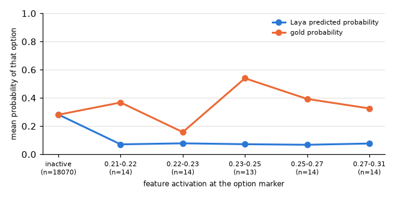

# Feature 7778

Critérios em que aparece: corr_error

**Interpretação (preencher):** 

---

## Maiores ativações

**tr_customer_service_000003 / category** (choice, customer_service) | ativação 8.375 em `estado` | opções ['account', 'billing', 'delivery', 'refund', 'technical'] | Laya: **delivery** [0.0, 0.0, 0.999, 0.0, 0.0] | gabarito: **delivery**

```
<bos> choice question: What is this customer conversation primarily about?<eos>
▸ <mask> account: Login, plan changes, profile or access management.
▸ <mask> billing: A charge, invoice, subscription or payment problem.
▸ <mask> delivery: Shipping, fulfilment or delivery of a physical item.
▸ <mask> refund: The customer is explicitly asking for money back.
▸ <mask> technical: The product or service is not working as expected.

<eos>

 {"account": {"lifetime_value_usd": 89, "prior_tickets_90d": 5, "seats": 1, "tenure_months": 1, "tier": "premium"}, "orders": [{"amount_usd": 49, "date": "2026-02-28", "id": "A-29326", "status": "settled"}], "thread": [{"role": "customer", "text": "I’m extremely frustrated – the item I received is completely wrong and I need the correct product by Friday, otherwise I’m canceling my premium⟦ subscription⟧."}, {"role": "agent", "text": "I’m sorry you’ve had this experience. Could you share the order number so I can look up the details?"}, {"role": "customer", "text": "The order number is #A12345. I ordered the wireless headphones, but got a Bluetooth speaker instead. I need the headphones before the weekend."}, {"role": "agent", "text": "Thank you for the information. To arrange a replacement, could you confirm the shipping address you’d like the headphones sent to?"}, {"role": "customer", "text": "Send them to 742 Evergreen Terrace, Springfield. I’ll be watching for the delivery, and I expect it before Friday as I mentioned."}]}<eos>
```

**tr_customer_service_000003 / needs_human** (noul, customer_service) | ativação 8.195 em `estado` | opções ['false', 'true'] | Laya: **true** [0.478, 0.522] | gabarito: **false**

```
<bos> noul question: This conversation requires a human agent rather than automated handling.<eos>
▸ <mask> false: Automation can carry this to resolution.
▸ <mask> true: A human must take over: judgement, authority or empathy is required.

<eos>

 {"account": {"lifetime_value_usd": 89, "prior_tickets_90d": 5, "seats": 1, "tenure_months": 1, "tier": "premium"}, "orders": [{"amount_usd": 49, "date": "2026-02-28", "id": "A-29326", "status": "settled"}], "thread": [{"role": "customer", "text": "I’m extremely frustrated – the item I received is completely wrong and I need the correct product by Friday, otherwise I’m canceling my premium⟦ subscription⟧."}, {"role": "agent", "text": "I’m sorry you’ve had this experience. Could you share the order number so I can look up the details?"}, {"role": "customer", "text": "The order number is #A12345. I ordered the wireless headphones, but got a Bluetooth speaker instead. I need the headphones before the weekend."}, {"role": "agent", "text": "Thank you for the information. To arrange a replacement, could you confirm the shipping address you’d like the headphones sent to?"}, {"role": "customer", "text": "Send them to 742 Evergreen Terrace, Springfield. I’ll be watching for the delivery, and I expect it before Friday as I mentioned."}]}<eos>
```

**tr_customer_service_000168 / churn_risk** (score, customer_service) | ativação 8.156 em `estado` | opções ['0', '1', '2', '3'] | Laya: **3** [0.048, 0.168, 0.172, 0.612] | gabarito: **1**

```
<bos> score question: How likely is this customer to stop doing business with us because of this interaction?<eos>
▸ <mask> level 0: No sign of dissatisfaction.
▸ <mask> level 1: Mild frustration, but the relationship is intact.
▸ <mask> level 2: Clearly unhappy; repeat problems or explicit complaints.
▸ <mask> level 3: Imminent: threatening to cancel, dispute or leave.

<eos>

 {"account": {"lifetime_value_usd": 4178, "prior_tickets_90d": 0, "seats": 1, "tenure_months": 60, "tier": "premium"}, "orders": [{"amount_usd": 147, "date": "2026-03-07", "id": "A-83083", "status": "settled"}, {"amount_usd": 147, "date": "2026-02-24", "id": "A-35216", "status": "settled"}], "thread": [{"role": "customer", "text": "I need a copy of the invoice for the $147 charge on my premium account—I've been a customer for five years and the deadline to submit it is tomorrow. This is getting ridiculous."}, {"role": "agent", "text": "I’m sorry to hear you’re under pressure. Could you tell me which billing period the invoice is for?"}, {"role": "customer", "text": "It’s the most recent one, the one that showed up on my statement for the $147 premium⟦ fee⟧. I can’t afford to wait any longer."}, {"role": "agent", "text": "Got it. Do you have a preferred way to receive the invoice—email attachment or a secure link?"}, {"role": "customer", "text": "Email it to me right away, please. I’ll be checking my inbox constantly until I get it."}]}<eos>
```

**tr_customer_service_000003 / churn_risk** (score, customer_service) | ativação 8.031 em `estado` | opções ['0', '1', '2', '3'] | Laya: **1** [0.114, 0.507, 0.179, 0.201] | gabarito: **3**

```
<bos> score question: How likely is this customer to stop doing business with us because of this interaction?<eos>
▸ <mask> level 0: No sign of dissatisfaction.
▸ <mask> level 1: Mild frustration, but the relationship is intact.
▸ <mask> level 2: Clearly unhappy; repeat problems or explicit complaints.
▸ <mask> level 3: Imminent: threatening to cancel, dispute or leave.

<eos>

 {"account": {"lifetime_value_usd": 89, "prior_tickets_90d": 5, "seats": 1, "tenure_months": 1, "tier": "premium"}, "orders": [{"amount_usd": 49, "date": "2026-02-28", "id": "A-29326", "status": "settled"}], "thread": [{"role": "customer", "text": "I’m extremely frustrated – the item I received is completely wrong and I need the correct product by Friday, otherwise I’m canceling my premium⟦ subscription⟧."}, {"role": "agent", "text": "I’m sorry you’ve had this experience. Could you share the order number so I can look up the details?"}, {"role": "customer", "text": "The order number is #A12345. I ordered the wireless headphones, but got a Bluetooth speaker instead. I need the headphones before the weekend."}, {"role": "agent", "text": "Thank you for the information. To arrange a replacement, could you confirm the shipping address you’d like the headphones sent to?"}, {"role": "customer", "text": "Send them to 742 Evergreen Terrace, Springfield. I’ll be watching for the delivery, and I expect it before Friday as I mentioned."}]}<eos>
```

**tr_customer_service_000200 / category** (choice, customer_service) | ativação 7.812 em `estado` | opções ['account', 'billing', 'delivery', 'refund', 'technical'] | Laya: **billing** [0.0, 1.0, 0.0, 0.0, 0.0] | gabarito: **billing**

```
<bos> choice question: What is this customer conversation primarily about?<eos>
▸ <mask> account: Login, plan changes, profile or access management.
▸ <mask> billing: A charge, invoice, subscription or payment problem.
▸ <mask> delivery: Shipping, fulfilment or delivery of a physical item.
▸ <mask> refund: The customer is explicitly asking for money back.
▸ <mask> technical: The product or service is not working as expected.

<eos>

 {"account": {"lifetime_value_usd": 1072, "prior_tickets_90d": 0, "seats": 12, "tenure_months": 41, "tier": "premium"}, "orders": [{"amount_usd": 29, "date": "2026-03-18", "id": "A-98366", "status": "refunded"}, {"amount_usd": 29, "date": "2026-03-25", "id": "A-11332", "status": "settled"}, {"amount_usd": 29, "date": "2026-03-18", "id": "A-35045", "status": "failed"}], "thread": [{"role": "customer", "text": "I can't believe you just⟦ charged⟧ me $29 this month! I've been on the premium plan for over three years and never saw this price before. This is unacceptable!"}, {"role": "agent", "text": "I’m sorry you’re seeing an unexpected charge. Could you confirm the email address linked to your account so I can look into the billing details?"}, {"role": "customer", "text": "Fine. It’s john.doe@example.com. I’ve been paying the same amount for 41 months, and now this random jump appears on my statement. I need an explanation, not a generic apology."}, {"role": "agent", "text": "Thank you for confirming. I’ll pull up the recent invoices. Just to be sure, are you referring to the $29.00 charge labeled as “Premium Plan Renewal” on your latest bill?"}, {"role": "customer", "text": "Yes, that’s the one. I want to know why it’s higher now and what I’m supposed to do about it. Please tell me what’s going on."}]}<eos>
```

## Ativações medianas (faixa 40-60%, mediana 1.133)

**tr_customer_service_000083 / action** (choice, customer_service) | ativação 1.059 em `estado` | opções ['answer_directly', 'close_no_action', 'escalate_to_human', 'execute_refund', 'request_information'] | Laya: **execute_refund** [0.23, 0.176, 0.034, 0.53, 0.029] | gabarito: **request_information**

```
<bos> choice question: What should the assistant do next with this conversation?<eos>
▸ <mask> answer_directly: The assistant can resolve this itself with information it already has.
▸ <mask> close_no_action: No further action is warranted; the matter is settled.
▸ <mask> escalate_to_human: Hand off to a human agent with the appropriate authority.
▸ <mask> execute_refund: Issue the refund or credit the customer is owed.
▸ <mask> request_information: More detail is needed from the customer before anything can be done.

<eos>

 {"account": {"lifetime_value_usd": 275, "prior_tickets_90d": 2, "seats": 1, "⟦ten⟧ure_months": 5, "tier": "standard"}, "thread": [{"role": "customer", "text": "I’m confused – I ordered the blue wireless mouse but received a black wired one, and I need the correct item by Friday for my project."}]}<eos>
```

**tr_invoice_processing_000237 / duplicate** (noul, invoice_processing) | ativação 1.216 em `estado` | opções ['false', 'true'] | Laya: **true** [0.008, 0.992] | gabarito: **false**

```
<bos> noul question: This invoice appears to duplicate an invoice already submitted.<eos>
▸ <mask> false: no, the statement does not hold
▸ <mask> true: yes, the statement holds

<eos>

 {"delivery": {"condition": "accepted", "date": "2026-03-02", "received_qty": 10}, "invoice": {"currency": "USD", "id": "INV-2026-3240", "lines": [{"qty": 10, "sku": "SKU-941", "total_usd": 2014.1, "unit_usd": 201.41}, {"qty": 1, "sku": "FREIGHT", "total_usd": 908.75, "unit_usd": 908.75}], "total_usd": 2922.85, "vendor": "Vantage Materials"}, "payment": {"days_until_due": 44, "discount_expires_in_days": null, "early_payment_⟦discount⟧_pct": null, "status": "scheduled", "terms": "net 15"}, "purchase_order": {"freight_terms": "freight prepaid by vendor, not separately billable", "id": "PO-5065", "lines": [{"qty": 10, "unit_usd": 201.41}], "total_usd": 2014.1}, "vendor_history": {"disputes_12m": 5, "invoices_12m": 5, "prior_invoice_ids": ["INV-2026-6503"]}}<eos>
```

**tr_customer_service_000084 / urgency** (score, customer_service) | ativação 1.197 em `estado` | opções ['0', '1', '2', '3'] | Laya: **1** [0.059, 0.479, 0.137, 0.324] | gabarito: **3**

```
<bos> score question: How time-sensitive is this conversation?<eos>
▸ <mask> level 0: No time pressure; can wait indefinitely.
▸ <mask> level 1: Routine; handle within the normal queue.
▸ <mask> level 2: Elevated; should be handled within the same week.
▸ <mask> level 3: Critical; requires action within the same day.

<eos>

 {"account": {"lifetime_value_usd": 228, "prior_tickets_90d": 1, "seats": 12, "tenure_months": 5, "tier": "premium"}, "orders": [{"amount_usd": 49, "date": "2026-02-23", "id": "A-33356", "status": "settled"}, {"amount_usd": 49, "date": "2026-03-08", "id": "A-82014", "status": "pending"}, {"amount_usd": 49, "date": "2026-02-05", "id": "A-73657", "status": "settled"}], "thread": [{"role": "customer", "text": "I've been waiting for my refund for the $49 I was charged on my premium plan, and this is the second time you've said it'll be⟦ processed⟧ and nothing happened. I'm fed up and I'm ready to cancel my subscription if this isn't sorted right now."}, {"role": "agent", "text": "I’m sorry you’ve had to deal with this again. Could you please share the ticket number you received previously so I can pull up the details and see where the hold‑up is?"}, {"role": "customer", "text": "The ticket was #123456, and I need that money back today—otherwise I'm pulling my account and moving to a competitor."}]}<eos>
```

**tr_customer_service_000230 / urgency** (score, customer_service) | ativação 1.003 em `estado` | opções ['0', '1', '2', '3'] | Laya: **1** [0.162, 0.418, 0.224, 0.196] | gabarito: **3**

```
<bos> score question: How time-sensitive is this conversation?<eos>
▸ <mask> level 0: No time pressure; can wait indefinitely.
▸ <mask> level 1: Routine; handle within the normal queue.
▸ <mask> level 2: Elevated; should be handled within the same week.
▸ <mask> level 3: Critical; requires action within the same day.

<eos>

 {"account": {"lifetime_value_usd": 284, "prior_tickets_90d": 1, "seats": 1, "⟦ten⟧ure_months": 8, "tier": "free"}, "orders": [{"amount_usd": 18, "date": "2026-02-04", "id": "A-58579", "status": "refunded"}, {"amount_usd": 18, "date": "2026-02-26", "id": "A-36822", "status": "settled"}, {"amount_usd": 18, "date": "2026-02-07", "id": "A-33566", "status": "settled"}], "thread": [{"role": "customer", "text": "I’m furious that I still haven’t received the invoice copy for the $18 charge—this is the second time I’ve had to chase you about it!"}, {"role": "agent", "text": "I’m sorry you’ve had to follow up again. Could you tell me the date of the transaction or the invoice number you’re looking for?"}, {"role": "customer", "text": "It was on July 12, reference #FRE-2023-07-12. I opened a ticket about this last week and only got a vague reply, which didn’t include the document."}, {"role": "agent", "text": "Thank you for that information. Just to double‑check, is the email address jane.free@example.com still the best way to send the PDF?"}, {"role": "customer", "text": "Yes, that’s the address. Send me the proper invoice this time; I’m tired of being bounced around."}]}<eos>
```

**tr_invoice_processing_000129 / discrepancy_severity** (score, invoice_processing) | ativação 1.187 em `estado` | opções ['0', '1', '2', '3'] | Laya: **2** [0.059, 0.252, 0.614, 0.074] | gabarito: **2**

```
<bos> score question: How material is any discrepancy between the invoice, the order and the delivery?<eos>
▸ <mask> level 0: None: everything reconciles.
▸ <mask> level 1: Trivial: rounding or a cosmetic difference.
▸ <mask> level 2: Moderate: a real difference worth confirming.
▸ <mask> level 3: Material: a large or unexplained difference.

<eos>

 {"delivery": {"condition": "accepted", "date": "2026-03-28", "received_qty": 10}, "invoice": {"currency": "EUR", "id": "INV-2026-8563", "lines": [{"qty": 10, "sku": "SKU-495", "total_usd": 988.4, "unit_usd": 98.84}], "total_usd": 988.4, "vendor": "Kestrel Supply"}, "payment": {"days_until_due": 0, "discount_expires_in_days": 1, "early_payment_discount_pct": 2.0, "status": "scheduled", "terms": "net 60"}, "purchase_order": {"freight_terms": "⟦freight⟧ prepaid by vendor, not separately billable", "id": "PO-1536", "lines": [{"qty": 10, "unit_usd": 98.84}], "total_usd": 988.4}, "vendor_history": {"disputes_12m": 0, "invoices_12m": 9, "prior_invoice_ids": ["INV-2026-7035", "INV-2026-7348", "INV-2026-2760"]}}<eos>
```

## Estatísticas (conjunto de descoberta, dev e teste)

**pred / error**

| split | decisões | ativas | ativas e Laya errou | taxa | lift | q (BH) | OR (CMH) | q (CMH) |
|---|---|---|---|---|---|---|---|---|
| discovery | 5100 | 0 | 0 | nan | nan | nan | nan | nan |
| dev | 900 | 0 | 0 | nan | nan | nan | nan | nan |
| test | 2000 | 0 | 0 | nan | nan | nan | nan | nan |

**corr / error**

| split | decisões | ativas | ativas e Laya errou | taxa | lift | q (BH) | OR (CMH) | q (CMH) |
|---|---|---|---|---|---|---|---|---|
| discovery | 5100 | 25 | 25 | 1.000 | 1.55 | 6.22e-05 | nan | nan |
| dev | 900 | 6 | 6 | 1.000 | 1.49 | nan | nan | nan |
| test | 2000 | 6 | 6 | 1.000 | 1.54 | nan | nan | nan |

**state / error**

| split | decisões | ativas | ativas e Laya errou | taxa | lift | q (BH) | OR (CMH) | q (CMH) |
|---|---|---|---|---|---|---|---|---|
| discovery | 5100 | 3309 | 2098 | 0.634 | 0.98 | 0.132 | 0.88 | 0.446 |
| dev | 900 | 615 | 416 | 0.676 | 1.01 | 0.994 | 0.86 | 0.781 |
| test | 2000 | 1227 | 795 | 0.648 | 1.00 | 0.977 | 0.84 | 0.58 |

**pred / probe_right_laya_wrong**

| split | decisões | ativas | ativas e Laya errou | taxa | lift | q (BH) | OR (CMH) | q (CMH) |
|---|---|---|---|---|---|---|---|---|
| discovery | 2819 | 0 | 0 | nan | nan | nan | nan | nan |
| dev | 520 | 0 | 0 | nan | nan | nan | nan | nan |
| test | 1106 | 0 | 0 | nan | nan | nan | nan | nan |

**corr / probe_right_laya_wrong**

| split | decisões | ativas | ativas e Laya errou | taxa | lift | q (BH) | OR (CMH) | q (CMH) |
|---|---|---|---|---|---|---|---|---|
| discovery | 2819 | 24 | 24 | 1.000 | 1.55 | 9.23e-05 | nan | nan |
| dev | 520 | 6 | 6 | 1.000 | 1.48 | nan | nan | nan |
| test | 1106 | 6 | 6 | 1.000 | 1.58 | nan | nan | nan |

**state / probe_right_laya_wrong**

| split | decisões | ativas | ativas e Laya errou | taxa | lift | q (BH) | OR (CMH) | q (CMH) |
|---|---|---|---|---|---|---|---|---|
| discovery | 2819 | 1842 | 1174 | 0.637 | 0.99 | 0.254 | 0.87 | 0.482 |
| dev | 520 | 356 | 242 | 0.680 | 1.01 | 1 | 0.86 | 0.787 |
| test | 1106 | 692 | 431 | 0.623 | 0.98 | 0.653 | 0.72 | 0.287 |

Confusão mais sobre-representada (corr): `discrepancy_severity|2>0` (n=24, lift 45.33, p=1.08e-40). Formato `pergunta|índice previsto>índice correto`.

Confusão mais sobre-representada (state): `duplicate|1>0` (n=217, lift 1.54, p=1.29e-42). Formato `pergunta|índice previsto>índice correto`.



