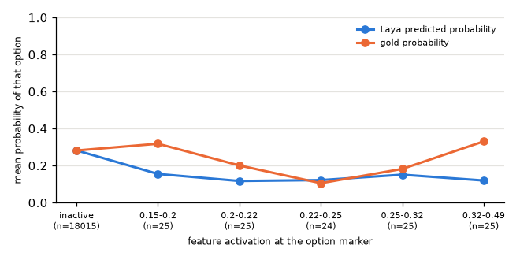

# Feature 8008

Critérios em que aparece: corr_error

**Interpretação (preencher):** 

---

## Maiores ativações

**tr_customer_service_000043 / churn_risk** (score, customer_service) | ativação 3.723 em `estado` | opções ['0', '1', '2', '3'] | Laya: **1** [0.275, 0.645, 0.048, 0.031] | gabarito: **2**

```
<bos> score question: How likely is this customer to stop doing business with us because of this interaction?<eos>
▸ <mask> level 0: No sign of dissatisfaction.
▸ <mask> level 1: Mild frustration, but the relationship is intact.
▸ <mask> level 2: Clearly unhappy; repeat problems or explicit complaints.
▸ <mask> level 3: Imminent: threatening to cancel, dispute or leave.

<eos>

 {"account": {"lifetime_value_usd": 208, "prior_tickets_90d": 0, "seats": 1, "tenure_months": 3, "tier": "free"}, "orders": [{"amount_usd": 999, "date": "2026-03-09", "id": "A-17017", "status": "refunded"}, {"amount_usd": 999, "date": "2026-01-04", "id": "A-58989", "status": "failed"}], "thread": [{"role": "customer", "text": "I need to get my data out of the system, but I’m not holding my breath—it probably won’t happen any time soon."}, {"role": "agent", "text": "I hear you. Could you tell me which parts of your account you’d like included in the export?"}, {"role": "customer", "text": "Just the basic account information—profile details and settings. Nothing fancy."}, {"role": "agent", "text": "Understood. Do you have a preferred format for the file—CSV, JSON, or something else?"}, {"role": "customer", "text": "Whatever⟦ you⟧ can manage, I don’t mind waiting."}]}<eos>
```

**tr_customer_service_000043 / urgency** (score, customer_service) | ativação 3.709 em `estado` | opções ['0', '1', '2', '3'] | Laya: **1** [0.359, 0.46, 0.147, 0.034] | gabarito: **0**

```
<bos> score question: How time-sensitive is this conversation?<eos>
▸ <mask> level 0: No time pressure; can wait indefinitely.
▸ <mask> level 1: Routine; handle within the normal queue.
▸ <mask> level 2: Elevated; should be handled within the same week.
▸ <mask> level 3: Critical; requires action within the same day.

<eos>

 {"account": {"lifetime_value_usd": 208, "prior_tickets_90d": 0, "seats": 1, "tenure_months": 3, "tier": "free"}, "orders": [{"amount_usd": 999, "date": "2026-03-09", "id": "A-17017", "status": "refunded"}, {"amount_usd": 999, "date": "2026-01-04", "id": "A-58989", "status": "failed"}], "thread": [{"role": "customer", "text": "I need to get my data out of the system, but I’m not holding my breath—it probably won’t happen any time soon."}, {"role": "agent", "text": "I hear you. Could you tell me which parts of your account you’d like included in the export?"}, {"role": "customer", "text": "Just the basic account information—profile details and settings. Nothing fancy."}, {"role": "agent", "text": "Understood. Do you have a preferred format for the file—CSV, JSON, or something else?"}, {"role": "customer", "text": "Whatever⟦ you⟧ can manage, I don’t mind waiting."}]}<eos>
```

**tr_customer_service_000043 / action** (choice, customer_service) | ativação 3.654 em `estado` | opções ['answer_directly', 'close_no_action', 'escalate_to_human', 'execute_refund', 'request_information'] | Laya: **close_no_action** [0.234, 0.46, 0.231, 0.05, 0.025] | gabarito: **answer_directly**

```
<bos> choice question: What should the assistant do next with this conversation?<eos>
▸ <mask> answer_directly: The assistant can resolve this itself with information it already has.
▸ <mask> close_no_action: No further action is warranted; the matter is settled.
▸ <mask> escalate_to_human: Hand off to a human agent with the appropriate authority.
▸ <mask> execute_refund: Issue the refund or credit the customer is owed.
▸ <mask> request_information: More detail is needed from the customer before anything can be done.

<eos>

 {"account": {"lifetime_value_usd": 208, "prior_tickets_90d": 0, "seats": 1, "tenure_months": 3, "tier": "free"}, "orders": [{"amount_usd": 999, "date": "2026-03-09", "id": "A-17017", "status": "refunded"}, {"amount_usd": 999, "date": "2026-01-04", "id": "A-58989", "status": "failed"}], "thread": [{"role": "customer", "text": "I need to get my data out of the system, but I’m not holding my breath—it probably won’t happen any time soon."}, {"role": "agent", "text": "I hear you. Could you tell me which parts of your account you’d like included in the export?"}, {"role": "customer", "text": "Just the basic account information—profile details and settings. Nothing fancy."}, {"role": "agent", "text": "Understood. Do you have a preferred format for the file—CSV, JSON, or something else?"}, {"role": "customer", "text": "Whatever⟦ you⟧ can manage, I don’t mind waiting."}]}<eos>
```

**tr_customer_service_000043 / needs_human** (noul, customer_service) | ativação 3.633 em `estado` | opções ['false', 'true'] | Laya: **false** [0.51, 0.49] | gabarito: **false**

```
<bos> noul question: This conversation requires a human agent rather than automated handling.<eos>
▸ <mask> false: Automation can carry this to resolution.
▸ <mask> true: A human must take over: judgement, authority or empathy is required.

<eos>

 {"account": {"lifetime_value_usd": 208, "prior_tickets_90d": 0, "seats": 1, "tenure_months": 3, "tier": "free"}, "orders": [{"amount_usd": 999, "date": "2026-03-09", "id": "A-17017", "status": "refunded"}, {"amount_usd": 999, "date": "2026-01-04", "id": "A-58989", "status": "failed"}], "thread": [{"role": "customer", "text": "I need to get my data out of the system, but I’m not holding my breath—it probably won’t happen any time soon."}, {"role": "agent", "text": "I hear you. Could you tell me which parts of your account you’d like included in the export?"}, {"role": "customer", "text": "Just the basic account information—profile details and settings. Nothing fancy."}, {"role": "agent", "text": "Understood. Do you have a preferred format for the file—CSV, JSON, or something else?"}, {"role": "customer", "text": "Whatever⟦ you⟧ can manage, I don’t mind waiting."}]}<eos>
```

**tr_customer_service_000043 / category** (choice, customer_service) | ativação 3.598 em `estado` | opções ['account', 'billing', 'delivery', 'refund', 'technical'] | Laya: **account** [0.892, 0.008, 0.008, 0.005, 0.087] | gabarito: **account**

```
<bos> choice question: What is this customer conversation primarily about?<eos>
▸ <mask> account: Login, plan changes, profile or access management.
▸ <mask> billing: A charge, invoice, subscription or payment problem.
▸ <mask> delivery: Shipping, fulfilment or delivery of a physical item.
▸ <mask> refund: The customer is explicitly asking for money back.
▸ <mask> technical: The product or service is not working as expected.

<eos>

 {"account": {"lifetime_value_usd": 208, "prior_tickets_90d": 0, "seats": 1, "tenure_months": 3, "tier": "free"}, "orders": [{"amount_usd": 999, "date": "2026-03-09", "id": "A-17017", "status": "refunded"}, {"amount_usd": 999, "date": "2026-01-04", "id": "A-58989", "status": "failed"}], "thread": [{"role": "customer", "text": "I need to get my data out of the system, but I’m not holding my breath—it probably won’t happen any time soon."}, {"role": "agent", "text": "I hear you. Could you tell me which parts of your account you’d like included in the export?"}, {"role": "customer", "text": "Just the basic account information—profile details and settings. Nothing fancy."}, {"role": "agent", "text": "Understood. Do you have a preferred format for the file—CSV, JSON, or something else?"}, {"role": "customer", "text": "Whatever⟦ you⟧ can manage, I don’t mind waiting."}]}<eos>
```

## Ativações medianas (faixa 40-60%, mediana 0.949)

**tr_customer_service_000163 / churn_risk** (score, customer_service) | ativação 0.998 em `estado` | opções ['0', '1', '2', '3'] | Laya: **1** [0.045, 0.686, 0.156, 0.114] | gabarito: **2**

```
<bos> score question: How likely is this customer to stop doing business with us because of this interaction?<eos>
▸ <mask> level 0: No sign of dissatisfaction.
▸ <mask> level 1: Mild frustration, but the relationship is intact.
▸ <mask> level 2: Clearly unhappy; repeat problems or explicit complaints.
▸ <mask> level 3: Imminent: threatening to cancel, dispute or leave.

<eos>

 {"account": {"lifetime_value_usd": 1046, "prior_tickets_90d": 1, "seats": 1, "tenure_months": 41, "tier": "standard"}, "orders": [{"amount_usd": 87, "date": "2026-01-23", "id": "A-89226", "status": "settled"}], "thread": [{"role": "customer", "text": "I’m fed up—my refund of $87 from about a month ago is still nowhere to be seen, despite the ticket I opened weeks back."}, {"role": "agent", "text": "I’m sorry you’re dealing with this; could you confirm the ticket reference so⟦ I⟧ can check the latest notes?"}, {"role": "customer", "text": "It’s ticket 98421. I was promised a response yesterday and got nothing."}, {"role": "agent", "text": "Understood. I’ll look into the activity on that ticket. Is there any additional documentation you’d like to attach?"}, {"role": "customer", "text": "No, I just want the refund processed—this back‑and‑forth is getting ridiculous."}]}<eos>
```

**tr_customer_service_000001 / action** (choice, customer_service) | ativação 0.949 em `opção` | opções ['answer_directly', 'close_no_action', 'escalate_to_human', 'execute_refund', 'request_information'] | Laya: **answer_directly** [0.802, 0.054, 0.12, 0.02, 0.004] | gabarito: **answer_directly**

```
<bos> choice question: What should the assistant do next with this conversation?<eos>
▸ <mask> answer_directly:⟦ The⟧ assistant can resolve this itself with information it already has.
▸ <mask> close_no_action: No further action is warranted; the matter is settled.
▸ <mask> escalate_to_human: Hand off to a human agent with the appropriate authority.
▸ <mask> execute_refund: Issue the refund or credit the customer is owed.
▸ <mask> request_information: More detail is needed from the customer before anything can be done.

<eos>

 {"account": {"lifetime_value_usd": 1646, "prior_tickets_90d": 1, "seats": 5, "tenure_months": 26, "tier": "premium"}, "orders": [{"amount_usd": 9, "date": "2026-01-23", "id": "A-68034", "status": "settled"}, {"amount_usd": 9, "date": "2026-03-16", "id": "A-14370", "status": "settled"}, {"amount_usd": 9, "date": "2026-03-08", "id": "A-24814", "status": "refunded"}], "thread": [{"role": "customer", "text": "I can’t log in to my premium dashboard at all – I need access immediately, this is urgent."}, {"role": "agent", "text": "I understand the urgency. Are you seeing any error message when you try to sign in?"}, {"role": "customer", "text": "It just says “Invalid credentials” even though I’m sure my password is correct. My account is tied to jason.lee@example.com."}]}<eos>
```

**tr_customer_service_000043 / category** (choice, customer_service) | ativação 0.974 em `estado` | opções ['account', 'billing', 'delivery', 'refund', 'technical'] | Laya: **account** [0.892, 0.008, 0.008, 0.005, 0.087] | gabarito: **account**

```
<bos> choice question: What is this customer conversation primarily about?<eos>
▸ <mask> account: Login, plan changes, profile or access management.
▸ <mask> billing: A charge, invoice, subscription or payment problem.
▸ <mask> delivery: Shipping, fulfilment or delivery of a physical item.
▸ <mask> refund: The customer is explicitly asking for money back.
▸ <mask> technical: The product or service is not working as expected.

<eos>

 {"account": {"lifetime_value_usd": 208, "prior_tickets_90d": 0, "seats": 1, "tenure_months": 3, "tier": "free"}, "orders": [{"amount_usd": 999, "date": "2026-03-09", "id": "A-17017", "status": "refunded"}, {"amount_usd": 999, "date": "2026-01-04", "id": "A-58989", "status": "failed"}], "thread": [{"role": "customer", "text": "I need to get my data out of the system, but I’m not holding my breath—it probably won’t happen any time soon."}, {"role": "agent", "text": "I hear you. Could⟦ you⟧ tell me which parts of your account you’d like included in the export?"}, {"role": "customer", "text": "Just the basic account information—profile details and settings. Nothing fancy."}, {"role": "agent", "text": "Understood. Do you have a preferred format for the file—CSV, JSON, or something else?"}, {"role": "customer", "text": "Whatever you can manage, I don’t mind waiting."}]}<eos>
```

**tr_customer_service_000279 / category** (choice, customer_service) | ativação 0.902 em `estado` | opções ['account', 'billing', 'delivery', 'refund', 'technical'] | Laya: **account** [0.613, 0.014, 0.004, 0.012, 0.357] | gabarito: **account**

```
<bos> choice question: What is this customer conversation primarily about?<eos>
▸ <mask> account: Login, plan changes, profile or access management.
▸ <mask> billing: A charge, invoice, subscription or payment problem.
▸ <mask> delivery: Shipping, fulfilment or delivery of a physical item.
▸ <mask> refund: The customer is explicitly asking for money back.
▸ <mask> technical: The product or service is not working as expected.

<eos>

 {"account": {"lifetime_value_usd": 2237, "prior_tickets_90d": 2, "seats": 1, "tenure_months": 33, "tier": "free"}, "thread": [{"role": "customer", "text": "Hi there, I’ve been using the free plan for 33 months now and I’m hoping to download my full data history. Could⟦ you⟧ let me know the steps to initiate an export?"}, {"role": "agent", "text": "Hello, thank you for reaching out. I see you've been with us for quite a while now. Could you please clarify if you are looking to export a specific date range or your entire account archive?"}, {"role": "customer", "text": "I would like to pull everything from the very beginning if that is possible."}]}<eos>
```

**tr_customer_service_000052 / action** (choice, customer_service) | ativação 0.963 em `opção` | opções ['answer_directly', 'close_no_action', 'escalate_to_human', 'execute_refund', 'request_information'] | Laya: **answer_directly** [0.398, 0.379, 0.062, 0.104, 0.056] | gabarito: **escalate_to_human**

```
<bos> choice question: What should the assistant do next with this conversation?<eos>
▸ <mask> answer_directly:⟦ The⟧ assistant can resolve this itself with information it already has.
▸ <mask> close_no_action: No further action is warranted; the matter is settled.
▸ <mask> escalate_to_human: Hand off to a human agent with the appropriate authority.
▸ <mask> execute_refund: Issue the refund or credit the customer is owed.
▸ <mask> request_information: More detail is needed from the customer before anything can be done.

<eos>

 {"account": {"lifetime_value_usd": 1015, "prior_tickets_90d": 3, "seats": 1, "tenure_months": 11, "tier": "standard"}, "orders": [{"amount_usd": 149, "date": "2026-01-24", "id": "A-11891", "status": "refunded"}, {"amount_usd": 149, "date": "2026-02-03", "id": "A-76056", "status": "failed"}], "thread": [{"role": "customer", "text": "Hello, I'm having trouble logging into my account. I've been a subscriber for 11 months on the standard plan, paying about $149, and I've already opened three tickets that haven't been resolved. Could you please look into this?"}, {"role": "agent", "text": "I’m sorry you’re still experiencing this. Could you let me know the exact error message you see when you try to sign in, and whether you’ve tried resetting your password?"}, {"role": "customer", "text": "Sure, the page just says 'Invalid credentials' even after I reset the password. I’m using the same email as before."}, {"role": "agent", "text": "Thank you for confirming that. I’ll need to check the status of your account and the recent password reset attempts. May I have the email address associated with the account?"}, {"role": "customer", "text": "The email is john.doe@example.com. Please let me know what you find."}]}<eos>
```

## Estatísticas (conjunto de descoberta, dev e teste)

**pred / error**

| split | decisões | ativas | ativas e Laya errou | taxa | lift | q (BH) | OR (CMH) | q (CMH) |
|---|---|---|---|---|---|---|---|---|
| discovery | 5100 | 4 | 4 | 1.000 | 1.55 | nan | nan | nan |
| dev | 900 | 1 | 1 | 1.000 | 1.49 | nan | nan | nan |
| test | 2000 | 0 | 0 | nan | nan | nan | nan | nan |

**corr / error**

| split | decisões | ativas | ativas e Laya errou | taxa | lift | q (BH) | OR (CMH) | q (CMH) |
|---|---|---|---|---|---|---|---|---|
| discovery | 5100 | 23 | 23 | 1.000 | 1.55 | 0.000142 | inf | 0.246 |
| dev | 900 | 1 | 1 | 1.000 | 1.49 | nan | nan | nan |
| test | 2000 | 13 | 13 | 1.000 | 1.54 | nan | nan | nan |

**state / error**

| split | decisões | ativas | ativas e Laya errou | taxa | lift | q (BH) | OR (CMH) | q (CMH) |
|---|---|---|---|---|---|---|---|---|
| discovery | 5100 | 1470 | 906 | 0.616 | 0.96 | 0.0359 | 1.09 | 0.67 |
| dev | 900 | 230 | 148 | 0.643 | 0.96 | 0.674 | 1.35 | 0.604 |
| test | 2000 | 645 | 400 | 0.620 | 0.95 | 0.219 | 0.84 | 0.55 |

**pred / probe_right_laya_wrong**

| split | decisões | ativas | ativas e Laya errou | taxa | lift | q (BH) | OR (CMH) | q (CMH) |
|---|---|---|---|---|---|---|---|---|
| discovery | 2819 | 1 | 1 | 1.000 | 1.55 | nan | nan | nan |
| dev | 520 | 0 | 0 | nan | nan | nan | nan | nan |
| test | 1106 | 0 | 0 | nan | nan | nan | nan | nan |

**corr / probe_right_laya_wrong**

| split | decisões | ativas | ativas e Laya errou | taxa | lift | q (BH) | OR (CMH) | q (CMH) |
|---|---|---|---|---|---|---|---|---|
| discovery | 2819 | 9 | 9 | 1.000 | 1.55 | nan | nan | nan |
| dev | 520 | 0 | 0 | nan | nan | nan | nan | nan |
| test | 1106 | 5 | 5 | 1.000 | 1.58 | nan | nan | nan |

**state / probe_right_laya_wrong**

| split | decisões | ativas | ativas e Laya errou | taxa | lift | q (BH) | OR (CMH) | q (CMH) |
|---|---|---|---|---|---|---|---|---|
| discovery | 2819 | 783 | 462 | 0.590 | 0.91 | 0.000608 | 1.30 | 0.203 |
| dev | 520 | 123 | 78 | 0.634 | 0.94 | 0.649 | 2.15 | 0.178 |
| test | 1106 | 332 | 195 | 0.587 | 0.93 | 0.157 | 1.28 | 0.512 |

Confusão mais sobre-representada (pred): `credential_compromise|0>1` (n=2, lift 115.91, p=nan). Formato `pergunta|índice previsto>índice correto`.

Confusão mais sobre-representada (corr): `urgency|3>0` (n=12, lift 66.52, p=1.12e-20). Formato `pergunta|índice previsto>índice correto`.

Confusão mais sobre-representada (state): `action|1>2` (n=63, lift 3.08, p=2.85e-26). Formato `pergunta|índice previsto>índice correto`.



