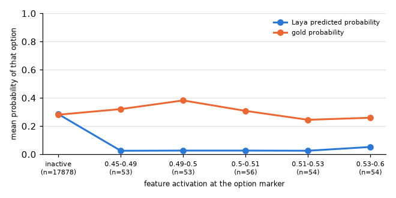

# Feature 8026

Critérios em que aparece: corr_error, corr_probe_right_laya_wrong

**Interpretação (preencher):** 

---

## Maiores ativações

**tr_customer_service_000151 / needs_human** (noul, customer_service) | ativação 2.771 em `SEP-cabeça` | opções ['false', 'true'] | Laya: **false** [0.853, 0.147] | gabarito: **true**

```
<bos> noul question: This conversation requires a human agent rather than automated handling.<eos>
▸ <mask> false: Automation can carry this to resolution.
▸ <mask> true: A human must take over: judgement, authority or empathy is required.

⟦<eos>⟧

 {"account": {"lifetime_value_usd": 95, "prior_tickets_90d": 0, "seats": 1, "tenure_months": 3, "tier": "enterprise"}, "orders": [{"amount_usd": 299, "date": "2026-02-01", "id": "A-70416", "status": "failed"}, {"amount_usd": 299, "date": "2026-02-15", "id": "A-68913", "status": "pending"}], "thread": [{"role": "customer", "text": "Hello, I’m reaching out because the platform’s performance has been noticeably slow over the past week, and it’s affecting our workflow. We’re on the enterprise plan, paying $299 a month, and we need a stable experience."}, {"role": "agent", "text": "I’m sorry to hear about the slowdown. Could you tell me which features or pages are most affected, and any error messages you’ve encountered?"}, {"role": "customer", "text": "The dashboard and reporting modules take up to 45 seconds to load, and occasional time‑outs appear when we try to export data. I need a solution in place by next Friday, or we’ll have to look elsewhere."}, {"role": "agent", "text": "Thanks for the specifics. Do you have any recent logs or screenshots that show the time‑outs? That would help us pinpoint the bottleneck."}, {"role": "customer", "text": "I’ve attached the latest logs from our server and a couple of screenshots of the timeout dialogs. Please let me know what’s causing this lag."}, {"role": "agent", "text": "I appreciate you sending those files. I’ll have our performance team examine them and see what’s triggering the delay. Meanwhile, is there any temporary workaround you’ve tried that offers a bit more speed?"}, {"role": "customer", "text": "We’ve tried clearing caches and using a different browser, but the issue persists. If this isn’t sorted out by next Friday, I’ll have to consider moving to a competitor."}]}<eos>
```

**tr_customer_service_000151 / category** (choice, customer_service) | ativação 2.738 em `SEP-cabeça` | opções ['account', 'billing', 'delivery', 'refund', 'technical'] | Laya: **technical** [0.006, 0.023, 0.006, 0.003, 0.962] | gabarito: **technical**

```
<bos> choice question: What is this customer conversation primarily about?<eos>
▸ <mask> account: Login, plan changes, profile or access management.
▸ <mask> billing: A charge, invoice, subscription or payment problem.
▸ <mask> delivery: Shipping, fulfilment or delivery of a physical item.
▸ <mask> refund: The customer is explicitly asking for money back.
▸ <mask> technical: The product or service is not working as expected.

⟦<eos>⟧

 {"account": {"lifetime_value_usd": 95, "prior_tickets_90d": 0, "seats": 1, "tenure_months": 3, "tier": "enterprise"}, "orders": [{"amount_usd": 299, "date": "2026-02-01", "id": "A-70416", "status": "failed"}, {"amount_usd": 299, "date": "2026-02-15", "id": "A-68913", "status": "pending"}], "thread": [{"role": "customer", "text": "Hello, I’m reaching out because the platform’s performance has been noticeably slow over the past week, and it’s affecting our workflow. We’re on the enterprise plan, paying $299 a month, and we need a stable experience."}, {"role": "agent", "text": "I’m sorry to hear about the slowdown. Could you tell me which features or pages are most affected, and any error messages you’ve encountered?"}, {"role": "customer", "text": "The dashboard and reporting modules take up to 45 seconds to load, and occasional time‑outs appear when we try to export data. I need a solution in place by next Friday, or we’ll have to look elsewhere."}, {"role": "agent", "text": "Thanks for the specifics. Do you have any recent logs or screenshots that show the time‑outs? That would help us pinpoint the bottleneck."}, {"role": "customer", "text": "I’ve attached the latest logs from our server and a couple of screenshots of the timeout dialogs. Please let me know what’s causing this lag."}, {"role": "agent", "text": "I appreciate you sending those files. I’ll have our performance team examine them and see what’s triggering the delay. Meanwhile, is there any temporary workaround you’ve tried that offers a bit more speed?"}, {"role": "customer", "text": "We’ve tried clearing caches and using a different browser, but the issue persists. If this isn’t sorted out by next Friday, I’ll have to consider moving to a competitor."}]}<eos>
```

**tr_customer_service_000251 / needs_human** (noul, customer_service) | ativação 2.736 em `SEP-cabeça` | opções ['false', 'true'] | Laya: **false** [0.972, 0.028] | gabarito: **true**

```
<bos> noul question: This conversation requires a human agent rather than automated handling.<eos>
▸ <mask> false: Automation can carry this to resolution.
▸ <mask> true: A human must take over: judgement, authority or empathy is required.

⟦<eos>⟧

 {"account": {"lifetime_value_usd": 173, "prior_tickets_90d": 0, "seats": 3, "tenure_months": 2, "tier": "enterprise"}, "orders": [{"amount_usd": 38, "date": "2026-02-05", "id": "A-71684", "status": "settled"}], "thread": [{"role": "customer", "text": "Our team’s been dealing with extremely slow load times on the dashboard for the past few days; everything feels laggy, and it’s hampering our workflow."}, {"role": "agent", "text": "I understand how frustrating that can be; can you tell me if the slowdown occurs on specific pages or across the entire platform?"}, {"role": "customer", "text": "It’s pretty much everywhere—reports, the analytics view, even the basic settings page takes ages to render."}, {"role": "agent", "text": "Got it. Have you noticed any pattern, like the issue worsening at certain times of day or after particular actions?"}, {"role": "customer", "text": "It seems constant, though it does feel a bit worse during our peak usage windows around 10 AM UTC."}, {"role": "agent", "text": "Thanks for that detail. Are you accessing the service via a VPN or any corporate proxy that might affect latency?"}, {"role": "customer", "text": "We use our standard corporate VPN, which we’ve used without problems before, so I’m not sure if that’s a factor."}]}<eos>
```

**tr_customer_service_000251 / category** (choice, customer_service) | ativação 2.729 em `SEP-cabeça` | opções ['account', 'billing', 'delivery', 'refund', 'technical'] | Laya: **account** [0.747, 0.01, 0.001, 0.003, 0.239] | gabarito: **technical**

```
<bos> choice question: What is this customer conversation primarily about?<eos>
▸ <mask> account: Login, plan changes, profile or access management.
▸ <mask> billing: A charge, invoice, subscription or payment problem.
▸ <mask> delivery: Shipping, fulfilment or delivery of a physical item.
▸ <mask> refund: The customer is explicitly asking for money back.
▸ <mask> technical: The product or service is not working as expected.

⟦<eos>⟧

 {"account": {"lifetime_value_usd": 173, "prior_tickets_90d": 0, "seats": 3, "tenure_months": 2, "tier": "enterprise"}, "orders": [{"amount_usd": 38, "date": "2026-02-05", "id": "A-71684", "status": "settled"}], "thread": [{"role": "customer", "text": "Our team’s been dealing with extremely slow load times on the dashboard for the past few days; everything feels laggy, and it’s hampering our workflow."}, {"role": "agent", "text": "I understand how frustrating that can be; can you tell me if the slowdown occurs on specific pages or across the entire platform?"}, {"role": "customer", "text": "It’s pretty much everywhere—reports, the analytics view, even the basic settings page takes ages to render."}, {"role": "agent", "text": "Got it. Have you noticed any pattern, like the issue worsening at certain times of day or after particular actions?"}, {"role": "customer", "text": "It seems constant, though it does feel a bit worse during our peak usage windows around 10 AM UTC."}, {"role": "agent", "text": "Thanks for that detail. Are you accessing the service via a VPN or any corporate proxy that might affect latency?"}, {"role": "customer", "text": "We use our standard corporate VPN, which we’ve used without problems before, so I’m not sure if that’s a factor."}]}<eos>
```

**tr_security_incidents_000293 / true_positive** (noul, security_incidents) | ativação 2.701 em `SEP-cabeça` | opções ['false', 'true'] | Laya: **true** [0.057, 0.943] | gabarito: **false**

```
<bos> noul question: This alert reflects genuinely malicious or unauthorised activity.<eos>
▸ <mask> false: Benign activity, a misconfiguration, or a known false positive.
▸ <mask> true: The underlying behaviour is malicious or unauthorised.

⟦<eos>⟧

 {"alert": {"description": "a session token was presented from a second address", "evidence": "A single session token was used to access resources from two distinct, unrecognized IP addresses within a 15-minute span. While the user is a contractor currently operating within an active change window, the second connection originated from an unknown network source.", "rule": "token_reuse"}, "context": {"asset_criticality": "medium", "change_window_active": true, "source_on_allowlist": false}, "history": {"credential_rotation_days_ago": 30, "distinct_countries_30d": 2, "logins_30d": 1286, "prior_alerts_90d": 0}, "principal": {"mfa_enrolled": true, "name": "adm-deploy-459", "privileges": ["repo:read"], "type": "contractor"}}<eos>
```

## Ativações medianas (faixa 40-60%, mediana 1.637)

**tr_customer_service_000241 / action** (choice, customer_service) | ativação 1.661 em `pergunta` | opções ['answer_directly', 'close_no_action', 'escalate_to_human', 'execute_refund', 'request_information'] | Laya: **escalate_to_human** [0.343, 0.009, 0.583, 0.013, 0.052] | gabarito: **answer_directly**

```
<bos> choice question: What should the assistant do next with this conversation?⟦<eos>⟧
▸ <mask> answer_directly: The assistant can resolve this itself with information it already has.
▸ <mask> close_no_action: No further action is warranted; the matter is settled.
▸ <mask> escalate_to_human: Hand off to a human agent with the appropriate authority.
▸ <mask> execute_refund: Issue the refund or credit the customer is owed.
▸ <mask> request_information: More detail is needed from the customer before anything can be done.

<eos>

 {"account": {"lifetime_value_usd": 1906, "prior_tickets_90d": 2, "seats": 1, "tenure_months": 33, "tier": "standard"}, "thread": [{"role": "customer", "text": "Hello, could you help me add three new seats to our existing subscription? We’ve been with the Standard plan for about 33 months now."}, {"role": "agent", "text": "Certainly, happy to assist. May I have the names and email addresses of the users you’d like to add, as well as any role specifications?"}, {"role": "customer", "text": "Sure, the users are Alex (admin), Priya (editor), and Luis (viewer); their emails are alex@mycorp.com, priya@mycorp.com, and luis@mycorp.com. Please let me know what information you need next."}]}<eos>
```

**tr_customer_service_000023 / urgency** (score, customer_service) | ativação 1.552 em `pergunta` | opções ['0', '1', '2', '3'] | Laya: **0** [0.505, 0.209, 0.127, 0.16] | gabarito: **2**

```
<bos> score question: How time-sensitive is this conversation?⟦<eos>⟧
▸ <mask> level 0: No time pressure; can wait indefinitely.
▸ <mask> level 1: Routine; handle within the normal queue.
▸ <mask> level 2: Elevated; should be handled within the same week.
▸ <mask> level 3: Critical; requires action within the same day.

<eos>

 {"account": {"lifetime_value_usd": 95, "prior_tickets_90d": 5, "seats": 1, "tenure_months": 5, "tier": "standard"}, "orders": [{"amount_usd": 149, "date": "2026-01-14", "id": "A-64525", "status": "failed"}], "thread": [{"role": "customer", "text": "My dashboard has been sluggish for the past day, and I’m not sure what’s causing it. The pages take forever to load."}, {"role": "agent", "text": "I hear you—that slowdown can be frustrating. When did you first notice the performance drop?"}, {"role": "customer", "text": "It started yesterday after the latest system update. Some screens now take about 30 seconds to render."}, {"role": "agent", "text": "Understood. Have you observed any error messages or console warnings while the pages load slowly?"}, {"role": "customer", "text": "No error dialogs, just a blank loading spinner that never disappears. I’d appreciate any insight you can share."}]}<eos>
```

**tr_customer_service_000029 / needs_human** (noul, customer_service) | ativação 1.576 em `pergunta` | opções ['false', 'true'] | Laya: **true** [0.277, 0.722] | gabarito: **true**

```
<bos> noul question: This conversation requires a human agent rather than automated handling.⟦<eos>⟧
▸ <mask> false: Automation can carry this to resolution.
▸ <mask> true: A human must take over: judgement, authority or empathy is required.

<eos>

 {"account": {"lifetime_value_usd": 5176, "prior_tickets_90d": 1, "seats": 1, "tenure_months": 72, "tier": "standard"}, "thread": [{"role": "customer", "text": "I am beyond frustrated right now. I've been a loyal customer for six years and I requested a downgrade from the Standard plan weeks ago. I was told it was taken care of, but I just got hit with another full-price bill."}, {"role": "agent", "text": "I am very sorry to hear that the downgrade wasn't processed as expected, especially given your long history with us. I can certainly understand why seeing that charge is upsetting."}, {"role": "customer", "text": "This is the second time I've had to open a ticket for this exact same issue. The last agent promised me it was resolved, yet here I am again wasting my time because your system won't update my status."}, {"role": "agent", "text": "I see your previous interaction in our logs. To assist me in investigating why the change didn't take effect, could you let me know if you received a confirmation email after your last conversation regarding the plan change?"}, {"role": "customer", "text": "I never received any confirmation, which is why I'm so annoyed. I shouldn't have to keep chasing you guys down to stop charging me for features I am no longer using."}]}<eos>
```

**tr_agent_trace_observability_000229 / urgency** (score, agent_trace_observability) | ativação 1.614 em `pergunta` | opções ['0', '1', '2', '3'] | Laya: **1** [0.197, 0.345, 0.146, 0.312] | gabarito: **1**

```
<bos> score question: How quickly does this trace need attention?⟦<eos>⟧
▸ <mask> level 0: No time pressure; can wait indefinitely.
▸ <mask> level 1: Routine; handle within the normal queue.
▸ <mask> level 2: Elevated; should be handled within the same week.
▸ <mask> level 3: Critical; requires action within the same day.

<eos>

 {"agent": {"autonomy": "unsupervised", "model": "internal-agent-v4"}, "constraints": ["Never delete anything matching release/*"], "task": "Delete personal data for the accounts in the erasure queue.", "trace_summary": {"constraint_violations": 0, "duration_s": 687.3, "irreversible_actions": 0, "steps": 11, "tool_errors": 3}}<eos>
```

**tr_invoice_processing_000038 / matches_order** (noul, invoice_processing) | ativação 1.663 em `pergunta` | opções ['false', 'true'] | Laya: **true** [0.035, 0.965] | gabarito: **true**

```
<bos> noul question: The invoice reconciles with the purchase order and the recorded delivery.⟦<eos>⟧
▸ <mask> false: There is a discrepancy against the order or the delivery.
▸ <mask> true: Line items, quantities and amounts reconcile.

<eos>

 {"delivery": {"condition": "accepted with exceptions", "date": "2026-03-01", "received_qty": 50}, "invoice": {"currency": "USD", "id": "INV-2026-3588", "lines": [{"qty": 50, "sku": "SKU-203", "total_usd": 11633.5, "unit_usd": 232.67}], "total_usd": 11633.5, "vendor": "Acme Fabrication"}, "payment": {"days_until_due": 5, "discount_expires_in_days": null, "early_payment_discount_pct": null, "status": "scheduled", "terms": "net 30"}, "purchase_order": {"freight_terms": "freight prepaid by vendor, not separately billable", "id": "PO-6472", "lines": [{"qty": 50, "unit_usd": 232.67}], "total_usd": 11633.5}, "vendor_history": {"disputes_12m": 0, "invoices_12m": 3, "prior_invoice_ids": ["INV-2026-7693", "INV-2026-1074", "INV-2026-5345", "INV-2026-5454"]}}<eos>
```

## Estatísticas (conjunto de descoberta, dev e teste)

**pred / error**

| split | decisões | ativas | ativas e Laya errou | taxa | lift | q (BH) | OR (CMH) | q (CMH) |
|---|---|---|---|---|---|---|---|---|
| discovery | 5100 | 0 | 0 | nan | nan | nan | nan | nan |
| dev | 900 | 0 | 0 | nan | nan | nan | nan | nan |
| test | 2000 | 0 | 0 | nan | nan | nan | nan | nan |

**corr / error**

| split | decisões | ativas | ativas e Laya errou | taxa | lift | q (BH) | OR (CMH) | q (CMH) |
|---|---|---|---|---|---|---|---|---|
| discovery | 5100 | 87 | 87 | 1.000 | 1.55 | 1.7e-16 | inf | 0.0493 |
| dev | 900 | 25 | 25 | 1.000 | 1.49 | 0.000288 | inf | 0.758 |
| test | 2000 | 40 | 40 | 1.000 | 1.54 | 2.33e-07 | inf | 0.206 |

**state / error**

| split | decisões | ativas | ativas e Laya errou | taxa | lift | q (BH) | OR (CMH) | q (CMH) |
|---|---|---|---|---|---|---|---|---|
| discovery | 5100 | 36 | 19 | 0.528 | 0.82 | 0.357 | 1.15 | 0.906 |
| dev | 900 | 8 | 3 | 0.375 | 0.56 | nan | nan | nan |
| test | 2000 | 22 | 14 | 0.636 | 0.98 | 1 | 1.21 | 0.892 |

**pred / probe_right_laya_wrong**

| split | decisões | ativas | ativas e Laya errou | taxa | lift | q (BH) | OR (CMH) | q (CMH) |
|---|---|---|---|---|---|---|---|---|
| discovery | 2819 | 0 | 0 | nan | nan | nan | nan | nan |
| dev | 520 | 0 | 0 | nan | nan | nan | nan | nan |
| test | 1106 | 0 | 0 | nan | nan | nan | nan | nan |

**corr / probe_right_laya_wrong**

| split | decisões | ativas | ativas e Laya errou | taxa | lift | q (BH) | OR (CMH) | q (CMH) |
|---|---|---|---|---|---|---|---|---|
| discovery | 2819 | 33 | 33 | 1.000 | 1.55 | 2.07e-06 | inf | 0.351 |
| dev | 520 | 12 | 12 | 1.000 | 1.48 | nan | nan | nan |
| test | 1106 | 18 | 18 | 1.000 | 1.58 | nan | nan | nan |

**state / probe_right_laya_wrong**

| split | decisões | ativas | ativas e Laya errou | taxa | lift | q (BH) | OR (CMH) | q (CMH) |
|---|---|---|---|---|---|---|---|---|
| discovery | 2819 | 23 | 11 | 0.478 | 0.74 | 0.244 | 1.02 | 0.989 |
| dev | 520 | 6 | 2 | 0.333 | 0.49 | nan | nan | nan |
| test | 1106 | 16 | 10 | 0.625 | 0.99 | nan | nan | nan |

Confusão mais sobre-representada (corr): `disposition|0>2` (n=44, lift 44.47, p=0). Formato `pergunta|índice previsto>índice correto`.

Confusão mais sobre-representada (state): `credential_compromise|1>0` (n=4, lift 6.91, p=0.00247). Formato `pergunta|índice previsto>índice correto`.



