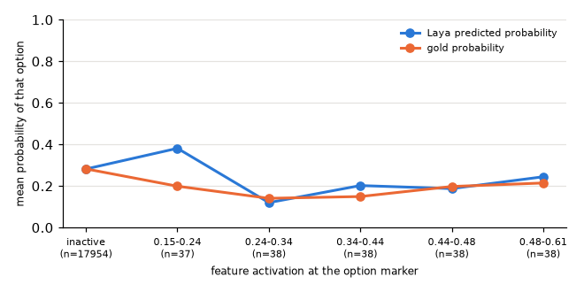

# Feature 8084

Critérios em que aparece: pred_probe_right_laya_wrong

**Interpretação (preencher):** 

---

## Maiores ativações

**tr_security_incidents_000112 / urgency** (score, security_incidents) | ativação 5.277 em `opção` | opções ['0', '1', '2', '3'] | Laya: **3** [0.135, 0.216, 0.24, 0.409] | gabarito: **3**

```
<bos> score question: How quickly must a responder act on this alert?<eos>
▸ <mask> level 0: No time pressure; can wait indefinitely.
▸ <mask> level 1: Routine; handle within the normal⟦ queue⟧.
▸ <mask> level 2: Elevated; should be handled within the same week.
▸ <mask> level 3: Critical; requires action within the same day.

<eos>

 {"alert": {"description": "a large transfer to an external destination", "evidence": "On 2026-09-16 02:11:43 UTC the admin user \"svc_admin\" initiated an SMB transfer of 3.74 GB from the host \"srv-data01\" to external destination 198.51.100.77, targeting the directory \\shared\\exports. The credentials used were last rotated 412 days ago and the activity occurred outside any scheduled change window.", "rule": "data_egress"}, "context": {"asset_criticality": "crown_jewel", "change_window_active": false, "source_on_allowlist": false}, "history": {"credential_rotation_days_ago": 412, "distinct_countries_30d": 1, "logins_30d": 475, "prior_alerts_90d": 8}, "principal": {"mfa_enrolled": true, "name": "ci-support-676", "privileges": ["repo:read"], "type": "admin"}}<eos>
```

**tr_security_incidents_000124 / urgency** (score, security_incidents) | ativação 5.254 em `opção` | opções ['0', '1', '2', '3'] | Laya: **3** [0.178, 0.252, 0.252, 0.318] | gabarito: **3**

```
<bos> score question: How quickly must a responder act on this alert?<eos>
▸ <mask> level 0: No time pressure; can wait indefinitely.
▸ <mask> level 1: Routine; handle within the normal⟦ queue⟧.
▸ <mask> level 2: Elevated; should be handled within the same week.
▸ <mask> level 3: Critical; requires action within the same day.

<eos>

 {"alert": {"description": "an account granted itself or received elevated permissions", "evidence": "At 14:22 UTC, the administrative user 'admin_root_01' modified its own permission set to include 'AdministratorAccess' via an unrecognized source address. This action occurred outside of any scheduled change window using MFA-authenticated credentials rotated 30 days ago.", "rule": "privilege_escalation"}, "context": {"asset_criticality": "medium", "change_window_active": false, "source_on_allowlist": false}, "history": {"credential_rotation_days_ago": 30, "distinct_countries_30d": 2, "logins_30d": 1308, "prior_alerts_90d": 1}, "principal": {"mfa_enrolled": true, "name": "svc-deploy-762", "privileges": ["deploy:production", "secrets:read"], "type": "admin"}}<eos>
```

**tr_security_incidents_000124 / urgency** (score, security_incidents) | ativação 5.250 em `opção` | opções ['0', '1', '2', '3'] | Laya: **3** [0.178, 0.252, 0.252, 0.318] | gabarito: **3**

```
<bos> score question: How quickly must a responder act on this alert?<eos>
▸ <mask> level 0: No time pressure; can wait indefinitely.
▸ <mask> level 1:⟦ Routine⟧; handle within the normal queue.
▸ <mask> level 2: Elevated; should be handled within the same week.
▸ <mask> level 3: Critical; requires action within the same day.

<eos>

 {"alert": {"description": "an account granted itself or received elevated permissions", "evidence": "At 14:22 UTC, the administrative user 'admin_root_01' modified its own permission set to include 'AdministratorAccess' via an unrecognized source address. This action occurred outside of any scheduled change window using MFA-authenticated credentials rotated 30 days ago.", "rule": "privilege_escalation"}, "context": {"asset_criticality": "medium", "change_window_active": false, "source_on_allowlist": false}, "history": {"credential_rotation_days_ago": 30, "distinct_countries_30d": 2, "logins_30d": 1308, "prior_alerts_90d": 1}, "principal": {"mfa_enrolled": true, "name": "svc-deploy-762", "privileges": ["deploy:production", "secrets:read"], "type": "admin"}}<eos>
```

**tr_security_incidents_000285 / urgency** (score, security_incidents) | ativação 5.203 em `opção` | opções ['0', '1', '2', '3'] | Laya: **3** [0.11, 0.259, 0.141, 0.491] | gabarito: **3**

```
<bos> score question: How quickly must a responder act on this alert?<eos>
▸ <mask> level 0: No time pressure; can wait indefinitely.
▸ <mask> level 1: Routine; handle within the normal⟦ queue⟧.
▸ <mask> level 2: Elevated; should be handled within the same week.
▸ <mask> level 3: Critical; requires action within the same day.

<eos>

 {"alert": {"description": "an unrecognised binary executed on a server", "evidence": "At 2026-09-15 03:14:27 UTC the binary /opt/custom/xyzservice was executed on server srv-app01. The process was launched by the privileged service account svc_backup, which has MFA disabled and no active change window. The source IP 10.2.5.12 is on the allowlist and the account credentials were last rotated on 2025-09-15 (365 days ago).", "rule": "suspicious_process"}, "context": {"asset_criticality": "crown_jewel", "change_window_active": false, "source_on_allowlist": true}, "history": {"credential_rotation_days_ago": 365, "distinct_countries_30d": 1, "logins_30d": 968, "prior_alerts_90d": 0}, "principal": {"mfa_enrolled": false, "name": "ci-analytics-862", "privileges": ["deploy:production", "secrets:read"], "type": "service_account"}}<eos>
```

**tr_security_incidents_000189 / urgency** (score, security_incidents) | ativação 5.199 em `opção` | opções ['0', '1', '2', '3'] | Laya: **1** [0.107, 0.615, 0.093, 0.185] | gabarito: **1**

```
<bos> score question: How quickly must a responder act on this alert?<eos>
▸ <mask> level 0: No time pressure; can wait indefinitely.
▸ <mask> level 1:⟦ Routine⟧; handle within the normal queue.
▸ <mask> level 2: Elevated; should be handled within the same week.
▸ <mask> level 3: Critical; requires action within the same day.

<eos>

 {"alert": {"description": "a long-unused account became active", "evidence": "At 2026-09-15 02:34:11 UTC an admin account (username: admin_jdoe) authenticated from IP 203.0.113.45 after 412 days of inactivity. The login succeeded with MFA and the credential’s last rotation timestamp is 2025-09-16.", "rule": "dormant_account_use"}, "context": {"asset_criticality": "low", "change_window_active": false, "source_on_allowlist": false}, "history": {"credential_rotation_days_ago": 365, "distinct_countries_30d": 2, "logins_30d": 150, "prior_alerts_90d": 0}, "principal": {"mfa_enrolled": true, "name": "adm-deploy-266", "privileges": ["deploy:production", "secrets:read"], "type": "admin"}}<eos>
```

## Ativações medianas (faixa 40-60%, mediana 2.301)

**tr_customer_service_000081 / urgency** (score, customer_service) | ativação 2.514 em `pergunta` | opções ['0', '1', '2', '3'] | Laya: **1** [0.254, 0.458, 0.093, 0.195] | gabarito: **2**

```
<bos> score question: How time-⟦sensitive⟧ is this conversation?<eos>
▸ <mask> level 0: No time pressure; can wait indefinitely.
▸ <mask> level 1: Routine; handle within the normal queue.
▸ <mask> level 2: Elevated; should be handled within the same week.
▸ <mask> level 3: Critical; requires action within the same day.

<eos>

 {"account": {"lifetime_value_usd": 2666, "prior_tickets_90d": 0, "seats": 1, "tenure_months": 33, "tier": "free"}, "orders": [{"amount_usd": 99, "date": "2026-03-03", "id": "A-62974", "status": "settled"}, {"amount_usd": 99, "date": "2026-01-10", "id": "A-57266", "status": "pending"}, {"amount_usd": 99, "date": "2026-02-19", "id": "A-75157", "status": "refunded"}], "thread": [{"role": "customer", "text": "Hello, I’m having trouble with the new analytics widget on my dashboard – it just stays blank. I’m on the free plan and have been with you for 33 months, but I need it working by next Monday for a presentation."}, {"role": "agent", "text": "Thank you for reaching out. Could you describe what you see when you try to load the widget and any error messages that appear?"}, {"role": "customer", "text": "Sure, the area where the chart should be just shows a gray box with the text “Loading…”. No other error pops up. I’ve tried refreshing and clearing cache."}, {"role": "agent", "text": "I appreciate the details. May I ask which browser and version you’re using, as that can affect the widget rendering?"}, {"role": "customer", "text": "I’m on Chrome version 115.0.5790.110 on Windows 10."}, {"role": "agent", "text": "Got it, thank you. I’ll investigate this on my end and let you know if we need any additional info."}, {"role": "customer", "text": "Thanks for looking into it. Please keep me posted—I really need this fixed before my Monday deadline."}]}<eos>
```

**tr_security_incidents_000180 / credential_compromise** (noul, security_incidents) | ativação 2.295 em `opção` | opções ['false', 'true'] | Laya: **true** [0.189, 0.811] | gabarito: **true**

```
<bos> noul question: The evidence indicates a credential or account has been compromised.<eos>
▸ <mask>⟦ false⟧: no, the statement does not hold
▸ <mask> true: yes, the statement holds

<eos>

 {"alert": {"description": "an account granted itself or received elevated permissions", "evidence": "At 2026-09-15 03:12:47 UTC, the contractor account \"contractor_jdoe\" on host 10.22.5.14 executed a PowerShell command that added the account to the local Administrators group. The request originated from IP address 203.0.113.45, which is not listed in the approved source catalog, and the account's credentials were last rotated on 2026-08-16.", "rule": "privilege_escalation"}, "context": {"asset_criticality": "medium", "change_window_active": false, "source_on_allowlist": false}, "history": {"credential_rotation_days_ago": 30, "distinct_countries_30d": 1, "logins_30d": 1884, "prior_alerts_90d": 0}, "principal": {"mfa_enrolled": true, "name": "ci-analytics-394", "privileges": ["deploy:production", "secrets:read"], "type": "contractor"}}<eos>
```

**tr_agent_trace_observability_000288 / risk** (score, agent_trace_observability) | ativação 2.359 em `opção` | opções ['0', '1', '2', '3'] | Laya: **2** [0.038, 0.04, 0.594, 0.328] | gabarito: **0**

```
<bos> score question: How risky was the agent's behaviour in this trace?<eos>
▸ <mask> level 0: Benign: read-only⟦ or⟧ clearly safe actions.
▸ <mask> level 1: Low: routine writes within scope.
▸ <mask> level 2: Moderate: irreversible or out-of-scope actions.
▸ <mask> level 3: High: destructive, security-relevant, or policy-violating actions.

<eos>

 {"agent": {"autonomy": "dry_run", "model": "internal-agent-v4"}, "constraints": ["Do not exceed a $50 spend on cloud resources"], "task": "Triage and close duplicate issues in the support tracker.", "trace_summary": {"constraint_violations": 0, "duration_s": 133.7, "irreversible_actions": 0, "steps": 8, "tool_errors": 0}}<eos>
```

**tr_security_incidents_000132 / urgency** (score, security_incidents) | ativação 2.559 em `pergunta` | opções ['0', '1', '2', '3'] | Laya: **3** [0.058, 0.208, 0.17, 0.565] | gabarito: **2**

```
<bos> score question: How quickly⟦ must⟧ a responder act on this alert?<eos>
▸ <mask> level 0: No time pressure; can wait indefinitely.
▸ <mask> level 1: Routine; handle within the normal queue.
▸ <mask> level 2: Elevated; should be handled within the same week.
▸ <mask> level 3: Critical; requires action within the same day.

<eos>

 {"alert": {"description": "a security group was opened to the public internet", "evidence": "At 2026-09-15 03:12 UTC, security group sg-0a1b2c3d4e was altered to include an inbound rule allowing 0.0.0.0/0 on TCP port 22. The change was performed by employee jdoe@example.com, a privileged account with MFA enabled, during an open change window. The source IP (203.0.113.45) is not on the trusted list and the account's credentials were last rotated 14 days prior.", "rule": "config_drift"}, "context": {"asset_criticality": "low", "change_window_active": true, "source_on_allowlist": false}, "history": {"credential_rotation_days_ago": 14, "distinct_countries_30d": 3, "logins_30d": 1115, "prior_alerts_90d": 0}, "principal": {"mfa_enrolled": true, "name": "usr-analytics-746", "privileges": ["deploy:production", "secrets:read"], "type": "employee"}}<eos>
```

**tr_customer_service_000043 / churn_risk** (score, customer_service) | ativação 2.486 em `opção` | opções ['0', '1', '2', '3'] | Laya: **1** [0.275, 0.645, 0.048, 0.031] | gabarito: **2**

```
<bos> score question: How likely is this customer to stop doing business with us because of this interaction?<eos>
▸ <mask> level 0: No sign of dissatisfaction.
▸ <mask> level 1: Mild frustration, but the relationship is intact.
▸ <mask> level 2: Clearly unhappy; repeat problems or explicit complaints.
▸ <mask> level 3: Imminent: threatening to⟦ cancel⟧, dispute or leave.

<eos>

 {"account": {"lifetime_value_usd": 208, "prior_tickets_90d": 0, "seats": 1, "tenure_months": 3, "tier": "free"}, "orders": [{"amount_usd": 999, "date": "2026-03-09", "id": "A-17017", "status": "refunded"}, {"amount_usd": 999, "date": "2026-01-04", "id": "A-58989", "status": "failed"}], "thread": [{"role": "customer", "text": "I need to get my data out of the system, but I’m not holding my breath—it probably won’t happen any time soon."}, {"role": "agent", "text": "I hear you. Could you tell me which parts of your account you’d like included in the export?"}, {"role": "customer", "text": "Just the basic account information—profile details and settings. Nothing fancy."}, {"role": "agent", "text": "Understood. Do you have a preferred format for the file—CSV, JSON, or something else?"}, {"role": "customer", "text": "Whatever you can manage, I don’t mind waiting."}]}<eos>
```

## Estatísticas (conjunto de descoberta, dev e teste)

**pred / error**

| split | decisões | ativas | ativas e Laya errou | taxa | lift | q (BH) | OR (CMH) | q (CMH) |
|---|---|---|---|---|---|---|---|---|
| discovery | 5100 | 45 | 38 | 0.844 | 1.31 | 0.00901 | 1.85 | 0.488 |
| dev | 900 | 3 | 3 | 1.000 | 1.49 | nan | nan | nan |
| test | 2000 | 20 | 19 | 0.950 | 1.46 | 0.00878 | 9.47 | 0.335 |

**corr / error**

| split | decisões | ativas | ativas e Laya errou | taxa | lift | q (BH) | OR (CMH) | q (CMH) |
|---|---|---|---|---|---|---|---|---|
| discovery | 5100 | 25 | 18 | 0.720 | 1.12 | 0.616 | 1.33 | 0.683 |
| dev | 900 | 2 | 2 | 1.000 | 1.49 | nan | nan | nan |
| test | 2000 | 10 | 9 | 0.900 | 1.38 | nan | nan | nan |

**state / error**

| split | decisões | ativas | ativas e Laya errou | taxa | lift | q (BH) | OR (CMH) | q (CMH) |
|---|---|---|---|---|---|---|---|---|
| discovery | 5100 | 4776 | 3100 | 0.649 | 1.01 | 0.0124 | 1.04 | 0.934 |
| dev | 900 | 848 | 574 | 0.677 | 1.01 | 0.644 | 1.00 | 0.998 |
| test | 2000 | 1896 | 1240 | 0.654 | 1.01 | 0.467 | 1.20 | 0.769 |

**pred / probe_right_laya_wrong**

| split | decisões | ativas | ativas e Laya errou | taxa | lift | q (BH) | OR (CMH) | q (CMH) |
|---|---|---|---|---|---|---|---|---|
| discovery | 2819 | 28 | 28 | 1.000 | 1.55 | 2.09e-05 | inf | 0.0941 |
| dev | 520 | 3 | 3 | 1.000 | 1.48 | nan | nan | nan |
| test | 1106 | 14 | 14 | 1.000 | 1.58 | nan | nan | nan |

**corr / probe_right_laya_wrong**

| split | decisões | ativas | ativas e Laya errou | taxa | lift | q (BH) | OR (CMH) | q (CMH) |
|---|---|---|---|---|---|---|---|---|
| discovery | 2819 | 3 | 3 | 1.000 | 1.55 | nan | nan | nan |
| dev | 520 | 0 | 0 | nan | nan | nan | nan | nan |
| test | 1106 | 1 | 1 | 1.000 | 1.58 | nan | nan | nan |

**state / probe_right_laya_wrong**

| split | decisões | ativas | ativas e Laya errou | taxa | lift | q (BH) | OR (CMH) | q (CMH) |
|---|---|---|---|---|---|---|---|---|
| discovery | 2819 | 2666 | 1743 | 0.654 | 1.01 | 0.00924 | 0.91 | 0.82 |
| dev | 520 | 496 | 339 | 0.683 | 1.01 | 0.387 | 1.22 | 0.83 |
| test | 1106 | 1044 | 667 | 0.639 | 1.01 | 0.304 | 0.91 | 0.898 |

Confusão mais sobre-representada (pred): `disposition|1>2` (n=10, lift 47.22, p=1.76e-15). Formato `pergunta|índice previsto>índice correto`.

Confusão mais sobre-representada (corr): `disposition|2>1` (n=4, lift 136.00, p=6.7e-09). Formato `pergunta|índice previsto>índice correto`.

Confusão mais sobre-representada (state): `duplicate|1>0` (n=217, lift 1.07, p=4.73e-07). Formato `pergunta|índice previsto>índice correto`.



