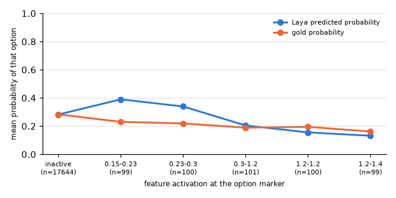

# Feature 8265

Critérios em que aparece: pred_error_stratified, pred_probe_right_laya_wrong_stratified

**Interpretação (preencher):** 

---

## Maiores ativações

**tr_customer_service_000176 / urgency** (score, customer_service) | ativação 10.609 em `estado` | opções ['0', '1', '2', '3'] | Laya: **1** [0.199, 0.48, 0.106, 0.215] | gabarito: **2**

```
<bos> score question: How time-sensitive is this conversation?<eos>
▸ <mask> level 0: No time pressure; can wait indefinitely.
▸ <mask> level 1: Routine; handle within the normal queue.
▸ <mask> level 2: Elevated; should be handled within the same week.
▸ <mask> level 3: Critical; requires action within the same day.

<eos>

 {"account": {"lifetime_value_usd": 389, "prior_tickets_90d": 0, "seats": 1, "tenure_months": 8, "tier": "standard"}, "orders": [{"amount_usd": 447, "date": "2026-03-17", "id": "A-79887", "status": "pending"}, {"amount_usd": 447, "date": "2026-02-17", "id": "A-28475", "status": "refunded"}], "thread": [{"role": "customer", "text": "I've been on the standard plan for eight months now, paying about $447, and I still can't get into my account."}, {"role": "agent", "text": "I’m sorry you’re experiencing this. Could you tell me what error message appears, or share the username you’re trying to sign in with?"}, {"role": "customer", "text": "It just says “invalid credentials”⟦ no⟧ matter what I type."}, {"role": "agent", "text": "Thanks for letting me know. Have you attempted a password reset, and if so, did you receive the reset email?"}, {"role": "customer", "text": "I tried resetting, but the reset email never arrives."}]}<eos>
```

**tr_customer_service_000176 / action** (choice, customer_service) | ativação 10.492 em `estado` | opções ['answer_directly', 'close_no_action', 'escalate_to_human', 'execute_refund', 'request_information'] | Laya: **answer_directly** [0.696, 0.26, 0.006, 0.031, 0.008] | gabarito: **request_information**

```
<bos> choice question: What should the assistant do next with this conversation?<eos>
▸ <mask> answer_directly: The assistant can resolve this itself with information it already has.
▸ <mask> close_no_action: No further action is warranted; the matter is settled.
▸ <mask> escalate_to_human: Hand off to a human agent with the appropriate authority.
▸ <mask> execute_refund: Issue the refund or credit the customer is owed.
▸ <mask> request_information: More detail is needed from the customer before anything can be done.

<eos>

 {"account": {"lifetime_value_usd": 389, "prior_tickets_90d": 0, "seats": 1, "tenure_months": 8, "tier": "standard"}, "orders": [{"amount_usd": 447, "date": "2026-03-17", "id": "A-79887", "status": "pending"}, {"amount_usd": 447, "date": "2026-02-17", "id": "A-28475", "status": "refunded"}], "thread": [{"role": "customer", "text": "I've been on the standard plan for eight months now, paying about $447, and I still can't get into my account."}, {"role": "agent", "text": "I’m sorry you’re experiencing this. Could you tell me what error message appears, or share the username you’re trying to sign in with?"}, {"role": "customer", "text": "It just says “invalid credentials”⟦ no⟧ matter what I type."}, {"role": "agent", "text": "Thanks for letting me know. Have you attempted a password reset, and if so, did you receive the reset email?"}, {"role": "customer", "text": "I tried resetting, but the reset email never arrives."}]}<eos>
```

**tr_customer_service_000235 / urgency** (score, customer_service) | ativação 10.453 em `estado` | opções ['0', '1', '2', '3'] | Laya: **1** [0.249, 0.552, 0.114, 0.086] | gabarito: **2**

```
<bos> score question: How time-sensitive is this conversation?<eos>
▸ <mask> level 0: No time pressure; can wait indefinitely.
▸ <mask> level 1: Routine; handle within the normal queue.
▸ <mask> level 2: Elevated; should be handled within the same week.
▸ <mask> level 3: Critical; requires action within the same day.

<eos>

 {"account": {"lifetime_value_usd": 116, "prior_tickets_90d": 2, "seats": 1, "tenure_months": 3, "tier": "standard"}, "thread": [{"role": "customer", "text": "I’ve only been on the standard plan for three months, but I think it’s time to just cancel the account. It’s not working out for me."}, {"role": "agent", "text": "I am sorry to hear you're considering leaving. Could you share a bit more about what hasn't been working for you so I can better understand your experience?"}, {"role": "customer", "text": "It’s just been a series of small issues that never really get sorted out properly. I’ve had two tickets open already, and things just stay the same."}, {"role": "agent", "text": "I appreciate your patience regarding those previous interactions. Would you mind telling me which specific aspects of the service have remained unresolved?"}, {"role": "customer", "text": "It's the integration sync. It never seems to pick up the changes I make in the dashboard,⟦ no⟧ matter how many times I refresh."}, {"role": "agent", "text": "Thank you for that detail. Are you seeing any particular status indicators or warnings within the dashboard when the sync fails to update?"}, {"role": "customer", "text": "No, it just acts like nothing happened. I'm tired of guessing why things aren't syncing."}]}<eos>
```

**tr_customer_service_000176 / churn_risk** (score, customer_service) | ativação 10.438 em `estado` | opções ['0', '1', '2', '3'] | Laya: **2** [0.084, 0.342, 0.492, 0.082] | gabarito: **2**

```
<bos> score question: How likely is this customer to stop doing business with us because of this interaction?<eos>
▸ <mask> level 0: No sign of dissatisfaction.
▸ <mask> level 1: Mild frustration, but the relationship is intact.
▸ <mask> level 2: Clearly unhappy; repeat problems or explicit complaints.
▸ <mask> level 3: Imminent: threatening to cancel, dispute or leave.

<eos>

 {"account": {"lifetime_value_usd": 389, "prior_tickets_90d": 0, "seats": 1, "tenure_months": 8, "tier": "standard"}, "orders": [{"amount_usd": 447, "date": "2026-03-17", "id": "A-79887", "status": "pending"}, {"amount_usd": 447, "date": "2026-02-17", "id": "A-28475", "status": "refunded"}], "thread": [{"role": "customer", "text": "I've been on the standard plan for eight months now, paying about $447, and I still can't get into my account."}, {"role": "agent", "text": "I’m sorry you’re experiencing this. Could you tell me what error message appears, or share the username you’re trying to sign in with?"}, {"role": "customer", "text": "It just says “invalid credentials”⟦ no⟧ matter what I type."}, {"role": "agent", "text": "Thanks for letting me know. Have you attempted a password reset, and if so, did you receive the reset email?"}, {"role": "customer", "text": "I tried resetting, but the reset email never arrives."}]}<eos>
```

**tr_customer_service_000235 / action** (choice, customer_service) | ativação 10.430 em `estado` | opções ['answer_directly', 'close_no_action', 'escalate_to_human', 'execute_refund', 'request_information'] | Laya: **close_no_action** [0.003, 0.996, 0.0, 0.0, 0.0] | gabarito: **request_information**

```
<bos> choice question: What should the assistant do next with this conversation?<eos>
▸ <mask> answer_directly: The assistant can resolve this itself with information it already has.
▸ <mask> close_no_action: No further action is warranted; the matter is settled.
▸ <mask> escalate_to_human: Hand off to a human agent with the appropriate authority.
▸ <mask> execute_refund: Issue the refund or credit the customer is owed.
▸ <mask> request_information: More detail is needed from the customer before anything can be done.

<eos>

 {"account": {"lifetime_value_usd": 116, "prior_tickets_90d": 2, "seats": 1, "tenure_months": 3, "tier": "standard"}, "thread": [{"role": "customer", "text": "I’ve only been on the standard plan for three months, but I think it’s time to just cancel the account. It’s not working out for me."}, {"role": "agent", "text": "I am sorry to hear you're considering leaving. Could you share a bit more about what hasn't been working for you so I can better understand your experience?"}, {"role": "customer", "text": "It’s just been a series of small issues that never really get sorted out properly. I’ve had two tickets open already, and things just stay the same."}, {"role": "agent", "text": "I appreciate your patience regarding those previous interactions. Would you mind telling me which specific aspects of the service have remained unresolved?"}, {"role": "customer", "text": "It's the integration sync. It never seems to pick up the changes I make in the dashboard,⟦ no⟧ matter how many times I refresh."}, {"role": "agent", "text": "Thank you for that detail. Are you seeing any particular status indicators or warnings within the dashboard when the sync fails to update?"}, {"role": "customer", "text": "No, it just acts like nothing happened. I'm tired of guessing why things aren't syncing."}]}<eos>
```

## Ativações medianas (faixa 40-60%, mediana 7.721)

**tr_customer_service_000136 / action** (choice, customer_service) | ativação 8.078 em `opção` | opções ['answer_directly', 'close_no_action', 'escalate_to_human', 'execute_refund', 'request_information'] | Laya: **answer_directly** [0.662, 0.259, 0.022, 0.054, 0.003] | gabarito: **escalate_to_human**

```
<bos> choice question: What should the assistant do next with this conversation?<eos>
▸ <mask> answer_directly: The assistant can resolve this itself with information it already has.
▸ <mask> close_no_action:⟦ No⟧ further action is warranted; the matter is settled.
▸ <mask> escalate_to_human: Hand off to a human agent with the appropriate authority.
▸ <mask> execute_refund: Issue the refund or credit the customer is owed.
▸ <mask> request_information: More detail is needed from the customer before anything can be done.

<eos>

 {"account": {"lifetime_value_usd": 151, "prior_tickets_90d": 0, "seats": 1, "tenure_months": 2, "tier": "free"}, "orders": [{"amount_usd": 2997, "date": "2026-02-27", "id": "A-95428", "status": "refunded"}], "thread": [{"role": "customer", "text": "I just got my latest invoice and it shows a charge of $2,997—something I never signed up for. I've only been on the free plan for two months and this is urgent, please explain why this amount is appearing."}, {"role": "agent", "text": "I’m sorry to hear about the surprise charge. Could you share the invoice number or the date it was issued so I can look into the details?"}, {"role": "customer", "text": "The invoice is #INV-8392, dated August 5th. I didn’t receive any notice about upgrading, and I’m still under the free tier."}, {"role": "agent", "text": "Thank you for that information. I’ll verify the account activity around that date. Did you perhaps receive any promotional email that might have triggered an automatic upgrade?"}, {"role": "customer", "text": "No, I haven’t seen any promotion, and I never clicked any upgrade link. I need to know what happened before this gets billed again."}, {"role": "agent", "text": "Understood. I’ll check the billing logs and see if there’s a misapplied charge. Meanwhile, could you confirm the primary email address on the account?"}, {"role": "customer", "text": "The email is jessica.rivera@example.com. Please let me know what you find as soon as possible."}]}<eos>
```

**tr_invoice_processing_000019 / duplicate** (noul, invoice_processing) | ativação 7.297 em `opção` | opções ['false', 'true'] | Laya: **true** [0.024, 0.976] | gabarito: **false**

```
<bos> noul question: This invoice appears to duplicate an invoice already submitted.<eos>
▸ <mask> false:⟦ no⟧, the statement does not hold
▸ <mask> true: yes, the statement holds

<eos>

 {"delivery": {"condition": "accepted", "date": "2026-03-18", "received_qty": 100}, "invoice": {"currency": "USD", "id": "INV-2026-9033", "lines": [{"qty": 100, "sku": "SKU-538", "total_usd": 1456.0, "unit_usd": 14.56}], "total_usd": 1456.0, "vendor": "Acme Fabrication"}, "payment": {"days_until_due": 5, "discount_expires_in_days": null, "early_payment_discount_pct": null, "status": "scheduled", "terms": "net 30"}, "purchase_order": {"freight_terms": "freight prepaid by vendor, not separately billable", "id": "PO-3023", "lines": [{"qty": 100, "unit_usd": 14.56}], "total_usd": 1456.0}, "vendor_history": {"disputes_12m": 0, "invoices_12m": 34, "prior_invoice_ids": ["INV-2026-9033", "INV-2026-3488", "INV-2026-5999", "INV-2026-7520"]}}<eos>
```

**tr_customer_service_000287 / churn_risk** (score, customer_service) | ativação 7.988 em `estado` | opções ['0', '1', '2', '3'] | Laya: **3** [0.007, 0.067, 0.024, 0.902] | gabarito: **3**

```
<bos> score question: How likely is this customer to stop doing business with us because of this interaction?<eos>
▸ <mask> level 0: No sign of dissatisfaction.
▸ <mask> level 1: Mild frustration, but the relationship is intact.
▸ <mask> level 2: Clearly unhappy; repeat problems or explicit complaints.
▸ <mask> level 3: Imminent: threatening to cancel, dispute or leave.

<eos>

 {"account": {"lifetime_value_usd": 400, "prior_tickets_90d": 0, "seats": 40, "tenure_months": 5, "tier": "premium"}, "thread": [{"role": "customer", "text": "I’m fed up with this service. I want my account closed right now—⟦no⟧ more emails, no more charges."}, {"role": "agent", "text": "I understand your frustration. Could you please confirm the email address associated with the account so I can locate it?"}, {"role": "customer", "text": "It’s the same one you have on file, but I’m telling you outright: terminate everything immediately."}, {"role": "agent", "text": "Thanks for confirming. To proceed, could you also provide the last four digits of the payment method on record?"}, {"role": "customer", "text": "Fine—4112. I expect this to be done without any more back‑and‑forth."}]}<eos>
```

**tr_security_incidents_000225 / credential_compromise** (noul, security_incidents) | ativação 7.363 em `opção` | opções ['false', 'true'] | Laya: **false** [0.787, 0.213] | gabarito: **false**

```
<bos> noul question: The evidence indicates a credential or account has been compromised.<eos>
▸ <mask> false:⟦ no⟧, the statement does not hold
▸ <mask> true: yes, the statement holds

<eos>

 {"alert": {"description": "audit logging was turned off on a host", "evidence": "Audit logging was disabled on the host workstation at 14:22 UTC. The authenticated employee account, which has not rotated credentials in 412 days, performed this action outside of an approved change window.", "rule": "disabled_logging"}, "context": {"asset_criticality": "medium", "change_window_active": false, "source_on_allowlist": true}, "history": {"credential_rotation_days_ago": 412, "distinct_countries_30d": 3, "logins_30d": 1204, "prior_alerts_90d": 0}, "principal": {"mfa_enrolled": true, "name": "ci-infra-325", "privileges": ["repo:read"], "type": "employee"}}<eos>
```

**tr_security_incidents_000075 / severity** (score, security_incidents) | ativação 7.598 em `estado` | opções ['0', '1', '2', '3', '4'] | Laya: **2** [0.132, 0.296, 0.32, 0.116, 0.136] | gabarito: **1**

```
<bos> score question: How severe is the potential impact if this alert is real?<eos>
▸ <mask> level 0: Negligible: no access to anything sensitive.
▸ <mask> level 1: Low: limited access, easily reversed.
▸ <mask> level 2: Moderate: access to internal systems or non-public data.
▸ <mask> level 3: High: access to production, secrets or customer data.
▸ <mask> level 4: Critical: active compromise of crown-jewel systems.

<eos>

 {"alert": {"description": "a first-ever sign-in from an unfamiliar country", "evidence": "At 2026-09-15 03:42:17 UTC, a sign‑in for principal type ci_runner (unprivileged) was recorded from IP 203.0.113.45, which maps to Brazil, a country not present in any prior login records for this account. The authentication succeeded with MFA and the associated credentials were last rotated 180 days earlier;⟦ no⟧ change window was configured.", "rule": "new_country_login"}, "context": {"asset_criticality": "low", "change_window_active": false, "source_on_allowlist": false}, "history": {"credential_rotation_days_ago": 180, "distinct_countries_30d": 1, "logins_30d": 1252, "prior_alerts_90d": 3}, "principal": {"mfa_enrolled": true, "name": "ci-billing-909", "privileges": ["repo:read"], "type": "ci_runner"}}<eos>
```

## Estatísticas (conjunto de descoberta, dev e teste)

**pred / error**

| split | decisões | ativas | ativas e Laya errou | taxa | lift | q (BH) | OR (CMH) | q (CMH) |
|---|---|---|---|---|---|---|---|---|
| discovery | 5100 | 159 | 101 | 0.635 | 0.99 | 0.919 | 2.67 | 0.00221 |
| dev | 900 | 34 | 23 | 0.676 | 1.01 | 1 | 2.86 | 0.468 |
| test | 2000 | 68 | 41 | 0.603 | 0.93 | 0.553 | 1.44 | 0.698 |

**corr / error**

| split | decisões | ativas | ativas e Laya errou | taxa | lift | q (BH) | OR (CMH) | q (CMH) |
|---|---|---|---|---|---|---|---|---|
| discovery | 5100 | 95 | 37 | 0.389 | 0.61 | 1.43e-06 | 1.19 | 0.725 |
| dev | 900 | 16 | 5 | 0.312 | 0.46 | nan | nan | nan |
| test | 2000 | 34 | 7 | 0.206 | 0.32 | 8.44e-07 | 0.39 | 0.552 |

**state / error**

| split | decisões | ativas | ativas e Laya errou | taxa | lift | q (BH) | OR (CMH) | q (CMH) |
|---|---|---|---|---|---|---|---|---|
| discovery | 5100 | 769 | 467 | 0.607 | 0.94 | 0.0734 | 1.08 | 0.719 |
| dev | 900 | 80 | 56 | 0.700 | 1.04 | 0.949 | 1.70 | 0.372 |
| test | 2000 | 240 | 152 | 0.633 | 0.97 | 0.852 | 1.17 | 0.717 |

**pred / probe_right_laya_wrong**

| split | decisões | ativas | ativas e Laya errou | taxa | lift | q (BH) | OR (CMH) | q (CMH) |
|---|---|---|---|---|---|---|---|---|
| discovery | 2819 | 70 | 43 | 0.614 | 0.95 | 0.683 | inf | 8.04e-07 |
| dev | 520 | 15 | 9 | 0.600 | 0.89 | nan | nan | nan |
| test | 1106 | 36 | 24 | 0.667 | 1.05 | 0.891 | inf | 0.0162 |

**corr / probe_right_laya_wrong**

| split | decisões | ativas | ativas e Laya errou | taxa | lift | q (BH) | OR (CMH) | q (CMH) |
|---|---|---|---|---|---|---|---|---|
| discovery | 2819 | 36 | 9 | 0.250 | 0.39 | 4.57e-06 | inf | 0.48 |
| dev | 520 | 8 | 2 | 0.250 | 0.37 | nan | nan | nan |
| test | 1106 | 14 | 2 | 0.143 | 0.23 | nan | nan | nan |

**state / probe_right_laya_wrong**

| split | decisões | ativas | ativas e Laya errou | taxa | lift | q (BH) | OR (CMH) | q (CMH) |
|---|---|---|---|---|---|---|---|---|
| discovery | 2819 | 436 | 258 | 0.592 | 0.91 | 0.029 | 1.24 | 0.262 |
| dev | 520 | 51 | 35 | 0.686 | 1.02 | 1 | 1.93 | 0.288 |
| test | 1106 | 151 | 93 | 0.616 | 0.97 | 0.907 | 1.54 | 0.235 |

Confusão mais sobre-representada (pred): `urgency|1>2` (n=52, lift 7.98, p=9.38e-35). Formato `pergunta|índice previsto>índice correto`.

Confusão mais sobre-representada (corr): `category|0>2` (n=10, lift 53.68, p=3.11e-18). Formato `pergunta|índice previsto>índice correto`.

Confusão mais sobre-representada (state): `needs_human|0>1` (n=24, lift 2.95, p=2.08e-07). Formato `pergunta|índice previsto>índice correto`.



