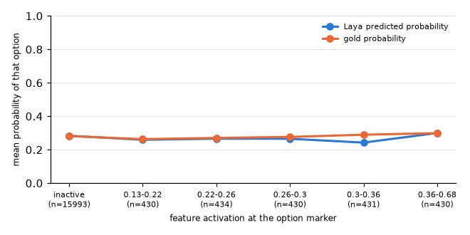

# Feature 8372

Critérios em que aparece: state_error_stratified

**Interpretação (preencher):** 

---

## Maiores ativações

**tr_security_incidents_000156 / urgency** (score, security_incidents) | ativação 2.256 em `estado` | opções ['0', '1', '2', '3'] | Laya: **1** [0.103, 0.517, 0.17, 0.209] | gabarito: **1**

```
<bos> score question: How quickly must a responder act on this alert?<eos>
▸ <mask> level 0: No time pressure; can wait indefinitely.
▸ <mask> level 1: Routine; handle within the normal queue.
▸ <mask> level 2: Elevated; should be handled within the same week.
▸ <mask> level 3: Critical; requires action within the same day.

<eos>

 {"alert": {"description": "two successful logins from distant locations too close together", "evidence": "At 2026-09-15 02:13 UTC the admin account authenticated successfully from 203.0.113.45 (New York, US). Twenty‑four minutes later the same account logged in from 51.178.0.1 (London, UK), both sessions using MFA and originating from IPs present on the allow‑list; the credentials for this account were last rotated on 2025‑09‑15.", "rule": "impossible_⟦travel⟧"}, "context": {"asset_criticality": "low", "change_window_active": false, "source_on_allowlist": true}, "history": {"credential_rotation_days_ago": 365, "distinct_countries_30d": 1, "logins_30d": 1571, "prior_alerts_90d": 0}, "principal": {"mfa_enrolled": true, "name": "svc-billing-407", "privileges": ["repo:read"], "type": "admin"}}<eos>
```

**tr_security_incidents_000068 / severity** (score, security_incidents) | ativação 2.227 em `estado` | opções ['0', '1', '2', '3', '4'] | Laya: **2** [0.126, 0.297, 0.302, 0.118, 0.157] | gabarito: **3**

```
<bos> score question: How severe is the potential impact if this alert is real?<eos>
▸ <mask> level 0: Negligible: no access to anything sensitive.
▸ <mask> level 1: Low: limited access, easily reversed.
▸ <mask> level 2: Moderate: access to internal systems or non-public data.
▸ <mask> level 3: High: access to production, secrets or customer data.
▸ <mask> level 4: Critical: active compromise of crown-jewel systems.

<eos>

 {"alert": {"description": "two successful logins from distant locations too close together", "evidence": "Two successful authentication events for the service account occurred 12 minutes apart from IP addresses located in London and Singapore. The account credentials have not been updated in 412 days.", "rule": "impossible_⟦travel⟧"}, "context": {"asset_criticality": "high", "change_window_active": false, "source_on_allowlist": false}, "history": {"credential_rotation_days_ago": 412, "distinct_countries_30d": 1, "logins_30d": 521, "prior_alerts_90d": 8}, "principal": {"mfa_enrolled": true, "name": "adm-analytics-682", "privileges": ["deploy:production", "secrets:read"], "type": "service_account"}}<eos>
```

**tr_security_incidents_000250 / severity** (score, security_incidents) | ativação 2.188 em `estado` | opções ['0', '1', '2', '3', '4'] | Laya: **0** [0.286, 0.257, 0.213, 0.109, 0.135] | gabarito: **3**

```
<bos> score question: How severe is the potential impact if this alert is real?<eos>
▸ <mask> level 0: Negligible: no access to anything sensitive.
▸ <mask> level 1: Low: limited access, easily reversed.
▸ <mask> level 2: Moderate: access to internal systems or non-public data.
▸ <mask> level 3: High: access to production, secrets or customer data.
▸ <mask> level 4: Critical: active compromise of crown-jewel systems.

<eos>

 {"alert": {"description": "two successful logins from distant locations too close together", "evidence": "A contractor account logged in from New York at 08:00 UTC and subsequently from London at 08:45 UTC. The user credentials associated with this unprivileged account were last rotated one year ago, though both access events originated from allowlisted IP addresses.", "rule": "impossible_⟦travel⟧"}, "context": {"asset_criticality": "crown_jewel", "change_window_active": false, "source_on_allowlist": true}, "history": {"credential_rotation_days_ago": 365, "distinct_countries_30d": 3, "logins_30d": 698, "prior_alerts_90d": 0}, "principal": {"mfa_enrolled": true, "name": "svc-analytics-492", "privileges": ["repo:read"], "type": "contractor"}}<eos>
```

**tr_security_incidents_000068 / urgency** (score, security_incidents) | ativação 2.135 em `estado` | opções ['0', '1', '2', '3'] | Laya: **3** [0.081, 0.38, 0.114, 0.424] | gabarito: **3**

```
<bos> score question: How quickly must a responder act on this alert?<eos>
▸ <mask> level 0: No time pressure; can wait indefinitely.
▸ <mask> level 1: Routine; handle within the normal queue.
▸ <mask> level 2: Elevated; should be handled within the same week.
▸ <mask> level 3: Critical; requires action within the same day.

<eos>

 {"alert": {"description": "two successful logins from distant locations too close together", "evidence": "Two successful authentication events for the service account occurred 12 minutes apart from IP addresses located in London and Singapore. The account credentials have not been updated in 412 days.", "rule": "impossible_⟦travel⟧"}, "context": {"asset_criticality": "high", "change_window_active": false, "source_on_allowlist": false}, "history": {"credential_rotation_days_ago": 412, "distinct_countries_30d": 1, "logins_30d": 521, "prior_alerts_90d": 8}, "principal": {"mfa_enrolled": true, "name": "adm-analytics-682", "privileges": ["deploy:production", "secrets:read"], "type": "service_account"}}<eos>
```

**tr_security_incidents_000298 / severity** (score, security_incidents) | ativação 2.125 em `estado` | opções ['0', '1', '2', '3', '4'] | Laya: **1** [0.114, 0.352, 0.234, 0.185, 0.114] | gabarito: **3**

```
<bos> score question: How severe is the potential impact if this alert is real?<eos>
▸ <mask> level 0: Negligible: no access to anything sensitive.
▸ <mask> level 1: Low: limited access, easily reversed.
▸ <mask> level 2: Moderate: access to internal systems or non-public data.
▸ <mask> level 3: High: access to production, secrets or customer data.
▸ <mask> level 4: Critical: active compromise of crown-jewel systems.

<eos>

 {"alert": {"description": "two successful logins from distant locations too close together", "evidence": "Two successful logins for a privileged administrator account were observed from geographically distant locations within a timeframe that exceeds physical travel capabilities. The second access request originated from an unrecognized source 90 days after the credentials were last rotated.", "rule": "impossible_⟦travel⟧"}, "context": {"asset_criticality": "high", "change_window_active": false, "source_on_allowlist": false}, "history": {"credential_rotation_days_ago": 90, "distinct_countries_30d": 4, "logins_30d": 1464, "prior_alerts_90d": 0}, "principal": {"mfa_enrolled": true, "name": "adm-support-624", "privileges": ["deploy:production", "secrets:read"], "type": "admin"}}<eos>
```

## Ativações medianas (faixa 40-60%, mediana 0.420)

**tr_security_incidents_000144 / severity** (score, security_incidents) | ativação 0.468 em `estado` | opções ['0', '1', '2', '3', '4'] | Laya: **2** [0.146, 0.291, 0.351, 0.131, 0.081] | gabarito: **3**

```
<bos> score question: How severe is the potential impact if this alert is real?<eos>
▸ <mask> level 0: Negligible: no access to anything sensitive.
▸ <mask> level 1: Low: limited access, easily reversed.
▸ <mask> level 2: Moderate: access to internal systems or non-public data.
▸ <mask> level 3: High: access to production, secrets or customer data.
▸ <mask> level 4: Critical: active compromise of crown-jewel systems.

<eos>

 {"alert": {"description": "a large transfer to an external destination", "evidence": "An administrative account initiated a large data transfer to an unrecognized external destination at 14:22 UTC. This activity occurred outside of any scheduled change window, and the account’s credentials were last updated 14 days ago.", "rule": "data_egress"}, "context": {"asset_criticality": "high", "change_window_active": false, "source_on_allowlist": false}, "history": {"credential_rotation_days_⟦ago⟧": 14, "distinct_countries_30d": 2, "logins_30d": 1277, "prior_alerts_90d": 1}, "principal": {"mfa_enrolled": true, "name": "svc-support-636", "privileges": ["deploy:production", "secrets:read"], "type": "admin"}}<eos>
```

**tr_customer_service_000017 / action** (choice, customer_service) | ativação 0.457 em `estado` | opções ['answer_directly', 'close_no_action', 'escalate_to_human', 'execute_refund', 'request_information'] | Laya: **close_no_action** [0.045, 0.884, 0.037, 0.032, 0.002] | gabarito: **escalate_to_human**

```
<bos> choice question: What should the assistant do next with this conversation?<eos>
▸ <mask> answer_directly: The assistant can resolve this itself with information it already has.
▸ <mask> close_no_action: No further action is warranted; the matter is settled.
▸ <mask> escalate_to_human: Hand off to a human agent with the appropriate authority.
▸ <mask> execute_refund: Issue the refund or credit the customer is owed.
▸ <mask> request_information: More detail is needed from the customer before anything can be done.

<eos>

 {"account": {"lifetime_value_usd": 228, "prior_tickets_90d": 3, "seats": 1, "tenure_months": 11, "tier": "premium"}, "orders": [{"amount_usd": 29, "date": "2026-03-25", "⟦id⟧": "A-17351", "status": "settled"}, {"amount_usd": 29, "date": "2026-02-18", "id": "A-55118", "status": "settled"}], "thread": [{"role": "customer", "text": "My payment for the $29 subscription failed this morning. I have a presentation tomorrow morning at 9:00 AM that requires this access, so I need this cleared up immediately."}, {"role": "agent", "text": "I see the status of your account. Before we look into the billing error, could you confirm if the payment method on file has expired or if you have recently updated your banking information?"}, {"role": "customer", "text": "The card is current and active. I have had three previous tickets regarding billing glitches that were supposedly addressed, yet here I am again with the same issue."}, {"role": "agent", "text": "I acknowledge your frustration regarding the previous tickets. To investigate this specific failure, could you provide the transaction reference ID shown in your payment history?"}, {"role": "customer", "text": "I am looking at my bank portal now, but I don't see a reference ID generated for this attempt. How are we going to fix this before my deadline tomorrow?"}]}<eos>
```

**tr_customer_service_000055 / urgency** (score, customer_service) | ativação 0.434 em `estado` | opções ['0', '1', '2', '3'] | Laya: **1** [0.13, 0.545, 0.198, 0.128] | gabarito: **2**

```
<bos> score question: How time-sensitive is this conversation?<eos>
▸ <mask> level 0: No time pressure; can wait indefinitely.
▸ <mask> level 1: Routine; handle within the normal queue.
▸ <mask> level 2: Elevated; should be handled within the same week.
▸ <mask> level 3: Critical; requires action within the same day.

<eos>

 {"account": {"lifetime_value_usd": 936, "prior_tickets_90d": 0, "seats": 40, "tenure_months": 19, "tier": "premium"}, "orders": [{"amount_usd": 149, "⟦date⟧": "2026-03-09", "id": "A-69038", "status": "pending"}, {"amount_usd": 149, "date": "2026-03-25", "id": "A-22591", "status": "settled"}], "thread": [{"role": "customer", "text": "I just checked my statement and see two identical charges for $149 on the same day. I’m on the premium plan and this is really puzzling."}, {"role": "agent", "text": "I’m sorry for the confusion. Could you provide the transaction dates and the last four digits of the card used, so I can locate the duplicate entries?"}, {"role": "customer", "text": "Both charges are dated September 5th, and the card ends in 9012. I need this sorted out before the 15th of this month."}, {"role": "agent", "text": "Got it, thank you. I’ll need to verify the merchant name associated with those charges. Could you let me know how the description appears on your statement?"}, {"role": "customer", "text": "It just says ‘Premium Service – Monthly Billing’. Please let me know what you find."}]}<eos>
```

**tr_customer_service_000281 / churn_risk** (score, customer_service) | ativação 0.441 em `estado` | opções ['0', '1', '2', '3'] | Laya: **3** [0.062, 0.262, 0.326, 0.35] | gabarito: **1**

```
<bos> score question: How likely is this customer to stop doing business with us because of this interaction?<eos>
▸ <mask> level 0: No sign of dissatisfaction.
▸ <mask> level 1: Mild frustration, but the relationship is intact.
▸ <mask> level 2: Clearly unhappy; repeat problems or explicit complaints.
▸ <mask> level 3: Imminent: threatening to cancel, dispute or leave.

<eos>

 {"account": {"lifetime_value_usd": 2899, "prior_tickets_90d": 1, "seats": 1, "tenure_months": 49, "tier": "free"}, "orders": [{"amount_usd": 29, "⟦date⟧": "2026-03-17", "id": "A-98902", "status": "settled"}, {"amount_usd": 29, "date": "2026-03-17", "id": "A-31035", "status": "settled"}, {"amount_usd": 29, "date": "2026-01-23", "id": "A-52749", "status": "refunded"}], "thread": [{"role": "customer", "text": "Hello, I am checking in on the $29 refund I requested. I have been a loyal user for 49 months and was hoping to have this settled before my bank statement closes this Friday."}, {"role": "agent", "text": "Thank you for your patience. I see we have a previous ticket open regarding this. Could you please verify the email address associated with the transaction you are referring to?"}, {"role": "customer", "text": "It is associated with the email I’m writing from right now. I just really need an update on where things stand because of that Friday deadline."}]}<eos>
```

**tr_customer_service_000053 / urgency** (score, customer_service) | ativação 0.480 em `estado` | opções ['0', '1', '2', '3'] | Laya: **3** [0.029, 0.345, 0.27, 0.356] | gabarito: **1**

```
<bos> score question: How time-sensitive is this conversation?<eos>
▸ <mask> level 0: No time pressure; can wait indefinitely.
▸ <mask> level 1: Routine; handle within the normal queue.
▸ <mask> level 2: Elevated; should be handled within the same week.
▸ <mask> level 3: Critical; requires action within the same day.

<eos>

 {"account": {"lifetime_value_usd": 3557, "prior_tickets_90d": 0, "seats": 1, "tenure_months": 72, "tier": "standard"}, "orders": [{"amount_usd": 58, "⟦date⟧": "2026-02-03", "id": "A-39815", "status": "settled"}], "thread": [{"role": "customer", "text": "Looks like my payment didn't go through again. I've been on the standard plan for six years, paying about $58 each month. I'm not sure what's happening."}, {"role": "agent", "text": "I’m sorry to hear that. Could you tell me which payment method you attempted to use and the date of the failed transaction?"}, {"role": "customer", "text": "It was my Visa ending in 1234 on the 12th of this month. The charge just shows as declined. I’d appreciate any help you can give."}]}<eos>
```

## Estatísticas (conjunto de descoberta, dev e teste)

**pred / error**

| split | decisões | ativas | ativas e Laya errou | taxa | lift | q (BH) | OR (CMH) | q (CMH) |
|---|---|---|---|---|---|---|---|---|
| discovery | 5100 | 569 | 356 | 0.626 | 0.97 | 0.415 | 1.19 | 0.45 |
| dev | 900 | 90 | 60 | 0.667 | 0.99 | 1 | 1.45 | 0.722 |
| test | 2000 | 206 | 130 | 0.631 | 0.97 | 0.652 | 0.83 | 0.698 |

**corr / error**

| split | decisões | ativas | ativas e Laya errou | taxa | lift | q (BH) | OR (CMH) | q (CMH) |
|---|---|---|---|---|---|---|---|---|
| discovery | 5100 | 589 | 376 | 0.638 | 0.99 | 0.842 | 1.37 | 0.00467 |
| dev | 900 | 92 | 62 | 0.674 | 1.00 | 1 | 1.63 | 0.125 |
| test | 2000 | 205 | 129 | 0.629 | 0.97 | 0.601 | 0.89 | 0.565 |

**state / error**

| split | decisões | ativas | ativas e Laya errou | taxa | lift | q (BH) | OR (CMH) | q (CMH) |
|---|---|---|---|---|---|---|---|---|
| discovery | 5100 | 1600 | 1038 | 0.649 | 1.01 | 0.798 | 1.42 | 0.00342 |
| dev | 900 | 258 | 169 | 0.655 | 0.97 | 0.858 | 1.18 | 0.827 |
| test | 2000 | 581 | 377 | 0.649 | 1.00 | 1 | 0.97 | 0.959 |

**pred / probe_right_laya_wrong**

| split | decisões | ativas | ativas e Laya errou | taxa | lift | q (BH) | OR (CMH) | q (CMH) |
|---|---|---|---|---|---|---|---|---|
| discovery | 2819 | 270 | 174 | 0.644 | 1.00 | 0.991 | 1.70 | 0.0234 |
| dev | 520 | 46 | 32 | 0.696 | 1.03 | 0.994 | 2.54 | 0.104 |
| test | 1106 | 98 | 64 | 0.653 | 1.03 | 0.837 | 2.13 | 0.188 |

**corr / probe_right_laya_wrong**

| split | decisões | ativas | ativas e Laya errou | taxa | lift | q (BH) | OR (CMH) | q (CMH) |
|---|---|---|---|---|---|---|---|---|
| discovery | 2819 | 253 | 157 | 0.621 | 0.96 | 0.439 | 1.70 | 0.00419 |
| dev | 520 | 46 | 32 | 0.696 | 1.03 | 0.969 | 3.11 | 0.00651 |
| test | 1106 | 92 | 58 | 0.630 | 1.00 | 1 | 1.31 | 0.385 |

**state / probe_right_laya_wrong**

| split | decisões | ativas | ativas e Laya errou | taxa | lift | q (BH) | OR (CMH) | q (CMH) |
|---|---|---|---|---|---|---|---|---|
| discovery | 2819 | 850 | 546 | 0.642 | 0.99 | 0.875 | 1.67 | 0.000771 |
| dev | 520 | 149 | 98 | 0.658 | 0.97 | 0.939 | 1.20 | 0.544 |
| test | 1106 | 322 | 194 | 0.602 | 0.95 | 0.422 | 1.02 | 0.952 |

Confusão mais sobre-representada (pred): `urgency|1>3` (n=63, lift 3.74, p=9.42e-23). Formato `pergunta|índice previsto>índice correto`.

Confusão mais sobre-representada (corr): `churn_risk|1>2` (n=42, lift 6.49, p=1.36e-28). Formato `pergunta|índice previsto>índice correto`.

Confusão mais sobre-representada (state): `severity|1>3` (n=61, lift 2.74, p=1.13e-21). Formato `pergunta|índice previsto>índice correto`.



