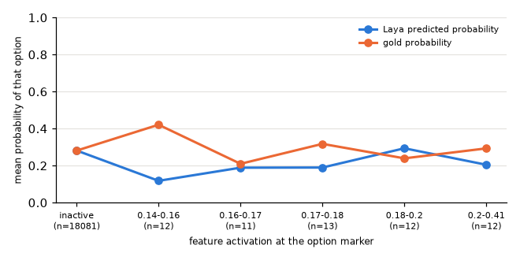

# Feature 8404

Critérios em que aparece: corr_error

**Interpretação (preencher):** 

---

## Maiores ativações

**tr_customer_service_000289 / action** (choice, customer_service) | ativação 2.307 em `estado` | opções ['answer_directly', 'close_no_action', 'escalate_to_human', 'execute_refund', 'request_information'] | Laya: **answer_directly** [0.786, 0.175, 0.005, 0.026, 0.008] | gabarito: **request_information**

```
<bos> choice question: What should the assistant do next with this conversation?<eos>
▸ <mask> answer_directly: The assistant can resolve this itself with information it already has.
▸ <mask> close_no_action: No further action is warranted; the matter is settled.
▸ <mask> escalate_to_human: Hand off to a human agent with the appropriate authority.
▸ <mask> execute_refund: Issue the refund or credit the customer is owed.
▸ <mask> request_information: More detail is needed from the customer before anything can be done.

<eos>

 {"account": {"lifetime_value_usd": 1589, "prior_tickets_90d": 0, "seats": 12, "tenure_months": 19, "tier": "premium"}, "thread": [{"role": "customer", "text": "The recurring payment for my premium subscription failed this morning. The card on file is active and has sufficient funds."}, {"role": "agent", "text": "I can certainly look into that for you. Could you please confirm the last four digits of the card you are currently using for this subscription?"}, {"role": "customer", "text": "The card ends in 1004. I have already verified with my bank that there are no blocks or restrictions on this account."}, {"role": "agent", "text": "Thank you for checking that. Are you seeing a specific error code in your billing dashboard, or did you only receive a generic failure notification via email?"}, {"role": "customer", "text": "The dashboard only indicates⟦ that⟧ the transaction was declined without providing a specific code. I need to know why the system is rejecting it."}]}<eos>
```

**tr_customer_service_000289 / category** (choice, customer_service) | ativação 2.299 em `estado` | opções ['account', 'billing', 'delivery', 'refund', 'technical'] | Laya: **billing** [0.0, 0.999, 0.0, 0.0, 0.0] | gabarito: **billing**

```
<bos> choice question: What is this customer conversation primarily about?<eos>
▸ <mask> account: Login, plan changes, profile or access management.
▸ <mask> billing: A charge, invoice, subscription or payment problem.
▸ <mask> delivery: Shipping, fulfilment or delivery of a physical item.
▸ <mask> refund: The customer is explicitly asking for money back.
▸ <mask> technical: The product or service is not working as expected.

<eos>

 {"account": {"lifetime_value_usd": 1589, "prior_tickets_90d": 0, "seats": 12, "tenure_months": 19, "tier": "premium"}, "thread": [{"role": "customer", "text": "The recurring payment for my premium subscription failed this morning. The card on file is active and has sufficient funds."}, {"role": "agent", "text": "I can certainly look into that for you. Could you please confirm the last four digits of the card you are currently using for this subscription?"}, {"role": "customer", "text": "The card ends in 1004. I have already verified with my bank that there are no blocks or restrictions on this account."}, {"role": "agent", "text": "Thank you for checking that. Are you seeing a specific error code in your billing dashboard, or did you only receive a generic failure notification via email?"}, {"role": "customer", "text": "The dashboard only indicates⟦ that⟧ the transaction was declined without providing a specific code. I need to know why the system is rejecting it."}]}<eos>
```

**tr_customer_service_000289 / churn_risk** (score, customer_service) | ativação 2.268 em `estado` | opções ['0', '1', '2', '3'] | Laya: **1** [0.145, 0.498, 0.272, 0.085] | gabarito: **1**

```
<bos> score question: How likely is this customer to stop doing business with us because of this interaction?<eos>
▸ <mask> level 0: No sign of dissatisfaction.
▸ <mask> level 1: Mild frustration, but the relationship is intact.
▸ <mask> level 2: Clearly unhappy; repeat problems or explicit complaints.
▸ <mask> level 3: Imminent: threatening to cancel, dispute or leave.

<eos>

 {"account": {"lifetime_value_usd": 1589, "prior_tickets_90d": 0, "seats": 12, "tenure_months": 19, "tier": "premium"}, "thread": [{"role": "customer", "text": "The recurring payment for my premium subscription failed this morning. The card on file is active and has sufficient funds."}, {"role": "agent", "text": "I can certainly look into that for you. Could you please confirm the last four digits of the card you are currently using for this subscription?"}, {"role": "customer", "text": "The card ends in 1004. I have already verified with my bank that there are no blocks or restrictions on this account."}, {"role": "agent", "text": "Thank you for checking that. Are you seeing a specific error code in your billing dashboard, or did you only receive a generic failure notification via email?"}, {"role": "customer", "text": "The dashboard only indicates⟦ that⟧ the transaction was declined without providing a specific code. I need to know why the system is rejecting it."}]}<eos>
```

**tr_customer_service_000131 / action** (choice, customer_service) | ativação 2.184 em `estado` | opções ['answer_directly', 'close_no_action', 'escalate_to_human', 'execute_refund', 'request_information'] | Laya: **answer_directly** [0.79, 0.137, 0.023, 0.026, 0.023] | gabarito: **request_information**

```
<bos> choice question: What should the assistant do next with this conversation?<eos>
▸ <mask> answer_directly: The assistant can resolve this itself with information it already has.
▸ <mask> close_no_action: No further action is warranted; the matter is settled.
▸ <mask> escalate_to_human: Hand off to a human agent with the appropriate authority.
▸ <mask> execute_refund: Issue the refund or credit the customer is owed.
▸ <mask> request_information: More detail is needed from the customer before anything can be done.

<eos>

 {"account": {"lifetime_value_usd": 1583, "prior_tickets_90d": 2, "seats": 1, "tenure_months": 72, "tier": "standard"}, "orders": [{"amount_usd": 299, "date": "2026-02-13", "id": "A-60442", "status": "failed"}], "thread": [{"role": "customer", "text": "Good afternoon, I’ve noticed⟦ that⟧ my recent payment for the standard plan didn’t go through. I’ve been subscribed for six years now, and I’ve previously raised two tickets about billing that were only partially resolved."}, {"role": "agent", "text": "I’m sorry for the inconvenience. Could you provide the date of the attempted transaction and any reference number you received?"}, {"role": "customer", "text": "The payment attempt was on August 10, and the reference number shown on my bank statement is TXN‑20230810‑001. Please advise what steps we should take next."}]}<eos>
```

**tr_customer_service_000289 / urgency** (score, customer_service) | ativação 2.146 em `estado` | opções ['0', '1', '2', '3'] | Laya: **1** [0.082, 0.509, 0.193, 0.216] | gabarito: **2**

```
<bos> score question: How time-sensitive is this conversation?<eos>
▸ <mask> level 0: No time pressure; can wait indefinitely.
▸ <mask> level 1: Routine; handle within the normal queue.
▸ <mask> level 2: Elevated; should be handled within the same week.
▸ <mask> level 3: Critical; requires action within the same day.

<eos>

 {"account": {"lifetime_value_usd": 1589, "prior_tickets_90d": 0, "seats": 12, "tenure_months": 19, "tier": "premium"}, "thread": [{"role": "customer", "text": "The recurring payment for my premium subscription failed this morning. The card on file is active and has sufficient funds."}, {"role": "agent", "text": "I can certainly look into that for you. Could you please confirm the last four digits of the card you are currently using for this subscription?"}, {"role": "customer", "text": "The card ends in 1004. I have already verified with my bank that there are no blocks or restrictions on this account."}, {"role": "agent", "text": "Thank you for checking that. Are you seeing a specific error code in your billing dashboard, or did you only receive a generic failure notification via email?"}, {"role": "customer", "text": "The dashboard only indicates⟦ that⟧ the transaction was declined without providing a specific code. I need to know why the system is rejecting it."}]}<eos>
```

## Ativações medianas (faixa 40-60%, mediana 0.518)

**tr_invoice_processing_000276 / urgency** (score, invoice_processing) | ativação 0.478 em `pergunta` | opções ['0', '1', '2', '3'] | Laya: **1** [0.111, 0.42, 0.243, 0.225] | gabarito: **3**

```
<bos> score question:⟦ How⟧ time-sensitive is processing this invoice?<eos>
▸ <mask> level 0: No time pressure; can wait indefinitely.
▸ <mask> level 1: Routine; handle within the normal queue.
▸ <mask> level 2: Elevated; should be handled within the same week.
▸ <mask> level 3: Critical; requires action within the same day.

<eos>

 {"delivery": {"condition": "accepted", "date": "2026-03-02", "received_qty": 25}, "invoice": {"currency": "USD", "id": "INV-2026-4114", "lines": [{"qty": 25, "sku": "SKU-776", "total_usd": 6578.75, "unit_usd": 263.15}], "total_usd": 6578.75, "vendor": "Acme Fabrication"}, "payment": {"days_until_due": 0, "discount_expires_in_days": null, "early_payment_discount_pct": null, "status": "scheduled", "terms": "net 15"}, "purchase_order": {"freight_terms": "freight prepaid by vendor, not separately billable", "id": null, "lines": [{"qty": 25, "unit_usd": 263.15}], "total_usd": 6578.75}, "vendor_history": {"disputes_12m": 0, "invoices_12m": 8, "prior_invoice_ids": ["INV-2026-5447", "INV-2026-7281", "INV-2026-3201"]}}<eos>
```

**tr_customer_service_000256 / needs_human** (noul, customer_service) | ativação 0.616 em `pergunta` | opções ['false', 'true'] | Laya: **true** [0.342, 0.658] | gabarito: **true**

```
<bos> noul question: This conversation requires⟦ a⟧ human agent rather than automated handling.<eos>
▸ <mask> false: Automation can carry this to resolution.
▸ <mask> true: A human must take over: judgement, authority or empathy is required.

<eos>

 {"account": {"lifetime_value_usd": 2574, "prior_tickets_90d": 5, "seats": 1, "tenure_months": 41, "tier": "premium"}, "orders": [{"amount_usd": 29, "date": "2026-03-10", "id": "A-42352", "status": "settled"}, {"amount_usd": 29, "date": "2026-03-26", "id": "A-82362", "status": "pending"}], "thread": [{"role": "customer", "text": "I’m done waiting for my refund. It’s been weeks and you keep giving me the run‑around—I’m ready to cancel my premium plan and take my business elsewhere."}, {"role": "agent", "text": "I understand how frustrating this is. Could you provide the transaction ID so I can locate the refund request?"}, {"role": "customer", "text": "The ID is TXN-987654321. Fix this now or I’m out."}]}<eos>
```

**tr_security_incidents_000040 / credential_compromise** (noul, security_incidents) | ativação 0.568 em `estado` | opções ['false', 'true'] | Laya: **true** [0.038, 0.962] | gabarito: **false**

```
<bos> noul question: The evidence indicates a credential or account has been compromised.<eos>
▸ <mask> false: no, the statement does not hold
▸ <mask> true: yes, the statement holds

<eos>

 {"alert": {"description": "an account granted itself or received elevated permissions", "evidence": "Security logs on 2026-09-16 08:45:12 UTC show employee user jdoe being added⟦ to⟧ the local Administrators group on workstation LAPTOP-23. The account originally held unprivileged rights, MFA is enabled, and its credentials were refreshed 30 days earlier. The change originated from an allowlisted source.", "rule": "privilege_escalation"}, "context": {"asset_criticality": "medium", "change_window_active": false, "source_on_allowlist": true}, "history": {"credential_rotation_days_ago": 30, "distinct_countries_30d": 4, "logins_30d": 659, "prior_alerts_90d": 0}, "principal": {"mfa_enrolled": true, "name": "usr-deploy-272", "privileges": ["repo:read"], "type": "employee"}}<eos>
```

**tr_customer_service_000004 / needs_human** (noul, customer_service) | ativação 0.573 em `estado` | opções ['false', 'true'] | Laya: **true** [0.319, 0.681] | gabarito: **true**

```
<bos> noul question: This conversation requires a human agent rather than automated handling.<eos>
▸ <mask> false: Automation can carry this to resolution.
▸ <mask> true: A human must take over: judgement, authority or empathy is required.

<eos>

 {"account": {"lifetime_value_usd": 3018, "prior_tickets_90d": 1, "seats": 1, "tenure_months": 60, "tier": "premium"}, "orders": [⟦{"⟧amount_usd": 147, "date": "2026-02-10", "id": "A-12312", "status": "settled"}, {"amount_usd": 147, "date": "2026-02-24", "id": "A-70365", "status": "refunded"}], "thread": [{"role": "customer", "text": "I'm back again because I still can't get into my account, and honestly, after the last ticket didn't go anywhere, I'm just expecting more of the same login loops."}]}<eos>
```

**tr_security_incidents_000203 / true_positive** (noul, security_incidents) | ativação 0.583 em `estado` | opções ['false', 'true'] | Laya: **true** [0.011, 0.989] | gabarito: **true**

```
<bos> noul question: This alert reflects genuinely malicious or unauthorised activity.<eos>
▸ <mask> false: Benign activity, a misconfiguration, or a known false positive.
▸ <mask> true: The underlying behaviour is malicious or unauthorised.

<eos>

 {"alert": {"description": "an endpoint agent matched a known signature", "evidence":⟦ "⟧The endpoint agent on a CI runner detected a file matching a known malware signature. This activity originated from an unrecognized source outside of any scheduled change window.", "rule": "malware_signature"}, "context": {"asset_criticality": "high", "change_window_active": false, "source_on_allowlist": false}, "history": {"credential_rotation_days_ago": 30, "distinct_countries_30d": 1, "logins_30d": 1180, "prior_alerts_90d": 0}, "principal": {"mfa_enrolled": true, "name": "usr-billing-596", "privileges": ["repo:read"], "type": "ci_runner"}}<eos>
```

## Estatísticas (conjunto de descoberta, dev e teste)

**pred / error**

| split | decisões | ativas | ativas e Laya errou | taxa | lift | q (BH) | OR (CMH) | q (CMH) |
|---|---|---|---|---|---|---|---|---|
| discovery | 5100 | 12 | 12 | 1.000 | 1.55 | nan | nan | nan |
| dev | 900 | 5 | 2 | 0.400 | 0.60 | nan | nan | nan |
| test | 2000 | 7 | 7 | 1.000 | 1.54 | nan | nan | nan |

**corr / error**

| split | decisões | ativas | ativas e Laya errou | taxa | lift | q (BH) | OR (CMH) | q (CMH) |
|---|---|---|---|---|---|---|---|---|
| discovery | 5100 | 21 | 21 | 1.000 | 1.55 | 0.000326 | inf | 0.747 |
| dev | 900 | 5 | 2 | 0.400 | 0.60 | nan | nan | nan |
| test | 2000 | 10 | 10 | 1.000 | 1.54 | nan | nan | nan |

**state / error**

| split | decisões | ativas | ativas e Laya errou | taxa | lift | q (BH) | OR (CMH) | q (CMH) |
|---|---|---|---|---|---|---|---|---|
| discovery | 5100 | 663 | 417 | 0.629 | 0.98 | 0.6 | 1.08 | 0.752 |
| dev | 900 | 92 | 57 | 0.620 | 0.92 | 0.662 | 0.90 | 0.881 |
| test | 2000 | 293 | 193 | 0.659 | 1.01 | 0.981 | 1.28 | 0.439 |

**pred / probe_right_laya_wrong**

| split | decisões | ativas | ativas e Laya errou | taxa | lift | q (BH) | OR (CMH) | q (CMH) |
|---|---|---|---|---|---|---|---|---|
| discovery | 2819 | 6 | 6 | 1.000 | 1.55 | nan | nan | nan |
| dev | 520 | 3 | 2 | 0.667 | 0.99 | nan | nan | nan |
| test | 1106 | 6 | 6 | 1.000 | 1.58 | nan | nan | nan |

**corr / probe_right_laya_wrong**

| split | decisões | ativas | ativas e Laya errou | taxa | lift | q (BH) | OR (CMH) | q (CMH) |
|---|---|---|---|---|---|---|---|---|
| discovery | 2819 | 17 | 17 | 1.000 | 1.55 | nan | nan | nan |
| dev | 520 | 3 | 2 | 0.667 | 0.99 | nan | nan | nan |
| test | 1106 | 6 | 6 | 1.000 | 1.58 | nan | nan | nan |

**state / probe_right_laya_wrong**

| split | decisões | ativas | ativas e Laya errou | taxa | lift | q (BH) | OR (CMH) | q (CMH) |
|---|---|---|---|---|---|---|---|---|
| discovery | 2819 | 413 | 256 | 0.620 | 0.96 | 0.357 | 1.17 | 0.495 |
| dev | 520 | 51 | 29 | 0.569 | 0.84 | 0.42 | 0.91 | 0.903 |
| test | 1106 | 170 | 107 | 0.629 | 0.99 | 1 | 1.59 | 0.156 |

Confusão mais sobre-representada (pred): `severity|1>3` (n=7, lift 41.90, p=nan). Formato `pergunta|índice previsto>índice correto`.

Confusão mais sobre-representada (corr): `severity|1>3` (n=11, lift 37.63, p=5.38e-16). Formato `pergunta|índice previsto>índice correto`.

Confusão mais sobre-representada (state): `disposition|3>2` (n=53, lift 2.43, p=1.5e-10). Formato `pergunta|índice previsto>índice correto`.



