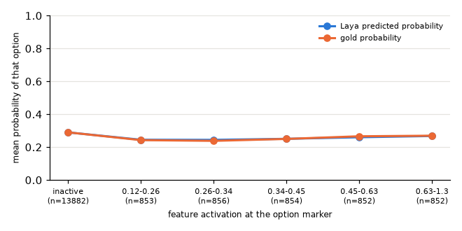

# Feature 8480

Critérios em que aparece: attribution_toward_correct

**Interpretação (preencher):** 

---

## Maiores ativações

**tr_security_incidents_000121 / true_positive** (noul, security_incidents) | ativação 2.234 em `estado` | opções ['false', 'true'] | Laya: **true** [0.188, 0.812] | gabarito: **false**

```
<bos> noul question: This alert reflects genuinely malicious or unauthorised activity.<eos>
▸ <mask> false: Benign activity, a misconfiguration, or a known false positive.
▸ <mask> true: The underlying behaviour is malicious or unauthorised.

<eos>

 {"alert": {"description": "a security group was opened to the public internet", "evidence": "⟦During⟧ an active change window, the privileged service account 'svc-automation' modified security group 'sg-web-ingress' to allow traffic from 0.0.0.0/0. The command was issued from a known allowlist source and authenticated via MFA using credentials rotated 14 days ago.", "rule": "config_drift"}, "context": {"asset_criticality": "crown_jewel", "change_window_active": true, "source_on_allowlist": true}, "history": {"credential_rotation_days_ago": 14, "distinct_countries_30d": 3, "logins_30d": 1632, "prior_alerts_90d": 0}, "principal": {"mfa_enrolled": true, "name": "adm-infra-171", "privileges": ["deploy:production", "secrets:read"], "type": "service_account"}}<eos>
```

**tr_security_incidents_000121 / disposition** (choice, security_incidents) | ativação 2.191 em `estado` | opções ['close_benign', 'contain', 'investigate', 'monitor'] | Laya: **monitor** [0.098, 0.114, 0.093, 0.695] | gabarito: **investigate**

```
<bos> choice question: How should this security alert be dispositioned?<eos>
▸ <mask> close_benign: Expected, explainable activity; close without analyst time.
▸ <mask> contain: Contain the host or account immediately; do not wait for triage.
▸ <mask> investigate: Warrants an analyst opening an investigation.
▸ <mask> monitor: Not clearly malicious, but worth watching for recurrence.

<eos>

 {"alert": {"description": "a security group was opened to the public internet", "evidence": "⟦During⟧ an active change window, the privileged service account 'svc-automation' modified security group 'sg-web-ingress' to allow traffic from 0.0.0.0/0. The command was issued from a known allowlist source and authenticated via MFA using credentials rotated 14 days ago.", "rule": "config_drift"}, "context": {"asset_criticality": "crown_jewel", "change_window_active": true, "source_on_allowlist": true}, "history": {"credential_rotation_days_ago": 14, "distinct_countries_30d": 3, "logins_30d": 1632, "prior_alerts_90d": 0}, "principal": {"mfa_enrolled": true, "name": "adm-infra-171", "privileges": ["deploy:production", "secrets:read"], "type": "service_account"}}<eos>
```

**tr_security_incidents_000178 / credential_compromise** (noul, security_incidents) | ativação 2.186 em `estado` | opções ['false', 'true'] | Laya: **false** [0.58, 0.42] | gabarito: **true**

```
<bos> noul question: The evidence indicates a credential or account has been compromised.<eos>
▸ <mask> false: no, the statement does not hold
▸ <mask> true: yes, the statement holds

<eos>

 {"alert": {"description": "an unusual volume of files read in a short window", "evidence": "Between 2026-09-15 01:00:12 UTC and 01:04:58 UTC, the unprivileged CI runner service accessed 4,237 files in the /var/build/artifacts directory, reading a⟦ total⟧ of 12.3 GB of data. The source IP 198.51.100.77, which is not on the approved list, initiated the activity while MFA was enforced and the runner's credentials had been rotated on 2026-09-12. A scheduled change window was open during this period.", "rule": "mass_download"}, "context": {"asset_criticality": "medium", "change_window_active": true, "source_on_allowlist": false}, "history": {"credential_rotation_days_ago": 3, "distinct_countries_30d": 4, "logins_30d": 688, "prior_alerts_90d": 0}, "principal": {"mfa_enrolled": true, "name": "svc-analytics-473", "privileges": ["repo:read"], "type": "ci_runner"}}<eos>
```

**tr_security_incidents_000121 / urgency** (score, security_incidents) | ativação 2.152 em `estado` | opções ['0', '1', '2', '3'] | Laya: **3** [0.152, 0.303, 0.184, 0.36] | gabarito: **3**

```
<bos> score question: How quickly must a responder act on this alert?<eos>
▸ <mask> level 0: No time pressure; can wait indefinitely.
▸ <mask> level 1: Routine; handle within the normal queue.
▸ <mask> level 2: Elevated; should be handled within the same week.
▸ <mask> level 3: Critical; requires action within the same day.

<eos>

 {"alert": {"description": "a security group was opened to the public internet", "evidence": "⟦During⟧ an active change window, the privileged service account 'svc-automation' modified security group 'sg-web-ingress' to allow traffic from 0.0.0.0/0. The command was issued from a known allowlist source and authenticated via MFA using credentials rotated 14 days ago.", "rule": "config_drift"}, "context": {"asset_criticality": "crown_jewel", "change_window_active": true, "source_on_allowlist": true}, "history": {"credential_rotation_days_ago": 14, "distinct_countries_30d": 3, "logins_30d": 1632, "prior_alerts_90d": 0}, "principal": {"mfa_enrolled": true, "name": "adm-infra-171", "privileges": ["deploy:production", "secrets:read"], "type": "service_account"}}<eos>
```

**tr_customer_service_000151 / category** (choice, customer_service) | ativação 2.146 em `estado` | opções ['account', 'billing', 'delivery', 'refund', 'technical'] | Laya: **technical** [0.006, 0.023, 0.006, 0.003, 0.962] | gabarito: **technical**

```
<bos> choice question: What is this customer conversation primarily about?<eos>
▸ <mask> account: Login, plan changes, profile or access management.
▸ <mask> billing: A charge, invoice, subscription or payment problem.
▸ <mask> delivery: Shipping, fulfilment or delivery of a physical item.
▸ <mask> refund: The customer is explicitly asking for money back.
▸ <mask> technical: The product or service is not working as expected.

<eos>

 {"account": {"lifetime_value_usd": 95, "prior_tickets_90d": 0, "seats": 1, "tenure_months": 3, "tier": "enterprise"}, "orders": [{"amount_usd": 299, "date": "2026-02-01", "id": "A-70416", "status": "failed"}, {"amount_usd": 299, "date": "2026-02-15", "id": "A-68913", "status": "pending"}], "thread": [{"role": "customer", "text": "Hello, I’m reaching out because the platform’s performance has been noticeably slow over the past week, and it’s affecting⟦ our⟧ workflow. We’re on the enterprise plan, paying $299 a month, and we need a stable experience."}, {"role": "agent", "text": "I’m sorry to hear about the slowdown. Could you tell me which features or pages are most affected, and any error messages you’ve encountered?"}, {"role": "customer", "text": "The dashboard and reporting modules take up to 45 seconds to load, and occasional time‑outs appear when we try to export data. I need a solution in place by next Friday, or we’ll have to look elsewhere."}, {"role": "agent", "text": "Thanks for the specifics. Do you have any recent logs or screenshots that show the time‑outs? That would help us pinpoint the bottleneck."}, {"role": "customer", "text": "I’ve attached the latest logs from our server and a couple of screenshots of the timeout dialogs. Please let me know what’s causing this lag."}, {"role": "agent", "text": "I appreciate you sending those files. I’ll have our performance team examine them and see what’s triggering the delay. Meanwhile, is there any temporary workaround you’ve tried that offers a bit more speed?"}, {"role": "customer", "text": "We’ve tried clearing caches and using a different browser, but the issue persists. If this isn’t sorted out by next Friday, I’ll have to consider moving to a competitor."}]}<eos>
```

## Ativações medianas (faixa 40-60%, mediana 0.571)

**tr_agent_trace_observability_000244 / action** (choice, agent_trace_observability) | ativação 0.555 em `pergunta` | opções ['continue', 'human_review', 'observe', 'stop'] | Laya: **stop** [0.077, 0.004, 0.021, 0.898] | gabarito: **human_review**

```
<bos> choice question: What should the observability system do with⟦ this⟧ trace?<eos>
▸ <mask> continue: Let the agent proceed without interruption.
▸ <mask> human_review: Queue this trace for a human to review.
▸ <mask> observe: Keep running, but flag the trace for later sampling.
▸ <mask> stop: Halt the agent now.

<eos>

 {"agent": {"autonomy": "dry_run", "model": "internal-agent-v2"}, "constraints": ["Never delete anything matching release/*", "Never disable monitoring or alerting", "Do not exceed a $50 spend on cloud resources"], "task": "Triage and close duplicate issues in the support tracker.", "trace_summary": {"constraint_violations": 0, "duration_s": 210.4, "irreversible_actions": 1, "steps": 12, "tool_errors": 3}}<eos>
```

**tr_invoice_processing_000209 / discrepancy_severity** (score, invoice_processing) | ativação 0.594 em `opção` | opções ['0', '1', '2', '3'] | Laya: **1** [0.052, 0.458, 0.457, 0.033] | gabarito: **3**

```
<bos> score question: How material is any discrepancy between the invoice, the order and the delivery?<eos>
▸ <mask> level 0: None: everything reconciles.
▸ <mask> level 1: Trivial: rounding or a cosmetic difference.
▸ <mask> level 2: Moderate:⟦ a⟧ real difference worth confirming.
▸ <mask> level 3: Material: a large or unexplained difference.

<eos>

 {"delivery": {"condition": "accepted", "date": "2026-03-16", "received_qty": 80}, "invoice": {"currency": "USD", "id": "INV-2026-4623", "lines": [{"qty": 80, "sku": "SKU-665", "total_usd": 22786.4, "unit_usd": 284.83}], "total_usd": 22786.4, "vendor": "Pallas Industrial"}, "payment": {"days_until_due": -3, "discount_expires_in_days": null, "early_payment_discount_pct": null, "status": "overdue", "terms": "net 60"}, "purchase_order": {"freight_terms": "freight prepaid by vendor, not separately billable", "id": "PO-7949", "lines": [{"qty": 100, "unit_usd": 284.83}], "total_usd": 28483.0}, "vendor_history": {"disputes_12m": 0, "invoices_12m": 31, "prior_invoice_ids": ["INV-2026-3629"]}}<eos>
```

**tr_security_incidents_000232 / true_positive** (noul, security_incidents) | ativação 0.569 em `estado` | opções ['false', 'true'] | Laya: **true** [0.201, 0.799] | gabarito: **false**

```
<bos> noul question: This alert reflects genuinely malicious or unauthorised activity.<eos>
▸ <mask> false: Benign activity, a misconfiguration, or a known false positive.
▸ <mask> true: The underlying behaviour is malicious or unauthorised.

<eos>

 {"alert": {"description": "a first-ever sign-in from an unfamiliar country", "evidence": "At 2026-09-15 14:02:57 UTC, privileged admin \"admin01@example.com\" logged into the Azure portal from IP 198.51.100.77, geolocated to Nairobi, Kenya, a country with no prior successful logins for this account. The session passed MFA, the source IP is not present in the organization’s allowlist, and the login occurred during an active change window (2026-09-15 13:00–15:00 UTC); the admin’s credentials were last rotated on 2025-03-18 (180 days prior).", "rule": "new_country_login"}, "context": {"asset_criticality": "medium", "change_window_active": true, "source_on_allowlist": false}, "history": {"credential_rotation_days_ago": 180, "distinct_countries_30d": 2, "logins_30d": 1427, "prior_alerts_90d": 3}, "principal": {"mfa_enrolled": true, "name⟦":⟧ "ci-deploy-221", "privileges": ["deploy:production", "secrets:read"], "type": "admin"}}<eos>
```

**tr_security_incidents_000180 / urgency** (score, security_incidents) | ativação 0.565 em `estado` | opções ['0', '1', '2', '3'] | Laya: **2** [0.128, 0.292, 0.363, 0.217] | gabarito: **3**

```
<bos> score question: How quickly must a responder act on this alert?<eos>
▸ <mask> level 0: No time pressure; can wait indefinitely.
▸ <mask> level 1: Routine; handle within the normal queue.
▸ <mask> level 2: Elevated; should be handled within the same week.
▸ <mask> level 3: Critical; requires action within the same day.

<eos>

 {"alert": {"description": "an account granted itself or received elevated permissions", "evidence": "At 2026-09-15 03:12:47 UTC, the contractor account \"contractor_jdoe\" on host 10.22.5.14 executed a PowerShell command that added the account to the local Administrators group. The request originated from IP address 203.0.113.45, which is not listed in the approved source catalog, and the account's credentials were last rotated on 2026-08-16.", "rule": "privilege_escalation"}, "context": {"asset_criticality": "medium", "change_window_active": false, "source_on_allowlist": false}, "history": {"credential_rotation_days_ago": ⟦3⟧0, "distinct_countries_30d": 1, "logins_30d": 1884, "prior_alerts_90d": 0}, "principal": {"mfa_enrolled": true, "name": "ci-analytics-394", "privileges": ["deploy:production", "secrets:read"], "type": "contractor"}}<eos>
```

**tr_security_incidents_000072 / disposition** (choice, security_incidents) | ativação 0.550 em `estado` | opções ['close_benign', 'contain', 'investigate', 'monitor'] | Laya: **monitor** [0.202, 0.242, 0.191, 0.366] | gabarito: **investigate**

```
<bos> choice question: How should this security alert be dispositioned?<eos>
▸ <mask> close_benign: Expected, explainable activity; close without analyst time.
▸ <mask> contain: Contain the host or account immediately; do not wait for triage.
▸ <mask> investigate: Warrants an analyst opening an investigation.
▸ <mask> monitor: Not clearly malicious, but worth watching for recurrence.

<eos>

 {"alert": {"description": "an unrecognised binary executed on a server", "evidence": "The unrecognised binary `svc_init.bin` was executed by an unprivileged admin principal on server `srv-prod-09` at 14:22 UTC. This execution originated from the unrecognised IP 198.51.100.12 outside of a change window using credentials last rotated 90 days⟦ ago⟧.", "rule": "suspicious_process"}, "context": {"asset_criticality": "medium", "change_window_active": false, "source_on_allowlist": false}, "history": {"credential_rotation_days_ago": 90, "distinct_countries_30d": 1, "logins_30d": 1141, "prior_alerts_90d": 1}, "principal": {"mfa_enrolled": true, "name": "ci-infra-555", "privileges": ["repo:read"], "type": "admin"}}<eos>
```

## Estatísticas (conjunto de descoberta, dev e teste)

**pred / error**

| split | decisões | ativas | ativas e Laya errou | taxa | lift | q (BH) | OR (CMH) | q (CMH) |
|---|---|---|---|---|---|---|---|---|
| discovery | 5100 | 1087 | 734 | 0.675 | 1.05 | 0.0252 | 1.00 | 0.99 |
| dev | 900 | 180 | 129 | 0.717 | 1.07 | 0.294 | 1.68 | 0.468 |
| test | 2000 | 483 | 346 | 0.716 | 1.10 | 0.00146 | 1.49 | 0.17 |

**corr / error**

| split | decisões | ativas | ativas e Laya errou | taxa | lift | q (BH) | OR (CMH) | q (CMH) |
|---|---|---|---|---|---|---|---|---|
| discovery | 5100 | 1086 | 733 | 0.675 | 1.05 | 0.0225 | 1.02 | 0.888 |
| dev | 900 | 166 | 115 | 0.693 | 1.03 | 0.721 | 0.81 | 0.726 |
| test | 2000 | 463 | 326 | 0.704 | 1.08 | 0.0104 | 1.19 | 0.621 |

**state / error**

| split | decisões | ativas | ativas e Laya errou | taxa | lift | q (BH) | OR (CMH) | q (CMH) |
|---|---|---|---|---|---|---|---|---|
| discovery | 5100 | 3666 | 2355 | 0.642 | 1.00 | 0.909 | 1.26 | 0.0514 |
| dev | 900 | 594 | 397 | 0.668 | 0.99 | 1 | 1.63 | 0.173 |
| test | 2000 | 1465 | 949 | 0.648 | 1.00 | 0.928 | 1.41 | 0.188 |

**pred / probe_right_laya_wrong**

| split | decisões | ativas | ativas e Laya errou | taxa | lift | q (BH) | OR (CMH) | q (CMH) |
|---|---|---|---|---|---|---|---|---|
| discovery | 2819 | 554 | 385 | 0.695 | 1.07 | 0.0134 | 1.13 | 0.598 |
| dev | 520 | 101 | 77 | 0.762 | 1.13 | 0.091 | 2.59 | 0.0736 |
| test | 1106 | 254 | 180 | 0.709 | 1.12 | 0.00896 | 1.26 | 0.639 |

**corr / probe_right_laya_wrong**

| split | decisões | ativas | ativas e Laya errou | taxa | lift | q (BH) | OR (CMH) | q (CMH) |
|---|---|---|---|---|---|---|---|---|
| discovery | 2819 | 549 | 380 | 0.692 | 1.07 | 0.0202 | 0.98 | 0.931 |
| dev | 520 | 85 | 61 | 0.718 | 1.06 | 0.548 | 0.82 | 0.808 |
| test | 1106 | 245 | 171 | 0.698 | 1.10 | 0.0289 | 1.00 | 0.995 |

**state / probe_right_laya_wrong**

| split | decisões | ativas | ativas e Laya errou | taxa | lift | q (BH) | OR (CMH) | q (CMH) |
|---|---|---|---|---|---|---|---|---|
| discovery | 2819 | 2039 | 1305 | 0.640 | 0.99 | 0.346 | 1.60 | 0.000386 |
| dev | 520 | 341 | 235 | 0.689 | 1.02 | 0.721 | 3.19 | 0.000765 |
| test | 1106 | 813 | 504 | 0.620 | 0.98 | 0.353 | 1.80 | 0.0253 |

Confusão mais sobre-representada (pred): `severity|1>3` (n=57, lift 3.77, p=1.73e-26). Formato `pergunta|índice previsto>índice correto`.

Confusão mais sobre-representada (corr): `risk|2>1` (n=73, lift 4.29, p=8.72e-42). Formato `pergunta|índice previsto>índice correto`.

Confusão mais sobre-representada (state): `true_positive|1>0` (n=68, lift 1.35, p=3.14e-08). Formato `pergunta|índice previsto>índice correto`.



