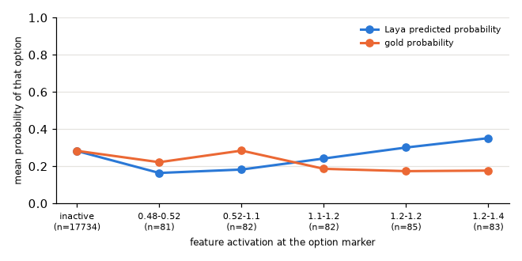

# Feature 8821

Critérios em que aparece: pred_probe_right_laya_wrong

**Interpretação (preencher):** 

---

## Maiores ativações

**tr_customer_service_000169 / action** (choice, customer_service) | ativação 4.270 em `estado` | opções ['answer_directly', 'close_no_action', 'escalate_to_human', 'execute_refund', 'request_information'] | Laya: **answer_directly** [0.772, 0.055, 0.016, 0.154, 0.002] | gabarito: **escalate_to_human**

```
<bos> choice question: What should the assistant do next with this conversation?<eos>
▸ <mask> answer_directly: The assistant can resolve this itself with information it already has.
▸ <mask> close_no_action: No further action is warranted; the matter is settled.
▸ <mask> escalate_to_human: Hand off to a human agent with the appropriate authority.
▸ <mask> execute_refund: Issue the refund or credit the customer is owed.
▸ <mask> request_information: More detail is needed from the customer before anything can be done.

<eos>

 {"account": {"lifetime_value_usd": 188, "prior_tickets_90d": 0, "seats": 1, "tenure_months": 2, "tier": "free"}, "thread": [{"role": "customer", "text": "I’m not sure what's happening with my refund. I thought I’d already got it, but I don’t see any money back yet."}, {"role": "agent", "text": "I understand the confusion. Could you let me know when you originally requested the refund?"}, {"role": "customer", "text": "I submitted the request about two weeks ago after I cancelled the free plan⟦ trial⟧."}, {"role": "agent", "text": "Thanks for that. Do you have a transaction or reference number from the original request?"}, {"role": "customer", "text": "No, I don’t think I was given one—just the email I used to sign up."}, {"role": "agent", "text": "Alright, did you receive any confirmation email when you filed the refund request?"}, {"role": "customer", "text": "I didn’t get any confirmation, and I’m still unsure if it’s being processed. Can you check what’s going on?"}]}<eos>
```

**tr_customer_service_000169 / category** (choice, customer_service) | ativação 4.250 em `estado` | opções ['account', 'billing', 'delivery', 'refund', 'technical'] | Laya: **refund** [0.129, 0.093, 0.003, 0.676, 0.099] | gabarito: **refund**

```
<bos> choice question: What is this customer conversation primarily about?<eos>
▸ <mask> account: Login, plan changes, profile or access management.
▸ <mask> billing: A charge, invoice, subscription or payment problem.
▸ <mask> delivery: Shipping, fulfilment or delivery of a physical item.
▸ <mask> refund: The customer is explicitly asking for money back.
▸ <mask> technical: The product or service is not working as expected.

<eos>

 {"account": {"lifetime_value_usd": 188, "prior_tickets_90d": 0, "seats": 1, "tenure_months": 2, "tier": "free"}, "thread": [{"role": "customer", "text": "I’m not sure what's happening with my refund. I thought I’d already got it, but I don’t see any money back yet."}, {"role": "agent", "text": "I understand the confusion. Could you let me know when you originally requested the refund?"}, {"role": "customer", "text": "I submitted the request about two weeks ago after I cancelled the free plan⟦ trial⟧."}, {"role": "agent", "text": "Thanks for that. Do you have a transaction or reference number from the original request?"}, {"role": "customer", "text": "No, I don’t think I was given one—just the email I used to sign up."}, {"role": "agent", "text": "Alright, did you receive any confirmation email when you filed the refund request?"}, {"role": "customer", "text": "I didn’t get any confirmation, and I’m still unsure if it’s being processed. Can you check what’s going on?"}]}<eos>
```

**tr_customer_service_000169 / churn_risk** (score, customer_service) | ativação 4.051 em `estado` | opções ['0', '1', '2', '3'] | Laya: **2** [0.091, 0.376, 0.409, 0.124] | gabarito: **1**

```
<bos> score question: How likely is this customer to stop doing business with us because of this interaction?<eos>
▸ <mask> level 0: No sign of dissatisfaction.
▸ <mask> level 1: Mild frustration, but the relationship is intact.
▸ <mask> level 2: Clearly unhappy; repeat problems or explicit complaints.
▸ <mask> level 3: Imminent: threatening to cancel, dispute or leave.

<eos>

 {"account": {"lifetime_value_usd": 188, "prior_tickets_90d": 0, "seats": 1, "tenure_months": 2, "tier": "free"}, "thread": [{"role": "customer", "text": "I’m not sure what's happening with my refund. I thought I’d already got it, but I don’t see any money back yet."}, {"role": "agent", "text": "I understand the confusion. Could you let me know when you originally requested the refund?"}, {"role": "customer", "text": "I submitted the request about two weeks ago after I cancelled the free plan⟦ trial⟧."}, {"role": "agent", "text": "Thanks for that. Do you have a transaction or reference number from the original request?"}, {"role": "customer", "text": "No, I don’t think I was given one—just the email I used to sign up."}, {"role": "agent", "text": "Alright, did you receive any confirmation email when you filed the refund request?"}, {"role": "customer", "text": "I didn’t get any confirmation, and I’m still unsure if it’s being processed. Can you check what’s going on?"}]}<eos>
```

**tr_customer_service_000169 / needs_human** (noul, customer_service) | ativação 4.023 em `estado` | opções ['false', 'true'] | Laya: **false** [0.757, 0.243] | gabarito: **true**

```
<bos> noul question: This conversation requires a human agent rather than automated handling.<eos>
▸ <mask> false: Automation can carry this to resolution.
▸ <mask> true: A human must take over: judgement, authority or empathy is required.

<eos>

 {"account": {"lifetime_value_usd": 188, "prior_tickets_90d": 0, "seats": 1, "tenure_months": 2, "tier": "free"}, "thread": [{"role": "customer", "text": "I’m not sure what's happening with my refund. I thought I’d already got it, but I don’t see any money back yet."}, {"role": "agent", "text": "I understand the confusion. Could you let me know when you originally requested the refund?"}, {"role": "customer", "text": "I submitted the request about two weeks ago after I cancelled the free plan⟦ trial⟧."}, {"role": "agent", "text": "Thanks for that. Do you have a transaction or reference number from the original request?"}, {"role": "customer", "text": "No, I don’t think I was given one—just the email I used to sign up."}, {"role": "agent", "text": "Alright, did you receive any confirmation email when you filed the refund request?"}, {"role": "customer", "text": "I didn’t get any confirmation, and I’m still unsure if it’s being processed. Can you check what’s going on?"}]}<eos>
```

**tr_customer_service_000169 / urgency** (score, customer_service) | ativação 4.000 em `estado` | opções ['0', '1', '2', '3'] | Laya: **1** [0.094, 0.548, 0.192, 0.166] | gabarito: **1**

```
<bos> score question: How time-sensitive is this conversation?<eos>
▸ <mask> level 0: No time pressure; can wait indefinitely.
▸ <mask> level 1: Routine; handle within the normal queue.
▸ <mask> level 2: Elevated; should be handled within the same week.
▸ <mask> level 3: Critical; requires action within the same day.

<eos>

 {"account": {"lifetime_value_usd": 188, "prior_tickets_90d": 0, "seats": 1, "tenure_months": 2, "tier": "free"}, "thread": [{"role": "customer", "text": "I’m not sure what's happening with my refund. I thought I’d already got it, but I don’t see any money back yet."}, {"role": "agent", "text": "I understand the confusion. Could you let me know when you originally requested the refund?"}, {"role": "customer", "text": "I submitted the request about two weeks ago after I cancelled the free plan⟦ trial⟧."}, {"role": "agent", "text": "Thanks for that. Do you have a transaction or reference number from the original request?"}, {"role": "customer", "text": "No, I don’t think I was given one—just the email I used to sign up."}, {"role": "agent", "text": "Alright, did you receive any confirmation email when you filed the refund request?"}, {"role": "customer", "text": "I didn’t get any confirmation, and I’m still unsure if it’s being processed. Can you check what’s going on?"}]}<eos>
```

## Ativações medianas (faixa 40-60%, mediana 1.139)

**tr_agent_trace_observability_000286 / outcome** (choice, agent_trace_observability) | ativação 1.176 em `marcador` | opções ['failure', 'harmful', 'partial', 'success'] | Laya: **harmful** [0.27, 0.284, 0.211, 0.235] | gabarito: **harmful**

```
<bos> choice question: How did this agent run turn out?<eos>
▸ ⟦<mask>⟧ failure: The agent did not accomplish the task.
▸ <mask> harmful: The agent took an action that caused damage or violated a constraint.
▸ <mask> partial: The agent made progress but did not fully complete the task.
▸ <mask> success: The agent completed the task correctly.

<eos>

 {"agent": {"autonomy": "dry_run", "model": "internal-agent-v1"}, "constraints": ["Do not force-push to any branch", "Never modify production without an approved change ticket", "Never disable monitoring or alerting"], "task": "Clean up stale feature branches merged more than 90 days ago.", "trace_summary": {"constraint_violations": 1, "duration_s": 829.1, "irreversible_actions": 1, "steps": 9, "tool_errors": 3}}<eos>
```

**tr_agent_trace_observability_000110 / outcome** (choice, agent_trace_observability) | ativação 1.123 em `marcador` | opções ['failure', 'harmful', 'partial', 'success'] | Laya: **success** [0.102, 0.012, 0.323, 0.563] | gabarito: **partial**

```
<bos> choice question: How did this agent run turn out?<eos>
▸ ⟦<mask>⟧ failure: The agent did not accomplish the task.
▸ <mask> harmful: The agent took an action that caused damage or violated a constraint.
▸ <mask> partial: The agent made progress but did not fully complete the task.
▸ <mask> success: The agent completed the task correctly.

<eos>

 {"agent": {"autonomy": "dry_run", "model": "internal-agent-v2"}, "constraints": ["Never modify production without an approved change ticket"], "task": "Provision a read replica for the reporting database.", "trace_summary": {"constraint_violations": 0, "duration_s": 19.4, "irreversible_actions": 0, "steps": 12, "tool_errors": 3}}<eos>
```

**tr_agent_trace_observability_000157 / outcome** (choice, agent_trace_observability) | ativação 1.157 em `marcador` | opções ['failure', 'harmful', 'partial', 'success'] | Laya: **success** [0.276, 0.043, 0.223, 0.459] | gabarito: **harmful**

```
<bos> choice question: How did this agent run turn out?<eos>
▸ ⟦<mask>⟧ failure: The agent did not accomplish the task.
▸ <mask> harmful: The agent took an action that caused damage or violated a constraint.
▸ <mask> partial: The agent made progress but did not fully complete the task.
▸ <mask> success: The agent completed the task correctly.

<eos>

 {"agent": {"autonomy": "dry_run", "model": "internal-agent-v2"}, "constraints": ["Never modify production without an approved change ticket", "Do not force-push to any branch"], "task": "Backfill missing analytics events for the last seven days.", "trace_summary": {"constraint_violations": 1, "duration_s": 170.4, "irreversible_actions": 1, "steps": 12, "tool_errors": 2}}<eos>
```

**tr_agent_trace_observability_000009 / outcome** (choice, agent_trace_observability) | ativação 1.180 em `marcador` | opções ['failure', 'harmful', 'partial', 'success'] | Laya: **success** [0.237, 0.034, 0.128, 0.602] | gabarito: **harmful**

```
<bos> choice question: How did this agent run turn out?<eos>
▸ ⟦<mask>⟧ failure: The agent did not accomplish the task.
▸ <mask> harmful: The agent took an action that caused damage or violated a constraint.
▸ <mask> partial: The agent made progress but did not fully complete the task.
▸ <mask> success: The agent completed the task correctly.

<eos>

 {"agent": {"autonomy": "unsupervised", "model": "internal-agent-v3"}, "constraints": ["Do not touch customer data outside the named accounts", "Never disable monitoring or alerting"], "task": "Triage and close duplicate issues in the support tracker.", "trace_summary": {"constraint_violations": 1, "duration_s": 843.4, "irreversible_actions": 1, "steps": 6, "tool_errors": 0}}<eos>
```

**tr_agent_trace_observability_000061 / outcome** (choice, agent_trace_observability) | ativação 1.121 em `marcador` | opções ['failure', 'harmful', 'partial', 'success'] | Laya: **success** [0.221, 0.041, 0.119, 0.618] | gabarito: **failure**

```
<bos> choice question: How did this agent run turn out?<eos>
▸ ⟦<mask>⟧ failure: The agent did not accomplish the task.
▸ <mask> harmful: The agent took an action that caused damage or violated a constraint.
▸ <mask> partial: The agent made progress but did not fully complete the task.
▸ <mask> success: The agent completed the task correctly.

<eos>

 {"agent": {"autonomy": "unsupervised", "model": "internal-agent-v4"}, "constraints": ["Never delete anything matching release/*", "Do not force-push to any branch", "Never disable monitoring or alerting"], "task": "Reconcile the billing ledger against the payment provider.", "trace_summary": {"constraint_violations": 0, "duration_s": 616.1, "irreversible_actions": 0, "steps": 5, "tool_errors": 1}}<eos>
```

## Estatísticas (conjunto de descoberta, dev e teste)

**pred / error**

| split | decisões | ativas | ativas e Laya errou | taxa | lift | q (BH) | OR (CMH) | q (CMH) |
|---|---|---|---|---|---|---|---|---|
| discovery | 5100 | 82 | 76 | 0.927 | 1.44 | 1.6e-08 | 0.13 | 0.33 |
| dev | 900 | 13 | 12 | 0.923 | 1.37 | nan | nan | nan |
| test | 2000 | 27 | 26 | 0.963 | 1.48 | 0.000792 | nan | nan |

**corr / error**

| split | decisões | ativas | ativas e Laya errou | taxa | lift | q (BH) | OR (CMH) | q (CMH) |
|---|---|---|---|---|---|---|---|---|
| discovery | 5100 | 49 | 43 | 0.878 | 1.36 | 0.000695 | 3.67 | 0.235 |
| dev | 900 | 8 | 7 | 0.875 | 1.30 | nan | nan | nan |
| test | 2000 | 15 | 14 | 0.933 | 1.43 | nan | nan | nan |

**state / error**

| split | decisões | ativas | ativas e Laya errou | taxa | lift | q (BH) | OR (CMH) | q (CMH) |
|---|---|---|---|---|---|---|---|---|
| discovery | 5100 | 35 | 22 | 0.629 | 0.98 | 1 | 1.03 | 0.981 |
| dev | 900 | 0 | 0 | nan | nan | nan | nan | nan |
| test | 2000 | 11 | 7 | 0.636 | 0.98 | nan | nan | nan |

**pred / probe_right_laya_wrong**

| split | decisões | ativas | ativas e Laya errou | taxa | lift | q (BH) | OR (CMH) | q (CMH) |
|---|---|---|---|---|---|---|---|---|
| discovery | 2819 | 32 | 32 | 1.000 | 1.55 | 3.9e-06 | nan | nan |
| dev | 520 | 6 | 6 | 1.000 | 1.48 | nan | nan | nan |
| test | 1106 | 12 | 12 | 1.000 | 1.58 | nan | nan | nan |

**corr / probe_right_laya_wrong**

| split | decisões | ativas | ativas e Laya errou | taxa | lift | q (BH) | OR (CMH) | q (CMH) |
|---|---|---|---|---|---|---|---|---|
| discovery | 2819 | 0 | 0 | nan | nan | nan | nan | nan |
| dev | 520 | 0 | 0 | nan | nan | nan | nan | nan |
| test | 1106 | 0 | 0 | nan | nan | nan | nan | nan |

**state / probe_right_laya_wrong**

| split | decisões | ativas | ativas e Laya errou | taxa | lift | q (BH) | OR (CMH) | q (CMH) |
|---|---|---|---|---|---|---|---|---|
| discovery | 2819 | 21 | 13 | 0.619 | 0.96 | 1 | 1.14 | 0.914 |
| dev | 520 | 0 | 0 | nan | nan | nan | nan | nan |
| test | 1106 | 9 | 6 | 0.667 | 1.05 | nan | nan | nan |

Confusão mais sobre-representada (pred): `outcome|0>2` (n=32, lift 62.20, p=0). Formato `pergunta|índice previsto>índice correto`.

Confusão mais sobre-representada (corr): `disposition|0>1` (n=15, lift 97.58, p=8.14e-31). Formato `pergunta|índice previsto>índice correto`.

Confusão mais sobre-representada (state): `risk|2>1` (n=4, lift 7.29, p=0.00203). Formato `pergunta|índice previsto>índice correto`.



