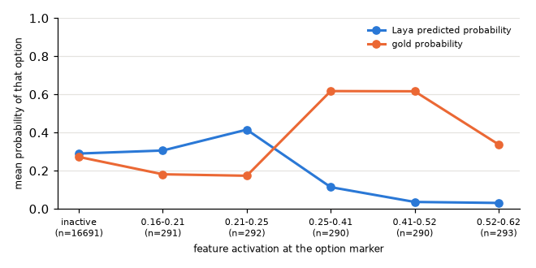

# Feature 8845

Critérios em que aparece: corr_error_stratified, corr_probe_right_laya_wrong_stratified

**Interpretação (preencher):** 

---

## Maiores ativações

**tr_security_incidents_000167 / severity** (score, security_incidents) | ativação 1.094 em `estado` | opções ['0', '1', '2', '3', '4'] | Laya: **1** [0.111, 0.346, 0.282, 0.095, 0.166] | gabarito: **2**

```
<bos> score question: How severe is the potential impact if this alert is real?<eos>
▸ <mask> level 0: Negligible: no access to anything sensitive.
▸ <mask> level 1: Low: limited access, easily reversed.
▸ <mask> level 2: Moderate: access to internal systems or non-public data.
▸ <mask> level 3: High: access to production, secrets or customer data.
▸ <mask> level 4: Critical: active compromise of crown-jewel systems.

<eos>

 {"alert": {"description": "a first-ever sign-in from an unfamiliar country", "evidence": "A VPN login for employee alice⟦.⟧smith was recorded at 2026-09-13 09:03 UTC from IP 45.90.28.11, located in Reykjavik, Iceland – the first sign‑in from that country for this user. The authentication succeeded with MFA. The employee’s password was last rotated 180 days prior.", "rule": "new_country_login"}, "context": {"asset_criticality": "crown_jewel", "change_window_active": false, "source_on_allowlist": true}, "history": {"credential_rotation_days_ago": 180, "distinct_countries_30d": 3, "logins_30d": 1877, "prior_alerts_90d": 1}, "principal": {"mfa_enrolled": true, "name": "ci-billing-107", "privileges": ["repo:read"], "type": "employee"}}<eos>
```

**tr_security_incidents_000167 / urgency** (score, security_incidents) | ativação 1.014 em `estado` | opções ['0', '1', '2', '3'] | Laya: **1** [0.151, 0.374, 0.31, 0.166] | gabarito: **2**

```
<bos> score question: How quickly must a responder act on this alert?<eos>
▸ <mask> level 0: No time pressure; can wait indefinitely.
▸ <mask> level 1: Routine; handle within the normal queue.
▸ <mask> level 2: Elevated; should be handled within the same week.
▸ <mask> level 3: Critical; requires action within the same day.

<eos>

 {"alert": {"description": "a first-ever sign-in from an unfamiliar country", "evidence": "A VPN login for employee alice⟦.⟧smith was recorded at 2026-09-13 09:03 UTC from IP 45.90.28.11, located in Reykjavik, Iceland – the first sign‑in from that country for this user. The authentication succeeded with MFA. The employee’s password was last rotated 180 days prior.", "rule": "new_country_login"}, "context": {"asset_criticality": "crown_jewel", "change_window_active": false, "source_on_allowlist": true}, "history": {"credential_rotation_days_ago": 180, "distinct_countries_30d": 3, "logins_30d": 1877, "prior_alerts_90d": 1}, "principal": {"mfa_enrolled": true, "name": "ci-billing-107", "privileges": ["repo:read"], "type": "employee"}}<eos>
```

**tr_security_incidents_000167 / disposition** (choice, security_incidents) | ativação 0.996 em `estado` | opções ['close_benign', 'contain', 'investigate', 'monitor'] | Laya: **monitor** [0.102, 0.296, 0.026, 0.575] | gabarito: **monitor**

```
<bos> choice question: How should this security alert be dispositioned?<eos>
▸ <mask> close_benign: Expected, explainable activity; close without analyst time.
▸ <mask> contain: Contain the host or account immediately; do not wait for triage.
▸ <mask> investigate: Warrants an analyst opening an investigation.
▸ <mask> monitor: Not clearly malicious, but worth watching for recurrence.

<eos>

 {"alert": {"description": "a first-ever sign-in from an unfamiliar country", "evidence": "A VPN login for employee alice⟦.⟧smith was recorded at 2026-09-13 09:03 UTC from IP 45.90.28.11, located in Reykjavik, Iceland – the first sign‑in from that country for this user. The authentication succeeded with MFA. The employee’s password was last rotated 180 days prior.", "rule": "new_country_login"}, "context": {"asset_criticality": "crown_jewel", "change_window_active": false, "source_on_allowlist": true}, "history": {"credential_rotation_days_ago": 180, "distinct_countries_30d": 3, "logins_30d": 1877, "prior_alerts_90d": 1}, "principal": {"mfa_enrolled": true, "name": "ci-billing-107", "privileges": ["repo:read"], "type": "employee"}}<eos>
```

**tr_security_incidents_000167 / credential_compromise** (noul, security_incidents) | ativação 0.947 em `estado` | opções ['false', 'true'] | Laya: **true** [0.101, 0.9] | gabarito: **false**

```
<bos> noul question: The evidence indicates a credential or account has been compromised.<eos>
▸ <mask> false: no, the statement does not hold
▸ <mask> true: yes, the statement holds

<eos>

 {"alert": {"description": "a first-ever sign-in from an unfamiliar country", "evidence": "A VPN login for employee alice⟦.⟧smith was recorded at 2026-09-13 09:03 UTC from IP 45.90.28.11, located in Reykjavik, Iceland – the first sign‑in from that country for this user. The authentication succeeded with MFA. The employee’s password was last rotated 180 days prior.", "rule": "new_country_login"}, "context": {"asset_criticality": "crown_jewel", "change_window_active": false, "source_on_allowlist": true}, "history": {"credential_rotation_days_ago": 180, "distinct_countries_30d": 3, "logins_30d": 1877, "prior_alerts_90d": 1}, "principal": {"mfa_enrolled": true, "name": "ci-billing-107", "privileges": ["repo:read"], "type": "employee"}}<eos>
```

**tr_customer_service_000294 / needs_human** (noul, customer_service) | ativação 0.942 em `estado` | opções ['false', 'true'] | Laya: **true** [0.023, 0.977] | gabarito: **true**

```
<bos> noul question: This conversation requires a human agent rather than automated handling.<eos>
▸ <mask> false: Automation can carry this to resolution.
▸ <mask> true: A human must take over: judgement, authority or empathy is required.

<eos>

 {"account": {"lifetime_value_usd": 3345, "prior_tickets_90d": 1, "seats": 1, "tenure_months": 41, "tier": "free"}, "orders": [{"amount_usd": 29, "date": "2026-02-13", "id": "A-72288", "status": "settled"}, {"amount_usd": 29, "date": "2026-02-07", "id": "A-13988", "status": "settled"}, {"amount_usd": 29, "date": "2026-03-22", "id": "A-75966", "status": "refunded"}], "thread": [{"role": "customer", "text": "I've had it—cancel my account immediately! I've been on your free plan for 41 months, paid roughly $29 a month, and you still can't sort out the billing mess. Ticket #12345 was only half‑fixed, and now you're making me think about leaving for good."}, {"role": "agent", "text": "I’m sorry you’re experiencing this frustration. Could you confirm the email address linked to the account and the exact issue you’d like us to address before we proceed with cancellation?"}, {"role": "customer", "text": "The issue is the same nonsense you tried to ‘partially fix’ before—random charges and a broken dashboard. I don’t want any more half‑measures; I want the account gone right now, or I’m posting a scathing review and moving my business elsewhere."}, {"role": "agent", "text": "I understand how aggravating that must be. To make sure we’re handling the correct profile, could you also let me know if you need a data export before we terminate the service?"}, {"role": "customer", "text": "Forget the export—just delete everything. I don’t care about my data; I just want you to stop billing me and shut the account down this instant."}, {"role": "agent", "text": "Got it, you’d like immediate termination without an export. For security, could you provide the last four digits of the payment method on file so I can verify the request?"}, {"role": "customer", "text": "I’m not⟦ giving⟧ you any more numbers. Do it now, or I’m taking this to your CEO and the press."}]}<eos>
```

## Ativações medianas (faixa 40-60%, mediana 0.376)

**tr_invoice_processing_000039 / duplicate** (noul, invoice_processing) | ativação 0.407 em `marcador` | opções ['false', 'true'] | Laya: **true** [0.103, 0.897] | gabarito: **false**

```
<bos> noul question: This invoice appears to duplicate an invoice already submitted.<eos>
▸ ⟦<mask>⟧ false: no, the statement does not hold
▸ <mask> true: yes, the statement holds

<eos>

 {"delivery": {"condition": "accepted", "date": "2026-03-25", "received_qty": 95}, "invoice": {"currency": "USD", "id": "INV-2026-8564", "lines": [{"qty": 95, "sku": "SKU-371", "total_usd": 16826.4, "unit_usd": 177.12}], "total_usd": 16826.4, "vendor": "Northwind Components"}, "payment": {"days_until_due": -21, "discount_expires_in_days": 6, "early_payment_discount_pct": 2.0, "status": "overdue", "terms": "net 30"}, "purchase_order": {"freight_terms": "freight prepaid by vendor, not separately billable", "id": "PO-5006", "lines": [{"qty": 100, "unit_usd": 177.12}], "total_usd": 17712.0}, "vendor_history": {"disputes_12m": 0, "invoices_12m": 12, "prior_invoice_ids": ["INV-2026-5684", "INV-2026-6924"]}}<eos>
```

**tr_customer_service_000228 / action** (choice, customer_service) | ativação 0.333 em `estado` | opções ['answer_directly', 'close_no_action', 'escalate_to_human', 'execute_refund', 'request_information'] | Laya: **close_no_action** [0.162, 0.783, 0.045, 0.005, 0.005] | gabarito: **escalate_to_human**

```
<bos> choice question: What should the assistant do next with this conversation?<eos>
▸ <mask> answer_directly: The assistant can resolve this itself with information it already has.
▸ <mask> close_no_action: No further action is warranted; the matter is settled.
▸ <mask> escalate_to_human: Hand off to a human agent with the appropriate authority.
▸ <mask> execute_refund: Issue the refund or credit the customer is owed.
▸ <mask> request_information: More detail is needed from the customer before anything can be done.

<eos>

 {"account": {"lifetime_value_usd": 1521, "prior_tickets_90d": 1, "seats": 1, "tenure_months": 26, "tier": "standard"}, "thread": [{"role": "customer", "text": "I've been with the standard plan for over two years now, and I think it's time to close my account. Please go ahead and cancel it."}, {"role": "agent", "text": "I’m sorry to hear you’d like to cancel. Could you confirm the email address associated with the account so I can pull up the details⟦?"⟧}, {"role": "customer", "text": "Sure, it's jane.doe@example.com. I’ve already tried this before; the last ticket was closed but the issue kept coming back."}]}<eos>
```

**tr_invoice_processing_000221 / duplicate** (noul, invoice_processing) | ativação 0.408 em `marcador` | opções ['false', 'true'] | Laya: **true** [0.022, 0.978] | gabarito: **false**

```
<bos> noul question: This invoice appears to duplicate an invoice already submitted.<eos>
▸ ⟦<mask>⟧ false: no, the statement does not hold
▸ <mask> true: yes, the statement holds

<eos>

 {"delivery": {"condition": "accepted with exceptions", "date": "2026-03-03", "received_qty": 45}, "invoice": {"currency": "USD", "id": "INV-2026-7507", "lines": [{"qty": 45, "sku": "SKU-681", "total_usd": 11008.8, "unit_usd": 244.64}], "total_usd": 11008.8, "vendor": "Vantage Materials"}, "payment": {"days_until_due": -21, "discount_expires_in_days": null, "early_payment_discount_pct": null, "status": "overdue", "terms": "net 45"}, "purchase_order": {"freight_terms": "freight prepaid by vendor, not separately billable", "id": "PO-3942", "lines": [{"qty": 50, "unit_usd": 244.64}], "total_usd": 12232.0}, "vendor_history": {"disputes_12m": 0, "invoices_12m": 36, "prior_invoice_ids": ["INV-2026-8402", "INV-2026-7111", "INV-2026-7653", "INV-2026-6427"]}}<eos>
```

**tr_invoice_processing_000088 / duplicate** (noul, invoice_processing) | ativação 0.395 em `marcador` | opções ['false', 'true'] | Laya: **true** [0.099, 0.901] | gabarito: **false**

```
<bos> noul question: This invoice appears to duplicate an invoice already submitted.<eos>
▸ ⟦<mask>⟧ false: no, the statement does not hold
▸ <mask> true: yes, the statement holds

<eos>

 {"delivery": {"condition": "accepted with exceptions", "date": "2026-03-27", "received_qty": 25}, "invoice": {"currency": "USD", "id": "INV-2026-2129", "lines": [{"qty": 45, "sku": "SKU-699", "total_usd": 2321.55, "unit_usd": 51.59}], "total_usd": 2321.55, "vendor": "Vantage Materials"}, "payment": {"days_until_due": 44, "discount_expires_in_days": 7, "early_payment_discount_pct": 2.0, "status": "scheduled", "terms": "net 60"}, "purchase_order": {"freight_terms": "freight prepaid by vendor, not separately billable", "id": "PO-2831", "lines": [{"qty": 25, "unit_usd": 51.59}], "total_usd": 1289.75}, "vendor_history": {"disputes_12m": 0, "invoices_12m": 5, "prior_invoice_ids": ["INV-2026-4325", "INV-2026-3895"]}}<eos>
```

**tr_invoice_processing_000027 / duplicate** (noul, invoice_processing) | ativação 0.397 em `marcador` | opções ['false', 'true'] | Laya: **true** [0.046, 0.954] | gabarito: **false**

```
<bos> noul question: This invoice appears to duplicate an invoice already submitted.<eos>
▸ ⟦<mask>⟧ false: no, the statement does not hold
▸ <mask> true: yes, the statement holds

<eos>

 {"delivery": {"condition": "accepted with exceptions", "date": "2026-03-05", "received_qty": 400}, "invoice": {"currency": "USD", "id": "INV-2026-1009", "lines": [{"qty": 400, "sku": "SKU-137", "total_usd": 2108.0, "unit_usd": 5.27}], "total_usd": 2108.0, "vendor": "Acme Fabrication"}, "payment": {"days_until_due": 44, "discount_expires_in_days": 2, "early_payment_discount_pct": 2.0, "status": "scheduled", "terms": "net 60"}, "purchase_order": {"freight_terms": "freight prepaid by vendor, not separately billable", "id": "PO-1877", "lines": [{"qty": 400, "unit_usd": 5.27}], "total_usd": 2108.0}, "vendor_history": {"disputes_12m": 0, "invoices_12m": 7, "prior_invoice_ids": ["INV-2026-6743", "INV-2026-8690"]}}<eos>
```

## Estatísticas (conjunto de descoberta, dev e teste)

**pred / error**

| split | decisões | ativas | ativas e Laya errou | taxa | lift | q (BH) | OR (CMH) | q (CMH) |
|---|---|---|---|---|---|---|---|---|
| discovery | 5100 | 259 | 189 | 0.730 | 1.13 | 0.00588 | 0.74 | 0.865 |
| dev | 900 | 58 | 47 | 0.810 | 1.21 | 0.059 | inf | 0.468 |
| test | 2000 | 105 | 88 | 0.838 | 1.29 | 8.33e-05 | 1.78 | 0.589 |

**corr / error**

| split | decisões | ativas | ativas e Laya errou | taxa | lift | q (BH) | OR (CMH) | q (CMH) |
|---|---|---|---|---|---|---|---|---|
| discovery | 5100 | 550 | 480 | 0.873 | 1.36 | 1.5e-35 | 3.13 | 1.48e-38 |
| dev | 900 | 146 | 135 | 0.925 | 1.38 | 5.09e-13 | 4.83 | 3.25e-12 |
| test | 2000 | 213 | 196 | 0.920 | 1.41 | 3.77e-20 | 5.08 | 1.36e-25 |

**state / error**

| split | decisões | ativas | ativas e Laya errou | taxa | lift | q (BH) | OR (CMH) | q (CMH) |
|---|---|---|---|---|---|---|---|---|
| discovery | 5100 | 815 | 483 | 0.593 | 0.92 | 0.00528 | 0.96 | 0.934 |
| dev | 900 | 166 | 107 | 0.645 | 0.96 | 0.793 | 0.98 | 0.986 |
| test | 2000 | 304 | 184 | 0.605 | 0.93 | 0.282 | 1.07 | 0.918 |

**pred / probe_right_laya_wrong**

| split | decisões | ativas | ativas e Laya errou | taxa | lift | q (BH) | OR (CMH) | q (CMH) |
|---|---|---|---|---|---|---|---|---|
| discovery | 2819 | 137 | 130 | 0.949 | 1.47 | 1.27e-16 | 0.49 | 0.73 |
| dev | 520 | 28 | 27 | 0.964 | 1.43 | 0.00151 | inf | 0.104 |
| test | 1106 | 55 | 54 | 0.982 | 1.55 | 3.27e-09 | inf | 0.547 |

**corr / probe_right_laya_wrong**

| split | decisões | ativas | ativas e Laya errou | taxa | lift | q (BH) | OR (CMH) | q (CMH) |
|---|---|---|---|---|---|---|---|---|
| discovery | 2819 | 331 | 324 | 0.979 | 1.51 | 1.82e-53 | 10.23 | 8.25e-48 |
| dev | 520 | 85 | 84 | 0.988 | 1.46 | 6.03e-13 | 15.76 | 4.95e-10 |
| test | 1106 | 130 | 129 | 0.992 | 1.57 | 1.59e-24 | 27.76 | 2.65e-24 |

**state / probe_right_laya_wrong**

| split | decisões | ativas | ativas e Laya errou | taxa | lift | q (BH) | OR (CMH) | q (CMH) |
|---|---|---|---|---|---|---|---|---|
| discovery | 2819 | 452 | 258 | 0.571 | 0.88 | 0.00144 | 0.89 | 0.784 |
| dev | 520 | 96 | 61 | 0.635 | 0.94 | 0.748 | 1.02 | 0.934 |
| test | 1106 | 174 | 97 | 0.557 | 0.88 | 0.118 | 1.22 | 0.792 |

Confusão mais sobre-representada (pred): `discrepancy_severity|2>0` (n=108, lift 19.69, p=0). Formato `pergunta|índice previsto>índice correto`.

Confusão mais sobre-representada (corr): `duplicate|1>0` (n=205, lift 8.76, p=0). Formato `pergunta|índice previsto>índice correto`.

Confusão mais sobre-representada (state): `outcome|3>1` (n=25, lift 4.35, p=9.08e-13). Formato `pergunta|índice previsto>índice correto`.



