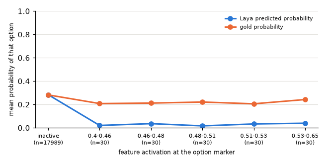

# Feature 9065

Critérios em que aparece: corr_error

**Interpretação (preencher):** 

---

## Maiores ativações

**tr_security_incidents_000080 / severity** (score, security_incidents) | ativação 5.137 em `estado` | opções ['0', '1', '2', '3', '4'] | Laya: **2** [0.113, 0.312, 0.4, 0.091, 0.085] | gabarito: **3**

```
<bos> score question: How severe is the potential impact if this alert is real?<eos>
▸ <mask> level 0: Negligible: no access to anything sensitive.
▸ <mask> level 1: Low: limited access, easily reversed.
▸ <mask> level 2: Moderate: access to internal systems or non-public data.
▸ <mask> level 3: High: access to production, secrets or customer data.
▸ <mask> level 4: Critical: active compromise of crown-jewel systems.

<eos>

 {"alert": {"description": "a first-ever sign-in from an unfamiliar country", "evidence": "A privileged shared mailbox \"admin@corp.com\" logged in from IP 200.150.10.77 (São ⟦Paulo⟧, Brazil) at 2026-09-16T01:22:10Z, marking the first login from that country for this principal. MFA was enabled, and the credential's last rotation date is recorded as 700 days ago.", "rule": "new_country_login"}, "context": {"asset_criticality": "low", "change_window_active": false, "source_on_allowlist": false}, "history": {"credential_rotation_days_ago": 700, "distinct_countries_30d": 2, "logins_30d": 721, "prior_alerts_90d": 8}, "principal": {"mfa_enrolled": true, "name": "ci-analytics-358", "privileges": ["deploy:production", "secrets:read"], "type": "shared_mailbox"}}<eos>
```

**tr_security_incidents_000080 / disposition** (choice, security_incidents) | ativação 5.102 em `estado` | opções ['close_benign', 'contain', 'investigate', 'monitor'] | Laya: **contain** [0.043, 0.53, 0.041, 0.386] | gabarito: **investigate**

```
<bos> choice question: How should this security alert be dispositioned?<eos>
▸ <mask> close_benign: Expected, explainable activity; close without analyst time.
▸ <mask> contain: Contain the host or account immediately; do not wait for triage.
▸ <mask> investigate: Warrants an analyst opening an investigation.
▸ <mask> monitor: Not clearly malicious, but worth watching for recurrence.

<eos>

 {"alert": {"description": "a first-ever sign-in from an unfamiliar country", "evidence": "A privileged shared mailbox \"admin@corp.com\" logged in from IP 200.150.10.77 (São ⟦Paulo⟧, Brazil) at 2026-09-16T01:22:10Z, marking the first login from that country for this principal. MFA was enabled, and the credential's last rotation date is recorded as 700 days ago.", "rule": "new_country_login"}, "context": {"asset_criticality": "low", "change_window_active": false, "source_on_allowlist": false}, "history": {"credential_rotation_days_ago": 700, "distinct_countries_30d": 2, "logins_30d": 721, "prior_alerts_90d": 8}, "principal": {"mfa_enrolled": true, "name": "ci-analytics-358", "privileges": ["deploy:production", "secrets:read"], "type": "shared_mailbox"}}<eos>
```

**tr_security_incidents_000080 / true_positive** (noul, security_incidents) | ativação 5.070 em `estado` | opções ['false', 'true'] | Laya: **true** [0.32, 0.68] | gabarito: **false**

```
<bos> noul question: This alert reflects genuinely malicious or unauthorised activity.<eos>
▸ <mask> false: Benign activity, a misconfiguration, or a known false positive.
▸ <mask> true: The underlying behaviour is malicious or unauthorised.

<eos>

 {"alert": {"description": "a first-ever sign-in from an unfamiliar country", "evidence": "A privileged shared mailbox \"admin@corp.com\" logged in from IP 200.150.10.77 (São ⟦Paulo⟧, Brazil) at 2026-09-16T01:22:10Z, marking the first login from that country for this principal. MFA was enabled, and the credential's last rotation date is recorded as 700 days ago.", "rule": "new_country_login"}, "context": {"asset_criticality": "low", "change_window_active": false, "source_on_allowlist": false}, "history": {"credential_rotation_days_ago": 700, "distinct_countries_30d": 2, "logins_30d": 721, "prior_alerts_90d": 8}, "principal": {"mfa_enrolled": true, "name": "ci-analytics-358", "privileges": ["deploy:production", "secrets:read"], "type": "shared_mailbox"}}<eos>
```

**tr_security_incidents_000080 / credential_compromise** (noul, security_incidents) | ativação 5.047 em `estado` | opções ['false', 'true'] | Laya: **true** [0.139, 0.861] | gabarito: **false**

```
<bos> noul question: The evidence indicates a credential or account has been compromised.<eos>
▸ <mask> false: no, the statement does not hold
▸ <mask> true: yes, the statement holds

<eos>

 {"alert": {"description": "a first-ever sign-in from an unfamiliar country", "evidence": "A privileged shared mailbox \"admin@corp.com\" logged in from IP 200.150.10.77 (São ⟦Paulo⟧, Brazil) at 2026-09-16T01:22:10Z, marking the first login from that country for this principal. MFA was enabled, and the credential's last rotation date is recorded as 700 days ago.", "rule": "new_country_login"}, "context": {"asset_criticality": "low", "change_window_active": false, "source_on_allowlist": false}, "history": {"credential_rotation_days_ago": 700, "distinct_countries_30d": 2, "logins_30d": 721, "prior_alerts_90d": 8}, "principal": {"mfa_enrolled": true, "name": "ci-analytics-358", "privileges": ["deploy:production", "secrets:read"], "type": "shared_mailbox"}}<eos>
```

**tr_security_incidents_000080 / urgency** (score, security_incidents) | ativação 5.035 em `estado` | opções ['0', '1', '2', '3'] | Laya: **3** [0.105, 0.35, 0.16, 0.384] | gabarito: **2**

```
<bos> score question: How quickly must a responder act on this alert?<eos>
▸ <mask> level 0: No time pressure; can wait indefinitely.
▸ <mask> level 1: Routine; handle within the normal queue.
▸ <mask> level 2: Elevated; should be handled within the same week.
▸ <mask> level 3: Critical; requires action within the same day.

<eos>

 {"alert": {"description": "a first-ever sign-in from an unfamiliar country", "evidence": "A privileged shared mailbox \"admin@corp.com\" logged in from IP 200.150.10.77 (São ⟦Paulo⟧, Brazil) at 2026-09-16T01:22:10Z, marking the first login from that country for this principal. MFA was enabled, and the credential's last rotation date is recorded as 700 days ago.", "rule": "new_country_login"}, "context": {"asset_criticality": "low", "change_window_active": false, "source_on_allowlist": false}, "history": {"credential_rotation_days_ago": 700, "distinct_countries_30d": 2, "logins_30d": 721, "prior_alerts_90d": 8}, "principal": {"mfa_enrolled": true, "name": "ci-analytics-358", "privileges": ["deploy:production", "secrets:read"], "type": "shared_mailbox"}}<eos>
```

## Ativações medianas (faixa 40-60%, mediana 0.514)

**tr_customer_service_000130 / action** (choice, customer_service) | ativação 0.523 em `marcador` | opções ['answer_directly', 'close_no_action', 'escalate_to_human', 'execute_refund', 'request_information'] | Laya: **close_no_action** [0.034, 0.956, 0.004, 0.003, 0.004] | gabarito: **escalate_to_human**

```
<bos> choice question: What should the assistant do next with this conversation?<eos>
▸ <mask> answer_directly: The assistant can resolve this itself with information it already has.
▸ <mask> close_no_action: No further action is warranted; the matter is settled.
▸ <mask> escalate_to_human: Hand off to a human agent with the appropriate authority.
▸ <mask> execute_refund: Issue the refund or credit the customer is owed.
▸ ⟦<mask>⟧ request_information: More detail is needed from the customer before anything can be done.

<eos>

 {"account": {"lifetime_value_usd": 84, "prior_tickets_90d": 1, "seats": 3, "tenure_months": 1, "tier": "premium"}, "orders": [{"amount_usd": 999, "date": "2026-01-07", "id": "A-49277", "status": "pending"}, {"amount_usd": 999, "date": "2026-01-14", "id": "A-26351", "status": "pending"}, {"amount_usd": 999, "date": "2026-03-12", "id": "A-14586", "status": "settled"}], "thread": [{"role": "customer", "text": "I can’t log into my premium account; the system keeps rejecting my password. I’ve only been with you for a month, paying $999, and after my last ticket was only half‑fixed, I’m stuck."}, {"role": "agent", "text": "I’m sorry you’re experiencing this. Could you tell me the exact error message you see and whether you’ve tried resetting your password?"}, {"role": "customer", "text": "The message says ‘Invalid credentials’ even after I used the ‘Forgot password’ link and followed the reset steps. I also tried from a different browser, same result."}, {"role": "agent", "text": "Thanks for the details. To rule out a possible lockout, could you let me know the time of your last successful login and the device you usually use?"}, {"role": "customer", "text": "My last successful login was yesterday around 2 pm on my workstation (Windows 10, Chrome). I haven’t logged in since the reset."}]}<eos>
```

**tr_customer_service_000092 / action** (choice, customer_service) | ativação 0.511 em `marcador` | opções ['answer_directly', 'close_no_action', 'escalate_to_human', 'execute_refund', 'request_information'] | Laya: **answer_directly** [0.774, 0.21, 0.008, 0.005, 0.002] | gabarito: **request_information**

```
<bos> choice question: What should the assistant do next with this conversation?<eos>
▸ <mask> answer_directly: The assistant can resolve this itself with information it already has.
▸ <mask> close_no_action: No further action is warranted; the matter is settled.
▸ <mask> escalate_to_human: Hand off to a human agent with the appropriate authority.
▸ <mask> execute_refund: Issue the refund or credit the customer is owed.
▸ ⟦<mask>⟧ request_information: More detail is needed from the customer before anything can be done.

<eos>

 {"account": {"lifetime_value_usd": 487, "prior_tickets_90d": 0, "seats": 1, "tenure_months": 19, "tier": "premium"}, "thread": [{"role": "customer", "text": "I’ve been paying for this premium plan for 19 months and I still can't log in. Every time I put my credentials in, it just kicks me back to the start. This is beyond annoying."}, {"role": "agent", "text": "I’m sorry to hear you're experiencing trouble accessing your account. Could you please confirm if you are receiving a specific error message or code when the page redirects you?"}, {"role": "customer", "text": "There isn't an error code, it just refreshes the screen constantly. I don't have all day to sit here guessing what's wrong with your system."}]}<eos>
```

**tr_customer_service_000217 / action** (choice, customer_service) | ativação 0.527 em `marcador` | opções ['answer_directly', 'close_no_action', 'escalate_to_human', 'execute_refund', 'request_information'] | Laya: **close_no_action** [0.048, 0.911, 0.014, 0.013, 0.014] | gabarito: **request_information**

```
<bos> choice question: What should the assistant do next with this conversation?<eos>
▸ <mask> answer_directly: The assistant can resolve this itself with information it already has.
▸ <mask> close_no_action: No further action is warranted; the matter is settled.
▸ <mask> escalate_to_human: Hand off to a human agent with the appropriate authority.
▸ <mask> execute_refund: Issue the refund or credit the customer is owed.
▸ ⟦<mask>⟧ request_information: More detail is needed from the customer before anything can be done.

<eos>

 {"account": {"lifetime_value_usd": 835, "prior_tickets_90d": 0, "seats": 1, "tenure_months": 33, "tier": "free"}, "thread": [{"role": "customer", "text": "I've been using this account for nearly three years without an issue, but now I'm locked out and the reset emails just aren't arriving. I suppose this is just how it goes sometimes; I'm not sure what else to try."}]}<eos>
```

**tr_customer_service_000131 / action** (choice, customer_service) | ativação 0.497 em `marcador` | opções ['answer_directly', 'close_no_action', 'escalate_to_human', 'execute_refund', 'request_information'] | Laya: **answer_directly** [0.79, 0.137, 0.023, 0.026, 0.023] | gabarito: **request_information**

```
<bos> choice question: What should the assistant do next with this conversation?<eos>
▸ <mask> answer_directly: The assistant can resolve this itself with information it already has.
▸ <mask> close_no_action: No further action is warranted; the matter is settled.
▸ <mask> escalate_to_human: Hand off to a human agent with the appropriate authority.
▸ <mask> execute_refund: Issue the refund or credit the customer is owed.
▸ ⟦<mask>⟧ request_information: More detail is needed from the customer before anything can be done.

<eos>

 {"account": {"lifetime_value_usd": 1583, "prior_tickets_90d": 2, "seats": 1, "tenure_months": 72, "tier": "standard"}, "orders": [{"amount_usd": 299, "date": "2026-02-13", "id": "A-60442", "status": "failed"}], "thread": [{"role": "customer", "text": "Good afternoon, I’ve noticed that my recent payment for the standard plan didn’t go through. I’ve been subscribed for six years now, and I’ve previously raised two tickets about billing that were only partially resolved."}, {"role": "agent", "text": "I’m sorry for the inconvenience. Could you provide the date of the attempted transaction and any reference number you received?"}, {"role": "customer", "text": "The payment attempt was on August 10, and the reference number shown on my bank statement is TXN‑20230810‑001. Please advise what steps we should take next."}]}<eos>
```

**tr_customer_service_000117 / action** (choice, customer_service) | ativação 0.516 em `marcador` | opções ['answer_directly', 'close_no_action', 'escalate_to_human', 'execute_refund', 'request_information'] | Laya: **execute_refund** [0.172, 0.223, 0.008, 0.595, 0.002] | gabarito: **execute_refund**

```
<bos> choice question: What should the assistant do next with this conversation?<eos>
▸ <mask> answer_directly: The assistant can resolve this itself with information it already has.
▸ <mask> close_no_action: No further action is warranted; the matter is settled.
▸ <mask> escalate_to_human: Hand off to a human agent with the appropriate authority.
▸ <mask> execute_refund: Issue the refund or credit the customer is owed.
▸ ⟦<mask>⟧ request_information: More detail is needed from the customer before anything can be done.

<eos>

 {"account": {"lifetime_value_usd": 1573, "prior_tickets_90d": 0, "seats": 1, "tenure_months": 19, "tier": "free"}, "orders": [{"amount_usd": 9, "date": "2026-02-10", "id": "A-62171", "status": "pending"}, {"amount_usd": 9, "date": "2026-03-19", "id": "A-51808", "status": "failed"}, {"amount_usd": 9, "date": "2026-01-01", "id": "A-58951", "status": "failed"}], "thread": [{"role": "customer", "text": "I’m looking at a charge for $9 on my account. I’ve been using the free plan for over a year and a half, so why am I being billed now? I'm ready to delete my account if this isn't fixed immediately."}, {"role": "agent", "text": "I understand this is unexpected. To help me investigate your account status, could you confirm the email address associated with your subscription?"}, {"role": "customer", "text": "It’s linked to my primary email. I’ve been a loyal user for 19 months, but this feels like a total scam. Fix this or I'm gone."}, {"role": "agent", "text": "Thank you for confirming that. I am looking into your history now; could you clarify if you recently signed up for any trial features or promotional add-ons?"}, {"role": "customer", "text": "No, I haven't clicked on anything new! I just want this $9 charge removed and my account returned to the free status I've always had."}]}<eos>
```

## Estatísticas (conjunto de descoberta, dev e teste)

**pred / error**

| split | decisões | ativas | ativas e Laya errou | taxa | lift | q (BH) | OR (CMH) | q (CMH) |
|---|---|---|---|---|---|---|---|---|
| discovery | 5100 | 1 | 1 | 1.000 | 1.55 | nan | nan | nan |
| dev | 900 | 0 | 0 | nan | nan | nan | nan | nan |
| test | 2000 | 0 | 0 | nan | nan | nan | nan | nan |

**corr / error**

| split | decisões | ativas | ativas e Laya errou | taxa | lift | q (BH) | OR (CMH) | q (CMH) |
|---|---|---|---|---|---|---|---|---|
| discovery | 5100 | 30 | 30 | 1.000 | 1.55 | 7.47e-06 | nan | nan |
| dev | 900 | 4 | 4 | 1.000 | 1.49 | nan | nan | nan |
| test | 2000 | 17 | 17 | 1.000 | 1.54 | nan | nan | nan |

**state / error**

| split | decisões | ativas | ativas e Laya errou | taxa | lift | q (BH) | OR (CMH) | q (CMH) |
|---|---|---|---|---|---|---|---|---|
| discovery | 5100 | 54 | 34 | 0.630 | 0.98 | 1 | 1.10 | 0.92 |
| dev | 900 | 4 | 1 | 0.250 | 0.37 | nan | nan | nan |
| test | 2000 | 7 | 4 | 0.571 | 0.88 | nan | nan | nan |

**pred / probe_right_laya_wrong**

| split | decisões | ativas | ativas e Laya errou | taxa | lift | q (BH) | OR (CMH) | q (CMH) |
|---|---|---|---|---|---|---|---|---|
| discovery | 2819 | 1 | 1 | 1.000 | 1.55 | nan | nan | nan |
| dev | 520 | 0 | 0 | nan | nan | nan | nan | nan |
| test | 1106 | 0 | 0 | nan | nan | nan | nan | nan |

**corr / probe_right_laya_wrong**

| split | decisões | ativas | ativas e Laya errou | taxa | lift | q (BH) | OR (CMH) | q (CMH) |
|---|---|---|---|---|---|---|---|---|
| discovery | 2819 | 1 | 1 | 1.000 | 1.55 | nan | nan | nan |
| dev | 520 | 0 | 0 | nan | nan | nan | nan | nan |
| test | 1106 | 3 | 3 | 1.000 | 1.58 | nan | nan | nan |

**state / probe_right_laya_wrong**

| split | decisões | ativas | ativas e Laya errou | taxa | lift | q (BH) | OR (CMH) | q (CMH) |
|---|---|---|---|---|---|---|---|---|
| discovery | 2819 | 24 | 17 | 0.708 | 1.09 | 0.812 | 2.00 | 0.412 |
| dev | 520 | 3 | 1 | 0.333 | 0.49 | nan | nan | nan |
| test | 1106 | 2 | 2 | 1.000 | 1.58 | nan | nan | nan |

Confusão mais sobre-representada (pred): `action|4>2` (n=1, lift 5100.00, p=nan). Formato `pergunta|índice previsto>índice correto`.

Confusão mais sobre-representada (corr): `action|0>4` (n=17, lift 107.04, p=3.37e-34). Formato `pergunta|índice previsto>índice correto`.

Confusão mais sobre-representada (state): `category|4>0` (n=2, lift 18.89, p=0.00469). Formato `pergunta|índice previsto>índice correto`.



