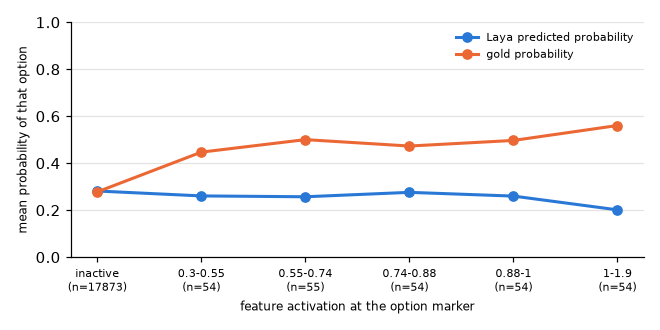

# Feature 9154

Critérios em que aparece: corr_error_stratified, corr_probe_right_laya_wrong_stratified

**Interpretação (preencher):** 

---

## Maiores ativações

**tr_customer_service_000088 / urgency** (score, customer_service) | ativação 2.344 em `estado` | opções ['0', '1', '2', '3'] | Laya: **3** [0.137, 0.272, 0.268, 0.323] | gabarito: **2**

```
<bos> score question: How time-sensitive is this conversation?<eos>
▸ <mask> level 0: No time pressure; can wait indefinitely.
▸ <mask> level 1: Routine; handle within the normal queue.
▸ <mask> level 2: Elevated; should be handled within the same week.
▸ <mask> level 3: Critical; requires action within the same day.

<eos>

 {"account": {"lifetime_value_usd": 73, "prior_tickets_90d": 1, "seats": 5, "tenure_months": 2, "tier": "enterprise"}, "orders": [{"amount_usd": 19, "date": "2026-02-04", "id": "A-66055", "status": "settled"}], "thread": [{"role": "customer", "text": "Hello, I hope you can help – I tried to renew our Enterprise plan today and the $19 charge didn’t go through. This is our second month with you, and we’ve already opened a ticket about a similar issue that was resolved, but it seems to be happening again."}, {"role": "agent", "text": "I’m sorry to hear the payment didn’t process. Could you let me know the date of the attempted charge and the last four digits of the card you used?"}, {"role": "customer", "text": "The attempt was on September 12th, and the card ends in 8427. I also tried using the same card on the portal, but it still shows a failure."}, {"role": "agent", "text": "Thank you for the details. Have you tried using a different payment method, or does the same error appear with another card?"}, {"role": "customer", "text": "We only have the one corporate card for billing, so we haven’t switched. The earlier ticket (ID #12345) was resolved, but the problem⟦ resur⟧faced today."}, {"role": "agent", "text": "I see, and I’ve noted the previous ticket. I’ll look into the transaction logs and see why the charge is failing again."}, {"role": "customer", "text": "Please let me know when you have an update, as we need the renewal to be confirmed before the end of the week."}]}<eos>
```

**tr_customer_service_000088 / category** (choice, customer_service) | ativação 2.318 em `estado` | opções ['account', 'billing', 'delivery', 'refund', 'technical'] | Laya: **billing** [0.001, 0.98, 0.0, 0.0, 0.018] | gabarito: **billing**

```
<bos> choice question: What is this customer conversation primarily about?<eos>
▸ <mask> account: Login, plan changes, profile or access management.
▸ <mask> billing: A charge, invoice, subscription or payment problem.
▸ <mask> delivery: Shipping, fulfilment or delivery of a physical item.
▸ <mask> refund: The customer is explicitly asking for money back.
▸ <mask> technical: The product or service is not working as expected.

<eos>

 {"account": {"lifetime_value_usd": 73, "prior_tickets_90d": 1, "seats": 5, "tenure_months": 2, "tier": "enterprise"}, "orders": [{"amount_usd": 19, "date": "2026-02-04", "id": "A-66055", "status": "settled"}], "thread": [{"role": "customer", "text": "Hello, I hope you can help – I tried to renew our Enterprise plan today and the $19 charge didn’t go through. This is our second month with you, and we’ve already opened a ticket about a similar issue that was resolved, but it seems to be happening again."}, {"role": "agent", "text": "I’m sorry to hear the payment didn’t process. Could you let me know the date of the attempted charge and the last four digits of the card you used?"}, {"role": "customer", "text": "The attempt was on September 12th, and the card ends in 8427. I also tried using the same card on the portal, but it still shows a failure."}, {"role": "agent", "text": "Thank you for the details. Have you tried using a different payment method, or does the same error appear with another card?"}, {"role": "customer", "text": "We only have the one corporate card for billing, so we haven’t switched. The earlier ticket (ID #12345) was resolved, but the problem⟦ resur⟧faced today."}, {"role": "agent", "text": "I see, and I’ve noted the previous ticket. I’ll look into the transaction logs and see why the charge is failing again."}, {"role": "customer", "text": "Please let me know when you have an update, as we need the renewal to be confirmed before the end of the week."}]}<eos>
```

**tr_customer_service_000088 / action** (choice, customer_service) | ativação 2.217 em `estado` | opções ['answer_directly', 'close_no_action', 'escalate_to_human', 'execute_refund', 'request_information'] | Laya: **close_no_action** [0.178, 0.508, 0.05, 0.233, 0.03] | gabarito: **escalate_to_human**

```
<bos> choice question: What should the assistant do next with this conversation?<eos>
▸ <mask> answer_directly: The assistant can resolve this itself with information it already has.
▸ <mask> close_no_action: No further action is warranted; the matter is settled.
▸ <mask> escalate_to_human: Hand off to a human agent with the appropriate authority.
▸ <mask> execute_refund: Issue the refund or credit the customer is owed.
▸ <mask> request_information: More detail is needed from the customer before anything can be done.

<eos>

 {"account": {"lifetime_value_usd": 73, "prior_tickets_90d": 1, "seats": 5, "tenure_months": 2, "tier": "enterprise"}, "orders": [{"amount_usd": 19, "date": "2026-02-04", "id": "A-66055", "status": "settled"}], "thread": [{"role": "customer", "text": "Hello, I hope you can help – I tried to renew our Enterprise plan today and the $19 charge didn’t go through. This is our second month with you, and we’ve already opened a ticket about a similar issue that was resolved, but it seems to be happening again."}, {"role": "agent", "text": "I’m sorry to hear the payment didn’t process. Could you let me know the date of the attempted charge and the last four digits of the card you used?"}, {"role": "customer", "text": "The attempt was on September 12th, and the card ends in 8427. I also tried using the same card on the portal, but it still shows a failure."}, {"role": "agent", "text": "Thank you for the details. Have you tried using a different payment method, or does the same error appear with another card?"}, {"role": "customer", "text": "We only have the one corporate card for billing, so we haven’t switched. The earlier ticket (ID #12345) was resolved, but the problem⟦ resur⟧faced today."}, {"role": "agent", "text": "I see, and I’ve noted the previous ticket. I’ll look into the transaction logs and see why the charge is failing again."}, {"role": "customer", "text": "Please let me know when you have an update, as we need the renewal to be confirmed before the end of the week."}]}<eos>
```

**tr_customer_service_000088 / needs_human** (noul, customer_service) | ativação 2.217 em `estado` | opções ['false', 'true'] | Laya: **true** [0.347, 0.653] | gabarito: **true**

```
<bos> noul question: This conversation requires a human agent rather than automated handling.<eos>
▸ <mask> false: Automation can carry this to resolution.
▸ <mask> true: A human must take over: judgement, authority or empathy is required.

<eos>

 {"account": {"lifetime_value_usd": 73, "prior_tickets_90d": 1, "seats": 5, "tenure_months": 2, "tier": "enterprise"}, "orders": [{"amount_usd": 19, "date": "2026-02-04", "id": "A-66055", "status": "settled"}], "thread": [{"role": "customer", "text": "Hello, I hope you can help – I tried to renew our Enterprise plan today and the $19 charge didn’t go through. This is our second month with you, and we’ve already opened a ticket about a similar issue that was resolved, but it seems to be happening again."}, {"role": "agent", "text": "I’m sorry to hear the payment didn’t process. Could you let me know the date of the attempted charge and the last four digits of the card you used?"}, {"role": "customer", "text": "The attempt was on September 12th, and the card ends in 8427. I also tried using the same card on the portal, but it still shows a failure."}, {"role": "agent", "text": "Thank you for the details. Have you tried using a different payment method, or does the same error appear with another card?"}, {"role": "customer", "text": "We only have the one corporate card for billing, so we haven’t switched. The earlier ticket (ID #12345) was resolved, but the problem⟦ resur⟧faced today."}, {"role": "agent", "text": "I see, and I’ve noted the previous ticket. I’ll look into the transaction logs and see why the charge is failing again."}, {"role": "customer", "text": "Please let me know when you have an update, as we need the renewal to be confirmed before the end of the week."}]}<eos>
```

**tr_customer_service_000088 / churn_risk** (score, customer_service) | ativação 2.084 em `estado` | opções ['0', '1', '2', '3'] | Laya: **2** [0.085, 0.379, 0.445, 0.092] | gabarito: **2**

```
<bos> score question: How likely is this customer to stop doing business with us because of this interaction?<eos>
▸ <mask> level 0: No sign of dissatisfaction.
▸ <mask> level 1: Mild frustration, but the relationship is intact.
▸ <mask> level 2: Clearly unhappy; repeat problems or explicit complaints.
▸ <mask> level 3: Imminent: threatening to cancel, dispute or leave.

<eos>

 {"account": {"lifetime_value_usd": 73, "prior_tickets_90d": 1, "seats": 5, "tenure_months": 2, "tier": "enterprise"}, "orders": [{"amount_usd": 19, "date": "2026-02-04", "id": "A-66055", "status": "settled"}], "thread": [{"role": "customer", "text": "Hello, I hope you can help – I tried to renew our Enterprise plan today and the $19 charge didn’t go through. This is our second month with you, and we’ve already opened a ticket about a similar issue that was resolved, but it seems to be happening again."}, {"role": "agent", "text": "I’m sorry to hear the payment didn’t process. Could you let me know the date of the attempted charge and the last four digits of the card you used?"}, {"role": "customer", "text": "The attempt was on September 12th, and the card ends in 8427. I also tried using the same card on the portal, but it still shows a failure."}, {"role": "agent", "text": "Thank you for the details. Have you tried using a different payment method, or does the same error appear with another card?"}, {"role": "customer", "text": "We only have the one corporate card for billing, so we haven’t switched. The earlier ticket (ID #12345) was resolved, but the problem⟦ resur⟧faced today."}, {"role": "agent", "text": "I see, and I’ve noted the previous ticket. I’ll look into the transaction logs and see why the charge is failing again."}, {"role": "customer", "text": "Please let me know when you have an update, as we need the renewal to be confirmed before the end of the week."}]}<eos>
```

## Ativações medianas (faixa 40-60%, mediana 0.783)

**tr_security_incidents_000200 / credential_compromise** (noul, security_incidents) | ativação 0.827 em `marcador` | opções ['false', 'true'] | Laya: **true** [0.014, 0.986] | gabarito: **true**

```
<bos> noul question: The evidence indicates a credential or account has been compromised.<eos>
▸ ⟦<mask>⟧ false: no, the statement does not hold
▸ <mask> true: yes, the statement holds

<eos>

 {"alert": {"description": "many failed authentications followed by a success", "evidence": "Service account 'svc_account_2' recorded 48 failed authentication attempts followed by a successful login at 22:10 UTC from an unrecognized network origin. The account operates without MFA and has not undergone credential rotation in the past 90 days.", "rule": "brute_force"}, "context": {"asset_criticality": "medium", "change_window_active": false, "source_on_allowlist": false}, "history": {"credential_rotation_days_ago": 90, "distinct_countries_30d": 3, "logins_30d": 938, "prior_alerts_90d": 3}, "principal": {"mfa_enrolled": false, "name": "svc-deploy-730", "privileges": ["repo:read"], "type": "service_account"}}<eos>
```

**tr_security_incidents_000227 / credential_compromise** (noul, security_incidents) | ativação 0.791 em `marcador` | opções ['false', 'true'] | Laya: **true** [0.019, 0.981] | gabarito: **true**

```
<bos> noul question: The evidence indicates a credential or account has been compromised.<eos>
▸ ⟦<mask>⟧ false: no, the statement does not hold
▸ <mask> true: yes, the statement holds

<eos>

 {"alert": {"description": "a large transfer to an external destination", "evidence": "A transfer of 4.2 GB of data was initiated to an unrecognized external IP address at 03:40 UTC. This activity was performed by a shared mailbox account that currently has MFA disabled.", "rule": "data_egress"}, "context": {"asset_criticality": "low", "change_window_active": false, "source_on_allowlist": false}, "history": {"credential_rotation_days_ago": 30, "distinct_countries_30d": 4, "logins_30d": 1619, "prior_alerts_90d": 1}, "principal": {"mfa_enrolled": false, "name": "svc-support-910", "privileges": ["repo:read"], "type": "shared_mailbox"}}<eos>
```

**tr_customer_service_000229 / churn_risk** (score, customer_service) | ativação 0.822 em `estado` | opções ['0', '1', '2', '3'] | Laya: **2** [0.031, 0.254, 0.474, 0.241] | gabarito: **2**

```
<bos> score question: How likely is this customer to stop doing business with us because of this interaction?<eos>
▸ <mask> level 0: No sign of dissatisfaction.
▸ <mask> level 1: Mild frustration, but the relationship is intact.
▸ <mask> level 2: Clearly unhappy; repeat problems or explicit complaints.
▸ <mask> level 3: Imminent: threatening to cancel, dispute or leave.

<eos>

 {"account": {"lifetime_value_usd": 926, "prior_tickets_90d": 3, "seats": 1, "tenure_months": 19, "tier": "standard"}, "orders": [{"amount_usd": 147, "date": "2026-01-24", "id": "A-70530", "status": "settled"}, {"amount_usd": 147, "date": "2026-02-11", "id": "A-96734", "status": "pending"}], "thread": [{"role": "customer", "text": "Hello, I hope you’re doing well. I recently noticed a charge of about $147 on my statement that I wasn’t expecting."}, {"role": "agent", "text": "Thank you for reaching out. I can look into that for you. Could you let me know which billing period this charge appears⟦ on⟧, or share the invoice number?"}, {"role": "customer", "text": "The charge is on the March invoice, number INV-2023-03-019. I’ve opened a few tickets about billing inconsistencies over the past months—three in total—but the explanations never quite matched the amounts."}, {"role": "agent", "text": "I appreciate you sharing that. To make sure I’m looking at the right record, could you confirm the email address tied to the standard plan account you’ve had for 19 months?"}, {"role": "customer", "text": "It’s mike.smith@example.com. I’m just hoping we can figure out why this $147 appeared, as it’s higher than what I’ve been paying."}]}<eos>
```

**tr_security_incidents_000155 / severity** (score, security_incidents) | ativação 0.714 em `estado` | opções ['0', '1', '2', '3', '4'] | Laya: **1** [0.085, 0.441, 0.247, 0.172, 0.054] | gabarito: **2**

```
<bos> score question: How severe is the potential impact if this alert is real?<eos>
▸ <mask> level 0: Negligible: no access to anything sensitive.
▸ <mask> level 1: Low: limited access, easily reversed.
▸ <mask> level 2: Moderate: access to internal systems or non-public data.
▸ <mask> level 3: High: access to production, secrets or customer data.
▸ <mask> level 4: Critical: active compromise of crown-jewel systems.

<eos>

 {"alert": {"description": "a security group was opened to the public internet", "evidence": "An administrative user updated the security group 'sg-0a1b2c3d' to permit ingress traffic⟦ on⟧ all ports from the 0.0.0.0/0 CIDR block. The modification was performed at 10:05 UTC from an unrecognized network origin during an active change window.", "rule": "config_drift"}, "context": {"asset_criticality": "low", "change_window_active": true, "source_on_allowlist": false}, "history": {"credential_rotation_days_ago": 180, "distinct_countries_30d": 1, "logins_30d": 1475, "prior_alerts_90d": 0}, "principal": {"mfa_enrolled": true, "name": "svc-billing-961", "privileges": ["deploy:production", "secrets:read"], "type": "admin"}}<eos>
```

**tr_security_incidents_000078 / credential_compromise** (noul, security_incidents) | ativação 0.808 em `marcador` | opções ['false', 'true'] | Laya: **true** [0.288, 0.712] | gabarito: **true**

```
<bos> noul question: The evidence indicates a credential or account has been compromised.<eos>
▸ ⟦<mask>⟧ false: no, the statement does not hold
▸ <mask> true: yes, the statement holds

<eos>

 {"alert": {"description": "an account granted itself or received elevated permissions", "evidence": "At 2026-09-15T03:12:44Z the service account \"svc-backup\" on host 10.2.5.7 was granted the Owner role. The request originated from IP 203.0.113.45, which is not listed in the known inventory, and the account's MFA setting is disabled. Credential metadata shows the password was last rotated 700 days ago.", "rule": "privilege_escalation"}, "context": {"asset_criticality": "medium", "change_window_active": false, "source_on_allowlist": false}, "history": {"credential_rotation_days_ago": 700, "distinct_countries_30d": 1, "logins_30d": 861, "prior_alerts_90d": 3}, "principal": {"mfa_enrolled": false, "name": "usr-billing-797", "privileges": ["deploy:production", "secrets:read"], "type": "service_account"}}<eos>
```

## Estatísticas (conjunto de descoberta, dev e teste)

**pred / error**

| split | decisões | ativas | ativas e Laya errou | taxa | lift | q (BH) | OR (CMH) | q (CMH) |
|---|---|---|---|---|---|---|---|---|
| discovery | 5100 | 53 | 25 | 0.472 | 0.73 | 0.0242 | 1.85 | 0.722 |
| dev | 900 | 10 | 4 | 0.400 | 0.60 | nan | nan | nan |
| test | 2000 | 19 | 6 | 0.316 | 0.49 | nan | nan | nan |

**corr / error**

| split | decisões | ativas | ativas e Laya errou | taxa | lift | q (BH) | OR (CMH) | q (CMH) |
|---|---|---|---|---|---|---|---|---|
| discovery | 5100 | 114 | 86 | 0.754 | 1.17 | 0.0195 | 7.97 | 0.000218 |
| dev | 900 | 19 | 13 | 0.684 | 1.02 | nan | nan | nan |
| test | 2000 | 44 | 31 | 0.705 | 1.08 | 0.606 | 0.00 | 0.64 |

**state / error**

| split | decisões | ativas | ativas e Laya errou | taxa | lift | q (BH) | OR (CMH) | q (CMH) |
|---|---|---|---|---|---|---|---|---|
| discovery | 5100 | 44 | 25 | 0.568 | 0.88 | 0.551 | 0.84 | 0.868 |
| dev | 900 | 1 | 1 | 1.000 | 1.49 | nan | nan | nan |
| test | 2000 | 19 | 13 | 0.684 | 1.05 | nan | nan | nan |

**pred / probe_right_laya_wrong**

| split | decisões | ativas | ativas e Laya errou | taxa | lift | q (BH) | OR (CMH) | q (CMH) |
|---|---|---|---|---|---|---|---|---|
| discovery | 2819 | 35 | 18 | 0.514 | 0.79 | 0.176 | 2.05 | 0.679 |
| dev | 520 | 8 | 3 | 0.375 | 0.56 | nan | nan | nan |
| test | 1106 | 10 | 4 | 0.400 | 0.63 | nan | nan | nan |

**corr / probe_right_laya_wrong**

| split | decisões | ativas | ativas e Laya errou | taxa | lift | q (BH) | OR (CMH) | q (CMH) |
|---|---|---|---|---|---|---|---|---|
| discovery | 2819 | 81 | 64 | 0.790 | 1.22 | 0.00952 | 7.53 | 0.0387 |
| dev | 520 | 13 | 8 | 0.615 | 0.91 | nan | nan | nan |
| test | 1106 | 28 | 22 | 0.786 | 1.24 | 0.159 | 0.00 | 0.753 |

**state / probe_right_laya_wrong**

| split | decisões | ativas | ativas e Laya errou | taxa | lift | q (BH) | OR (CMH) | q (CMH) |
|---|---|---|---|---|---|---|---|---|
| discovery | 2819 | 28 | 13 | 0.464 | 0.72 | 0.139 | 0.53 | 0.469 |
| dev | 520 | 0 | 0 | nan | nan | nan | nan | nan |
| test | 1106 | 12 | 8 | 0.667 | 1.05 | nan | nan | nan |

Confusão mais sobre-representada (pred): `credential_compromise|0>1` (n=21, lift 91.85, p=5.13e-43). Formato `pergunta|índice previsto>índice correto`.

Confusão mais sobre-representada (corr): `credential_compromise|1>0` (n=79, lift 43.10, p=0). Formato `pergunta|índice previsto>índice correto`.

Confusão mais sobre-representada (state): `severity|1>2` (n=3, lift 9.15, p=0.0041). Formato `pergunta|índice previsto>índice correto`.



