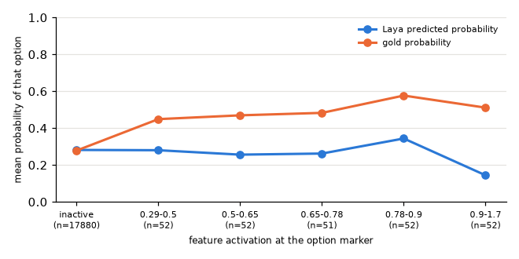

# Feature 9158

Critérios em que aparece: corr_error_stratified

**Interpretação (preencher):** 

---

## Maiores ativações

**tr_security_incidents_000108 / urgency** (score, security_incidents) | ativação 2.900 em `estado` | opções ['0', '1', '2', '3'] | Laya: **3** [0.114, 0.23, 0.29, 0.367] | gabarito: **3**

```
<bos> score question: How quickly must a responder act on this alert?<eos>
▸ <mask> level 0: No time pressure; can wait indefinitely.
▸ <mask> level 1: Routine; handle within the normal queue.
▸ <mask> level 2: Elevated; should be handled within the same week.
▸ <mask> level 3: Critical; requires action within the same day.

<eos>

 {"alert": {"description": "a large transfer to an external destination", "evidence": "A transfer of approximately 2.3 TB was recorded from internal address 10.12.45.78 to external destination 203.0.113.45 over TCP port 443, beginning at 2026-09-15 02:14 UTC and completing at 03:01 UTC. The activity originated from a shared_mailbox account with privileged rights, MFA enabled, and a password last rotated 90 days ago, occurring outside any defined change window.", "rule": "data_⟦e⟧gress"}, "context": {"asset_criticality": "medium", "change_window_active": false, "source_on_allowlist": false}, "history": {"credential_rotation_days_ago": 90, "distinct_countries_30d": 1, "logins_30d": 1708, "prior_alerts_90d": 3}, "principal": {"mfa_enrolled": true, "name": "usr-support-496", "privileges": ["deploy:production", "secrets:read"], "type": "shared_mailbox"}}<eos>
```

**tr_security_incidents_000108 / true_positive** (noul, security_incidents) | ativação 2.889 em `estado` | opções ['false', 'true'] | Laya: **true** [0.036, 0.964] | gabarito: **true**

```
<bos> noul question: This alert reflects genuinely malicious or unauthorised activity.<eos>
▸ <mask> false: Benign activity, a misconfiguration, or a known false positive.
▸ <mask> true: The underlying behaviour is malicious or unauthorised.

<eos>

 {"alert": {"description": "a large transfer to an external destination", "evidence": "A transfer of approximately 2.3 TB was recorded from internal address 10.12.45.78 to external destination 203.0.113.45 over TCP port 443, beginning at 2026-09-15 02:14 UTC and completing at 03:01 UTC. The activity originated from a shared_mailbox account with privileged rights, MFA enabled, and a password last rotated 90 days ago, occurring outside any defined change window.", "rule": "data_⟦e⟧gress"}, "context": {"asset_criticality": "medium", "change_window_active": false, "source_on_allowlist": false}, "history": {"credential_rotation_days_ago": 90, "distinct_countries_30d": 1, "logins_30d": 1708, "prior_alerts_90d": 3}, "principal": {"mfa_enrolled": true, "name": "usr-support-496", "privileges": ["deploy:production", "secrets:read"], "type": "shared_mailbox"}}<eos>
```

**tr_security_incidents_000208 / severity** (score, security_incidents) | ativação 2.873 em `estado` | opções ['0', '1', '2', '3', '4'] | Laya: **1** [0.152, 0.308, 0.244, 0.148, 0.148] | gabarito: **3**

```
<bos> score question: How severe is the potential impact if this alert is real?<eos>
▸ <mask> level 0: Negligible: no access to anything sensitive.
▸ <mask> level 1: Low: limited access, easily reversed.
▸ <mask> level 2: Moderate: access to internal systems or non-public data.
▸ <mask> level 3: High: access to production, secrets or customer data.
▸ <mask> level 4: Critical: active compromise of crown-jewel systems.

<eos>

 {"alert": {"description": "a large transfer to an external destination", "evidence": "At 04:03 UTC on 2026-09-15, a service account named svc_backup transferred 4.8 GB of data to external IP 198.51.100.77 over port 443 using the process rsync.exe. The transfer completed in 7 minutes and originated from an unrecognised host in the DMZ. The event took place during an open change window.", "rule": "data_⟦e⟧gress"}, "context": {"asset_criticality": "low", "change_window_active": true, "source_on_allowlist": false}, "history": {"credential_rotation_days_ago": 30, "distinct_countries_30d": 3, "logins_30d": 873, "prior_alerts_90d": 3}, "principal": {"mfa_enrolled": false, "name": "ci-support-613", "privileges": ["deploy:production", "secrets:read"], "type": "service_account"}}<eos>
```

**tr_security_incidents_000108 / disposition** (choice, security_incidents) | ativação 2.814 em `estado` | opções ['close_benign', 'contain', 'investigate', 'monitor'] | Laya: **monitor** [0.252, 0.094, 0.11, 0.543] | gabarito: **contain**

```
<bos> choice question: How should this security alert be dispositioned?<eos>
▸ <mask> close_benign: Expected, explainable activity; close without analyst time.
▸ <mask> contain: Contain the host or account immediately; do not wait for triage.
▸ <mask> investigate: Warrants an analyst opening an investigation.
▸ <mask> monitor: Not clearly malicious, but worth watching for recurrence.

<eos>

 {"alert": {"description": "a large transfer to an external destination", "evidence": "A transfer of approximately 2.3 TB was recorded from internal address 10.12.45.78 to external destination 203.0.113.45 over TCP port 443, beginning at 2026-09-15 02:14 UTC and completing at 03:01 UTC. The activity originated from a shared_mailbox account with privileged rights, MFA enabled, and a password last rotated 90 days ago, occurring outside any defined change window.", "rule": "data_⟦e⟧gress"}, "context": {"asset_criticality": "medium", "change_window_active": false, "source_on_allowlist": false}, "history": {"credential_rotation_days_ago": 90, "distinct_countries_30d": 1, "logins_30d": 1708, "prior_alerts_90d": 3}, "principal": {"mfa_enrolled": true, "name": "usr-support-496", "privileges": ["deploy:production", "secrets:read"], "type": "shared_mailbox"}}<eos>
```

**tr_security_incidents_000147 / urgency** (score, security_incidents) | ativação 2.801 em `estado` | opções ['0', '1', '2', '3'] | Laya: **1** [0.192, 0.289, 0.271, 0.247] | gabarito: **3**

```
<bos> score question: How quickly must a responder act on this alert?<eos>
▸ <mask> level 0: No time pressure; can wait indefinitely.
▸ <mask> level 1: Routine; handle within the normal queue.
▸ <mask> level 2: Elevated; should be handled within the same week.
▸ <mask> level 3: Critical; requires action within the same day.

<eos>

 {"alert": {"description": "a large transfer to an external destination", "evidence": "At 2026-09-14 03:12:07 UTC, a 78 GB file transfer was observed from internal host 10.2.5.23 to external address 203.0.113.45 over HTTPS. The operation was initiated by a contractor account with unprivileged rights, MFA disabled, and credentials that have not been rotated for 412 days; the source IP is listed on the allowlist and the activity occurred outside any defined change window.", "rule": "data_⟦e⟧gress"}, "context": {"asset_criticality": "medium", "change_window_active": false, "source_on_allowlist": true}, "history": {"credential_rotation_days_ago": 412, "distinct_countries_30d": 2, "logins_30d": 1481, "prior_alerts_90d": 1}, "principal": {"mfa_enrolled": false, "name": "adm-billing-881", "privileges": ["repo:read"], "type": "contractor"}}<eos>
```

## Ativações medianas (faixa 40-60%, mediana 0.822)

**tr_security_incidents_000083 / credential_compromise** (noul, security_incidents) | ativação 0.869 em `marcador` | opções ['false', 'true'] | Laya: **false** [0.928, 0.072] | gabarito: **true**

```
<bos> noul question: The evidence indicates a credential or account has been compromised.<eos>
▸ ⟦<mask>⟧ false: no, the statement does not hold
▸ <mask> true: yes, the statement holds

<eos>

 {"alert": {"description": "a long-unused account became active", "evidence": "At 2026-09-14 22:05:00 UTC, the privileged CI runner account \"ci-runner-07\"—inactive for 312 days—initiated a Git fetch from IP 192.0.2.77, which is not part of the trusted network. No change window was active, MFA was enabled for the account, and its credentials were last refreshed 14 days prior.", "rule": "dormant_account_use"}, "context": {"asset_criticality": "medium", "change_window_active": false, "source_on_allowlist": false}, "history": {"credential_rotation_days_ago": 14, "distinct_countries_30d": 2, "logins_30d": 356, "prior_alerts_90d": 0}, "principal": {"mfa_enrolled": true, "name": "ci-support-380", "privileges": ["deploy:production", "secrets:read"], "type": "ci_runner"}}<eos>
```

**tr_security_incidents_000179 / credential_compromise** (noul, security_incidents) | ativação 0.785 em `marcador` | opções ['false', 'true'] | Laya: **true** [0.013, 0.987] | gabarito: **true**

```
<bos> noul question: The evidence indicates a credential or account has been compromised.<eos>
▸ ⟦<mask>⟧ false: no, the statement does not hold
▸ <mask> true: yes, the statement holds

<eos>

 {"alert": {"description": "many failed authentications followed by a success", "evidence": "From 2026-09-15 03:20:05 UTC to 03:22:31 UTC, the privileged service account svc_backup attempted 87 logins from allowlisted IP 192.0.2.55, recording 86 failed password attempts before a successful authentication. MFA was disabled for this account, and its password has not been changed since 2024-09-20 (approximately 700 days). No change window was in effect at the time.", "rule": "brute_force"}, "context": {"asset_criticality": "medium", "change_window_active": false, "source_on_allowlist": true}, "history": {"credential_rotation_days_ago": 700, "distinct_countries_30d": 1, "logins_30d": 1592, "prior_alerts_90d": 0}, "principal": {"mfa_enrolled": false, "name": "ci-deploy-675", "privileges": ["deploy:production", "secrets:read"], "type": "service_account"}}<eos>
```

**tr_security_incidents_000299 / credential_compromise** (noul, security_incidents) | ativação 0.912 em `marcador` | opções ['false', 'true'] | Laya: **true** [0.334, 0.666] | gabarito: **true**

```
<bos> noul question: The evidence indicates a credential or account has been compromised.<eos>
▸ ⟦<mask>⟧ false: no, the statement does not hold
▸ <mask> true: yes, the statement holds

<eos>

 {"alert": {"description": "an unusual volume of files read in a short window", "evidence": "A privileged administrator account without MFA enabled initiated an unusually high volume of file read operations from an unrecognized source. This activity took place during a non-change window, exactly 30 days after the principal's credentials were last updated.", "rule": "mass_download"}, "context": {"asset_criticality": "medium", "change_window_active": false, "source_on_allowlist": false}, "history": {"credential_rotation_days_ago": 30, "distinct_countries_30d": 4, "logins_30d": 1329, "prior_alerts_90d": 0}, "principal": {"mfa_enrolled": false, "name": "svc-analytics-679", "privileges": ["deploy:production", "secrets:read"], "type": "admin"}}<eos>
```

**tr_security_incidents_000170 / credential_compromise** (noul, security_incidents) | ativação 0.890 em `marcador` | opções ['false', 'true'] | Laya: **false** [0.832, 0.168] | gabarito: **false**

```
<bos> noul question: The evidence indicates a credential or account has been compromised.<eos>
▸ ⟦<mask>⟧ false: no, the statement does not hold
▸ <mask> true: yes, the statement holds

<eos>

 {"alert": {"description": "a first-ever sign-in from an unfamiliar country", "evidence": "Service account svc_backup logged in from IP 45.77.22.9 (Russia) at 2026-09-16 08:45 UTC, representing the first sign‑in from that nation for this privileged service account. The authentication included MFA, and the source IP is not present in the allowlist. Credential rotation for the account occurred three days earlier.", "rule": "new_country_login"}, "context": {"asset_criticality": "low", "change_window_active": false, "source_on_allowlist": false}, "history": {"credential_rotation_days_ago": 3, "distinct_countries_30d": 1, "logins_30d": 744, "prior_alerts_90d": 1}, "principal": {"mfa_enrolled": true, "name": "adm-infra-676", "privileges": ["deploy:production", "secrets:read"], "type": "service_account"}}<eos>
```

**tr_security_incidents_000005 / credential_compromise** (noul, security_incidents) | ativação 0.855 em `marcador` | opções ['false', 'true'] | Laya: **true** [0.311, 0.689] | gabarito: **true**

```
<bos> noul question: The evidence indicates a credential or account has been compromised.<eos>
▸ ⟦<mask>⟧ false: no, the statement does not hold
▸ <mask> true: yes, the statement holds

<eos>

 {"alert": {"description": "a session token was presented from a second address", "evidence": "Session token XYZ123 was presented to the API from internal address 10.0.0.5 at 2026-09-15 01:05:17 UTC, and the identical token was subsequently used from external address 198.51.100.22 at 01:06:12 UTC. The principal is an unprivileged CI runner with MFA active, the event occurred during an open change window, and the source is not on the recognised list. Credential rotation for this token occurred 700 days ago.", "rule": "token_reuse"}, "context": {"asset_criticality": "low", "change_window_active": true, "source_on_allowlist": false}, "history": {"credential_rotation_days_ago": 700, "distinct_countries_30d": 1, "logins_30d": 1701, "prior_alerts_90d": 1}, "principal": {"mfa_enrolled": true, "name": "ci-deploy-438", "privileges": ["repo:read"], "type": "ci_runner"}}<eos>
```

## Estatísticas (conjunto de descoberta, dev e teste)

**pred / error**

| split | decisões | ativas | ativas e Laya errou | taxa | lift | q (BH) | OR (CMH) | q (CMH) |
|---|---|---|---|---|---|---|---|---|
| discovery | 5100 | 55 | 26 | 0.473 | 0.73 | 0.0223 | 1.75 | 0.753 |
| dev | 900 | 12 | 5 | 0.417 | 0.62 | nan | nan | nan |
| test | 2000 | 19 | 7 | 0.368 | 0.57 | nan | nan | nan |

**corr / error**

| split | decisões | ativas | ativas e Laya errou | taxa | lift | q (BH) | OR (CMH) | q (CMH) |
|---|---|---|---|---|---|---|---|---|
| discovery | 5100 | 113 | 84 | 0.743 | 1.15 | 0.0388 | 4.02 | 3.93e-19 |
| dev | 900 | 19 | 12 | 0.632 | 0.94 | nan | nan | nan |
| test | 2000 | 43 | 31 | 0.721 | 1.11 | 0.473 | 3.51 | 6.12e-07 |

**state / error**

| split | decisões | ativas | ativas e Laya errou | taxa | lift | q (BH) | OR (CMH) | q (CMH) |
|---|---|---|---|---|---|---|---|---|
| discovery | 5100 | 130 | 72 | 0.554 | 0.86 | 0.106 | 0.72 | 0.568 |
| dev | 900 | 17 | 11 | 0.647 | 0.96 | nan | nan | nan |
| test | 2000 | 77 | 48 | 0.623 | 0.96 | 0.917 | 1.04 | 0.979 |

**pred / probe_right_laya_wrong**

| split | decisões | ativas | ativas e Laya errou | taxa | lift | q (BH) | OR (CMH) | q (CMH) |
|---|---|---|---|---|---|---|---|---|
| discovery | 2819 | 36 | 19 | 0.528 | 0.82 | 0.22 | 2.19 | 0.644 |
| dev | 520 | 9 | 3 | 0.333 | 0.49 | nan | nan | nan |
| test | 1106 | 11 | 5 | 0.455 | 0.72 | nan | nan | nan |

**corr / probe_right_laya_wrong**

| split | decisões | ativas | ativas e Laya errou | taxa | lift | q (BH) | OR (CMH) | q (CMH) |
|---|---|---|---|---|---|---|---|---|
| discovery | 2819 | 80 | 63 | 0.788 | 1.22 | 0.0116 | 4.42 | 1.75e-14 |
| dev | 520 | 13 | 7 | 0.538 | 0.80 | nan | nan | nan |
| test | 1106 | 28 | 22 | 0.786 | 1.24 | 0.159 | 4.13 | 1.81e-05 |

**state / probe_right_laya_wrong**

| split | decisões | ativas | ativas e Laya errou | taxa | lift | q (BH) | OR (CMH) | q (CMH) |
|---|---|---|---|---|---|---|---|---|
| discovery | 2819 | 87 | 49 | 0.563 | 0.87 | 0.218 | 0.67 | 0.567 |
| dev | 520 | 8 | 6 | 0.750 | 1.11 | nan | nan | nan |
| test | 1106 | 56 | 34 | 0.607 | 0.96 | 0.959 | 1.09 | 0.954 |

Confusão mais sobre-representada (pred): `credential_compromise|0>1` (n=21, lift 88.51, p=1.36e-42). Formato `pergunta|índice previsto>índice correto`.

Confusão mais sobre-representada (corr): `credential_compromise|1>0` (n=78, lift 42.93, p=0). Formato `pergunta|índice previsto>índice correto`.

Confusão mais sobre-representada (state): `disposition|3>2` (n=15, lift 3.50, p=1.95e-05). Formato `pergunta|índice previsto>índice correto`.



