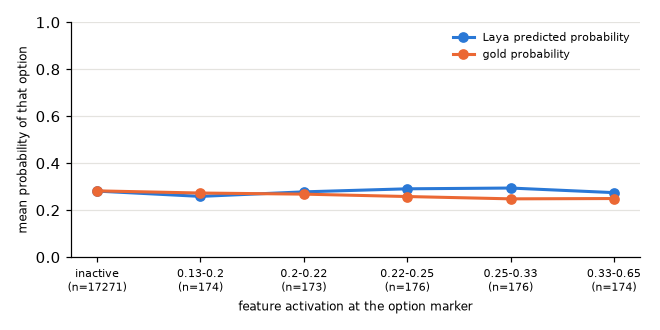

# Feature 9361

Critérios em que aparece: corr_probe_right_laya_wrong_stratified

**Interpretação (preencher):** 

---

## Maiores ativações

**tr_customer_service_000153 / churn_risk** (score, customer_service) | ativação 1.580 em `opção` | opções ['0', '1', '2', '3'] | Laya: **1** [0.1, 0.721, 0.125, 0.053] | gabarito: **0**

```
<bos> score question: How likely is this customer to stop doing business with us because of this interaction?<eos>
▸ <mask> level 0: No sign of dissatisfaction.
▸ <mask> level 1: Mild frustration, but the relationship is intact.
▸ <mask> level 2: Clearly⟦ unhappy⟧; repeat problems or explicit complaints.
▸ <mask> level 3: Imminent: threatening to cancel, dispute or leave.

<eos>

 {"account": {"lifetime_value_usd": 232, "prior_tickets_90d": 3, "seats": 1, "tenure_months": 8, "tier": "standard"}, "thread": [{"role": "customer", "text": "We've added three new team members and need to assign them seats in the admin portal. The current seat count shows six, but we should have nine."}, {"role": "agent", "text": "I see, thanks for the details. Could you confirm the email addresses of the new users?"}, {"role": "customer", "text": "Sure, they're alice@example.com, bob@example.com, and carol@example.com."}]}<eos>
```

**tr_security_incidents_000274 / credential_compromise** (noul, security_incidents) | ativação 1.554 em `estado` | opções ['false', 'true'] | Laya: **true** [0.313, 0.687] | gabarito: **true**

```
<bos> noul question: The evidence indicates a credential or account has been compromised.<eos>
▸ <mask> false: no, the statement does not hold
▸ <mask> true: yes, the statement holds

<eos>

 {"alert": {"description": "two successful logins from distant locations too close together", "evidence": "Successful logins were recorded for admin user 'jdoe' from IP 203.0.113.45 (New York, USA) at 2026-09-15 02:05:10 UTC and from IP 198.51.100.22 (Sydney, AU) at 2026-09-15 02:18:43 UTC, a 13‑⟦minute⟧ interval. Both sessions used MFA and originated from an unrecognized source. The account’s credentials had not been refreshed for 180 days and no change window was defined.", "rule": "impossible_travel"}, "context": {"asset_criticality": "crown_jewel", "change_window_active": false, "source_on_allowlist": false}, "history": {"credential_rotation_days_ago": 180, "distinct_countries_30d": 1, "logins_30d": 1701, "prior_alerts_90d": 1}, "principal": {"mfa_enrolled": true, "name": "adm-support-968", "privileges": ["deploy:production", "secrets:read"], "type": "admin"}}<eos>
```

**tr_security_incidents_000274 / severity** (score, security_incidents) | ativação 1.544 em `estado` | opções ['0', '1', '2', '3', '4'] | Laya: **1** [0.079, 0.573, 0.201, 0.086, 0.061] | gabarito: **4**

```
<bos> score question: How severe is the potential impact if this alert is real?<eos>
▸ <mask> level 0: Negligible: no access to anything sensitive.
▸ <mask> level 1: Low: limited access, easily reversed.
▸ <mask> level 2: Moderate: access to internal systems or non-public data.
▸ <mask> level 3: High: access to production, secrets or customer data.
▸ <mask> level 4: Critical: active compromise of crown-jewel systems.

<eos>

 {"alert": {"description": "two successful logins from distant locations too close together", "evidence": "Successful logins were recorded for admin user 'jdoe' from IP 203.0.113.45 (New York, USA) at 2026-09-15 02:05:10 UTC and from IP 198.51.100.22 (Sydney, AU) at 2026-09-15 02:18:43 UTC, a 13‑⟦minute⟧ interval. Both sessions used MFA and originated from an unrecognized source. The account’s credentials had not been refreshed for 180 days and no change window was defined.", "rule": "impossible_travel"}, "context": {"asset_criticality": "crown_jewel", "change_window_active": false, "source_on_allowlist": false}, "history": {"credential_rotation_days_ago": 180, "distinct_countries_30d": 1, "logins_30d": 1701, "prior_alerts_90d": 1}, "principal": {"mfa_enrolled": true, "name": "adm-support-968", "privileges": ["deploy:production", "secrets:read"], "type": "admin"}}<eos>
```

**tr_security_incidents_000274 / true_positive** (noul, security_incidents) | ativação 1.536 em `estado` | opções ['false', 'true'] | Laya: **false** [0.509, 0.491] | gabarito: **true**

```
<bos> noul question: This alert reflects genuinely malicious or unauthorised activity.<eos>
▸ <mask> false: Benign activity, a misconfiguration, or a known false positive.
▸ <mask> true: The underlying behaviour is malicious or unauthorised.

<eos>

 {"alert": {"description": "two successful logins from distant locations too close together", "evidence": "Successful logins were recorded for admin user 'jdoe' from IP 203.0.113.45 (New York, USA) at 2026-09-15 02:05:10 UTC and from IP 198.51.100.22 (Sydney, AU) at 2026-09-15 02:18:43 UTC, a 13‑⟦minute⟧ interval. Both sessions used MFA and originated from an unrecognized source. The account’s credentials had not been refreshed for 180 days and no change window was defined.", "rule": "impossible_travel"}, "context": {"asset_criticality": "crown_jewel", "change_window_active": false, "source_on_allowlist": false}, "history": {"credential_rotation_days_ago": 180, "distinct_countries_30d": 1, "logins_30d": 1701, "prior_alerts_90d": 1}, "principal": {"mfa_enrolled": true, "name": "adm-support-968", "privileges": ["deploy:production", "secrets:read"], "type": "admin"}}<eos>
```

**tr_security_incidents_000274 / disposition** (choice, security_incidents) | ativação 1.533 em `estado` | opções ['close_benign', 'contain', 'investigate', 'monitor'] | Laya: **contain** [0.1, 0.448, 0.082, 0.371] | gabarito: **contain**

```
<bos> choice question: How should this security alert be dispositioned?<eos>
▸ <mask> close_benign: Expected, explainable activity; close without analyst time.
▸ <mask> contain: Contain the host or account immediately; do not wait for triage.
▸ <mask> investigate: Warrants an analyst opening an investigation.
▸ <mask> monitor: Not clearly malicious, but worth watching for recurrence.

<eos>

 {"alert": {"description": "two successful logins from distant locations too close together", "evidence": "Successful logins were recorded for admin user 'jdoe' from IP 203.0.113.45 (New York, USA) at 2026-09-15 02:05:10 UTC and from IP 198.51.100.22 (Sydney, AU) at 2026-09-15 02:18:43 UTC, a 13‑⟦minute⟧ interval. Both sessions used MFA and originated from an unrecognized source. The account’s credentials had not been refreshed for 180 days and no change window was defined.", "rule": "impossible_travel"}, "context": {"asset_criticality": "crown_jewel", "change_window_active": false, "source_on_allowlist": false}, "history": {"credential_rotation_days_ago": 180, "distinct_countries_30d": 1, "logins_30d": 1701, "prior_alerts_90d": 1}, "principal": {"mfa_enrolled": true, "name": "adm-support-968", "privileges": ["deploy:production", "secrets:read"], "type": "admin"}}<eos>
```

## Ativações medianas (faixa 40-60%, mediana 0.470)

**tr_security_incidents_000155 / disposition** (choice, security_incidents) | ativação 0.509 em `estado` | opções ['close_benign', 'contain', 'investigate', 'monitor'] | Laya: **monitor** [0.219, 0.364, 0.035, 0.382] | gabarito: **investigate**

```
<bos> choice question: How should this security alert be dispositioned?<eos>
▸ <mask> close_benign: Expected, explainable activity; close without analyst time.
▸ <mask> contain: Contain the host or account immediately; do not wait for triage.
▸ <mask> investigate: Warrants an analyst opening an investigation.
▸ <mask> monitor: Not clearly malicious, but worth watching for recurrence.

<eos>

 {"alert": {"description": "a security group was opened to the public internet", "evidence": "An administrative user updated the security group 'sg-0a1b2c3d' to permit ingress traffic on all ports from the 0.0.0.0/0 CIDR block. The modification was performed at 10:05 UTC from an unrecognized network origin during an active change window.", "rule": "config_drift"}, "context": {"asset_critical⟦ity⟧": "low", "change_window_active": true, "source_on_allowlist": false}, "history": {"credential_rotation_days_ago": 180, "distinct_countries_30d": 1, "logins_30d": 1475, "prior_alerts_90d": 0}, "principal": {"mfa_enrolled": true, "name": "svc-billing-961", "privileges": ["deploy:production", "secrets:read"], "type": "admin"}}<eos>
```

**tr_invoice_processing_000084 / disposition** (choice, invoice_processing) | ativação 0.440 em `estado` | opções ['approve', 'hold', 'manual_review', 'reject'] | Laya: **reject** [0.226, 0.028, 0.01, 0.736] | gabarito: **manual_review**

```
<bos> choice question: How should this vendor invoice be dispositioned?<eos>
▸ <mask> approve: Matches the order and delivery; approve for payment.
▸ <mask> hold: Something needs confirming before payment; hold pending clarification.
▸ <mask> manual_review: A human in finance must review the discrepancy.
▸ <mask> reject: Should not be paid: duplicate, unauthorised or materially wrong.

<eos>

 {"delivery": {"condition": "accepted with exceptions", "date": "2026-03-16", "received_qty": 50}, "invoice": {"currency": "USD", "id": "INV-2026-1996", "lines": [{"qty": 50, "sku": "SKU-328", "total_usd": 12712.0, "unit_usd": 254.24}, {"qty": 1, "sku": "FREIGHT", "total_usd": 1109.62, "unit_usd": 1109.62}], "total_usd": 13821.62, "vendor": "Northwind Components"}, "payment": {"days_until_due": -3, "discount_expires_in_days": null, "early_payment_discount_pct": null, "status": "overdue", "terms": "net 45"}, "purchase_order": {"freight_terms": "freight prepaid by vendor, not separately b⟦illable⟧", "id": "PO-1937", "lines": [{"qty": 50, "unit_usd": 254.24}], "total_usd": 12712.0}, "vendor_history": {"disputes_12m": 1, "invoices_12m": 47, "prior_invoice_ids": ["INV-2026-9682", "INV-2026-1261"]}}<eos>
```

**tr_security_incidents_000132 / severity** (score, security_incidents) | ativação 0.433 em `estado` | opções ['0', '1', '2', '3', '4'] | Laya: **1** [0.057, 0.58, 0.202, 0.09, 0.071] | gabarito: **1**

```
<bos> score question: How severe is the potential impact if this alert is real?<eos>
▸ <mask> level 0: Negligible: no access to anything sensitive.
▸ <mask> level 1: Low: limited access, easily reversed.
▸ <mask> level 2: Moderate: access to internal systems or non-public data.
▸ <mask> level 3: High: access to production, secrets or customer data.
▸ <mask> level 4: Critical: active compromise of crown-jewel systems.

<eos>

 {"alert": {"description": "a security group was opened to the public internet", "evidence": "At 2026-09-15 03:12 UTC, security group sg-0a1b2c3d4e was altered to include an inbound rule allowing 0.0.0.0/0 on TCP port 22. The change was performed by employee jdoe@example.com, a privileged account with MFA enabled, during an open change window. The source IP (203.0.113.45) is⟦ not⟧ on the trusted list and the account's credentials were last rotated 14 days prior.", "rule": "config_drift"}, "context": {"asset_criticality": "low", "change_window_active": true, "source_on_allowlist": false}, "history": {"credential_rotation_days_ago": 14, "distinct_countries_30d": 3, "logins_30d": 1115, "prior_alerts_90d": 0}, "principal": {"mfa_enrolled": true, "name": "usr-analytics-746", "privileges": ["deploy:production", "secrets:read"], "type": "employee"}}<eos>
```

**tr_customer_service_000003 / urgency** (score, customer_service) | ativação 0.483 em `opção` | opções ['0', '1', '2', '3'] | Laya: **2** [0.257, 0.155, 0.333, 0.255] | gabarito: **2**

```
<bos> score question: How time-sensitive is this conversation?<eos>
▸ <mask> level 0: No time pressure; can wait indefinitely.
▸ <mask> level 1: Routine; handle within the normal queue.
▸ <mask> level 2: Elevated; should be handled within the same week.
▸ <mask> level 3: Critical; requires action within the⟦ same⟧ day.

<eos>

 {"account": {"lifetime_value_usd": 89, "prior_tickets_90d": 5, "seats": 1, "tenure_months": 1, "tier": "premium"}, "orders": [{"amount_usd": 49, "date": "2026-02-28", "id": "A-29326", "status": "settled"}], "thread": [{"role": "customer", "text": "I’m extremely frustrated – the item I received is completely wrong and I need the correct product by Friday, otherwise I’m canceling my premium subscription."}, {"role": "agent", "text": "I’m sorry you’ve had this experience. Could you share the order number so I can look up the details?"}, {"role": "customer", "text": "The order number is #A12345. I ordered the wireless headphones, but got a Bluetooth speaker instead. I need the headphones before the weekend."}, {"role": "agent", "text": "Thank you for the information. To arrange a replacement, could you confirm the shipping address you’d like the headphones sent to?"}, {"role": "customer", "text": "Send them to 742 Evergreen Terrace, Springfield. I’ll be watching for the delivery, and I expect it before Friday as I mentioned."}]}<eos>
```

**tr_invoice_processing_000235 / matches_order** (noul, invoice_processing) | ativação 0.451 em `estado` | opções ['false', 'true'] | Laya: **true** [0.027, 0.972] | gabarito: **false**

```
<bos> noul question: The invoice reconciles with the purchase order and the recorded delivery.<eos>
▸ <mask> false: There is a discrepancy against the order or the delivery.
▸ <mask> true: Line items, quantities and amounts reconcile.

<eos>

 {"delivery": {"condition": "accepted", "date": "2026-03-02", "received_qty": 400}, "invoice": {"currency": "USD", "id": "INV-2026-5490", "lines": [{"qty": 400, "sku": "SKU-582", "total_usd": 38948.0, "unit_usd": 97.37}], "total_usd": 38948.0, "vendor": "Pallas Industrial"}, "payment": {"days_until_due": -⟦3⟧, "discount_expires_in_days": null, "early_payment_discount_pct": null, "status": "overdue", "terms": "net 30"}, "purchase_order": {"freight_terms": "freight prepaid by vendor, not separately billable", "id": "PO-1506", "lines": [{"qty": 400, "unit_usd": 94.53}], "total_usd": 37812.0}, "vendor_history": {"disputes_12m": 5, "invoices_12m": 1, "prior_invoice_ids": ["INV-2026-9347"]}}<eos>
```

## Estatísticas (conjunto de descoberta, dev e teste)

**pred / error**

| split | decisões | ativas | ativas e Laya errou | taxa | lift | q (BH) | OR (CMH) | q (CMH) |
|---|---|---|---|---|---|---|---|---|
| discovery | 5100 | 251 | 171 | 0.681 | 1.06 | 0.276 | 1.01 | 0.988 |
| dev | 900 | 40 | 30 | 0.750 | 1.12 | 0.507 | 1.59 | 0.729 |
| test | 2000 | 89 | 66 | 0.742 | 1.14 | 0.114 | 1.08 | 0.964 |

**corr / error**

| split | decisões | ativas | ativas e Laya errou | taxa | lift | q (BH) | OR (CMH) | q (CMH) |
|---|---|---|---|---|---|---|---|---|
| discovery | 5100 | 236 | 156 | 0.661 | 1.03 | 0.669 | 1.40 | 0.13 |
| dev | 900 | 37 | 27 | 0.730 | 1.09 | 0.708 | 2.51 | 0.221 |
| test | 2000 | 79 | 56 | 0.709 | 1.09 | 0.375 | 2.03 | 0.0954 |

**state / error**

| split | decisões | ativas | ativas e Laya errou | taxa | lift | q (BH) | OR (CMH) | q (CMH) |
|---|---|---|---|---|---|---|---|---|
| discovery | 5100 | 3785 | 2542 | 0.672 | 1.04 | 1.1e-10 | 1.27 | 0.0681 |
| dev | 900 | 704 | 488 | 0.693 | 1.03 | 0.176 | 1.35 | 0.594 |
| test | 2000 | 1477 | 984 | 0.666 | 1.02 | 0.111 | 1.11 | 0.789 |

**pred / probe_right_laya_wrong**

| split | decisões | ativas | ativas e Laya errou | taxa | lift | q (BH) | OR (CMH) | q (CMH) |
|---|---|---|---|---|---|---|---|---|
| discovery | 2819 | 105 | 72 | 0.686 | 1.06 | 0.508 | 0.86 | 0.69 |
| dev | 520 | 13 | 9 | 0.692 | 1.03 | nan | nan | nan |
| test | 1106 | 46 | 33 | 0.717 | 1.13 | 0.369 | 0.95 | 0.938 |

**corr / probe_right_laya_wrong**

| split | decisões | ativas | ativas e Laya errou | taxa | lift | q (BH) | OR (CMH) | q (CMH) |
|---|---|---|---|---|---|---|---|---|
| discovery | 2819 | 109 | 76 | 0.697 | 1.08 | 0.354 | 2.11 | 0.0497 |
| dev | 520 | 18 | 14 | 0.778 | 1.15 | nan | nan | nan |
| test | 1106 | 45 | 32 | 0.711 | 1.12 | 0.395 | 2.43 | 0.232 |

**state / probe_right_laya_wrong**

| split | decisões | ativas | ativas e Laya errou | taxa | lift | q (BH) | OR (CMH) | q (CMH) |
|---|---|---|---|---|---|---|---|---|
| discovery | 2819 | 2079 | 1426 | 0.686 | 1.06 | 2.34e-11 | 1.21 | 0.354 |
| dev | 520 | 406 | 286 | 0.704 | 1.04 | 0.117 | 1.45 | 0.542 |
| test | 1106 | 815 | 539 | 0.661 | 1.04 | 0.0133 | 0.92 | 0.872 |

Confusão mais sobre-representada (pred): `risk|2>1` (n=26, lift 6.60, p=1.99e-15). Formato `pergunta|índice previsto>índice correto`.

Confusão mais sobre-representada (corr): `risk|2>1` (n=29, lift 7.83, p=2.36e-19). Formato `pergunta|índice previsto>índice correto`.

Confusão mais sobre-representada (state): `discrepancy_severity|2>0` (n=107, lift 1.33, p=2.74e-13). Formato `pergunta|índice previsto>índice correto`.



