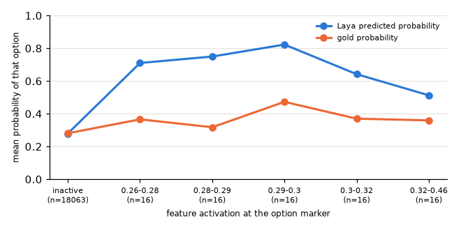

# Feature 9379

Critérios em que aparece: pred_error_stratified

**Interpretação (preencher):** 

---

## Maiores ativações

**tr_security_incidents_000046 / credential_compromise** (noul, security_incidents) | ativação 3.439 em `estado` | opções ['false', 'true'] | Laya: **false** [0.656, 0.344] | gabarito: **true**

```
<bos> noul question: The evidence indicates a credential or account has been compromised.<eos>
▸ <mask> false: no, the statement does not hold
▸ <mask> true: yes, the statement holds

<eos>

 {"alert": {"description": "a large transfer to an external destination", "evidence": "On 2026-09-15 09:22:03 UTC, a shared mailbox credential \"svc_mailbox\" initiated an outbound TCP session to 203.0.113.45:443, transferring⟦ approximately⟧ 1.3 TB of data over 38 minutes. The connection originated from the allowlisted IP 192.168.10.55, MFA was off for the account, and its password was last changed 14 days ago.", "rule": "data_egress"}, "context": {"asset_criticality": "medium", "change_window_active": false, "source_on_allowlist": true}, "history": {"credential_rotation_days_ago": 14, "distinct_countries_30d": 3, "logins_30d": 1058, "prior_alerts_90d": 8}, "principal": {"mfa_enrolled": false, "name": "svc-support-440", "privileges": ["deploy:production", "secrets:read"], "type": "shared_mailbox"}}<eos>
```

**tr_security_incidents_000046 / disposition** (choice, security_incidents) | ativação 3.402 em `estado` | opções ['close_benign', 'contain', 'investigate', 'monitor'] | Laya: **monitor** [0.156, 0.334, 0.056, 0.454] | gabarito: **investigate**

```
<bos> choice question: How should this security alert be dispositioned?<eos>
▸ <mask> close_benign: Expected, explainable activity; close without analyst time.
▸ <mask> contain: Contain the host or account immediately; do not wait for triage.
▸ <mask> investigate: Warrants an analyst opening an investigation.
▸ <mask> monitor: Not clearly malicious, but worth watching for recurrence.

<eos>

 {"alert": {"description": "a large transfer to an external destination", "evidence": "On 2026-09-15 09:22:03 UTC, a shared mailbox credential \"svc_mailbox\" initiated an outbound TCP session to 203.0.113.45:443, transferring⟦ approximately⟧ 1.3 TB of data over 38 minutes. The connection originated from the allowlisted IP 192.168.10.55, MFA was off for the account, and its password was last changed 14 days ago.", "rule": "data_egress"}, "context": {"asset_criticality": "medium", "change_window_active": false, "source_on_allowlist": true}, "history": {"credential_rotation_days_ago": 14, "distinct_countries_30d": 3, "logins_30d": 1058, "prior_alerts_90d": 8}, "principal": {"mfa_enrolled": false, "name": "svc-support-440", "privileges": ["deploy:production", "secrets:read"], "type": "shared_mailbox"}}<eos>
```

**tr_security_incidents_000046 / urgency** (score, security_incidents) | ativação 3.367 em `estado` | opções ['0', '1', '2', '3'] | Laya: **1** [0.098, 0.342, 0.235, 0.326] | gabarito: **3**

```
<bos> score question: How quickly must a responder act on this alert?<eos>
▸ <mask> level 0: No time pressure; can wait indefinitely.
▸ <mask> level 1: Routine; handle within the normal queue.
▸ <mask> level 2: Elevated; should be handled within the same week.
▸ <mask> level 3: Critical; requires action within the same day.

<eos>

 {"alert": {"description": "a large transfer to an external destination", "evidence": "On 2026-09-15 09:22:03 UTC, a shared mailbox credential \"svc_mailbox\" initiated an outbound TCP session to 203.0.113.45:443, transferring⟦ approximately⟧ 1.3 TB of data over 38 minutes. The connection originated from the allowlisted IP 192.168.10.55, MFA was off for the account, and its password was last changed 14 days ago.", "rule": "data_egress"}, "context": {"asset_criticality": "medium", "change_window_active": false, "source_on_allowlist": true}, "history": {"credential_rotation_days_ago": 14, "distinct_countries_30d": 3, "logins_30d": 1058, "prior_alerts_90d": 8}, "principal": {"mfa_enrolled": false, "name": "svc-support-440", "privileges": ["deploy:production", "secrets:read"], "type": "shared_mailbox"}}<eos>
```

**tr_security_incidents_000046 / severity** (score, security_incidents) | ativação 3.252 em `estado` | opções ['0', '1', '2', '3', '4'] | Laya: **1** [0.116, 0.316, 0.316, 0.132, 0.12] | gabarito: **3**

```
<bos> score question: How severe is the potential impact if this alert is real?<eos>
▸ <mask> level 0: Negligible: no access to anything sensitive.
▸ <mask> level 1: Low: limited access, easily reversed.
▸ <mask> level 2: Moderate: access to internal systems or non-public data.
▸ <mask> level 3: High: access to production, secrets or customer data.
▸ <mask> level 4: Critical: active compromise of crown-jewel systems.

<eos>

 {"alert": {"description": "a large transfer to an external destination", "evidence": "On 2026-09-15 09:22:03 UTC, a shared mailbox credential \"svc_mailbox\" initiated an outbound TCP session to 203.0.113.45:443, transferring⟦ approximately⟧ 1.3 TB of data over 38 minutes. The connection originated from the allowlisted IP 192.168.10.55, MFA was off for the account, and its password was last changed 14 days ago.", "rule": "data_egress"}, "context": {"asset_criticality": "medium", "change_window_active": false, "source_on_allowlist": true}, "history": {"credential_rotation_days_ago": 14, "distinct_countries_30d": 3, "logins_30d": 1058, "prior_alerts_90d": 8}, "principal": {"mfa_enrolled": false, "name": "svc-support-440", "privileges": ["deploy:production", "secrets:read"], "type": "shared_mailbox"}}<eos>
```

**tr_security_incidents_000179 / credential_compromise** (noul, security_incidents) | ativação 3.238 em `estado` | opções ['false', 'true'] | Laya: **true** [0.013, 0.987] | gabarito: **true**

```
<bos> noul question: The evidence indicates a credential or account has been compromised.<eos>
▸ <mask> false: no, the statement does not hold
▸ <mask> true: yes, the statement holds

<eos>

 {"alert": {"description": "many failed authentications followed by a success", "evidence": "From 2026-09-15 03:20:05 UTC to 03:22:31 UTC, the privileged service account svc_backup attempted 87 logins from allowlisted IP 192.0.2.55, recording 86 failed password attempts before a successful authentication. MFA was disabled for this account, and its password has not been changed since 2024-09-20 (⟦approximately⟧ 700 days). No change window was in effect at the time.", "rule": "brute_force"}, "context": {"asset_criticality": "medium", "change_window_active": false, "source_on_allowlist": true}, "history": {"credential_rotation_days_ago": 700, "distinct_countries_30d": 1, "logins_30d": 1592, "prior_alerts_90d": 0}, "principal": {"mfa_enrolled": false, "name": "ci-deploy-675", "privileges": ["deploy:production", "secrets:read"], "type": "service_account"}}<eos>
```

## Ativações medianas (faixa 40-60%, mediana 0.752)

**tr_agent_trace_observability_000018 / urgency** (score, agent_trace_observability) | ativação 0.932 em `estado` | opções ['0', '1', '2', '3'] | Laya: **1** [0.13, 0.351, 0.305, 0.213] | gabarito: **0**

```
<bos> score question: How quickly does this trace need attention?<eos>
▸ <mask> level 0: No time pressure; can wait indefinitely.
▸ <mask> level 1: Routine; handle within the normal queue.
▸ <mask> level 2: Elevated; should be handled within the same week.
▸ <mask> level 3: Critical; requires action within the same day.

<eos>

 {"agent": {"autonomy": "dry_run", "model": "internal-agent-v3"}, "constraints": ["Never modify production without an approved change ticket"], "task": "Triage⟦ and⟧ close duplicate issues in the support tracker.", "trace_summary": {"constraint_violations": 0, "duration_s": 655.6, "irreversible_actions": 0, "steps": 9, "tool_errors": 2}}<eos>
```

**tr_customer_service_000220 / action** (choice, customer_service) | ativação 0.566 em `estado` | opções ['answer_directly', 'close_no_action', 'escalate_to_human', 'execute_refund', 'request_information'] | Laya: **close_no_action** [0.202, 0.728, 0.022, 0.032, 0.016] | gabarito: **request_information**

```
<bos> choice question: What should the assistant do next with this conversation?<eos>
▸ <mask> answer_directly: The assistant can resolve this itself with information it already has.
▸ <mask> close_no_action: No further action is warranted; the matter is settled.
▸ <mask> escalate_to_human: Hand off to a human agent with the appropriate authority.
▸ <mask> execute_refund: Issue the refund or credit the customer is owed.
▸ <mask> request_information: More detail is needed from the customer before anything can be done.

<eos>

 {"account": {"lifetime_value_usd": 94, "prior_tickets_90d": 0, "seats": 1, "tenure_months": 1, "tier": "standard"}, "orders": [{"amount_usd": 9, "date": "2026-01-18", "id": "A-69685", "status": "settled"}, {"amount_usd": 9, "date": "2026-03-15", "id": "A-58214", "status": "settled"}, {"amount_usd": 9, "date": "2026-02-06", "id": "A-56446", "status": "failed"}], "thread": [{"role": "customer", "text": "I’ve been trying to log into my account for the past hour and it keeps throwing an error. I have a major presentation due in two hours and this is beyond frustrating. Why is this happening?"}, {"role": "agent", "text": "I’m sorry to hear you're experiencing trouble accessing your account right before your deadline. Could you please provide the specific error message or code you are seeing on your screen?"}, {"role": "customer", "text": "It just says 'Authentication Failed' no matter how many times I reset my password. I don't have time for this nonsense, I need access now."}, {"role": "agent", "text": "Thank you for that information. To help me investigate further, are you attempting to log in via a web browser or our mobile application?"}, {"role": "customer", "text": "I am using Chrome on my laptop, just like I do every single day. Just fix it, I have people waiting on these files."⟦}]⟧}<eos>
```

**tr_agent_trace_observability_000060 / outcome** (choice, agent_trace_observability) | ativação 0.901 em `estado` | opções ['failure', 'harmful', 'partial', 'success'] | Laya: **success** [0.175, 0.01, 0.177, 0.638] | gabarito: **partial**

```
<bos> choice question: How did this agent run turn out?<eos>
▸ <mask> failure: The agent did not accomplish the task.
▸ <mask> harmful: The agent took an action that caused damage or violated a constraint.
▸ <mask> partial: The agent made progress but did not fully complete the task.
▸ <mask> success: The agent completed the task correctly.

<eos>

 {"agent": {"autonomy": "unsupervised", "model": "internal-agent-v4"}, "constraints": ["Never modify production without an approved change ticket"], "task": "Triage⟦ and⟧ close duplicate issues in the support tracker.", "trace_summary": {"constraint_violations": 0, "duration_s": 330.2, "irreversible_actions": 0, "steps": 8, "tool_errors": 2}}<eos>
```

**tr_customer_service_000210 / needs_human** (noul, customer_service) | ativação 0.615 em `estado` | opções ['false', 'true'] | Laya: **false** [0.852, 0.148] | gabarito: **true**

```
<bos> noul question: This conversation requires a human agent rather than automated handling.<eos>
▸ <mask> false: Automation can carry this to resolution.
▸ <mask> true: A human must take over: judgement, authority or empathy is required.

<eos>

 {"account": {"lifetime_value_usd": 459, "prior_tickets_90d": 5, "seats": 1, "tenure_months": 14, "tier": "free"}, "orders": [{"amount_usd": 299, "date": "2026-03-18", "id": "A-97738", "status": "failed"}, {"amount_usd": 299, "date": "2026-02-26", "id": "A-91369", "status": "refunded"}, {"amount_usd": 299, "date": "2026-03-24", "id": "A-52614", "status": "settled"}], "thread": [{"role": "customer", "text": "Hello, I’d like to downgrade my account to the Free plan. I’ve been with you for over a year and have $299 worth of credits, but I need this change by the end of the month."}, {"role": "agent", "text": "Thank you for reaching out. Just to confirm, you’re currently on a paid tier and want to move to the Free plan. May I ask which features you rely on most so we can ensure the downgrade won’t impact your workflow?"}, {"role": "customer", "text": "I mainly use the analytics dashboard and the API access; I’m okay losing the advanced reporting, but I can’t lose API keys."}, {"role": "agent", "text": "Got it. Could you also let me know if there are any pending invoices or credit adjustments that need to be addressed before we proceed?"}, {"role": "customer", "text": "No pending invoices—just the $299 credit I’ve accumulated, which I’d like applied before the downgrade takes effect."⟦}]⟧}<eos>
```

**tr_customer_service_000031 / action** (choice, customer_service) | ativação 0.807 em `estado` | opções ['answer_directly', 'close_no_action', 'escalate_to_human', 'execute_refund', 'request_information'] | Laya: **answer_directly** [0.979, 0.008, 0.002, 0.011, 0.0] | gabarito: **escalate_to_human**

```
<bos> choice question: What should the assistant do next with this conversation?<eos>
▸ <mask> answer_directly: The assistant can resolve this itself with information it already has.
▸ <mask> close_no_action: No further action is warranted; the matter is settled.
▸ <mask> escalate_to_human: Hand off to a human agent with the appropriate authority.
▸ <mask> execute_refund: Issue the refund or credit the customer is owed.
▸ <mask> request_information: More detail is needed from the customer before anything can be done.

<eos>

 {"account": {"lifetime_value_usd": 581, "prior_tickets_90d": 0, "seats": 3, "tenure_months": 14, "tier": "enterprise"}, "thread": [{"role": "customer", "text": "I noticed two identical charges on my bank statement for this month's enterprise subscription. I suppose I'm not surprised, but I'd like to know why this happened."}, {"role": "agent", "text": "I am sorry to hear that you are seeing duplicate charges. To help me investigate this further, could you please share the transaction IDs associated with those charges?"}, {"role": "customer", "text": "I'm not sure where to find those IDs. I just see the two lines on my dashboard history that match the ones on my bank app."}, {"role": "agent", "text": "No problem at all. If you could send over a screenshot of your billing history page or the exact timestamps listed for those two transactions, I can start looking into the account logs."}, {"role": "customer", "text": "Here is the screenshot. It’s the same amount charged twice on the same day, which seems like a bit of a mess."}, {"role": "agent", "text": "Thank you for attaching that file. I’ve received the document, and I’m going to begin reviewing our payment processing records to see how these entries were⟦ generated⟧."}, {"role": "customer", "text": "Alright, let me know what you find whenever you get around to it, I guess."}]}<eos>
```

## Estatísticas (conjunto de descoberta, dev e teste)

**pred / error**

| split | decisões | ativas | ativas e Laya errou | taxa | lift | q (BH) | OR (CMH) | q (CMH) |
|---|---|---|---|---|---|---|---|---|
| discovery | 5100 | 59 | 40 | 0.678 | 1.05 | 0.735 | 2.62 | 0.0498 |
| dev | 900 | 9 | 4 | 0.444 | 0.66 | nan | nan | nan |
| test | 2000 | 22 | 12 | 0.545 | 0.84 | 0.493 | 1.53 | 0.758 |

**corr / error**

| split | decisões | ativas | ativas e Laya errou | taxa | lift | q (BH) | OR (CMH) | q (CMH) |
|---|---|---|---|---|---|---|---|---|
| discovery | 5100 | 25 | 6 | 0.240 | 0.37 | 0.000159 | 0.31 | 0.194 |
| dev | 900 | 9 | 4 | 0.444 | 0.66 | nan | nan | nan |
| test | 2000 | 13 | 3 | 0.231 | 0.35 | nan | nan | nan |

**state / error**

| split | decisões | ativas | ativas e Laya errou | taxa | lift | q (BH) | OR (CMH) | q (CMH) |
|---|---|---|---|---|---|---|---|---|
| discovery | 5100 | 628 | 388 | 0.618 | 0.96 | 0.303 | 1.02 | 0.947 |
| dev | 900 | 102 | 62 | 0.608 | 0.90 | 0.489 | 0.88 | 0.863 |
| test | 2000 | 192 | 116 | 0.604 | 0.93 | 0.449 | 0.85 | 0.73 |

**pred / probe_right_laya_wrong**

| split | decisões | ativas | ativas e Laya errou | taxa | lift | q (BH) | OR (CMH) | q (CMH) |
|---|---|---|---|---|---|---|---|---|
| discovery | 2819 | 40 | 31 | 0.775 | 1.20 | 0.147 | 2.72 | 0.0803 |
| dev | 520 | 5 | 3 | 0.600 | 0.89 | nan | nan | nan |
| test | 1106 | 16 | 10 | 0.625 | 0.99 | nan | nan | nan |

**corr / probe_right_laya_wrong**

| split | decisões | ativas | ativas e Laya errou | taxa | lift | q (BH) | OR (CMH) | q (CMH) |
|---|---|---|---|---|---|---|---|---|
| discovery | 2819 | 11 | 2 | 0.182 | 0.28 | nan | nan | nan |
| dev | 520 | 5 | 3 | 0.600 | 0.89 | nan | nan | nan |
| test | 1106 | 8 | 2 | 0.250 | 0.40 | nan | nan | nan |

**state / probe_right_laya_wrong**

| split | decisões | ativas | ativas e Laya errou | taxa | lift | q (BH) | OR (CMH) | q (CMH) |
|---|---|---|---|---|---|---|---|---|
| discovery | 2819 | 334 | 196 | 0.587 | 0.91 | 0.044 | 0.95 | 0.886 |
| dev | 520 | 48 | 24 | 0.500 | 0.74 | 0.13 | 0.68 | 0.589 |
| test | 1106 | 102 | 61 | 0.598 | 0.94 | 0.754 | 1.31 | 0.601 |

Confusão mais sobre-representada (pred): `needs_review|0>1` (n=35, lift 28.81, p=0). Formato `pergunta|índice previsto>índice correto`.

Confusão mais sobre-representada (corr): `true_positive|1>0` (n=3, lift 8.74, p=0.00459). Formato `pergunta|índice previsto>índice correto`.

Confusão mais sobre-representada (state): `needs_human|0>1` (n=31, lift 4.66, p=2.19e-15). Formato `pergunta|índice previsto>índice correto`.



