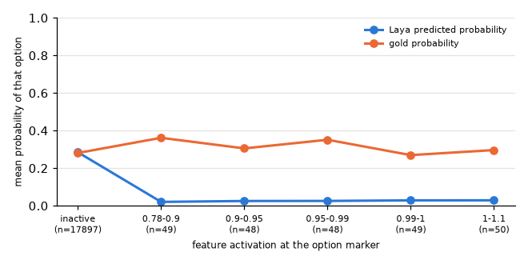

# Feature 9524

Critérios em que aparece: corr_probe_right_laya_wrong

**Interpretação (preencher):** 

---

## Maiores ativações

**tr_customer_service_000203 / category** (choice, customer_service) | ativação 1.512 em `estado` | opções ['account', 'billing', 'delivery', 'refund', 'technical'] | Laya: **account** [0.995, 0.0, 0.0, 0.0, 0.004] | gabarito: **technical**

```
<bos> choice question: What is this customer conversation primarily about?<eos>
▸ <mask> account: Login, plan changes, profile or access management.
▸ <mask> billing: A charge, invoice, subscription or payment problem.
▸ <mask> delivery: Shipping, fulfilment or delivery of a physical item.
▸ <mask> refund: The customer is explicitly asking for money back.
▸ <mask> technical: The product or service is not working as expected.

<eos>

 {"account": {"lifetime_value_usd": 303, "prior_tickets_90d": 1, "seats": 12, "tenure_months": 5, "tier": "premium"}, "thread": [{"role": "customer", "text": "Since the last update, the sync process has been taking around 15 minutes for a few⟦ meg⟧abytes, which is much slower than before."}]}<eos>
```

**tr_security_incidents_000110 / severity** (score, security_incidents) | ativação 1.453 em `estado` | opções ['0', '1', '2', '3', '4'] | Laya: **1** [0.126, 0.358, 0.258, 0.126, 0.134] | gabarito: **2**

```
<bos> score question: How severe is the potential impact if this alert is real?<eos>
▸ <mask> level 0: Negligible: no access to anything sensitive.
▸ <mask> level 1: Low: limited access, easily reversed.
▸ <mask> level 2: Moderate: access to internal systems or non-public data.
▸ <mask> level 3: High: access to production, secrets or customer data.
▸ <mask> level 4: Critical: active compromise of crown-jewel systems.

<eos>

 {"alert": {"description": "many failed authentications followed by a success", "evidence": "⟦Fifty⟧‑seven failed RDP authentication attempts were logged against host WIN-DB01 (192.168.5.22) between 2026-09-15 14:10 and 14:18 UTC, followed by a successful login from the same source IP 172.16.8.44 at 14:19 UTC. The login used a shared_mailbox account with MFA enabled, unprivileged status, and a password that has not been rotated for 700 days; the source IP is present on the allowlist.", "rule": "brute_force"}, "context": {"asset_criticality": "high", "change_window_active": false, "source_on_allowlist": true}, "history": {"credential_rotation_days_ago": 700, "distinct_countries_30d": 1, "logins_30d": 1558, "prior_alerts_90d": 1}, "principal": {"mfa_enrolled": true, "name": "svc-billing-899", "privileges": ["repo:read"], "type": "shared_mailbox"}}<eos>
```

**tr_security_incidents_000110 / urgency** (score, security_incidents) | ativação 1.446 em `estado` | opções ['0', '1', '2', '3'] | Laya: **3** [0.172, 0.228, 0.228, 0.371] | gabarito: **3**

```
<bos> score question: How quickly must a responder act on this alert?<eos>
▸ <mask> level 0: No time pressure; can wait indefinitely.
▸ <mask> level 1: Routine; handle within the normal queue.
▸ <mask> level 2: Elevated; should be handled within the same week.
▸ <mask> level 3: Critical; requires action within the same day.

<eos>

 {"alert": {"description": "many failed authentications followed by a success", "evidence": "⟦Fifty⟧‑seven failed RDP authentication attempts were logged against host WIN-DB01 (192.168.5.22) between 2026-09-15 14:10 and 14:18 UTC, followed by a successful login from the same source IP 172.16.8.44 at 14:19 UTC. The login used a shared_mailbox account with MFA enabled, unprivileged status, and a password that has not been rotated for 700 days; the source IP is present on the allowlist.", "rule": "brute_force"}, "context": {"asset_criticality": "high", "change_window_active": false, "source_on_allowlist": true}, "history": {"credential_rotation_days_ago": 700, "distinct_countries_30d": 1, "logins_30d": 1558, "prior_alerts_90d": 1}, "principal": {"mfa_enrolled": true, "name": "svc-billing-899", "privileges": ["repo:read"], "type": "shared_mailbox"}}<eos>
```

**tr_security_incidents_000110 / true_positive** (noul, security_incidents) | ativação 1.429 em `estado` | opções ['false', 'true'] | Laya: **true** [0.008, 0.992] | gabarito: **true**

```
<bos> noul question: This alert reflects genuinely malicious or unauthorised activity.<eos>
▸ <mask> false: Benign activity, a misconfiguration, or a known false positive.
▸ <mask> true: The underlying behaviour is malicious or unauthorised.

<eos>

 {"alert": {"description": "many failed authentications followed by a success", "evidence": "⟦Fifty⟧‑seven failed RDP authentication attempts were logged against host WIN-DB01 (192.168.5.22) between 2026-09-15 14:10 and 14:18 UTC, followed by a successful login from the same source IP 172.16.8.44 at 14:19 UTC. The login used a shared_mailbox account with MFA enabled, unprivileged status, and a password that has not been rotated for 700 days; the source IP is present on the allowlist.", "rule": "brute_force"}, "context": {"asset_criticality": "high", "change_window_active": false, "source_on_allowlist": true}, "history": {"credential_rotation_days_ago": 700, "distinct_countries_30d": 1, "logins_30d": 1558, "prior_alerts_90d": 1}, "principal": {"mfa_enrolled": true, "name": "svc-billing-899", "privileges": ["repo:read"], "type": "shared_mailbox"}}<eos>
```

**tr_security_incidents_000110 / credential_compromise** (noul, security_incidents) | ativação 1.349 em `estado` | opções ['false', 'true'] | Laya: **true** [0.006, 0.994] | gabarito: **true**

```
<bos> noul question: The evidence indicates a credential or account has been compromised.<eos>
▸ <mask> false: no, the statement does not hold
▸ <mask> true: yes, the statement holds

<eos>

 {"alert": {"description": "many failed authentications followed by a success", "evidence": "⟦Fifty⟧‑seven failed RDP authentication attempts were logged against host WIN-DB01 (192.168.5.22) between 2026-09-15 14:10 and 14:18 UTC, followed by a successful login from the same source IP 172.16.8.44 at 14:19 UTC. The login used a shared_mailbox account with MFA enabled, unprivileged status, and a password that has not been rotated for 700 days; the source IP is present on the allowlist.", "rule": "brute_force"}, "context": {"asset_criticality": "high", "change_window_active": false, "source_on_allowlist": true}, "history": {"credential_rotation_days_ago": 700, "distinct_countries_30d": 1, "logins_30d": 1558, "prior_alerts_90d": 1}, "principal": {"mfa_enrolled": true, "name": "svc-billing-899", "privileges": ["repo:read"], "type": "shared_mailbox"}}<eos>
```

## Ativações medianas (faixa 40-60%, mediana 0.977)

**tr_invoice_processing_000137 / disposition** (choice, invoice_processing) | ativação 0.958 em `marcador` | opções ['approve', 'hold', 'manual_review', 'reject'] | Laya: **approve** [0.636, 0.17, 0.029, 0.165] | gabarito: **approve**

```
<bos> choice question: How should this vendor invoice be dispositioned?<eos>
▸ <mask> approve: Matches the order and delivery; approve for payment.
▸ <mask> hold: Something needs confirming before payment; hold pending clarification.
▸ ⟦<mask>⟧ manual_review: A human in finance must review the discrepancy.
▸ <mask> reject: Should not be paid: duplicate, unauthorised or materially wrong.

<eos>

 {"delivery": {"condition": "accepted", "date": "2026-03-06", "received_qty": 250}, "invoice": {"currency": "USD", "id": "INV-2026-7185", "lines": [{"qty": 250, "sku": "SKU-192", "total_usd": 19170.0, "unit_usd": 76.68}], "total_usd": 19170.0, "vendor": "Northwind Components"}, "payment": {"days_until_due": 11, "discount_expires_in_days": null, "early_payment_discount_pct": null, "status": "scheduled", "terms": "net 15"}, "purchase_order": {"freight_terms": "freight prepaid by vendor, not separately billable", "id": "PO-6991", "lines": [{"qty": 250, "unit_usd": 76.68}], "total_usd": 19170.0}, "vendor_history": {"disputes_12m": 5, "invoices_12m": 54, "prior_invoice_ids": ["INV-2026-3366", "INV-2026-2925"]}}<eos>
```

**tr_invoice_processing_000270 / disposition** (choice, invoice_processing) | ativação 0.976 em `marcador` | opções ['approve', 'hold', 'manual_review', 'reject'] | Laya: **reject** [0.415, 0.115, 0.027, 0.442] | gabarito: **hold**

```
<bos> choice question: How should this vendor invoice be dispositioned?<eos>
▸ <mask> approve: Matches the order and delivery; approve for payment.
▸ <mask> hold: Something needs confirming before payment; hold pending clarification.
▸ ⟦<mask>⟧ manual_review: A human in finance must review the discrepancy.
▸ <mask> reject: Should not be paid: duplicate, unauthorised or materially wrong.

<eos>

 {"delivery": {"condition": "accepted with exceptions", "date": "2026-03-27", "received_qty": 250}, "invoice": {"currency": "USD", "id": "INV-2026-6405", "lines": [{"qty": 250, "sku": "SKU-989", "total_usd": 43932.5, "unit_usd": 175.73}], "total_usd": 43932.5, "vendor": "Orbit Logistics"}, "payment": {"days_until_due": -9, "discount_expires_in_days": null, "early_payment_discount_pct": null, "status": "overdue", "terms": "net 45"}, "purchase_order": {"freight_terms": "freight prepaid by vendor, not separately billable", "id": "PO-9640", "lines": [{"qty": 250, "unit_usd": 175.73}], "total_usd": 43932.5}, "vendor_history": {"disputes_12m": 1, "invoices_12m": 34, "prior_invoice_ids": ["INV-2026-6405", "INV-2026-9686", "INV-2026-1551", "INV-2026-1949"]}}<eos>
```

**tr_invoice_processing_000286 / disposition** (choice, invoice_processing) | ativação 0.974 em `marcador` | opções ['approve', 'hold', 'manual_review', 'reject'] | Laya: **approve** [0.625, 0.087, 0.021, 0.266] | gabarito: **manual_review**

```
<bos> choice question: How should this vendor invoice be dispositioned?<eos>
▸ <mask> approve: Matches the order and delivery; approve for payment.
▸ <mask> hold: Something needs confirming before payment; hold pending clarification.
▸ ⟦<mask>⟧ manual_review: A human in finance must review the discrepancy.
▸ <mask> reject: Should not be paid: duplicate, unauthorised or materially wrong.

<eos>

 {"delivery": {"condition": "accepted", "date": "2026-03-01", "received_qty": 250}, "invoice": {"currency": "USD", "id": "INV-2026-8786", "lines": [{"qty": 250, "sku": "SKU-448", "total_usd": 7165.0, "unit_usd": 28.66}, {"qty": 1, "sku": "FREIGHT", "total_usd": 401.46, "unit_usd": 401.46}], "total_usd": 7566.46, "vendor": "Northwind Components"}, "payment": {"days_until_due": 2, "discount_expires_in_days": 1, "early_payment_discount_pct": 2.0, "status": "scheduled", "terms": "net 60"}, "purchase_order": {"freight_terms": "freight prepaid by vendor, not separately billable", "id": "PO-7457", "lines": [{"qty": 250, "unit_usd": 28.66}], "total_usd": 7165.0}, "vendor_history": {"disputes_12m": 0, "invoices_12m": 13, "prior_invoice_ids": ["INV-2026-4234", "INV-2026-5783", "INV-2026-1864"]}}<eos>
```

**tr_invoice_processing_000258 / disposition** (choice, invoice_processing) | ativação 0.966 em `marcador` | opções ['approve', 'hold', 'manual_review', 'reject'] | Laya: **approve** [0.39, 0.295, 0.032, 0.283] | gabarito: **manual_review**

```
<bos> choice question: How should this vendor invoice be dispositioned?<eos>
▸ <mask> approve: Matches the order and delivery; approve for payment.
▸ <mask> hold: Something needs confirming before payment; hold pending clarification.
▸ ⟦<mask>⟧ manual_review: A human in finance must review the discrepancy.
▸ <mask> reject: Should not be paid: duplicate, unauthorised or materially wrong.

<eos>

 {"delivery": {"condition": "accepted", "date": null, "received_qty": 0}, "invoice": {"currency": "USD", "id": "INV-2026-5102", "lines": [{"qty": 0, "sku": "SKU-492", "total_usd": 0.0, "unit_usd": 71.37}], "total_usd": 0.0, "vendor": "Vantage Materials"}, "payment": {"days_until_due": 5, "discount_expires_in_days": null, "early_payment_discount_pct": null, "status": "scheduled", "terms": "net 15"}, "purchase_order": {"freight_terms": "freight prepaid by vendor, not separately billable", "id": "PO-8165", "lines": [{"qty": 50, "unit_usd": 71.37}], "total_usd": 3568.5}, "vendor_history": {"disputes_12m": 0, "invoices_12m": 51, "prior_invoice_ids": ["INV-2026-9720"]}}<eos>
```

**tr_invoice_processing_000106 / disposition** (choice, invoice_processing) | ativação 0.953 em `marcador` | opções ['approve', 'hold', 'manual_review', 'reject'] | Laya: **approve** [0.476, 0.175, 0.025, 0.324] | gabarito: **manual_review**

```
<bos> choice question: How should this vendor invoice be dispositioned?<eos>
▸ <mask> approve: Matches the order and delivery; approve for payment.
▸ <mask> hold: Something needs confirming before payment; hold pending clarification.
▸ ⟦<mask>⟧ manual_review: A human in finance must review the discrepancy.
▸ <mask> reject: Should not be paid: duplicate, unauthorised or materially wrong.

<eos>

 {"delivery": {"condition": "accepted", "date": "2026-03-13", "received_qty": 100}, "invoice": {"currency": "USD", "id": "INV-2026-6136", "lines": [{"qty": 120, "sku": "SKU-324", "total_usd": 37388.4, "unit_usd": 311.57}], "total_usd": 37388.4, "vendor": "Vantage Materials"}, "payment": {"days_until_due": 11, "discount_expires_in_days": null, "early_payment_discount_pct": null, "status": "scheduled", "terms": "net 30"}, "purchase_order": {"freight_terms": "freight prepaid by vendor, not separately billable", "id": "PO-3705", "lines": [{"qty": 100, "unit_usd": 311.57}], "total_usd": 31157.0}, "vendor_history": {"disputes_12m": 1, "invoices_12m": 19, "prior_invoice_ids": ["INV-2026-9523", "INV-2026-7079", "INV-2026-5186", "INV-2026-5506"]}}<eos>
```

## Estatísticas (conjunto de descoberta, dev e teste)

**pred / error**

| split | decisões | ativas | ativas e Laya errou | taxa | lift | q (BH) | OR (CMH) | q (CMH) |
|---|---|---|---|---|---|---|---|---|
| discovery | 5100 | 0 | 0 | nan | nan | nan | nan | nan |
| dev | 900 | 0 | 0 | nan | nan | nan | nan | nan |
| test | 2000 | 0 | 0 | nan | nan | nan | nan | nan |

**corr / error**

| split | decisões | ativas | ativas e Laya errou | taxa | lift | q (BH) | OR (CMH) | q (CMH) |
|---|---|---|---|---|---|---|---|---|
| discovery | 5100 | 84 | 84 | 1.000 | 1.55 | 5.63e-16 | inf | 0.0398 |
| dev | 900 | 27 | 27 | 1.000 | 1.49 | 0.000141 | inf | 0.726 |
| test | 2000 | 38 | 38 | 1.000 | 1.54 | 5.15e-07 | inf | 0.176 |

**state / error**

| split | decisões | ativas | ativas e Laya errou | taxa | lift | q (BH) | OR (CMH) | q (CMH) |
|---|---|---|---|---|---|---|---|---|
| discovery | 5100 | 13 | 6 | 0.462 | 0.72 | nan | nan | nan |
| dev | 900 | 1 | 1 | 1.000 | 1.49 | nan | nan | nan |
| test | 2000 | 1 | 1 | 1.000 | 1.54 | nan | nan | nan |

**pred / probe_right_laya_wrong**

| split | decisões | ativas | ativas e Laya errou | taxa | lift | q (BH) | OR (CMH) | q (CMH) |
|---|---|---|---|---|---|---|---|---|
| discovery | 2819 | 0 | 0 | nan | nan | nan | nan | nan |
| dev | 520 | 0 | 0 | nan | nan | nan | nan | nan |
| test | 1106 | 0 | 0 | nan | nan | nan | nan | nan |

**corr / probe_right_laya_wrong**

| split | decisões | ativas | ativas e Laya errou | taxa | lift | q (BH) | OR (CMH) | q (CMH) |
|---|---|---|---|---|---|---|---|---|
| discovery | 2819 | 36 | 36 | 1.000 | 1.55 | 5.87e-07 | inf | 0.311 |
| dev | 520 | 13 | 13 | 1.000 | 1.48 | nan | nan | nan |
| test | 1106 | 20 | 20 | 1.000 | 1.58 | 0.000406 | inf | 0.397 |

**state / probe_right_laya_wrong**

| split | decisões | ativas | ativas e Laya errou | taxa | lift | q (BH) | OR (CMH) | q (CMH) |
|---|---|---|---|---|---|---|---|---|
| discovery | 2819 | 11 | 6 | 0.545 | 0.84 | nan | nan | nan |
| dev | 520 | 1 | 1 | 1.000 | 1.48 | nan | nan | nan |
| test | 1106 | 0 | 0 | nan | nan | nan | nan | nan |

Confusão mais sobre-representada (corr): `disposition|0>2` (n=48, lift 50.25, p=0). Formato `pergunta|índice previsto>índice correto`.

Confusão mais sobre-representada (state): `category|0>4` (n=1, lift 32.69, p=nan). Formato `pergunta|índice previsto>índice correto`.



