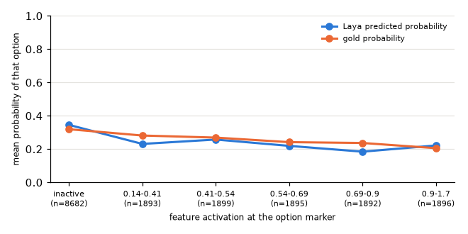

# Feature 9598

Critérios em que aparece: corr_error_stratified, pred_probe_right_laya_wrong_stratified, corr_probe_right_laya_wrong_stratified, attribution_toward_wrong

**Interpretação (preencher):** 

---

## Maiores ativações

**tr_customer_service_000069 / churn_risk** (score, customer_service) | ativação 1.743 em `marcador` | opções ['0', '1', '2', '3'] | Laya: **1** [0.084, 0.648, 0.182, 0.086] | gabarito: **2**

```
<bos> score question: How likely is this customer to stop doing business with us because of this interaction?<eos>
▸ ⟦<mask>⟧ level 0: No sign of dissatisfaction.
▸ <mask> level 1: Mild frustration, but the relationship is intact.
▸ <mask> level 2: Clearly unhappy; repeat problems or explicit complaints.
▸ <mask> level 3: Imminent: threatening to cancel, dispute or leave.

<eos>

 {"account": {"lifetime_value_usd": 1693, "prior_tickets_90d": 0, "seats": 1, "tenure_months": 26, "tier": "free"}, "thread": [{"role": "customer", "text": "I'm trying to pull our team's records into a CSV for a client deliverable and the export just spins. We're on the free plan, this has been going on for days, and I need the file by Friday at 5 p.m. It's our 26th month on the platform, so it's surprising how broken basic export is."}, {"role": "agent", "text": "Thanks for letting me know where you're at. Could you tell me whether the export fails during the initial request, after selecting the date range, or when the download file is supposed to start?"}, {"role": "customer", "text": "It fails right after I click generate. No error, just the spinner. I've tried Chrome and Safari, and I've even cleared cookies. The client deadline doesn't move, so I need someone to actually look at this before Friday."}, {"role": "agent", "text": "I understand the timing is tight. To help narrow it down, can you share the approximate number of records you're trying to export and whether you're exporting all projects or a subset?"}, {"role": "customer", "text": "It's roughly the whole workspace, but I can't get past the spinner to confirm. If it's an account limit or a backend issue, I need that explained by tomorrow, because Friday is non-negotiable."}]}<eos>
```

**tr_customer_service_000069 / action** (choice, customer_service) | ativação 1.725 em `marcador` | opções ['answer_directly', 'close_no_action', 'escalate_to_human', 'execute_refund', 'request_information'] | Laya: **close_no_action** [0.008, 0.963, 0.02, 0.005, 0.003] | gabarito: **escalate_to_human**

```
<bos> choice question: What should the assistant do next with this conversation?<eos>
▸ <mask> answer_directly: The assistant can resolve this itself with information it already has.
▸ <mask> close_no_action: No further action is warranted; the matter is settled.
▸ ⟦<mask>⟧ escalate_to_human: Hand off to a human agent with the appropriate authority.
▸ <mask> execute_refund: Issue the refund or credit the customer is owed.
▸ <mask> request_information: More detail is needed from the customer before anything can be done.

<eos>

 {"account": {"lifetime_value_usd": 1693, "prior_tickets_90d": 0, "seats": 1, "tenure_months": 26, "tier": "free"}, "thread": [{"role": "customer", "text": "I'm trying to pull our team's records into a CSV for a client deliverable and the export just spins. We're on the free plan, this has been going on for days, and I need the file by Friday at 5 p.m. It's our 26th month on the platform, so it's surprising how broken basic export is."}, {"role": "agent", "text": "Thanks for letting me know where you're at. Could you tell me whether the export fails during the initial request, after selecting the date range, or when the download file is supposed to start?"}, {"role": "customer", "text": "It fails right after I click generate. No error, just the spinner. I've tried Chrome and Safari, and I've even cleared cookies. The client deadline doesn't move, so I need someone to actually look at this before Friday."}, {"role": "agent", "text": "I understand the timing is tight. To help narrow it down, can you share the approximate number of records you're trying to export and whether you're exporting all projects or a subset?"}, {"role": "customer", "text": "It's roughly the whole workspace, but I can't get past the spinner to confirm. If it's an account limit or a backend issue, I need that explained by tomorrow, because Friday is non-negotiable."}]}<eos>
```

**tr_customer_service_000069 / churn_risk** (score, customer_service) | ativação 1.650 em `marcador` | opções ['0', '1', '2', '3'] | Laya: **1** [0.084, 0.648, 0.182, 0.086] | gabarito: **2**

```
<bos> score question: How likely is this customer to stop doing business with us because of this interaction?<eos>
▸ <mask> level 0: No sign of dissatisfaction.
▸ ⟦<mask>⟧ level 1: Mild frustration, but the relationship is intact.
▸ <mask> level 2: Clearly unhappy; repeat problems or explicit complaints.
▸ <mask> level 3: Imminent: threatening to cancel, dispute or leave.

<eos>

 {"account": {"lifetime_value_usd": 1693, "prior_tickets_90d": 0, "seats": 1, "tenure_months": 26, "tier": "free"}, "thread": [{"role": "customer", "text": "I'm trying to pull our team's records into a CSV for a client deliverable and the export just spins. We're on the free plan, this has been going on for days, and I need the file by Friday at 5 p.m. It's our 26th month on the platform, so it's surprising how broken basic export is."}, {"role": "agent", "text": "Thanks for letting me know where you're at. Could you tell me whether the export fails during the initial request, after selecting the date range, or when the download file is supposed to start?"}, {"role": "customer", "text": "It fails right after I click generate. No error, just the spinner. I've tried Chrome and Safari, and I've even cleared cookies. The client deadline doesn't move, so I need someone to actually look at this before Friday."}, {"role": "agent", "text": "I understand the timing is tight. To help narrow it down, can you share the approximate number of records you're trying to export and whether you're exporting all projects or a subset?"}, {"role": "customer", "text": "It's roughly the whole workspace, but I can't get past the spinner to confirm. If it's an account limit or a backend issue, I need that explained by tomorrow, because Friday is non-negotiable."}]}<eos>
```

**tr_customer_service_000069 / urgency** (score, customer_service) | ativação 1.575 em `marcador` | opções ['0', '1', '2', '3'] | Laya: **1** [0.228, 0.465, 0.152, 0.154] | gabarito: **2**

```
<bos> score question: How time-sensitive is this conversation?<eos>
▸ ⟦<mask>⟧ level 0: No time pressure; can wait indefinitely.
▸ <mask> level 1: Routine; handle within the normal queue.
▸ <mask> level 2: Elevated; should be handled within the same week.
▸ <mask> level 3: Critical; requires action within the same day.

<eos>

 {"account": {"lifetime_value_usd": 1693, "prior_tickets_90d": 0, "seats": 1, "tenure_months": 26, "tier": "free"}, "thread": [{"role": "customer", "text": "I'm trying to pull our team's records into a CSV for a client deliverable and the export just spins. We're on the free plan, this has been going on for days, and I need the file by Friday at 5 p.m. It's our 26th month on the platform, so it's surprising how broken basic export is."}, {"role": "agent", "text": "Thanks for letting me know where you're at. Could you tell me whether the export fails during the initial request, after selecting the date range, or when the download file is supposed to start?"}, {"role": "customer", "text": "It fails right after I click generate. No error, just the spinner. I've tried Chrome and Safari, and I've even cleared cookies. The client deadline doesn't move, so I need someone to actually look at this before Friday."}, {"role": "agent", "text": "I understand the timing is tight. To help narrow it down, can you share the approximate number of records you're trying to export and whether you're exporting all projects or a subset?"}, {"role": "customer", "text": "It's roughly the whole workspace, but I can't get past the spinner to confirm. If it's an account limit or a backend issue, I need that explained by tomorrow, because Friday is non-negotiable."}]}<eos>
```

**tr_customer_service_000069 / action** (choice, customer_service) | ativação 1.570 em `marcador` | opções ['answer_directly', 'close_no_action', 'escalate_to_human', 'execute_refund', 'request_information'] | Laya: **close_no_action** [0.008, 0.963, 0.02, 0.005, 0.003] | gabarito: **escalate_to_human**

```
<bos> choice question: What should the assistant do next with this conversation?<eos>
▸ <mask> answer_directly: The assistant can resolve this itself with information it already has.
▸ ⟦<mask>⟧ close_no_action: No further action is warranted; the matter is settled.
▸ <mask> escalate_to_human: Hand off to a human agent with the appropriate authority.
▸ <mask> execute_refund: Issue the refund or credit the customer is owed.
▸ <mask> request_information: More detail is needed from the customer before anything can be done.

<eos>

 {"account": {"lifetime_value_usd": 1693, "prior_tickets_90d": 0, "seats": 1, "tenure_months": 26, "tier": "free"}, "thread": [{"role": "customer", "text": "I'm trying to pull our team's records into a CSV for a client deliverable and the export just spins. We're on the free plan, this has been going on for days, and I need the file by Friday at 5 p.m. It's our 26th month on the platform, so it's surprising how broken basic export is."}, {"role": "agent", "text": "Thanks for letting me know where you're at. Could you tell me whether the export fails during the initial request, after selecting the date range, or when the download file is supposed to start?"}, {"role": "customer", "text": "It fails right after I click generate. No error, just the spinner. I've tried Chrome and Safari, and I've even cleared cookies. The client deadline doesn't move, so I need someone to actually look at this before Friday."}, {"role": "agent", "text": "I understand the timing is tight. To help narrow it down, can you share the approximate number of records you're trying to export and whether you're exporting all projects or a subset?"}, {"role": "customer", "text": "It's roughly the whole workspace, but I can't get past the spinner to confirm. If it's an account limit or a backend issue, I need that explained by tomorrow, because Friday is non-negotiable."}]}<eos>
```

## Ativações medianas (faixa 40-60%, mediana 0.489)

**tr_agent_trace_observability_000000 / action** (choice, agent_trace_observability) | ativação 0.558 em `marcador` | opções ['continue', 'human_review', 'observe', 'stop'] | Laya: **stop** [0.19, 0.036, 0.117, 0.657] | gabarito: **human_review**

```
<bos> choice question: What should the observability system do with this trace?<eos>
▸ <mask> continue: Let the agent proceed without interruption.
▸ <mask> human_review: Queue this trace for a human to review.
▸ <mask> observe: Keep running, but flag the trace for later sampling.
▸ ⟦<mask>⟧ stop: Halt the agent now.

<eos>

 {"agent": {"autonomy": "checkpointed", "model": "internal-agent-v4"}, "constraints": ["Do not touch customer data outside the named accounts"], "task": "Delete personal data for the accounts in the erasure queue.", "trace_summary": {"constraint_violations": 0, "duration_s": 128.5, "irreversible_actions": 0, "steps": 7, "tool_errors": 1}}<eos>
```

**tr_customer_service_000017 / action** (choice, customer_service) | ativação 0.480 em `CLS` | opções ['answer_directly', 'close_no_action', 'escalate_to_human', 'execute_refund', 'request_information'] | Laya: **close_no_action** [0.045, 0.884, 0.037, 0.032, 0.002] | gabarito: **escalate_to_human**

```
⟦<bos>⟧ choice question: What should the assistant do next with this conversation?<eos>
▸ <mask> answer_directly: The assistant can resolve this itself with information it already has.
▸ <mask> close_no_action: No further action is warranted; the matter is settled.
▸ <mask> escalate_to_human: Hand off to a human agent with the appropriate authority.
▸ <mask> execute_refund: Issue the refund or credit the customer is owed.
▸ <mask> request_information: More detail is needed from the customer before anything can be done.

<eos>

 {"account": {"lifetime_value_usd": 228, "prior_tickets_90d": 3, "seats": 1, "tenure_months": 11, "tier": "premium"}, "orders": [{"amount_usd": 29, "date": "2026-03-25", "id": "A-17351", "status": "settled"}, {"amount_usd": 29, "date": "2026-02-18", "id": "A-55118", "status": "settled"}], "thread": [{"role": "customer", "text": "My payment for the $29 subscription failed this morning. I have a presentation tomorrow morning at 9:00 AM that requires this access, so I need this cleared up immediately."}, {"role": "agent", "text": "I see the status of your account. Before we look into the billing error, could you confirm if the payment method on file has expired or if you have recently updated your banking information?"}, {"role": "customer", "text": "The card is current and active. I have had three previous tickets regarding billing glitches that were supposedly addressed, yet here I am again with the same issue."}, {"role": "agent", "text": "I acknowledge your frustration regarding the previous tickets. To investigate this specific failure, could you provide the transaction reference ID shown in your payment history?"}, {"role": "customer", "text": "I am looking at my bank portal now, but I don't see a reference ID generated for this attempt. How are we going to fix this before my deadline tomorrow?"}]}<eos>
```

**tr_customer_service_000215 / action** (choice, customer_service) | ativação 0.523 em `pergunta` | opções ['answer_directly', 'close_no_action', 'escalate_to_human', 'execute_refund', 'request_information'] | Laya: **answer_directly** [0.698, 0.236, 0.012, 0.051, 0.004] | gabarito: **request_information**

```
<bos> choice question: What should the assistant do next with this conversation?⟦<eos>⟧
▸ <mask> answer_directly: The assistant can resolve this itself with information it already has.
▸ <mask> close_no_action: No further action is warranted; the matter is settled.
▸ <mask> escalate_to_human: Hand off to a human agent with the appropriate authority.
▸ <mask> execute_refund: Issue the refund or credit the customer is owed.
▸ <mask> request_information: More detail is needed from the customer before anything can be done.

<eos>

 {"account": {"lifetime_value_usd": 182, "prior_tickets_90d": 1, "seats": 1, "tenure_months": 8, "tier": "free"}, "thread": [{"role": "customer", "text": "Managing seats on the free tier is a nightmare—every time I try to add or remove a user, the UI freezes and I lose my changes."}, {"role": "agent", "text": "That definitely isn’t the experience we want you to have. Could you let me know exactly where in the seat management page the freeze occurs?"}, {"role": "customer", "text": "It happens when I hit ‘Add new seat’ and also when I click the trash can icon to delete a user. The screen just spins and never updates."}, {"role": "agent", "text": "Thanks for the specifics. Are you seeing any error messages in the browser console, or does it just stay on the loading spinner?"}, {"role": "customer", "text": "No error pop‑ups, just the endless spinner. I’ve been on the free plan for eight months and this is the only time I’ve run into such a problem."}]}<eos>
```

**tr_customer_service_000041 / urgency** (score, customer_service) | ativação 0.542 em `SEP-cabeça` | opções ['0', '1', '2', '3'] | Laya: **0** [0.664, 0.161, 0.042, 0.133] | gabarito: **3**

```
<bos> score question: How time-sensitive is this conversation?<eos>
▸ <mask> level 0: No time pressure; can wait indefinitely.
▸ <mask> level 1: Routine; handle within the normal queue.
▸ <mask> level 2: Elevated; should be handled within the same week.
▸ <mask> level 3: Critical; requires action within the same day.

⟦<eos>⟧

 {"account": {"lifetime_value_usd": 446, "prior_tickets_90d": 1, "seats": 1, "tenure_months": 5, "tier": "free"}, "orders": [{"amount_usd": 999, "date": "2026-01-24", "id": "A-86387", "status": "pending"}, {"amount_usd": 999, "date": "2026-03-10", "id": "A-88077", "status": "settled"}, {"amount_usd": 999, "date": "2026-01-19", "id": "A-21190", "status": "settled"}], "thread": [{"role": "customer", "text": "I thought my order was supposed to arrive last week, but nothing’s here yet. I need it for the event on Friday and I’m completely confused."}, {"role": "agent", "text": "I understand how frustrating that can be. Could you share the order number so I can look into the shipping status?"}, {"role": "customer", "text": "It’s #A12345. The tracking just says ‘in transit’ and I’ve got no idea where it is."}, {"role": "agent", "text": "Thanks for that. Do you know which carrier was selected for the shipment? That will help me pinpoint the delay."}, {"role": "customer", "text": "It was supposed to be UPS, but I’m not sure if they even have it. I really need it before Friday, can anything be done?"}]}<eos>
```

**tr_agent_trace_observability_000058 / risk** (score, agent_trace_observability) | ativação 0.540 em `marcador` | opções ['0', '1', '2', '3'] | Laya: **2** [0.006, 0.015, 0.969, 0.01] | gabarito: **1**

```
<bos> score question: How risky was the agent's behaviour in this trace?<eos>
▸ <mask> level 0: Benign: read-only or clearly safe actions.
▸ ⟦<mask>⟧ level 1: Low: routine writes within scope.
▸ <mask> level 2: Moderate: irreversible or out-of-scope actions.
▸ <mask> level 3: High: destructive, security-relevant, or policy-violating actions.

<eos>

 {"agent": {"autonomy": "unsupervised", "model": "internal-agent-v1"}, "constraints": ["Do not touch customer data outside the named accounts"], "task": "Backfill missing analytics events for the last seven days.", "trace_summary": {"constraint_violations": 0, "duration_s": 667.9, "irreversible_actions": 0, "steps": 11, "tool_errors": 2}}<eos>
```

## Estatísticas (conjunto de descoberta, dev e teste)

**pred / error**

| split | decisões | ativas | ativas e Laya errou | taxa | lift | q (BH) | OR (CMH) | q (CMH) |
|---|---|---|---|---|---|---|---|---|
| discovery | 5100 | 1996 | 1391 | 0.697 | 1.08 | 9.92e-10 | 1.21 | 0.393 |
| dev | 900 | 301 | 218 | 0.724 | 1.08 | 0.0536 | 1.30 | 0.729 |
| test | 2000 | 764 | 545 | 0.713 | 1.10 | 1.85e-05 | 1.01 | 0.992 |

**corr / error**

| split | decisões | ativas | ativas e Laya errou | taxa | lift | q (BH) | OR (CMH) | q (CMH) |
|---|---|---|---|---|---|---|---|---|
| discovery | 5100 | 2383 | 1778 | 0.746 | 1.16 | 3.23e-45 | 1.62 | 0.000864 |
| dev | 900 | 378 | 295 | 0.780 | 1.16 | 4.72e-08 | 1.56 | 0.335 |
| test | 2000 | 911 | 692 | 0.760 | 1.17 | 1.8e-19 | 0.95 | 0.941 |

**state / error**

| split | decisões | ativas | ativas e Laya errou | taxa | lift | q (BH) | OR (CMH) | q (CMH) |
|---|---|---|---|---|---|---|---|---|
| discovery | 5100 | 14 | 12 | 0.857 | 1.33 | nan | nan | nan |
| dev | 900 | 0 | 0 | nan | nan | nan | nan | nan |
| test | 2000 | 2 | 2 | 1.000 | 1.54 | nan | nan | nan |

**pred / probe_right_laya_wrong**

| split | decisões | ativas | ativas e Laya errou | taxa | lift | q (BH) | OR (CMH) | q (CMH) |
|---|---|---|---|---|---|---|---|---|
| discovery | 2819 | 944 | 675 | 0.715 | 1.11 | 2.47e-07 | 1.82 | 0.00663 |
| dev | 520 | 154 | 116 | 0.753 | 1.12 | 0.0407 | 1.74 | 0.104 |
| test | 1106 | 381 | 268 | 0.703 | 1.11 | 0.00108 | 1.16 | 0.694 |

**corr / probe_right_laya_wrong**

| split | decisões | ativas | ativas e Laya errou | taxa | lift | q (BH) | OR (CMH) | q (CMH) |
|---|---|---|---|---|---|---|---|---|
| discovery | 2819 | 1244 | 975 | 0.784 | 1.21 | 5.98e-41 | 2.18 | 0.00191 |
| dev | 520 | 203 | 165 | 0.813 | 1.20 | 6.44e-07 | 5.08 | 0.0153 |
| test | 1106 | 487 | 374 | 0.768 | 1.21 | 1.74e-15 | 1.15 | 0.797 |

**state / probe_right_laya_wrong**

| split | decisões | ativas | ativas e Laya errou | taxa | lift | q (BH) | OR (CMH) | q (CMH) |
|---|---|---|---|---|---|---|---|---|
| discovery | 2819 | 9 | 9 | 1.000 | 1.55 | nan | nan | nan |
| dev | 520 | 0 | 0 | nan | nan | nan | nan | nan |
| test | 1106 | 0 | 0 | nan | nan | nan | nan | nan |

Confusão mais sobre-representada (pred): `urgency|3>1` (n=81, lift 2.52, p=1.87e-32). Formato `pergunta|índice previsto>índice correto`.

Confusão mais sobre-representada (corr): `action|3>2` (n=115, lift 2.14, p=2.22e-39). Formato `pergunta|índice previsto>índice correto`.

Confusão mais sobre-representada (state): `category|4>1` (n=1, lift 182.14, p=nan). Formato `pergunta|índice previsto>índice correto`.



