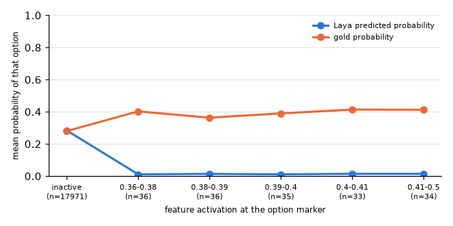

# Feature 9614

Critérios em que aparece: corr_error, corr_probe_right_laya_wrong

**Interpretação (preencher):** 

---

## Maiores ativações

**tr_customer_service_000281 / category** (choice, customer_service) | ativação 3.643 em `estado` | opções ['account', 'billing', 'delivery', 'refund', 'technical'] | Laya: **refund** [0.089, 0.358, 0.003, 0.371, 0.179] | gabarito: **refund**

```
<bos> choice question: What is this customer conversation primarily about?<eos>
▸ <mask> account: Login, plan changes, profile or access management.
▸ <mask> billing: A charge, invoice, subscription or payment problem.
▸ <mask> delivery: Shipping, fulfilment or delivery of a physical item.
▸ <mask> refund: The customer is explicitly asking for money back.
▸ <mask> technical: The product or service is not working as expected.

<eos>

 {"account": {"lifetime_value_usd": 2899, "prior_tickets_90d": 1, "seats": 1, "tenure_months": 49, "tier": "free"}, "orders": [{"amount_usd": 29, "date": "2026-03-17", "id": "A-98902", "status": "settled"}, {"amount_usd": 29, "date": "2026-03-17", "id": "A-31035", "status": "settled"}, {"amount_usd": 29, "date": "2026-01-23", "id": "A-52749", "status": "refunded"}], "thread": [{"role": "customer", "text": "Hello, I am checking in on the $29 refund I requested. I have been a loyal user for 49 months and was hoping to have this settled before my bank statement closes this Friday."}, {"role": "agent", "text": "Thank you⟦ for⟧ your patience. I see we have a previous ticket open regarding this. Could you please verify the email address associated with the transaction you are referring to?"}, {"role": "customer", "text": "It is associated with the email I’m writing from right now. I just really need an update on where things stand because of that Friday deadline."}]}<eos>
```

**tr_customer_service_000121 / category** (choice, customer_service) | ativação 3.613 em `estado` | opções ['account', 'billing', 'delivery', 'refund', 'technical'] | Laya: **billing** [0.0, 0.994, 0.0, 0.0, 0.006] | gabarito: **billing**

```
<bos> choice question: What is this customer conversation primarily about?<eos>
▸ <mask> account: Login, plan changes, profile or access management.
▸ <mask> billing: A charge, invoice, subscription or payment problem.
▸ <mask> delivery: Shipping, fulfilment or delivery of a physical item.
▸ <mask> refund: The customer is explicitly asking for money back.
▸ <mask> technical: The product or service is not working as expected.

<eos>

 {"account": {"lifetime_value_usd": 285, "prior_tickets_90d": 2, "seats": 5, "tenure_months": 5, "tier": "enterprise"}, "orders": [{"amount_usd": 999, "date": "2026-01-20", "id": "A-59192", "status": "settled"}], "thread": [{"role": "customer", "text": "I just checked our Enterprise account and we have been charged $999 twice this morning. This needs to be corrected immediately as it's a significant duplicate hit⟦ on⟧ our corporate card."}, {"role": "agent", "text": "I understand the urgency of this billing matter. Let me pull up your transaction history to see what might have triggered the double charge."}, {"role": "customer", "text": "We've only been with you for five months and I already have two other unresolved tickets regarding our seat configuration. Now this happens and I have a hard deadline of 4:00 PM today to finalize our monthly budget report."}, {"role": "agent", "text": "I see those open tickets in our system and I appreciate you bringing this new discrepancy to our attention. Are both charges showing as 'posted' on your bank statement, or is one still in a 'pending' state?"}, {"role": "customer", "text": "Both are fully posted. I cannot submit my financial report to my director with a $1,000 error, so I need a status update as soon as possible."}, {"role": "agent", "text": "Understood. To help me investigate further, could you confirm the last four digits of the credit card that was charged and the exact timestamps for both transactions?"}, {"role": "customer", "text": "The card ends in 8821. The first charge was at 8:05 AM and the second was at 8:07 AM. Please get back to me quickly because the clock is ticking on my reporting deadline."}]}<eos>
```

**tr_customer_service_000281 / urgency** (score, customer_service) | ativação 3.605 em `estado` | opções ['0', '1', '2', '3'] | Laya: **3** [0.197, 0.191, 0.123, 0.488] | gabarito: **2**

```
<bos> score question: How time-sensitive is this conversation?<eos>
▸ <mask> level 0: No time pressure; can wait indefinitely.
▸ <mask> level 1: Routine; handle within the normal queue.
▸ <mask> level 2: Elevated; should be handled within the same week.
▸ <mask> level 3: Critical; requires action within the same day.

<eos>

 {"account": {"lifetime_value_usd": 2899, "prior_tickets_90d": 1, "seats": 1, "tenure_months": 49, "tier": "free"}, "orders": [{"amount_usd": 29, "date": "2026-03-17", "id": "A-98902", "status": "settled"}, {"amount_usd": 29, "date": "2026-03-17", "id": "A-31035", "status": "settled"}, {"amount_usd": 29, "date": "2026-01-23", "id": "A-52749", "status": "refunded"}], "thread": [{"role": "customer", "text": "Hello, I am checking in on the $29 refund I requested. I have been a loyal user for 49 months and was hoping to have this settled before my bank statement closes this Friday."}, {"role": "agent", "text": "Thank you⟦ for⟧ your patience. I see we have a previous ticket open regarding this. Could you please verify the email address associated with the transaction you are referring to?"}, {"role": "customer", "text": "It is associated with the email I’m writing from right now. I just really need an update on where things stand because of that Friday deadline."}]}<eos>
```

**tr_customer_service_000281 / needs_human** (noul, customer_service) | ativação 3.568 em `estado` | opções ['false', 'true'] | Laya: **true** [0.182, 0.818] | gabarito: **false**

```
<bos> noul question: This conversation requires a human agent rather than automated handling.<eos>
▸ <mask> false: Automation can carry this to resolution.
▸ <mask> true: A human must take over: judgement, authority or empathy is required.

<eos>

 {"account": {"lifetime_value_usd": 2899, "prior_tickets_90d": 1, "seats": 1, "tenure_months": 49, "tier": "free"}, "orders": [{"amount_usd": 29, "date": "2026-03-17", "id": "A-98902", "status": "settled"}, {"amount_usd": 29, "date": "2026-03-17", "id": "A-31035", "status": "settled"}, {"amount_usd": 29, "date": "2026-01-23", "id": "A-52749", "status": "refunded"}], "thread": [{"role": "customer", "text": "Hello, I am checking in on the $29 refund I requested. I have been a loyal user for 49 months and was hoping to have this settled before my bank statement closes this Friday."}, {"role": "agent", "text": "Thank you⟦ for⟧ your patience. I see we have a previous ticket open regarding this. Could you please verify the email address associated with the transaction you are referring to?"}, {"role": "customer", "text": "It is associated with the email I’m writing from right now. I just really need an update on where things stand because of that Friday deadline."}]}<eos>
```

**tr_customer_service_000121 / churn_risk** (score, customer_service) | ativação 3.557 em `estado` | opções ['0', '1', '2', '3'] | Laya: **3** [0.114, 0.287, 0.268, 0.331] | gabarito: **2**

```
<bos> score question: How likely is this customer to stop doing business with us because of this interaction?<eos>
▸ <mask> level 0: No sign of dissatisfaction.
▸ <mask> level 1: Mild frustration, but the relationship is intact.
▸ <mask> level 2: Clearly unhappy; repeat problems or explicit complaints.
▸ <mask> level 3: Imminent: threatening to cancel, dispute or leave.

<eos>

 {"account": {"lifetime_value_usd": 285, "prior_tickets_90d": 2, "seats": 5, "tenure_months": 5, "tier": "enterprise"}, "orders": [{"amount_usd": 999, "date": "2026-01-20", "id": "A-59192", "status": "settled"}], "thread": [{"role": "customer", "text": "I just checked our Enterprise account and we have been charged $999 twice this morning. This needs to be corrected immediately as it's a significant duplicate hit⟦ on⟧ our corporate card."}, {"role": "agent", "text": "I understand the urgency of this billing matter. Let me pull up your transaction history to see what might have triggered the double charge."}, {"role": "customer", "text": "We've only been with you for five months and I already have two other unresolved tickets regarding our seat configuration. Now this happens and I have a hard deadline of 4:00 PM today to finalize our monthly budget report."}, {"role": "agent", "text": "I see those open tickets in our system and I appreciate you bringing this new discrepancy to our attention. Are both charges showing as 'posted' on your bank statement, or is one still in a 'pending' state?"}, {"role": "customer", "text": "Both are fully posted. I cannot submit my financial report to my director with a $1,000 error, so I need a status update as soon as possible."}, {"role": "agent", "text": "Understood. To help me investigate further, could you confirm the last four digits of the credit card that was charged and the exact timestamps for both transactions?"}, {"role": "customer", "text": "The card ends in 8821. The first charge was at 8:05 AM and the second was at 8:07 AM. Please get back to me quickly because the clock is ticking on my reporting deadline."}]}<eos>
```

## Ativações medianas (faixa 40-60%, mediana 0.688)

**tr_customer_service_000172 / needs_human** (noul, customer_service) | ativação 0.633 em `estado` | opções ['false', 'true'] | Laya: **false** [0.681, 0.319] | gabarito: **true**

```
<bos> noul question: This conversation requires a human agent rather than automated handling.<eos>
▸ <mask> false: Automation can carry this to resolution.
▸ <mask> true: A human must take over: judgement, authority or empathy is required.

<eos>

 {"account": {"lifetime_value_usd": 131, "prior_tickets_90d": 0, "seats": 5, "tenure_months": 5, "tier": "premium"}, "thread": [{"role": "customer", "text": "Hi, I'm really scratching my head here. My package says it was delivered yesterday, but I've been checking my porch all morning and there's absolutely nothing. I've been with you for five months on the premium plan and this has never happened."}, {"role": "agent", "text": "I’m sorry to hear that you haven't received your package yet. Could you please confirm the tracking number you are referring to so I can take a look?"}, {"role": "customer", "text": "The tracking number is 94001000. I'm just so confused because the status hasn't updated since yesterday morning. I really need this by tomorrow afternoon⟦ for⟧ a presentation."}, {"role": "agent", "text": "Thank you for providing that number. I am pulling up your account details now. Could you tell me if you have checked with any neighbors or a building manager in the meantime?"}, {"role": "customer", "text": "I did check with my neighbor, but they didn't see anything. I'm worried because I'm on a tight timeline here. Is there any way to see exactly where the driver left it?"}, {"role": "agent", "text": "I understand your concern given your upcoming deadline. I need to reach out to our logistics partner to get more information on the delivery scan; could you confirm the exact address on file?"}, {"role": "customer", "text": "It's 442 Maple Drive. I just hope this gets sorted out quickly because I really can't miss this deadline."}]}<eos>
```

**tr_customer_service_000194 / category** (choice, customer_service) | ativação 0.750 em `opção` | opções ['account', 'billing', 'delivery', 'refund', 'technical'] | Laya: **account** [0.425, 0.238, 0.002, 0.299, 0.036] | gabarito: **refund**

```
<bos> choice question: What is this customer conversation primarily about?<eos>
▸ <mask> account: Login, plan changes, profile or access management.
▸ <mask> billing⟦:⟧ A charge, invoice, subscription or payment problem.
▸ <mask> delivery: Shipping, fulfilment or delivery of a physical item.
▸ <mask> refund: The customer is explicitly asking for money back.
▸ <mask> technical: The product or service is not working as expected.

<eos>

 {"account": {"lifetime_value_usd": 1402, "prior_tickets_90d": 3, "seats": 12, "tenure_months": 41, "tier": "premium"}, "orders": [{"amount_usd": 999, "date": "2026-01-18", "id": "A-58533", "status": "settled"}, {"amount_usd": 999, "date": "2026-01-16", "id": "A-39855", "status": "refunded"}, {"amount_usd": 999, "date": "2026-02-13", "id": "A-83743", "status": "settled"}], "thread": [{"role": "customer", "text": "I need an update on my $999 refund right now; it’s been over two weeks and I can’t wait any longer."}]}<eos>
```

**tr_customer_service_000264 / action** (choice, customer_service) | ativação 0.653 em `opção` | opções ['answer_directly', 'close_no_action', 'escalate_to_human', 'execute_refund', 'request_information'] | Laya: **answer_directly** [0.731, 0.046, 0.008, 0.214, 0.0] | gabarito: **escalate_to_human**

```
<bos> choice question: What should the assistant do next with this conversation?<eos>
▸ <mask> answer_directly: The assistant can resolve this itself with information it already has.
▸ <mask> close_no_action: No further action is warranted; the matter is settled.
▸ <mask> escalate_to_human: Hand off to a human agent with the appropriate authority.
▸ <mask> execute_refund: Issue the refund or credit the customer is owed.
▸ <mask> request_information: More detail is needed⟦ from⟧ the customer before anything can be done.

<eos>

 {"account": {"lifetime_value_usd": 166, "prior_tickets_90d": 2, "seats": 1, "tenure_months": 3, "tier": "standard"}, "thread": [{"role": "customer", "text": "I’m looking at my statement and see I’ve been hit with another duplicate charge for my standard plan. This is the third time now, and those last two tickets I opened resulted in absolutely nothing but empty promises from your team."}, {"role": "agent", "text": "I understand how frustrating it is to see recurring billing issues like this, and I apologize that your previous experience hasn't met expectations. Could you please provide the dates of those specific charges so I can pull up the transaction history?"}, {"role": "customer", "text": "It’s happened on the 15th of each of the last three months. I've already sent these dates in twice before, so I’m really not sure why you need them again."}, {"role": "agent", "text": "Thank you for clarifying that timeline. I am currently cross-referencing your billing records with the account activity; could you confirm if you have received any automated notification emails regarding these specific transaction dates?"}, {"role": "customer", "text": "I haven't seen a single email about these charges, which is exactly why this is so confusing. I’m just trying to get this sorted out once and for all."}]}<eos>
```

**tr_agent_trace_observability_000178 / needs_review** (noul, agent_trace_observability) | ativação 0.721 em `pergunta` | opções ['false', 'true'] | Laya: **false** [0.914, 0.086] | gabarito: **true**

```
<bos> noul question⟦:⟧ This trace requires human review.<eos>
▸ <mask> false: No human attention is warranted.
▸ <mask> true: A human should inspect this run.

<eos>

 {"agent": {"autonomy": "checkpointed", "model": "internal-agent-v4"}, "constraints": ["Never delete anything matching release/*", "Do not exceed a $50 spend on cloud resources"], "task": "Delete personal data for the accounts in the erasure queue.", "trace_summary": {"constraint_violations": 0, "duration_s": 199.7, "irreversible_actions": 1, "steps": 4, "tool_errors": 2}}<eos>
```

**tr_security_incidents_000084 / true_positive** (noul, security_incidents) | ativação 0.645 em `pergunta` | opções ['false', 'true'] | Laya: **true** [0.025, 0.975] | gabarito: **true**

```
<bos>⟦ n⟧oul question: This alert reflects genuinely malicious or unauthorised activity.<eos>
▸ <mask> false: Benign activity, a misconfiguration, or a known false positive.
▸ <mask> true: The underlying behaviour is malicious or unauthorised.

<eos>

 {"alert": {"description": "many failed authentications followed by a success", "evidence": "The service account 'ci_runner' recorded 52 failed authentication attempts within a three-minute window, followed by a single successful login from an unrecognized IP address. This access occurred outside of a designated change window, and the account credentials have not been updated in 180 days.", "rule": "brute_force"}, "context": {"asset_criticality": "medium", "change_window_active": false, "source_on_allowlist": false}, "history": {"credential_rotation_days_ago": 180, "distinct_countries_30d": 2, "logins_30d": 1289, "prior_alerts_90d": 0}, "principal": {"mfa_enrolled": true, "name": "usr-infra-939", "privileges": ["repo:read"], "type": "ci_runner"}}<eos>
```

## Estatísticas (conjunto de descoberta, dev e teste)

**pred / error**

| split | decisões | ativas | ativas e Laya errou | taxa | lift | q (BH) | OR (CMH) | q (CMH) |
|---|---|---|---|---|---|---|---|---|
| discovery | 5100 | 0 | 0 | nan | nan | nan | nan | nan |
| dev | 900 | 0 | 0 | nan | nan | nan | nan | nan |
| test | 2000 | 0 | 0 | nan | nan | nan | nan | nan |

**corr / error**

| split | decisões | ativas | ativas e Laya errou | taxa | lift | q (BH) | OR (CMH) | q (CMH) |
|---|---|---|---|---|---|---|---|---|
| discovery | 5100 | 79 | 79 | 1.000 | 1.55 | 4.91e-15 | nan | nan |
| dev | 900 | 10 | 10 | 1.000 | 1.49 | nan | nan | nan |
| test | 2000 | 22 | 22 | 1.000 | 1.54 | 0.000322 | nan | nan |

**state / error**

| split | decisões | ativas | ativas e Laya errou | taxa | lift | q (BH) | OR (CMH) | q (CMH) |
|---|---|---|---|---|---|---|---|---|
| discovery | 5100 | 4026 | 2597 | 0.645 | 1.00 | 0.87 | 1.09 | 0.633 |
| dev | 900 | 689 | 458 | 0.665 | 0.99 | 0.779 | 0.95 | 0.945 |
| test | 2000 | 1558 | 1013 | 0.650 | 1.00 | 1 | 1.04 | 0.939 |

**pred / probe_right_laya_wrong**

| split | decisões | ativas | ativas e Laya errou | taxa | lift | q (BH) | OR (CMH) | q (CMH) |
|---|---|---|---|---|---|---|---|---|
| discovery | 2819 | 0 | 0 | nan | nan | nan | nan | nan |
| dev | 520 | 0 | 0 | nan | nan | nan | nan | nan |
| test | 1106 | 0 | 0 | nan | nan | nan | nan | nan |

**corr / probe_right_laya_wrong**

| split | decisões | ativas | ativas e Laya errou | taxa | lift | q (BH) | OR (CMH) | q (CMH) |
|---|---|---|---|---|---|---|---|---|
| discovery | 2819 | 59 | 59 | 1.000 | 1.55 | 3.32e-11 | nan | nan |
| dev | 520 | 7 | 7 | 1.000 | 1.48 | nan | nan | nan |
| test | 1106 | 14 | 14 | 1.000 | 1.58 | nan | nan | nan |

**state / probe_right_laya_wrong**

| split | decisões | ativas | ativas e Laya errou | taxa | lift | q (BH) | OR (CMH) | q (CMH) |
|---|---|---|---|---|---|---|---|---|
| discovery | 2819 | 2226 | 1434 | 0.644 | 1.00 | 0.713 | 1.23 | 0.217 |
| dev | 520 | 406 | 273 | 0.672 | 1.00 | 1 | 1.19 | 0.745 |
| test | 1106 | 856 | 549 | 0.641 | 1.01 | 0.559 | 1.50 | 0.167 |

Confusão mais sobre-representada (corr): `action|3>1` (n=72, lift 41.87, p=0). Formato `pergunta|índice previsto>índice correto`.

Confusão mais sobre-representada (state): `risk|2>1` (n=79, lift 1.25, p=1.17e-07). Formato `pergunta|índice previsto>índice correto`.



