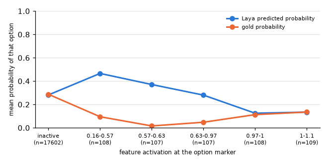

# Feature 9656

Critérios em que aparece: corr_error_stratified, pred_probe_right_laya_wrong_stratified

**Interpretação (preencher):** 

---

## Maiores ativações

**tr_invoice_processing_000109 / duplicate** (noul, invoice_processing) | ativação 8.445 em `pergunta` | opções ['false', 'true'] | Laya: **true** [0.013, 0.987] | gabarito: **false**

```
<bos>⟦ n⟧oul question: This invoice appears to duplicate an invoice already submitted.<eos>
▸ <mask> false: no, the statement does not hold
▸ <mask> true: yes, the statement holds

<eos>

 {"delivery": {"condition": "accepted", "date": "2026-03-13", "received_qty": 50}, "invoice": {"currency": "USD", "id": "INV-2026-1558", "lines": [{"qty": 100, "sku": "SKU-351", "total_usd": 8003.0, "unit_usd": 80.03}], "total_usd": 8003.0, "vendor": "Vantage Materials"}, "payment": {"days_until_due": 44, "discount_expires_in_days": null, "early_payment_discount_pct": null, "status": "scheduled", "terms": "net 30"}, "purchase_order": {"freight_terms": "freight prepaid by vendor, not separately billable", "id": "PO-3499", "lines": [{"qty": 50, "unit_usd": 80.03}], "total_usd": 4001.5}, "vendor_history": {"disputes_12m": 0, "invoices_12m": 9, "prior_invoice_ids": ["INV-2026-2254", "INV-2026-7618", "INV-2026-3837", "INV-2026-2225"]}}<eos>
```

**tr_invoice_processing_000243 / duplicate** (noul, invoice_processing) | ativação 8.438 em `pergunta` | opções ['false', 'true'] | Laya: **true** [0.029, 0.971] | gabarito: **false**

```
<bos>⟦ n⟧oul question: This invoice appears to duplicate an invoice already submitted.<eos>
▸ <mask> false: no, the statement does not hold
▸ <mask> true: yes, the statement holds

<eos>

 {"delivery": {"condition": "accepted", "date": "2026-03-21", "received_qty": 1000}, "invoice": {"currency": "USD", "id": "INV-2026-2996", "lines": [{"qty": 1000, "sku": "SKU-704", "total_usd": 347130.0, "unit_usd": 347.13}, {"qty": 1, "sku": "FREIGHT", "total_usd": 328.32, "unit_usd": 328.32}], "total_usd": 347458.32, "vendor": "Orbit Logistics"}, "payment": {"days_until_due": 0, "discount_expires_in_days": null, "early_payment_discount_pct": null, "status": "scheduled", "terms": "net 30"}, "purchase_order": {"freight_terms": "freight prepaid by vendor, not separately billable", "id": "PO-9513", "lines": [{"qty": 1000, "unit_usd": 347.13}], "total_usd": 347130.0}, "vendor_history": {"disputes_12m": 2, "invoices_12m": 16, "prior_invoice_ids": ["INV-2026-2361", "INV-2026-8993", "INV-2026-3050"]}}<eos>
```

**tr_invoice_processing_000154 / duplicate** (noul, invoice_processing) | ativação 8.438 em `pergunta` | opções ['false', 'true'] | Laya: **true** [0.005, 0.995] | gabarito: **false**

```
<bos>⟦ n⟧oul question: This invoice appears to duplicate an invoice already submitted.<eos>
▸ <mask> false: no, the statement does not hold
▸ <mask> true: yes, the statement holds

<eos>

 {"delivery": {"condition": "accepted", "date": "2026-03-01", "received_qty": 250}, "invoice": {"currency": "USD", "id": "INV-2026-7413", "lines": [{"qty": 250, "sku": "SKU-182", "total_usd": 23190.0, "unit_usd": 92.76}, {"qty": 1, "sku": "FREIGHT", "total_usd": 830.67, "unit_usd": 830.67}], "total_usd": 24020.67, "vendor": "Kestrel Supply"}, "payment": {"days_until_due": 44, "discount_expires_in_days": null, "early_payment_discount_pct": null, "status": "scheduled", "terms": "net 60"}, "purchase_order": {"freight_terms": "freight prepaid by vendor, not separately billable", "id": "PO-3689", "lines": [{"qty": 250, "unit_usd": 92.76}], "total_usd": 23190.0}, "vendor_history": {"disputes_12m": 1, "invoices_12m": 2, "prior_invoice_ids": ["INV-2026-8130", "INV-2026-9090"]}}<eos>
```

**tr_invoice_processing_000196 / duplicate** (noul, invoice_processing) | ativação 8.430 em `pergunta` | opções ['false', 'true'] | Laya: **true** [0.011, 0.989] | gabarito: **false**

```
<bos>⟦ n⟧oul question: This invoice appears to duplicate an invoice already submitted.<eos>
▸ <mask> false: no, the statement does not hold
▸ <mask> true: yes, the statement holds

<eos>

 {"delivery": {"condition": "accepted", "date": "2026-03-12", "received_qty": 50}, "invoice": {"currency": "USD", "id": "INV-2026-9921", "lines": [{"qty": 50, "sku": "SKU-318", "total_usd": 4862.0, "unit_usd": 97.24}], "total_usd": 4862.0, "vendor": "Vantage Materials"}, "payment": {"days_until_due": 0, "discount_expires_in_days": null, "early_payment_discount_pct": null, "status": "scheduled", "terms": "net 30"}, "purchase_order": {"freight_terms": "freight prepaid by vendor, not separately billable", "id": "PO-1505", "lines": [{"qty": 50, "unit_usd": 97.24}], "total_usd": 4862.0}, "vendor_history": {"disputes_12m": 1, "invoices_12m": 25, "prior_invoice_ids": ["INV-2026-5325"]}}<eos>
```

**tr_invoice_processing_000212 / duplicate** (noul, invoice_processing) | ativação 8.430 em `pergunta` | opções ['false', 'true'] | Laya: **true** [0.016, 0.984] | gabarito: **false**

```
<bos>⟦ n⟧oul question: This invoice appears to duplicate an invoice already submitted.<eos>
▸ <mask> false: no, the statement does not hold
▸ <mask> true: yes, the statement holds

<eos>

 {"delivery": {"condition": "accepted", "date": "2026-03-15", "received_qty": 50}, "invoice": {"currency": "USD", "id": "INV-2026-9746", "lines": [{"qty": 50, "sku": "SKU-109", "total_usd": 1888.0, "unit_usd": 37.76}], "total_usd": 1888.0, "vendor": "Kestrel Supply"}, "payment": {"days_until_due": 27, "discount_expires_in_days": null, "early_payment_discount_pct": null, "status": "scheduled", "terms": "net 60"}, "purchase_order": {"freight_terms": "freight prepaid by vendor, not separately billable", "id": "PO-9528", "lines": [{"qty": 50, "unit_usd": 26.97}], "total_usd": 1348.5}, "vendor_history": {"disputes_12m": 0, "invoices_12m": 31, "prior_invoice_ids": ["INV-2026-4023", "INV-2026-4752", "INV-2026-8633", "INV-2026-3220"]}}<eos>
```

## Ativações medianas (faixa 40-60%, mediana 8.031)

**tr_security_incidents_000188 / credential_compromise** (noul, security_incidents) | ativação 8.008 em `pergunta` | opções ['false', 'true'] | Laya: **true** [0.006, 0.994] | gabarito: **true**

```
<bos>⟦ n⟧oul question: The evidence indicates a credential or account has been compromised.<eos>
▸ <mask> false: no, the statement does not hold
▸ <mask> true: yes, the statement holds

<eos>

 {"alert": {"description": "a long-unused account became active", "evidence": "Employee account \"blee\" that had no successful logon events since 2025-12-01 logged in from an unknown external address 203.0.113.88 at 2026-09-16 14:03:19 UTC. This activity marks the first use of the account in over 180 days, with its password last changed 14 days ago.", "rule": "dormant_account_use"}, "context": {"asset_criticality": "medium", "change_window_active": false, "source_on_allowlist": false}, "history": {"credential_rotation_days_ago": 14, "distinct_countries_30d": 2, "logins_30d": 49, "prior_alerts_90d": 0}, "principal": {"mfa_enrolled": true, "name": "usr-deploy-427", "privileges": ["repo:read"], "type": "employee"}}<eos>
```

**tr_customer_service_000007 / needs_human** (noul, customer_service) | ativação 8.023 em `pergunta` | opções ['false', 'true'] | Laya: **true** [0.068, 0.932] | gabarito: **true**

```
<bos>⟦ n⟧oul question: This conversation requires a human agent rather than automated handling.<eos>
▸ <mask> false: Automation can carry this to resolution.
▸ <mask> true: A human must take over: judgement, authority or empathy is required.

<eos>

 {"account": {"lifetime_value_usd": 46, "prior_tickets_90d": 0, "seats": 1, "tenure_months": 1, "tier": "premium"}, "thread": [{"role": "customer", "text": "I'm trying to use the new collaboration feature I just paid for, but the invite link doesn't seem to do anything when my partner clicks it, am I missing a step?"}, {"role": "agent", "text": "I'd like to help you get that working. When your partner clicks the link, what exactly do they see on their screen?"}, {"role": "customer", "text": "They just see a blank white page, and I thought this was supposed to be a simple process for premium users."}, {"role": "agent", "text": "I see. Have you tried generating a new link to see if the same issue persists, or does it happen with every invite you send?"}, {"role": "customer", "text": "I tried creating three different links and they all lead to the same blank page, so I'm really confused about what the problem is."}]}<eos>
```

**tr_invoice_processing_000111 / matches_order** (noul, invoice_processing) | ativação 8.078 em `pergunta` | opções ['false', 'true'] | Laya: **true** [0.06, 0.94] | gabarito: **false**

```
<bos>⟦ n⟧oul question: The invoice reconciles with the purchase order and the recorded delivery.<eos>
▸ <mask> false: There is a discrepancy against the order or the delivery.
▸ <mask> true: Line items, quantities and amounts reconcile.

<eos>

 {"delivery": {"condition": "accepted with exceptions", "date": "2026-03-07", "received_qty": 1000}, "invoice": {"currency": "USD", "id": "INV-2026-5057", "lines": [{"qty": 1000, "sku": "SKU-452", "total_usd": 137220.0, "unit_usd": 137.22}], "total_usd": 137220.0, "vendor": "Northwind Components"}, "payment": {"days_until_due": 27, "discount_expires_in_days": null, "early_payment_discount_pct": null, "status": "scheduled", "terms": "net 30"}, "purchase_order": {"freight_terms": "freight prepaid by vendor, not separately billable", "id": "PO-8637", "lines": [{"qty": 1000, "unit_usd": 137.22}], "total_usd": 137220.0}, "vendor_history": {"disputes_12m": 0, "invoices_12m": 11, "prior_invoice_ids": ["INV-2026-5057"]}}<eos>
```

**tr_security_incidents_000247 / true_positive** (noul, security_incidents) | ativação 8.016 em `pergunta` | opções ['false', 'true'] | Laya: **true** [0.004, 0.996] | gabarito: **true**

```
<bos>⟦ n⟧oul question: This alert reflects genuinely malicious or unauthorised activity.<eos>
▸ <mask> false: Benign activity, a misconfiguration, or a known false positive.
▸ <mask> true: The underlying behaviour is malicious or unauthorised.

<eos>

 {"alert": {"description": "an endpoint agent matched a known signature", "evidence": "An endpoint agent detected the file 'win_payload.exe' matching a known malware signature on a host associated with a shared mailbox. This activity occurred outside of any approved change window, and the credentials for this account have not been updated in 365 days.", "rule": "malware_signature"}, "context": {"asset_criticality": "medium", "change_window_active": false, "source_on_allowlist": false}, "history": {"credential_rotation_days_ago": 365, "distinct_countries_30d": 4, "logins_30d": 1034, "prior_alerts_90d": 8}, "principal": {"mfa_enrolled": true, "name": "svc-analytics-742", "privileges": ["repo:read"], "type": "shared_mailbox"}}<eos>
```

**tr_customer_service_000221 / needs_human** (noul, customer_service) | ativação 8.023 em `pergunta` | opções ['false', 'true'] | Laya: **false** [0.861, 0.139] | gabarito: **true**

```
<bos>⟦ n⟧oul question: This conversation requires a human agent rather than automated handling.<eos>
▸ <mask> false: Automation can carry this to resolution.
▸ <mask> true: A human must take over: judgement, authority or empathy is required.

<eos>

 {"account": {"lifetime_value_usd": 1327, "prior_tickets_90d": 0, "seats": 1, "tenure_months": 14, "tier": "standard"}, "orders": [{"amount_usd": 149, "date": "2026-02-16", "id": "A-75209", "status": "pending"}, {"amount_usd": 149, "date": "2026-02-14", "id": "A-62252", "status": "settled"}], "thread": [{"role": "customer", "text": "My order arrived this afternoon, but the contents are incorrect. I received a blue thermal carafe instead of the stainless steel model I ordered."}, {"role": "agent", "text": "I apologize for the mix-up with your shipment. I’d like to look into this for you; could you please share your order number and the SKU listed on the box you received?"}, {"role": "customer", "text": "The order number is #88492-AX. The box says SKU-992-B, but my invoice clearly lists SKU-992-S."}, {"role": "agent", "text": "Thank you for verifying those details. Are you able to upload a photo of the item you received so I can confirm the discrepancy for our records?"}, {"role": "customer", "text": "I've attached the photo to this message. Please let me know what the next steps are once you have verified it."}]}<eos>
```

## Estatísticas (conjunto de descoberta, dev e teste)

**pred / error**

| split | decisões | ativas | ativas e Laya errou | taxa | lift | q (BH) | OR (CMH) | q (CMH) |
|---|---|---|---|---|---|---|---|---|
| discovery | 5100 | 131 | 121 | 0.924 | 1.43 | 8.56e-13 | 2.21 | 0.391 |
| dev | 900 | 29 | 27 | 0.931 | 1.39 | 0.00706 | 1.97 | 0.765 |
| test | 2000 | 53 | 52 | 0.981 | 1.51 | 5.54e-08 | 11.39 | 0.227 |

**corr / error**

| split | decisões | ativas | ativas e Laya errou | taxa | lift | q (BH) | OR (CMH) | q (CMH) |
|---|---|---|---|---|---|---|---|---|
| discovery | 5100 | 35 | 25 | 0.714 | 1.11 | 0.543 | 10.39 | 7.17e-08 |
| dev | 900 | 7 | 5 | 0.714 | 1.06 | nan | nan | nan |
| test | 2000 | 4 | 3 | 0.750 | 1.15 | nan | nan | nan |

**state / error**

| split | decisões | ativas | ativas e Laya errou | taxa | lift | q (BH) | OR (CMH) | q (CMH) |
|---|---|---|---|---|---|---|---|---|
| discovery | 5100 | 2 | 2 | 1.000 | 1.55 | nan | nan | nan |
| dev | 900 | 0 | 0 | nan | nan | nan | nan | nan |
| test | 2000 | 5 | 3 | 0.600 | 0.92 | nan | nan | nan |

**pred / probe_right_laya_wrong**

| split | decisões | ativas | ativas e Laya errou | taxa | lift | q (BH) | OR (CMH) | q (CMH) |
|---|---|---|---|---|---|---|---|---|
| discovery | 2819 | 87 | 79 | 0.908 | 1.40 | 8.8e-08 | 6.05 | 0.00444 |
| dev | 520 | 17 | 16 | 0.941 | 1.39 | nan | nan | nan |
| test | 1106 | 31 | 30 | 0.968 | 1.53 | 6.05e-05 | 6.30 | 0.56 |

**corr / probe_right_laya_wrong**

| split | decisões | ativas | ativas e Laya errou | taxa | lift | q (BH) | OR (CMH) | q (CMH) |
|---|---|---|---|---|---|---|---|---|
| discovery | 2819 | 9 | 1 | 0.111 | 0.17 | nan | nan | nan |
| dev | 520 | 1 | 0 | 0.000 | 0.00 | nan | nan | nan |
| test | 1106 | 1 | 0 | 0.000 | 0.00 | nan | nan | nan |

**state / probe_right_laya_wrong**

| split | decisões | ativas | ativas e Laya errou | taxa | lift | q (BH) | OR (CMH) | q (CMH) |
|---|---|---|---|---|---|---|---|---|
| discovery | 2819 | 0 | 0 | nan | nan | nan | nan | nan |
| dev | 520 | 0 | 0 | nan | nan | nan | nan | nan |
| test | 1106 | 4 | 2 | 0.500 | 0.79 | nan | nan | nan |

Confusão mais sobre-representada (pred): `action|1>2` (n=71, lift 38.93, p=0). Formato `pergunta|índice previsto>índice correto`.

Confusão mais sobre-representada (corr): `disposition|3>0` (n=17, lift 68.81, p=1.25e-29). Formato `pergunta|índice previsto>índice correto`.

Confusão mais sobre-representada (state): `churn_risk|1>2` (n=1, lift 45.54, p=nan). Formato `pergunta|índice previsto>índice correto`.



