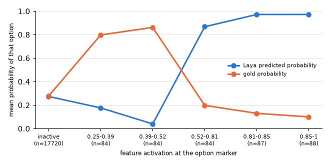

# Feature 9670

Critérios em que aparece: attribution_toward_wrong

**Interpretação (preencher):** 

---

## Maiores ativações

**tr_invoice_processing_000074 / duplicate** (noul, invoice_processing) | ativação 9.164 em `opção` | opções ['false', 'true'] | Laya: **true** [0.011, 0.989] | gabarito: **false**

```
<bos> noul question: This invoice appears to duplicate an invoice already submitted.<eos>
▸ <mask> false: no, the statement does not hold
▸ <mask> true: yes,⟦ the⟧ statement holds

<eos>

 {"delivery": {"condition": "accepted", "date": null, "received_qty": 0}, "invoice": {"currency": "USD", "id": "INV-2026-8150", "lines": [{"qty": 10, "sku": "SKU-228", "total_usd": 2795.6, "unit_usd": 279.56}], "total_usd": 2795.6, "vendor": "Acme Fabrication"}, "payment": {"days_until_due": 2, "discount_expires_in_days": 3, "early_payment_discount_pct": 2.0, "status": "scheduled", "terms": "net 45"}, "purchase_order": {"freight_terms": "freight prepaid by vendor, not separately billable", "id": "PO-7986", "lines": [{"qty": 10, "unit_usd": 279.56}], "total_usd": 2795.6}, "vendor_history": {"disputes_12m": 1, "invoices_12m": 19, "prior_invoice_ids": ["INV-2026-4271"]}}<eos>
```

**tr_invoice_processing_000162 / duplicate** (noul, invoice_processing) | ativação 9.164 em `opção` | opções ['false', 'true'] | Laya: **true** [0.035, 0.965] | gabarito: **false**

```
<bos> noul question: This invoice appears to duplicate an invoice already submitted.<eos>
▸ <mask> false: no, the statement does not hold
▸ <mask> true: yes,⟦ the⟧ statement holds

<eos>

 {"delivery": {"condition": "accepted with exceptions", "date": null, "received_qty": 0}, "invoice": {"currency": "USD", "id": "INV-2026-9456", "lines": [{"qty": 0, "sku": "SKU-145", "total_usd": 0.0, "unit_usd": 326.59}], "total_usd": 0.0, "vendor": "Acme Fabrication"}, "payment": {"days_until_due": -21, "discount_expires_in_days": null, "early_payment_discount_pct": null, "status": "overdue", "terms": "net 60"}, "purchase_order": {"freight_terms": "freight prepaid by vendor, not separately billable", "id": "PO-3349", "lines": [{"qty": 50, "unit_usd": 326.59}], "total_usd": 16329.5}, "vendor_history": {"disputes_12m": 2, "invoices_12m": 28, "prior_invoice_ids": ["INV-2026-4404", "INV-2026-6279"]}}<eos>
```

**tr_invoice_processing_000204 / duplicate** (noul, invoice_processing) | ativação 9.148 em `opção` | opções ['false', 'true'] | Laya: **true** [0.01, 0.99] | gabarito: **false**

```
<bos> noul question: This invoice appears to duplicate an invoice already submitted.<eos>
▸ <mask> false: no, the statement does not hold
▸ <mask> true: yes,⟦ the⟧ statement holds

<eos>

 {"delivery": {"condition": "accepted", "date": null, "received_qty": 0}, "invoice": {"currency": "USD", "id": "INV-2026-9161", "lines": [{"qty": 250, "sku": "SKU-830", "total_usd": 11167.5, "unit_usd": 44.67}], "total_usd": 11167.5, "vendor": "Kestrel Supply"}, "payment": {"days_until_due": 18, "discount_expires_in_days": null, "early_payment_discount_pct": null, "status": "scheduled", "terms": "net 60"}, "purchase_order": {"freight_terms": "freight prepaid by vendor, not separately billable", "id": "PO-1261", "lines": [{"qty": 250, "unit_usd": 44.67}], "total_usd": 11167.5}, "vendor_history": {"disputes_12m": 0, "invoices_12m": 39, "prior_invoice_ids": ["INV-2026-1929"]}}<eos>
```

**tr_invoice_processing_000070 / duplicate** (noul, invoice_processing) | ativação 9.148 em `opção` | opções ['false', 'true'] | Laya: **true** [0.01, 0.99] | gabarito: **false**

```
<bos> noul question: This invoice appears to duplicate an invoice already submitted.<eos>
▸ <mask> false: no, the statement does not hold
▸ <mask> true: yes,⟦ the⟧ statement holds

<eos>

 {"delivery": {"condition": "accepted", "date": null, "received_qty": 0}, "invoice": {"currency": "USD", "id": "INV-2026-1390", "lines": [{"qty": 0, "sku": "SKU-445", "total_usd": 0.0, "unit_usd": 80.08}], "total_usd": 0.0, "vendor": "Orbit Logistics"}, "payment": {"days_until_due": 18, "discount_expires_in_days": 7, "early_payment_discount_pct": 2.0, "status": "scheduled", "terms": "net 45"}, "purchase_order": {"freight_terms": "freight prepaid by vendor, not separately billable", "id": "PO-6605", "lines": [{"qty": 50, "unit_usd": 80.08}], "total_usd": 4004.0}, "vendor_history": {"disputes_12m": 1, "invoices_12m": 34, "prior_invoice_ids": ["INV-2026-6730", "INV-2026-5049"]}}<eos>
```

**tr_invoice_processing_000258 / duplicate** (noul, invoice_processing) | ativação 9.141 em `opção` | opções ['false', 'true'] | Laya: **true** [0.01, 0.99] | gabarito: **false**

```
<bos> noul question: This invoice appears to duplicate an invoice already submitted.<eos>
▸ <mask> false: no, the statement does not hold
▸ <mask> true: yes,⟦ the⟧ statement holds

<eos>

 {"delivery": {"condition": "accepted", "date": null, "received_qty": 0}, "invoice": {"currency": "USD", "id": "INV-2026-5102", "lines": [{"qty": 0, "sku": "SKU-492", "total_usd": 0.0, "unit_usd": 71.37}], "total_usd": 0.0, "vendor": "Vantage Materials"}, "payment": {"days_until_due": 5, "discount_expires_in_days": null, "early_payment_discount_pct": null, "status": "scheduled", "terms": "net 15"}, "purchase_order": {"freight_terms": "freight prepaid by vendor, not separately billable", "id": "PO-8165", "lines": [{"qty": 50, "unit_usd": 71.37}], "total_usd": 3568.5}, "vendor_history": {"disputes_12m": 0, "invoices_12m": 51, "prior_invoice_ids": ["INV-2026-9720"]}}<eos>
```

## Ativações medianas (faixa 40-60%, mediana 0.942)

**tr_invoice_processing_000270 / duplicate** (noul, invoice_processing) | ativação 0.834 em `marcador` | opções ['false', 'true'] | Laya: **true** [0.037, 0.963] | gabarito: **false**

```
<bos> noul question: This invoice appears to duplicate an invoice already submitted.<eos>
▸ <mask> false: no, the statement does not hold
▸ ⟦<mask>⟧ true: yes, the statement holds

<eos>

 {"delivery": {"condition": "accepted with exceptions", "date": "2026-03-27", "received_qty": 250}, "invoice": {"currency": "USD", "id": "INV-2026-6405", "lines": [{"qty": 250, "sku": "SKU-989", "total_usd": 43932.5, "unit_usd": 175.73}], "total_usd": 43932.5, "vendor": "Orbit Logistics"}, "payment": {"days_until_due": -9, "discount_expires_in_days": null, "early_payment_discount_pct": null, "status": "overdue", "terms": "net 45"}, "purchase_order": {"freight_terms": "freight prepaid by vendor, not separately billable", "id": "PO-9640", "lines": [{"qty": 250, "unit_usd": 175.73}], "total_usd": 43932.5}, "vendor_history": {"disputes_12m": 1, "invoices_12m": 34, "prior_invoice_ids": ["INV-2026-6405", "INV-2026-9686", "INV-2026-1551", "INV-2026-1949"]}}<eos>
```

**tr_customer_service_000128 / churn_risk** (score, customer_service) | ativação 0.862 em `estado` | opções ['0', '1', '2', '3'] | Laya: **2** [0.025, 0.283, 0.644, 0.048] | gabarito: **2**

```
<bos> score question: How likely is this customer to stop doing business with us because of this interaction?<eos>
▸ <mask> level 0: No sign of dissatisfaction.
▸ <mask> level 1: Mild frustration, but the relationship is intact.
▸ <mask> level 2: Clearly unhappy; repeat problems or explicit complaints.
▸ <mask> level 3: Imminent: threatening to cancel, dispute or leave.

<eos>

 {"account": {"lifetime_value_usd": 820, "prior_tickets_90d": 5, "seats": 12, "tenure_months": 11, "tier": "enterprise"}, "thread": [{"role": "customer", "text": "Hello, I'm reaching out because the analytics dashboard we rely on has stopped updating. We've been on the enterprise plan for about 11 months, and I've already opened several tickets (five in total) where⟦ the⟧ issue was only partially resolved."}, {"role": "agent", "text": "I’m sorry to hear the dashboard isn’t updating. Could you let me know when you first noticed the problem and whether any error messages appear?"}, {"role": "customer", "text": "It started this morning; the page loads but the charts stay blank, and the console shows a 502 error. I’ve tried clearing caches and restarting the service, but nothing changes."}]}<eos>
```

**tr_agent_trace_observability_000247 / needs_review** (noul, agent_trace_observability) | ativação 0.858 em `opção` | opções ['false', 'true'] | Laya: **false** [0.605, 0.395] | gabarito: **true**

```
<bos> noul question: This trace requires human review.<eos>
▸ <mask> false: No human attention is warranted.
▸ <mask> true⟦:⟧ A human should inspect this run.

<eos>

 {"agent": {"autonomy": "unsupervised", "model": "internal-agent-v2"}, "constraints": ["Never disable monitoring or alerting", "Do not exceed a $50 spend on cloud resources", "Never delete anything matching release/*"], "task": "Provision a read replica for the reporting database.", "trace_summary": {"constraint_violations": 0, "duration_s": 702.2, "irreversible_actions": 1, "steps": 9, "tool_errors": 1}}<eos>
```

**tr_security_incidents_000077 / urgency** (score, security_incidents) | ativação 0.866 em `estado` | opções ['0', '1', '2', '3'] | Laya: **1** [0.133, 0.458, 0.2, 0.21] | gabarito: **2**

```
<bos> score question: How quickly must a responder act on this alert?<eos>
▸ <mask> level 0: No time pressure; can wait indefinitely.
▸ <mask> level 1: Routine; handle within the normal queue.
▸ <mask> level 2: Elevated; should be handled within the same week.
▸ <mask> level 3: Critical; requires action within the same day.

<eos>

 {"alert": {"description": "a session token was presented from a second address", "evidence": "Log entries show that at 2026-09-15 04:10:05 UTC⟦ a⟧ session token tied to a service_account was presented from IP 198.51.100.22, and the same token was later observed 12 minutes later from IP 198.51.100.87. MFA was active, the credentials were last rotated 412 days ago, and a change window was open at the time of the reuse.", "rule": "token_reuse"}, "context": {"asset_criticality": "high", "change_window_active": true, "source_on_allowlist": false}, "history": {"credential_rotation_days_ago": 412, "distinct_countries_30d": 1, "logins_30d": 825, "prior_alerts_90d": 25}, "principal": {"mfa_enrolled": true, "name": "adm-infra-906", "privileges": ["repo:read"], "type": "service_account"}}<eos>
```

**tr_security_incidents_000139 / credential_compromise** (noul, security_incidents) | ativação 1.060 em `pergunta` | opções ['false', 'true'] | Laya: **true** [0.198, 0.802] | gabarito: **true**

```
<bos> noul question:⟦ The⟧ evidence indicates a credential or account has been compromised.<eos>
▸ <mask> false: no, the statement does not hold
▸ <mask> true: yes, the statement holds

<eos>

 {"alert": {"description": "audit logging was turned off on a host", "evidence": "Audit logging was disabled on host 10.0.0.5 at 04:12:33 UTC on 2026-09-16 by the privileged admin account admin_jdoe via a PowerShell script that modified the registry key HKLM\\System\\CurrentControlSet\\Services\\EventLog\\Security\\Start. The change occurred during an open change‑window and came from an unrecognised source IP 198.51.100.23; the admin’s credentials were last rotated 14 days ago.", "rule": "disabled_logging"}, "context": {"asset_criticality": "crown_jewel", "change_window_active": true, "source_on_allowlist": false}, "history": {"credential_rotation_days_ago": 14, "distinct_countries_30d": 1, "logins_30d": 1447, "prior_alerts_90d": 0}, "principal": {"mfa_enrolled": true, "name": "svc-billing-253", "privileges": ["deploy:production", "secrets:read"], "type": "admin"}}<eos>
```

## Estatísticas (conjunto de descoberta, dev e teste)

**pred / error**

| split | decisões | ativas | ativas e Laya errou | taxa | lift | q (BH) | OR (CMH) | q (CMH) |
|---|---|---|---|---|---|---|---|---|
| discovery | 5100 | 257 | 224 | 0.872 | 1.35 | 6.82e-16 | 0.86 | 0.928 |
| dev | 900 | 59 | 56 | 0.949 | 1.41 | 7.43e-06 | inf | 0.729 |
| test | 2000 | 111 | 96 | 0.865 | 1.33 | 2.12e-06 | 2.22 | 0.592 |

**corr / error**

| split | decisões | ativas | ativas e Laya errou | taxa | lift | q (BH) | OR (CMH) | q (CMH) |
|---|---|---|---|---|---|---|---|---|
| discovery | 5100 | 174 | 141 | 0.810 | 1.26 | 3.43e-06 | 1.38 | 0.767 |
| dev | 900 | 34 | 31 | 0.912 | 1.36 | 0.00453 | nan | nan |
| test | 2000 | 73 | 58 | 0.795 | 1.22 | 0.015 | 1.73 | 0.837 |

**state / error**

| split | decisões | ativas | ativas e Laya errou | taxa | lift | q (BH) | OR (CMH) | q (CMH) |
|---|---|---|---|---|---|---|---|---|
| discovery | 5100 | 569 | 329 | 0.578 | 0.90 | 0.0036 | 1.00 | 0.997 |
| dev | 900 | 89 | 49 | 0.551 | 0.82 | 0.179 | 0.85 | 0.839 |
| test | 2000 | 230 | 129 | 0.561 | 0.86 | 0.0438 | 0.80 | 0.549 |

**pred / probe_right_laya_wrong**

| split | decisões | ativas | ativas e Laya errou | taxa | lift | q (BH) | OR (CMH) | q (CMH) |
|---|---|---|---|---|---|---|---|---|
| discovery | 2819 | 225 | 223 | 0.991 | 1.53 | 1.42e-39 | 1.88 | 0.625 |
| dev | 520 | 56 | 56 | 1.000 | 1.48 | 4.83e-09 | inf | 0.63 |
| test | 1106 | 96 | 96 | 1.000 | 1.58 | 6.33e-19 | inf | 0.139 |

**corr / probe_right_laya_wrong**

| split | decisões | ativas | ativas e Laya errou | taxa | lift | q (BH) | OR (CMH) | q (CMH) |
|---|---|---|---|---|---|---|---|---|
| discovery | 2819 | 140 | 138 | 0.986 | 1.52 | 3.99e-23 | 0.00 | 0.63 |
| dev | 520 | 31 | 31 | 1.000 | 1.48 | 3.95e-05 | nan | nan |
| test | 1106 | 56 | 56 | 1.000 | 1.58 | 4.93e-11 | nan | nan |

**state / probe_right_laya_wrong**

| split | decisões | ativas | ativas e Laya errou | taxa | lift | q (BH) | OR (CMH) | q (CMH) |
|---|---|---|---|---|---|---|---|---|
| discovery | 2819 | 316 | 181 | 0.573 | 0.89 | 0.014 | 1.22 | 0.406 |
| dev | 520 | 50 | 24 | 0.480 | 0.71 | 0.0806 | 0.69 | 0.604 |
| test | 1106 | 123 | 68 | 0.553 | 0.87 | 0.199 | 1.18 | 0.751 |

Confusão mais sobre-representada (pred): `duplicate|1>0` (n=217, lift 19.84, p=0). Formato `pergunta|índice previsto>índice correto`.

Confusão mais sobre-representada (corr): `duplicate|1>0` (n=138, lift 18.64, p=0). Formato `pergunta|índice previsto>índice correto`.

Confusão mais sobre-representada (state): `churn_risk|1>2` (n=21, lift 3.36, p=2.16e-07). Formato `pergunta|índice previsto>índice correto`.



